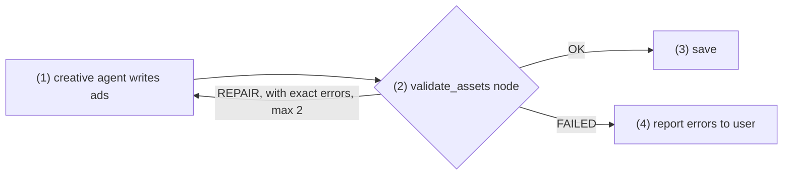

# Milestone 2 — Harness Core + ADK Spike Implementation Plan

> **For agentic workers:** REQUIRED SUB-SKILL: Use superpowers:subagent-driven-development (recommended) or superpowers:executing-plans to implement this plan task-by-task. Steps use checkbox (`- [ ]`) syntax for tracking. Follow superpowers:test-driven-development for every RED/GREEN step.

**Goal:** Build the deterministic core that keeps the agent safe, and prove how Google ADK 2.x behaves before building agents on it. The core covers copy rules, the Instagram image check, requirement tracking, the campaign state machine, versions, and approvals. On the ADK side: a spike, `ScriptedModel`, the tool guard, and the validate→repair workflow.

**Architecture:** Pure rules live in `app/domain/` (no I/O). MongoDB-backed services live in `app/services/` (conditional updates, transactions, audit). Everything ADK-specific lives in `app/agents/`. The ADK pieces in this milestone are small and proven with `ScriptedModel`, so Milestone 4 can assemble the real agents on top.

**Tech Stack:** Python 3.12, Pydantic v2, PyMongo async, Pillow, `google-adk` 2.x (pinned in Task 8), `litellm`, pytest.

**Spec:** `.claude/plans/lld.md` §4 (domain), §5 (agents), §6 (services) · HLD §7–§8 · PRD FR-2, FR-3, FR-6, FR-7, FR-8, FR-9, FR-20.

## Global Constraints

- `app/domain/` imports nothing from `pymongo`, `httpx`, `facebook_business`, `google.adk`, `litellm`, or `app.services`, `app.agents`, `app.meta`, `app.api`. An architecture test enforces this.
- Copy limits 40 / 125 / 30; 2–3 variants; CTA ∈ `LEARN_MORE, SIGN_UP, DOWNLOAD, GET_QUOTE, CONTACT_US, SUBSCRIBE`.
- Instagram image: JPEG/PNG, ≤ 8 MB, width ≥ 600, width/height ∈ [0.8, 1.91].
- `SYSTEM_FIELDS` (`ad_account_id`, `page_id`, `instagram_user_id`, `image_id`) can never be set from model output.
- State changes only through `services.transitions.transition()` (conditional update + audit).
- Approval is recorded only by `services.approvals.approve_version()`, in a transaction, against the version hash the user saw.
- ADK callbacks do no I/O; they append to lists that the runtime flushes.
- `REPAIR_MAX = 2`.

---

## Before You Start: Learn This Phase

### Part A — The deterministic core (Tasks 1–7)

The model will *propose* field values, plans and ad copy. This milestone builds the code that *decides*:

| Piece | Question it answers | Why it's code, not the model |
|---|---|---|
| Copy rules (`AdVariant`, `finalize_assets`) | Is this ad within Instagram's display limits and our content policy? | Must be exact, every time |
| Image check | Will Instagram accept this image? | A rejected upload at publish time is worse than a clear message now |
| Requirements | What do we know, what was only guessed, what is missing? | Decides what to ask; the model must not mark its own guesses as confirmed |
| State table + `transition()` | Is this step allowed now? Did someone else change the campaign meanwhile? | The approval gate is only real if no code path can skip it |
| Versions | What exactly did the user see? What changed? | Approval must point at an exact, unchangeable version |
| Approvals | Did the user approve *this* version, right now? | The single door to publishing |

Two database ideas you'll use:

- **Optimistic concurrency.** Every campaign has a `rev` number. To change it you say "update where status = X **and** rev = N, then set rev = N+1". If someone changed it first, nothing matches and you get `ConcurrentModification` instead of silently overwriting their change.
- **Transactions.** Approving means inserting an approval *and* changing the state. A transaction makes both happen or neither.

### Part B — Google ADK in 10 minutes (Tasks 8–11)

| ADK concept | What it is | In our project |
|---|---|---|
| `Agent` | A model + an instruction (+ optional `output_schema` or `tools`) | One agent per language task: extract, ask, research, plan, creative, revise, analyst |
| `output_schema` | Pydantic model the agent's reply must match; parsed into session state under `output_key` | `AssetDraft`, `PlanDraft`, `Extraction` … |
| Tool | A plain Python function (type hints + docstring) the model may call | Read-only research tools only |
| `Workflow` | A graph: `edges=[("START", a, b), (router, {"ROUTE": node})]` | One workflow per chat turn |
| Function node | A plain Python function placed in the graph; gets the previous node's output | Where the harness decides: validate, route, save |
| `Event(route=...)` | What a node returns to choose the next edge | `OK` / `REPAIR` / `FAILED` |
| `before_tool_callback` | Runs before every tool call; returning a dict blocks the call | Our tool allow-list by campaign state |
| `after_model_callback` | Runs after every model call | Token logging into `agent_runs` |
| `BaseLlm` | The model interface; `LiteLlm` is one implementation | `ScriptedModel` is ours: canned replies for tests and mock mode |
| `InMemoryRunner` + session | Runs the workflow; the session holds per-run state | One short session per turn; MongoDB remains the source of truth |

The heart of the harness, which we build and prove in Task 11:



**Why a spike first (Task 8):** ADK 2.0 went GA in May 2026 and changed several APIs. Before building on it we write **learning tests**: small tests that pin down exactly how ADK behaves (node inputs, routes, loops, schema parsing, tool blocking). They document the API for the rest of the project, and they fail loudly if an ADK upgrade changes behaviour we rely on.

## File Map

| File | Responsibility |
|---|---|
| `app/domain/rules.py` | Constants (limits, CTA list, banned phrases, objectives, Instagram, images) |
| `app/domain/validators.py` | `policy_violation`, `FIELD_VALIDATORS`, `cross_field_errors` |
| `app/domain/models.py` | `AdVariantDraft`, `AssetDraft`, `AdVariant`, `finalize_assets` |
| `app/domain/media.py` | `check_instagram_image` |
| `app/domain/requirements.py` | `FieldStatus`, `FieldState`, `Extraction`, `Requirements`, `apply_extraction`, … |
| `app/domain/states.py` | `CampaignState`, `ALLOWED`, `can_transition` |
| `app/services/transitions.py` | `transition`, `IllegalTransition`, `ConcurrentModification` |
| `app/services/versions.py` | `content_hash`, `snapshot`, `create_version`, `diff_versions` |
| `app/services/approvals.py` | `approve_version`, `active_approval`, `ApprovalError` |
| `app/agents/errors.py` | `ModelUnavailable`, `TurnFailed` |
| `app/agents/scripted_model.py` | `ScriptedModel` |
| `app/agents/models.py` | `load_scenario`, `make_model` |
| `app/agents/guards.py` | `TOOLS_BY_STATE`, `TOOL_INPUTS`, `make_before_tool_guard`, `make_model_logging_callbacks` |
| `app/agents/nodes.py` | `as_model`, `RepairState`, `make_validate_assets_node` |
| `tests/factories.py` | Shared test data builders |
| `tests/agents/adk_helpers.py` | `run_root()` — runs an ADK root agent/workflow in tests |

---

### Task 1: Copy Rules and Variant Validation

> **Understand this task:** an Instagram ad variant is valid when its headline is ≤ 40 characters, its caption ≤ 125 (Instagram truncates after that), its description ≤ 30, its CTA is one Meta supports, and its text doesn't make banned claims or assert personal attributes ("Are you a developer?" breaks Meta policy). There are two classes:
> - `AdVariantDraft` is what the model fills (shape only). Structured output can't enforce lengths, so we don't pretend it does.
> - `AdVariant` adds the real rules.
>
> `finalize_assets` validates every variant and reports **all** problems at once, so one repair round can fix everything.

**Files:**
- Create: `app/domain/__init__.py`, `app/domain/rules.py`, `app/domain/validators.py`, `app/domain/models.py`
- Modify: `tests/unit/test_architecture.py`
- Test: `tests/unit/test_copy_rules.py`

**Interfaces:**
- Produces: constants in `rules.py` (LLD §4.1); `policy_violation(text) -> str | None`; `CTA`; `AdVariantDraft`; `AssetDraft`; `AdVariant`; `finalize_assets(draft) -> list[AdVariant]` (raises `ValueError` whose message has one line per problem, formatted `variants.<i>.<field>: <message>`)

- [ ] **Step 1: Write the failing tests**

`tests/unit/test_copy_rules.py`:

```python
import pytest
from pydantic import ValidationError

from app.domain.models import AdVariant, AssetDraft, finalize_assets
from app.domain.validators import policy_violation

GOOD = {
    "headline": "Ship reviews 2x faster",
    "primary_text": "AI code review that catches bugs before your teammates do.",
    "description": "Free 14-day trial",
    "call_to_action": "LEARN_MORE",
    "image_concept": "Developer smiling at a green CI check, square",
}


def variant(**overrides):
    return {**GOOD, **overrides}


def test_valid_variant_is_accepted():
    assert AdVariant.model_validate(GOOD).headline == GOOD["headline"]


def test_headline_of_exactly_40_is_accepted():
    AdVariant.model_validate(variant(headline="H" * 40))


def test_headline_over_40_is_rejected():
    with pytest.raises(ValidationError, match="headline"):
        AdVariant.model_validate(variant(headline="H" * 41))


def test_caption_over_125_is_rejected():
    with pytest.raises(ValidationError, match="primary_text"):
        AdVariant.model_validate(variant(primary_text="P" * 126))


def test_description_over_30_is_rejected():
    with pytest.raises(ValidationError, match="description"):
        AdVariant.model_validate(variant(description="D" * 31))


def test_empty_headline_is_rejected():
    with pytest.raises(ValidationError):
        AdVariant.model_validate(variant(headline=""))


def test_unknown_cta_is_rejected():
    with pytest.raises(ValidationError, match="call_to_action"):
        AdVariant.model_validate(variant(call_to_action="BUY_NOW"))


def test_banned_claim_is_rejected():
    with pytest.raises(ValidationError, match="banned claim"):
        AdVariant.model_validate(variant(headline="Guaranteed results"))


def test_personal_attribute_is_rejected():
    with pytest.raises(ValidationError, match="personal attribute"):
        AdVariant.model_validate(variant(primary_text="Are you a Python developer? Try it."))


def test_clean_text_has_no_policy_violation():
    assert policy_violation("Review code faster with AI") is None


def test_finalize_accepts_two_or_three_variants():
    assert len(finalize_assets(AssetDraft(variants=[GOOD, GOOD]))) == 2
    assert len(finalize_assets(AssetDraft(variants=[GOOD, GOOD, GOOD]))) == 3


@pytest.mark.parametrize("count", [1, 4])
def test_finalize_rejects_wrong_number_of_variants(count):
    with pytest.raises(ValueError, match="expected 2-3"):
        finalize_assets(AssetDraft(variants=[GOOD] * count))


def test_finalize_lists_every_problem():
    with pytest.raises(ValueError) as exc:
        finalize_assets(AssetDraft(variants=[variant(headline="H" * 41), variant(description="D" * 31)]))
    message = str(exc.value)
    assert "variants.0.headline" in message
    assert "variants.1.description" in message
```

Add to `tests/unit/test_architecture.py`:

```python
FORBIDDEN_IN_DOMAIN = ("pymongo", "httpx", "facebook_business", "google.adk", "litellm",
                       "app.services", "app.agents", "app.meta", "app.api")


def test_domain_has_no_io_or_outer_layer_imports():
    offenders = [
        f"{p.name}: {bad}"
        for p, src in _sources().items()
        if "domain" in p.parts
        for bad in FORBIDDEN_IN_DOMAIN
        if f"import {bad}" in src or f"from {bad}" in src
    ]
    assert offenders == []
```

- [ ] **Step 2: Run and watch them fail**

Run: `uv run pytest tests/unit/test_copy_rules.py -v`
Expected: `ModuleNotFoundError: No module named 'app.domain'`.

- [ ] **Step 3: Implement**

`app/domain/__init__.py`: empty.

`app/domain/rules.py`:

```python
HEADLINE_MAX = 40
PRIMARY_TEXT_MAX = 125
DESCRIPTION_MAX = 30
VARIANTS_MIN, VARIANTS_MAX = 2, 3
AGE_MIN, AGE_MAX = 18, 65
CTA_ALLOWED = ("LEARN_MORE", "SIGN_UP", "DOWNLOAD", "GET_QUOTE", "CONTACT_US", "SUBSCRIBE")
BANNED_PHRASES = ("guaranteed", "100%", "#1", "risk-free", "best in the world")
PUBLISHER_PLATFORMS = ("instagram",)
DEFAULT_INSTAGRAM_POSITIONS = ("stream", "explore")
IMAGE_MIN_WIDTH = 600
IMAGE_MAX_BYTES = 8 * 1024 * 1024
IMAGE_RATIO_MIN, IMAGE_RATIO_MAX = 0.8, 1.91
IMAGE_FORMATS = ("JPEG", "PNG")
OBJECTIVES = {
    "TRAFFIC": {"objective": "OUTCOME_TRAFFIC", "optimization_goal": "LINK_CLICKS",
                "billing_event": "IMPRESSIONS", "bid_strategy": "LOWEST_COST_WITHOUT_CAP"},
    "AWARENESS": {"objective": "OUTCOME_AWARENESS", "optimization_goal": "REACH",
                  "billing_event": "IMPRESSIONS", "bid_strategy": "LOWEST_COST_WITHOUT_CAP"},
}
REPAIR_MAX = 2
CONTEXT_TURNS = 8
```

`app/domain/validators.py`:

```python
import re

from app.domain.rules import BANNED_PHRASES

_PERSONAL_ATTRIBUTE = re.compile(r"\bare you\b", re.IGNORECASE)


def policy_violation(text: str) -> str | None:
    lowered = text.lower()
    for phrase in BANNED_PHRASES:
        if phrase in lowered:
            return f"contains banned claim '{phrase}'"
    if _PERSONAL_ATTRIBUTE.search(text):
        return "asserts a personal attribute ('are you ...'), which Meta ad policy does not allow"
    return None
```

`app/domain/models.py`:

```python
from typing import Literal

from pydantic import BaseModel, Field, ValidationError, field_validator

from app.domain.rules import CTA_ALLOWED, DESCRIPTION_MAX, HEADLINE_MAX, PRIMARY_TEXT_MAX, VARIANTS_MAX, VARIANTS_MIN
from app.domain.validators import policy_violation

CTA = Literal[CTA_ALLOWED]


class AdVariantDraft(BaseModel):
    headline: str = Field(description=f"At most {HEADLINE_MAX} characters")
    primary_text: str = Field(description=f"Instagram caption, at most {PRIMARY_TEXT_MAX} characters")
    description: str = Field(description=f"At most {DESCRIPTION_MAX} characters")
    call_to_action: CTA
    image_concept: str = Field(description="Idea for a 1:1 or 4:5 Instagram feed image")


class AssetDraft(BaseModel):
    variants: list[AdVariantDraft]


class AdVariant(AdVariantDraft):
    headline: str = Field(min_length=1, max_length=HEADLINE_MAX)
    primary_text: str = Field(min_length=1, max_length=PRIMARY_TEXT_MAX)
    description: str = Field(min_length=1, max_length=DESCRIPTION_MAX)

    @field_validator("headline", "primary_text", "description")
    @classmethod
    def _no_policy_violation(cls, value: str) -> str:
        if problem := policy_violation(value):
            raise ValueError(problem)
        return value


def finalize_assets(draft: AssetDraft) -> list[AdVariant]:
    count = len(draft.variants)
    if not VARIANTS_MIN <= count <= VARIANTS_MAX:
        raise ValueError(f"variants: expected {VARIANTS_MIN}-{VARIANTS_MAX}, got {count}")
    variants, problems = [], []
    for i, draft_variant in enumerate(draft.variants):
        try:
            variants.append(AdVariant.model_validate(draft_variant.model_dump()))
        except ValidationError as exc:
            problems += [f"variants.{i}.{'.'.join(map(str, e['loc']))}: {e['msg']}" for e in exc.errors()]
    if problems:
        raise ValueError("\n".join(problems))
    return variants
```

- [ ] **Step 4: Run and watch them pass**

Run: `uv run pytest tests/unit/test_copy_rules.py tests/unit/test_architecture.py -v` → all passed.

- [ ] **Step 5: Commit** — `git add backend && git commit -m "feat: Instagram copy rules and variant validation"`

---

### Task 2: Instagram Image Check

> **Understand this task:** Instagram ads need an image, and Instagram only accepts certain shapes. We check the uploaded file **before** storing it, so the user hears "use a square or 4:5 image" immediately instead of seeing a Meta error at publish time. Pillow reads the image header for us; we don't parse image formats ourselves.

**Files:**
- Modify: `backend/pyproject.toml` (run `uv add pillow`)
- Create: `app/domain/media.py`
- Test: `tests/unit/test_media.py`

**Interfaces:**
- Produces: `ImageRejected(ValueError)`, `ImageInfo(width, height, format)`, `check_instagram_image(data: bytes) -> ImageInfo`

- [ ] **Step 1: Write the failing tests**

```python
from io import BytesIO

import pytest
from PIL import Image

from app.domain.media import ImageRejected, check_instagram_image
from app.domain.rules import IMAGE_MAX_BYTES


def image_bytes(width: int, height: int, fmt: str = "PNG") -> bytes:
    buffer = BytesIO()
    Image.new("RGB", (width, height), "white").save(buffer, fmt)
    return buffer.getvalue()


def test_square_image_is_accepted():
    info = check_instagram_image(image_bytes(1080, 1080))
    assert (info.width, info.height, info.format) == (1080, 1080, "PNG")


def test_portrait_4_5_jpeg_is_accepted():
    assert check_instagram_image(image_bytes(1080, 1350, "JPEG")).format == "JPEG"


def test_landscape_1_91_is_accepted():
    check_instagram_image(image_bytes(1146, 600))


def test_story_shaped_image_is_rejected():
    with pytest.raises(ImageRejected, match="aspect ratio"):
        check_instagram_image(image_bytes(1080, 1920))


def test_narrow_image_is_rejected():
    with pytest.raises(ImageRejected, match="600"):
        check_instagram_image(image_bytes(500, 500))


def test_gif_is_rejected():
    with pytest.raises(ImageRejected, match="JPEG or PNG"):
        check_instagram_image(image_bytes(800, 800, "GIF"))


def test_non_image_is_rejected():
    with pytest.raises(ImageRejected, match="not a valid image"):
        check_instagram_image(b"hello")


def test_oversized_file_is_rejected_before_decoding():
    with pytest.raises(ImageRejected, match="larger than"):
        check_instagram_image(b"x" * (IMAGE_MAX_BYTES + 1))
```

- [ ] **Step 2: Run and watch them fail** — `uv run pytest tests/unit/test_media.py -v` → `ModuleNotFoundError: app.domain.media`.

- [ ] **Step 3: Implement** — `app/domain/media.py`:

```python
from dataclasses import dataclass
from io import BytesIO

from PIL import Image, UnidentifiedImageError

from app.domain.rules import IMAGE_FORMATS, IMAGE_MAX_BYTES, IMAGE_MIN_WIDTH, IMAGE_RATIO_MAX, IMAGE_RATIO_MIN


class ImageRejected(ValueError):
    pass


@dataclass(frozen=True)
class ImageInfo:
    width: int
    height: int
    format: str


def check_instagram_image(data: bytes) -> ImageInfo:
    if len(data) > IMAGE_MAX_BYTES:
        raise ImageRejected(f"Image is larger than {IMAGE_MAX_BYTES // (1024 * 1024)} MB")
    try:
        with Image.open(BytesIO(data)) as img:
            width, height, fmt = img.width, img.height, img.format
    except (UnidentifiedImageError, OSError) as exc:
        raise ImageRejected("File is not a valid image") from exc
    if fmt not in IMAGE_FORMATS:
        raise ImageRejected("Image must be JPEG or PNG")
    if width < IMAGE_MIN_WIDTH:
        raise ImageRejected(f"Image must be at least {IMAGE_MIN_WIDTH} px wide (1080 px recommended)")
    if not IMAGE_RATIO_MIN <= width / height <= IMAGE_RATIO_MAX:
        raise ImageRejected(
            "Image aspect ratio must be between 4:5 (portrait) and 1.91:1 (landscape); 1:1 or 4:5 is recommended"
        )
    return ImageInfo(width, height, fmt)
```

- [ ] **Step 4: Run and watch them pass** → 8 passed.

- [ ] **Step 5: Commit** — `git add backend && git commit -m "feat: Instagram image size and ratio check"`

---

### Task 3: Requirements — What We Know, What Was Guessed, What's Missing

> **Understand this task:** each required campaign field has a status:
> - `missing`: nothing known yet.
> - `proposed`: the model **guessed** it (e.g. "probably India"); shown to the user to confirm.
> - `confirmed`: the user stated it, or confirmed the guess.
> - `invalid`: a value was given but breaks a rule (e.g. an `http://` URL).
>
> The model reports `stated_by_user` for each value, and **code** decides the status. The model can never set the account, Page, Instagram account or image: those `SYSTEM_FIELDS` come only from the app's own UI actions. Planning starts only when every required field is confirmed and the cross-field checks pass (dates in order, budget above Meta's minimum).

**Files:**
- Modify: `app/domain/validators.py` (add `FIELD_VALIDATORS`, `cross_field_errors`)
- Create: `app/domain/requirements.py`, `tests/factories.py`
- Test: `tests/unit/test_requirements.py`

**Interfaces:**
- Produces: `FIELD_VALIDATORS: dict[str, Callable[[object], str | None]]`; `cross_field_errors(values, *, today, min_daily_budget_minor) -> dict[str, str]`; `FieldStatus`; `FieldState`; `ExtractedField`; `Extraction`; `REQUIRED_FIELDS`; `SYSTEM_FIELDS`; `Requirements` (`.empty()`, `.values()`); `apply_extraction`; `confirm_fields`; `set_system_field`; `missing_fields`; `ready_for_planning`
- Test helpers (`tests/factories.py`): `COMPLETE_BRIEF`, `SYSTEM_VALUES`, `extraction(values, stated=True)`, `complete_requirements()`

- [ ] **Step 1: Write the factories and the failing tests**

`tests/factories.py`:

```python
from app.domain.requirements import ExtractedField, Extraction, Requirements, apply_extraction, set_system_field

COMPLETE_BRIEF = {
    "product_name": "ReviewBot",
    "product_description": "AI code review for engineering teams",
    "landing_url": "https://reviewbot.example.com",
    "objective": "TRAFFIC",
    "geo_countries": ["IN"],
    "audience_description": "Software developers",
    "budget_total_minor": 5_000_000,
    "currency": "INR",
    "start_date": "2026-10-10",
    "end_date": "2026-11-09",
}
SYSTEM_VALUES = {"ad_account_id": "act_1", "page_id": "page_1", "instagram_user_id": "ig_1", "image_id": "img_1"}


def extraction(values: dict, stated: bool = True) -> Extraction:
    return Extraction(fields=[ExtractedField(name=k, value=v, stated_by_user=stated) for k, v in values.items()])


def complete_requirements() -> Requirements:
    req = apply_extraction(Requirements.empty(), extraction(COMPLETE_BRIEF))
    for name, value in SYSTEM_VALUES.items():
        req = set_system_field(req, name, value)
    return req
```

`tests/unit/test_requirements.py`:

```python
from datetime import date

import pytest

from app.domain.requirements import (
    REQUIRED_FIELDS, FieldStatus, Requirements, apply_extraction, confirm_fields,
    missing_fields, ready_for_planning, set_system_field,
)
from app.domain.validators import FIELD_VALIDATORS, cross_field_errors
from tests.factories import COMPLETE_BRIEF, complete_requirements, extraction

TODAY = date(2026, 10, 6)


def test_empty_requirements_report_every_required_field_missing():
    assert missing_fields(Requirements.empty()) == list(REQUIRED_FIELDS)


def test_optional_defaults_start_confirmed():
    field = Requirements.empty().fields["age_min"]
    assert (field.value, field.status) == (18, FieldStatus.CONFIRMED)


def test_stated_valid_value_is_confirmed():
    req = apply_extraction(Requirements.empty(), extraction({"currency": "INR"}))
    assert req.fields["currency"].status == FieldStatus.CONFIRMED


def test_inferred_value_is_only_proposed():
    req = apply_extraction(Requirements.empty(), extraction({"geo_countries": ["IN"]}, stated=False))
    assert req.fields["geo_countries"].status == FieldStatus.PROPOSED


def test_invalid_value_is_marked_with_a_reason():
    req = apply_extraction(Requirements.empty(), extraction({"landing_url": "http://insecure.example.com"}))
    field = req.fields["landing_url"]
    assert field.status == FieldStatus.INVALID
    assert "https" in field.error


def test_unknown_field_is_ignored():
    req = apply_extraction(Requirements.empty(), extraction({"favourite_colour": "blue"}))
    assert "favourite_colour" not in req.fields


def test_model_cannot_set_system_fields():
    req = apply_extraction(Requirements.empty(), extraction({"page_id": "attacker_page"}))
    assert req.fields["page_id"].status == FieldStatus.MISSING


def test_guess_does_not_overwrite_confirmed_value():
    req = apply_extraction(Requirements.empty(), extraction({"currency": "INR"}))
    req = apply_extraction(req, extraction({"currency": "USD"}, stated=False))
    assert req.fields["currency"].value == "INR"


def test_confirm_promotes_only_proposed_fields():
    req = apply_extraction(Requirements.empty(), extraction({"geo_countries": ["IN"]}, stated=False))
    req = apply_extraction(req, extraction({"landing_url": "http://bad.example.com"}))
    req = confirm_fields(req, ["geo_countries", "landing_url"])
    assert req.fields["geo_countries"].status == FieldStatus.CONFIRMED
    assert req.fields["landing_url"].status == FieldStatus.INVALID


def test_set_system_field_rejects_non_system_fields():
    with pytest.raises(ValueError):
        set_system_field(Requirements.empty(), "budget_total_minor", "1")


def test_complete_and_consistent_requirements_are_ready():
    assert ready_for_planning(complete_requirements(), today=TODAY, min_daily_budget_minor=8_000)


def test_end_before_start_is_not_ready():
    req = apply_extraction(complete_requirements(), extraction({"end_date": "2026-10-09"}))
    assert not ready_for_planning(req, today=TODAY, min_daily_budget_minor=None)
    assert "end_date" in cross_field_errors(req.values(), today=TODAY, min_daily_budget_minor=None)


def test_start_in_the_past_is_not_ready():
    req = apply_extraction(complete_requirements(), extraction({"start_date": "2026-10-01"}))
    assert not ready_for_planning(req, today=TODAY, min_daily_budget_minor=None)


def test_budget_below_meta_minimum_is_not_ready():
    # 30 days x 200,000 paise minimum = 6,000,000 > 5,000,000
    assert not ready_for_planning(complete_requirements(), today=TODAY, min_daily_budget_minor=200_000)


def test_bool_is_not_a_budget():
    assert FIELD_VALIDATORS["budget_total_minor"](True) is not None


def test_complete_brief_values_all_pass_their_validators():
    assert all(FIELD_VALIDATORS[k](v) is None for k, v in COMPLETE_BRIEF.items())
```

- [ ] **Step 2: Run and watch them fail** — `uv run pytest tests/unit/test_requirements.py -v` → `ModuleNotFoundError: app.domain.requirements`.

- [ ] **Step 3: Implement**

Add to `app/domain/validators.py` (imports at the top of the file):

```python
from collections.abc import Callable
from datetime import date
from urllib.parse import urlparse

from app.domain.rules import AGE_MAX, AGE_MIN, OBJECTIVES


def _text(low: int, high: int) -> Callable[[object], str | None]:
    def check(value: object) -> str | None:
        ok = isinstance(value, str) and low <= len(value.strip()) <= high
        return None if ok else f"must be {low}-{high} characters"
    return check


def _https_url(value: object) -> str | None:
    if not isinstance(value, str) or len(value) > 2048:
        return "must be a URL of at most 2048 characters"
    parsed = urlparse(value)
    return None if parsed.scheme == "https" and parsed.netloc else "must be an https:// URL"


def _objective(value: object) -> str | None:
    return None if value in OBJECTIVES else f"must be one of {sorted(OBJECTIVES)}"


def _countries(value: object) -> str | None:
    ok = isinstance(value, list) and value and all(
        isinstance(c, str) and len(c) == 2 and c.isalpha() and c.isupper() for c in value
    )
    return None if ok else "must be a list of 2-letter country codes, e.g. ['IN']"


def _positive_int(value: object) -> str | None:
    ok = isinstance(value, int) and not isinstance(value, bool) and value > 0
    return None if ok else "must be a positive whole number in minor units (e.g. paise)"


def _currency(value: object) -> str | None:
    ok = isinstance(value, str) and len(value) == 3 and value.isalpha() and value.isupper()
    return None if ok else "must be a 3-letter currency code, e.g. INR"


def _iso_date(value: object) -> str | None:
    try:
        date.fromisoformat(value)  # type: ignore[arg-type]
        return None
    except (TypeError, ValueError):
        return "must be a date in YYYY-MM-DD format"


def _age(value: object) -> str | None:
    ok = isinstance(value, int) and not isinstance(value, bool) and AGE_MIN <= value <= AGE_MAX
    return None if ok else f"must be between {AGE_MIN} and {AGE_MAX}"


def _identifier(value: object) -> str | None:
    return None if isinstance(value, str) and value.strip() else "must be a non-empty id"


FIELD_VALIDATORS: dict[str, Callable[[object], str | None]] = {
    "product_name": _text(1, 100),
    "product_description": _text(1, 1000),
    "landing_url": _https_url,
    "objective": _objective,
    "geo_countries": _countries,
    "audience_description": _text(1, 500),
    "budget_total_minor": _positive_int,
    "currency": _currency,
    "start_date": _iso_date,
    "end_date": _iso_date,
    "age_min": _age,
    "age_max": _age,
    "tone": _text(1, 100),
    "ad_account_id": _identifier,
    "page_id": _identifier,
    "instagram_user_id": _identifier,
    "image_id": _identifier,
}


def _as_date(value: object) -> date | None:
    return None if _iso_date(value) else date.fromisoformat(value)  # type: ignore[arg-type]


def cross_field_errors(values: dict, *, today: date, min_daily_budget_minor: int | None) -> dict[str, str]:
    errors: dict[str, str] = {}
    start, end = _as_date(values.get("start_date")), _as_date(values.get("end_date"))
    if start and start < today:
        errors["start_date"] = "must be today or later"
    if start and end and end <= start:
        errors["end_date"] = "must be after start_date"
    if values.get("age_min", AGE_MIN) > values.get("age_max", AGE_MAX):
        errors["age_max"] = "must be greater than or equal to age_min"
    budget = values.get("budget_total_minor")
    if start and end and end > start and min_daily_budget_minor and isinstance(budget, int):
        days = (end - start).days
        if budget < min_daily_budget_minor * days:
            errors["budget_total_minor"] = (
                f"is below Meta's minimum ({min_daily_budget_minor} per day x {days} days)"
            )
    return errors
```

`app/domain/requirements.py`:

```python
from datetime import date
from enum import StrEnum

from pydantic import BaseModel

from app.domain.validators import FIELD_VALIDATORS, cross_field_errors

REQUIRED_FIELDS = (
    "product_name", "product_description", "landing_url", "objective", "geo_countries",
    "audience_description", "budget_total_minor", "currency", "start_date", "end_date",
    "ad_account_id", "page_id", "instagram_user_id", "image_id",
)
SYSTEM_FIELDS = frozenset({"ad_account_id", "page_id", "instagram_user_id", "image_id"})
OPTIONAL_DEFAULTS = {"age_min": 18, "age_max": 65}


class FieldStatus(StrEnum):
    MISSING = "missing"
    PROPOSED = "proposed"
    CONFIRMED = "confirmed"
    INVALID = "invalid"


class FieldState(BaseModel):
    value: object = None
    status: FieldStatus = FieldStatus.MISSING
    error: str | None = None


class ExtractedField(BaseModel):
    name: str
    value: str | int | list[str] | None
    stated_by_user: bool


class Extraction(BaseModel):
    fields: list[ExtractedField]


class Requirements(BaseModel):
    fields: dict[str, FieldState]

    @classmethod
    def empty(cls) -> "Requirements":
        fields = {name: FieldState() for name in REQUIRED_FIELDS}
        fields |= {name: FieldState(value=v, status=FieldStatus.CONFIRMED) for name, v in OPTIONAL_DEFAULTS.items()}
        return cls(fields=fields)

    def values(self) -> dict:
        return {k: f.value for k, f in self.fields.items() if f.status == FieldStatus.CONFIRMED}


def apply_extraction(req: Requirements, extraction: Extraction) -> Requirements:
    fields = dict(req.fields)
    for item in extraction.fields:
        if item.name not in FIELD_VALIDATORS or item.name in SYSTEM_FIELDS:
            continue
        current = fields.get(item.name, FieldState())
        if current.status == FieldStatus.CONFIRMED and not item.stated_by_user:
            continue
        if error := FIELD_VALIDATORS[item.name](item.value):
            fields[item.name] = FieldState(value=item.value, status=FieldStatus.INVALID, error=error)
        else:
            status = FieldStatus.CONFIRMED if item.stated_by_user else FieldStatus.PROPOSED
            fields[item.name] = FieldState(value=item.value, status=status)
    return Requirements(fields=fields)


def confirm_fields(req: Requirements, names: list[str]) -> Requirements:
    fields = dict(req.fields)
    for name in names:
        if name in fields and fields[name].status == FieldStatus.PROPOSED:
            fields[name] = fields[name].model_copy(update={"status": FieldStatus.CONFIRMED})
    return Requirements(fields=fields)


def set_system_field(req: Requirements, name: str, value: str) -> Requirements:
    if name not in SYSTEM_FIELDS:
        raise ValueError(f"{name} is not a system field")
    if error := FIELD_VALIDATORS[name](value):
        raise ValueError(f"{name} {error}")
    return Requirements(fields={**req.fields, name: FieldState(value=value, status=FieldStatus.CONFIRMED)})


def missing_fields(req: Requirements) -> list[str]:
    return [name for name in REQUIRED_FIELDS if req.fields[name].status != FieldStatus.CONFIRMED]


def ready_for_planning(req: Requirements, *, today: date, min_daily_budget_minor: int | None) -> bool:
    return not missing_fields(req) and not cross_field_errors(
        req.values(), today=today, min_daily_budget_minor=min_daily_budget_minor
    )
```

- [ ] **Step 4: Run and watch them pass** → all passed; then `uv run pytest -q`.

- [ ] **Step 5: Commit** — `git add backend && git commit -m "feat: requirement field states with system-field protection"`

---

### Task 4: Campaign State Table

> **Understand this task:** the campaign lifecycle (HLD §8.1) is written as a lookup table: for each state, the set of states it may move to. "Can we skip approval?" becomes a one-line test. 17 edges = transitions S2–S18 (S1 is creation).

**Files:**
- Create: `app/domain/states.py`
- Test: `tests/unit/test_states.py`

**Interfaces:**
- Produces: `CampaignState` (StrEnum), `ALLOWED: dict[CampaignState, frozenset[CampaignState]]`, `can_transition(src, dst) -> bool`, `ProposalState`, `PROPOSAL_ALLOWED`

- [ ] **Step 1: Write the failing tests**

```python
import pytest

from app.domain.states import ALLOWED, CampaignState as S, can_transition

HAPPY_PATH = [S.COLLECTING, S.PLANNING, S.IN_REVIEW, S.APPROVED, S.PUBLISHING,
              S.READY_PAUSED, S.ACTIVE, S.COMPLETED]


def test_happy_path_is_allowed():
    assert all(can_transition(a, b) for a, b in zip(HAPPY_PATH, HAPPY_PATH[1:], strict=False))


@pytest.mark.parametrize("src,dst", [
    (S.IN_REVIEW, S.PUBLISHING),   # skip approval
    (S.PLANNING, S.APPROVED),      # approve without review
    (S.APPROVED, S.ACTIVE),        # activate without publishing
    (S.COLLECTING, S.IN_REVIEW),   # review without a plan
    (S.READY_PAUSED, S.COMPLETED),
])
def test_shortcuts_are_forbidden(src, dst):
    assert not can_transition(src, dst)


def test_completed_is_terminal():
    assert ALLOWED[S.COMPLETED] == frozenset()


def test_every_state_has_an_entry():
    assert set(ALLOWED) == set(S)


def test_table_has_the_17_transitions_from_the_hld():
    assert sum(len(targets) for targets in ALLOWED.values()) == 17
```

- [ ] **Step 2: Run and watch them fail** → `ModuleNotFoundError`.

- [ ] **Step 3: Implement**

```python
from enum import StrEnum


class CampaignState(StrEnum):
    COLLECTING = "COLLECTING"
    PLANNING = "PLANNING"
    IN_REVIEW = "IN_REVIEW"
    APPROVED = "APPROVED"
    PUBLISHING = "PUBLISHING"
    PUBLISH_FAILED = "PUBLISH_FAILED"
    READY_PAUSED = "READY_PAUSED"
    ACTIVE = "ACTIVE"
    PAUSED = "PAUSED"
    COMPLETED = "COMPLETED"


S = CampaignState
ALLOWED: dict[CampaignState, frozenset[CampaignState]] = {
    S.COLLECTING: frozenset({S.COLLECTING, S.PLANNING}),                     # S2, S3
    S.PLANNING: frozenset({S.PLANNING, S.IN_REVIEW, S.COLLECTING}),          # S4, S5, S6
    S.IN_REVIEW: frozenset({S.PLANNING, S.APPROVED}),                        # S7, S8
    S.APPROVED: frozenset({S.PLANNING, S.PUBLISHING}),                       # S9, S10
    S.PUBLISHING: frozenset({S.PUBLISH_FAILED, S.READY_PAUSED}),             # S11, S14
    S.PUBLISH_FAILED: frozenset({S.PUBLISHING, S.IN_REVIEW}),                # S12, S13
    S.READY_PAUSED: frozenset({S.ACTIVE}),                                   # S15
    S.ACTIVE: frozenset({S.PAUSED, S.COMPLETED}),                            # S16, S18
    S.PAUSED: frozenset({S.ACTIVE}),                                         # S17
    S.COMPLETED: frozenset(),
}


def can_transition(src: CampaignState, dst: CampaignState) -> bool:
    return dst in ALLOWED[src]


class ProposalState(StrEnum):
    PROPOSED = "PROPOSED"
    APPROVED = "APPROVED"
    APPLIED = "APPLIED"
    REJECTED = "REJECTED"
    EXPIRED = "EXPIRED"
    FAILED = "FAILED"


P = ProposalState
PROPOSAL_ALLOWED: dict[ProposalState, frozenset[ProposalState]] = {
    P.PROPOSED: frozenset({P.APPROVED, P.REJECTED, P.EXPIRED}),   # P2, P3, P4
    P.APPROVED: frozenset({P.APPLIED, P.FAILED}),                 # P5, P6
}
```

- [ ] **Step 4: Run and watch them pass** → all passed.

- [ ] **Step 5: Commit** — `git add backend && git commit -m "feat: campaign state table"`

---

### Task 5: Conditional Transitions

> **Understand this task:** `transition()` is the only way a campaign's state changes. It checks the table (Task 4), then updates **only if** the status and `rev` are still what the caller saw (optimistic concurrency). Two simultaneous requests can't both win, and a stale browser tab gets a clear 409 instead of overwriting newer work. Every change, and every blocked attempt, is written to the audit log.

**Files:**
- Create: `app/services/__init__.py`, `app/services/transitions.py`
- Modify: `tests/factories.py` (add `insert_campaign`)
- Test: `tests/integration/test_transitions.py`

**Interfaces:**
- Consumes: `CampaignState`, `can_transition` (Task 4), `audit.record`, `utcnow`, `AppError`, `NotFound` (M1)
- Produces: `IllegalTransition` (409 `ILLEGAL_TRANSITION`), `ConcurrentModification` (409 `CONCURRENT_MODIFICATION`), `async transition(db, campaign_id, *, to, expected_rev, actor, reason, session=None) -> dict`
- Test helper: `async insert_campaign(db, *, status="COLLECTING", rev=0, current_version=0, user_id=None) -> ObjectId`

- [ ] **Step 1: Add the factory and write the failing tests**

Append to `tests/factories.py` (move the import to the top):

```python
from bson import ObjectId


async def insert_campaign(db, *, status="COLLECTING", rev=0, current_version=0, user_id=None) -> ObjectId:
    doc = {"user_id": user_id or ObjectId(), "status": status, "rev": rev,
           "current_version": current_version, "approved_version": None, "meta": {}}
    return (await db.campaigns.insert_one(doc)).inserted_id
```

`tests/integration/test_transitions.py`:

```python
import asyncio

import pytest
from bson import ObjectId

from app.domain.states import CampaignState as S
from app.errors import NotFound
from app.services.transitions import ConcurrentModification, IllegalTransition, transition
from tests.factories import insert_campaign


async def test_allowed_transition_updates_status_and_rev(db):
    cid = await insert_campaign(db)
    updated = await transition(db, cid, to=S.PLANNING, expected_rev=0, actor="system", reason="ready")
    assert (updated["status"], updated["rev"]) == ("PLANNING", 1)


async def test_transition_is_audited(db):
    cid = await insert_campaign(db)
    await transition(db, cid, to=S.PLANNING, expected_rev=0, actor="system", reason="ready")
    entry = await db.audit_log.find_one({"event_type": "STATE_TRANSITION"})
    assert entry["payload"]["from"] == "COLLECTING" and entry["payload"]["to"] == "PLANNING"
    assert entry["campaign_id"] == cid


async def test_illegal_transition_is_refused_and_audited(db):
    cid = await insert_campaign(db, status="IN_REVIEW", rev=3)
    with pytest.raises(IllegalTransition):
        await transition(db, cid, to=S.PUBLISHING, expected_rev=3, actor="agent", reason="skip approval")
    assert (await db.campaigns.find_one({"_id": cid}))["status"] == "IN_REVIEW"
    assert await db.audit_log.find_one({"event_type": "TRANSITION_BLOCKED"})


async def test_stale_rev_is_a_concurrent_modification(db):
    cid = await insert_campaign(db, rev=4)
    with pytest.raises(ConcurrentModification):
        await transition(db, cid, to=S.PLANNING, expected_rev=3, actor="user", reason="stale tab")


async def test_only_one_of_two_simultaneous_transitions_wins(db):
    cid = await insert_campaign(db)
    results = await asyncio.gather(
        transition(db, cid, to=S.PLANNING, expected_rev=0, actor="user", reason="a"),
        transition(db, cid, to=S.PLANNING, expected_rev=0, actor="user", reason="b"),
        return_exceptions=True,
    )
    assert sum(isinstance(r, dict) for r in results) == 1
    assert sum(isinstance(r, ConcurrentModification) for r in results) == 1
    assert (await db.campaigns.find_one({"_id": cid}))["rev"] == 1


async def test_unknown_campaign_is_not_found(db):
    with pytest.raises(NotFound):
        await transition(db, ObjectId(), to=S.PLANNING, expected_rev=0, actor="user", reason="x")
```

- [ ] **Step 2: Run and watch them fail** → `ModuleNotFoundError: app.services`.

- [ ] **Step 3: Implement**

`app/services/__init__.py`: empty.

`app/services/transitions.py`:

```python
from pymongo import ReturnDocument

from app import audit
from app.clock import utcnow
from app.domain.states import CampaignState, can_transition
from app.errors import AppError, NotFound


class IllegalTransition(AppError):
    status, code = 409, "ILLEGAL_TRANSITION"


class ConcurrentModification(AppError):
    status, code = 409, "CONCURRENT_MODIFICATION"


async def transition(db, campaign_id, *, to: CampaignState, expected_rev: int, actor: str,
                     reason: str, session=None) -> dict:
    campaign = await db.campaigns.find_one({"_id": campaign_id}, session=session)
    if campaign is None:
        raise NotFound("Campaign not found")
    current = CampaignState(campaign["status"])
    if not can_transition(current, to):
        await audit.record(db, actor=actor, event_type="TRANSITION_BLOCKED",
                           payload={"from": current, "to": to, "reason": reason},
                           campaign_id=campaign_id, session=session)
        raise IllegalTransition(f"A campaign cannot move from {current} to {to}", {"from": current, "to": to})
    updated = await db.campaigns.find_one_and_update(
        {"_id": campaign_id, "status": current, "rev": expected_rev},
        {"$set": {"status": to, "updated_at": utcnow()}, "$inc": {"rev": 1}},
        return_document=ReturnDocument.AFTER,
        session=session,
    )
    if updated is None:
        raise ConcurrentModification("The campaign was changed by another request; reload and try again")
    await audit.record(db, actor=actor, event_type="STATE_TRANSITION",
                       payload={"from": current, "to": to, "reason": reason, "rev": updated["rev"]},
                       campaign_id=campaign_id, session=session)
    return updated
```

- [ ] **Step 4: Run and watch them pass** → 6 passed.

- [ ] **Step 5: Commit** — `git add backend && git commit -m "feat: conditional, audited state transitions"`

---

### Task 6: Versions, Content Hash and Diff

> **Understand this task:** every proposal or revision is saved as a **new, never-edited version**. Its `content_hash` is a fingerprint of the requirements, plan and assets (key order doesn't matter). `diff_versions` lists exactly which fields changed, for the side-by-side review. Creating a version also **revokes any active approval**: if the campaign changed, the old "yes" no longer applies.

**Files:**
- Create: `app/services/versions.py`
- Test: `tests/unit/test_versions_pure.py`, `tests/integration/test_versions.py`

**Interfaces:**
- Consumes: `audit.record`, `Clock` (M1)
- Produces: `content_hash(data) -> str`, `snapshot(version_doc) -> dict`, `async create_version(db, campaign_id, *, requirements, plan, assets, created_by, change_summary, clock, session=None) -> dict`, `diff_versions(before, after) -> list[dict]`

- [ ] **Step 1: Write the failing tests**

`tests/unit/test_versions_pure.py`:

```python
from app.services.versions import content_hash, diff_versions


def test_hash_ignores_key_order():
    assert content_hash({"a": 1, "b": {"c": 2, "d": 3}}) == content_hash({"b": {"d": 3, "c": 2}, "a": 1})


def test_hash_changes_with_content():
    assert content_hash({"a": 1}) != content_hash({"a": 2})


def test_diff_lists_changed_paths():
    before = {"assets": {"variants": [{"headline": "Old", "description": "Same"}]}}
    after = {"assets": {"variants": [{"headline": "New", "description": "Same"}]}}
    assert diff_versions(before, after) == [
        {"path": "assets.variants.0.headline", "before": "Old", "after": "New"}
    ]


def test_diff_reports_added_list_items():
    before = {"variants": [{"h": "A"}]}
    after = {"variants": [{"h": "A"}, {"h": "B"}]}
    assert diff_versions(before, after) == [{"path": "variants.1", "before": None, "after": {"h": "B"}}]


def test_diff_of_equal_documents_is_empty():
    assert diff_versions({"a": [1, {"b": 2}]}, {"a": [1, {"b": 2}]}) == []
```

`tests/integration/test_versions.py`:

```python
from datetime import UTC, datetime

from app.clock import FixedClock
from app.services.versions import content_hash, create_version, snapshot
from tests.factories import insert_campaign

CLOCK = FixedClock(datetime(2026, 10, 6, 9, 0, tzinfo=UTC))


async def make_version(db, cid, headline="Old"):
    return await create_version(
        db, cid, requirements={"fields": {}}, plan={"lifetime_budget_minor": 5_000_000},
        assets={"variants": [{"headline": headline}]}, created_by="agent",
        change_summary="test", clock=CLOCK,
    )


async def test_versions_are_numbered_sequentially(db):
    cid = await insert_campaign(db)
    assert (await make_version(db, cid))["version"] == 1
    assert (await make_version(db, cid, headline="New"))["version"] == 2
    assert (await db.campaigns.find_one({"_id": cid}))["current_version"] == 2


async def test_version_stores_hash_of_its_snapshot(db):
    cid = await insert_campaign(db)
    version = await make_version(db, cid)
    assert version["content_hash"] == content_hash(snapshot(version))


async def test_new_version_revokes_active_approvals(db):
    cid = await insert_campaign(db)
    await make_version(db, cid)
    await db.approvals.insert_one({"campaign_id": cid, "action": "PUBLISH", "revoked_at": None})
    await make_version(db, cid, headline="Changed")
    assert await db.approvals.count_documents({"campaign_id": cid, "revoked_at": None}) == 0
    assert await db.audit_log.find_one({"event_type": "APPROVAL_REVOKED"})


async def test_version_creation_is_audited(db):
    cid = await insert_campaign(db)
    await make_version(db, cid)
    entry = await db.audit_log.find_one({"event_type": "VERSION_CREATED"})
    assert entry["payload"]["version"] == 1
```

- [ ] **Step 2: Run and watch them fail** → `ModuleNotFoundError: app.services.versions`.

- [ ] **Step 3: Implement** — `app/services/versions.py`:

```python
import hashlib
import json

from pymongo import ReturnDocument

from app import audit
from app.clock import Clock

SNAPSHOT_KEYS = ("requirements", "plan", "assets")


def content_hash(data: dict) -> str:
    encoded = json.dumps(data, sort_keys=True, separators=(",", ":"), default=str).encode()
    return hashlib.sha256(encoded).hexdigest()


def snapshot(version_doc: dict) -> dict:
    return {key: version_doc.get(key) for key in SNAPSHOT_KEYS}


async def create_version(db, campaign_id, *, requirements: dict, plan: dict | None, assets: dict | None,
                         created_by: str, change_summary: str, clock: Clock, session=None) -> dict:
    campaign = await db.campaigns.find_one_and_update(
        {"_id": campaign_id}, {"$inc": {"current_version": 1}},
        return_document=ReturnDocument.AFTER, session=session,
    )
    now = clock.now()
    data = {"requirements": requirements, "plan": plan, "assets": assets}
    version = {
        "campaign_id": campaign_id, "version": campaign["current_version"], **data,
        "content_hash": content_hash(data), "created_by": created_by,
        "change_summary": change_summary, "created_at": now, "schema_version": 1,
    }
    await db.campaign_versions.insert_one(version, session=session)
    revoked = await db.approvals.update_many(
        {"campaign_id": campaign_id, "revoked_at": None}, {"$set": {"revoked_at": now}}, session=session
    )
    if revoked.modified_count:
        await audit.record(db, actor="system", event_type="APPROVAL_REVOKED",
                           payload={"reason": f"version {version['version']} created"},
                           campaign_id=campaign_id, session=session)
    await audit.record(db, actor=created_by, event_type="VERSION_CREATED",
                       payload={"version": version["version"], "content_hash": version["content_hash"],
                                "change_summary": change_summary},
                       campaign_id=campaign_id, session=session)
    return version


def diff_versions(before, after, _path: str = "") -> list[dict]:
    if isinstance(before, dict) and isinstance(after, dict):
        changes = []
        for key in sorted(set(before) | set(after), key=str):
            changes += diff_versions(before.get(key), after.get(key), f"{_path}.{key}" if _path else str(key))
        return changes
    if isinstance(before, list) and isinstance(after, list):
        changes = []
        for i in range(max(len(before), len(after))):
            b = before[i] if i < len(before) else None
            a = after[i] if i < len(after) else None
            changes += diff_versions(b, a, f"{_path}.{i}" if _path else str(i))
        return changes
    return [] if before == after else [{"path": _path, "before": before, "after": after}]
```

- [ ] **Step 4: Run and watch them pass** → 9 passed.

- [ ] **Step 5: Commit** — `git add backend && git commit -m "feat: immutable versions with content hash, diff and approval revocation"`

---

### Task 7: Approvals in a Transaction

> **Understand this task:** this is the gate the brief cares most about. `approve_version()` succeeds only if:
> - the campaign is IN_REVIEW,
> - the version number is the current one, and
> - the hash the browser sent equals that version's hash. In other words, the user approved exactly what they saw.
>
> The approval record and the state change happen in **one transaction**. A rejected attempt is audited **after** the transaction rolls back; otherwise the rollback would erase the record of the rejection. Nothing in the agent layer can call this. Only the authenticated API endpoint (M5) does.

**Files:**
- Create: `app/services/approvals.py`
- Test: `tests/integration/test_approvals.py`

**Interfaces:**
- Consumes: `transition` (Task 5), `create_version` (Task 6), `audit.record`, `Clock`, `NotFound`
- Produces: `ApprovalError(reason, message)` with `.reason ∈ {"stale","missing","state"}` and code `STALE_VERSION` / `APPROVAL_REQUIRED` / `ILLEGAL_TRANSITION`; `async approve_version(db, campaign_id, *, user_id, version, shown_hash, clock) -> dict`; `async active_approval(db, campaign_id, action, *, session=None) -> dict | None`

- [ ] **Step 1: Write the failing tests**

```python
from datetime import UTC, datetime

import pytest
from bson import ObjectId

from app.clock import FixedClock
from app.services.approvals import ApprovalError, active_approval, approve_version
from app.services.versions import create_version
from tests.factories import insert_campaign

CLOCK = FixedClock(datetime(2026, 10, 6, 9, 0, tzinfo=UTC))
USER = ObjectId()


async def campaign_in_review(db, headline="Ship faster"):
    cid = await insert_campaign(db, status="IN_REVIEW", rev=3, user_id=USER)
    version = await create_version(
        db, cid, requirements={"fields": {}}, plan={"lifetime_budget_minor": 5_000_000},
        assets={"variants": [{"headline": headline}]}, created_by="agent", change_summary="v", clock=CLOCK,
    )
    return cid, version


async def test_matching_hash_records_approval_and_approves(db):
    cid, v = await campaign_in_review(db)
    approval = await approve_version(db, cid, user_id=USER, version=v["version"],
                                     shown_hash=v["content_hash"], clock=CLOCK)
    campaign = await db.campaigns.find_one({"_id": cid})
    assert campaign["status"] == "APPROVED" and campaign["approved_version"] == v["version"]
    assert approval["approved_budget_minor"] == 5_000_000
    assert await db.audit_log.find_one({"event_type": "APPROVAL_RECORDED"})


async def test_stale_hash_is_rejected_and_nothing_is_written(db):
    cid, v = await campaign_in_review(db)
    with pytest.raises(ApprovalError) as exc:
        await approve_version(db, cid, user_id=USER, version=v["version"], shown_hash="0" * 64, clock=CLOCK)
    assert exc.value.reason == "stale" and exc.value.code == "STALE_VERSION"
    assert await db.approvals.count_documents({}) == 0
    assert (await db.campaigns.find_one({"_id": cid}))["status"] == "IN_REVIEW"
    assert await db.audit_log.find_one({"event_type": "APPROVAL_REJECTED"})


async def test_approving_an_older_version_is_stale(db):
    cid, v1 = await campaign_in_review(db)
    await create_version(db, cid, requirements={"fields": {}}, plan={"lifetime_budget_minor": 5_000_000},
                         assets={"variants": [{"headline": "Changed"}]}, created_by="user",
                         change_summary="edit", clock=CLOCK)
    with pytest.raises(ApprovalError, match="changed"):
        await approve_version(db, cid, user_id=USER, version=1, shown_hash=v1["content_hash"], clock=CLOCK)


async def test_wrong_state_is_rejected(db):
    cid = await insert_campaign(db, status="COLLECTING", user_id=USER)
    with pytest.raises(ApprovalError) as exc:
        await approve_version(db, cid, user_id=USER, version=1, shown_hash="x", clock=CLOCK)
    assert exc.value.reason == "state"


async def test_second_approval_of_same_version_is_rejected(db):
    cid, v = await campaign_in_review(db)
    await approve_version(db, cid, user_id=USER, version=v["version"], shown_hash=v["content_hash"], clock=CLOCK)
    with pytest.raises(ApprovalError):
        await approve_version(db, cid, user_id=USER, version=v["version"], shown_hash=v["content_hash"], clock=CLOCK)
    assert await db.approvals.count_documents({}) == 1


async def test_active_approval_found_then_cleared_by_new_version(db):
    cid, v = await campaign_in_review(db)
    await approve_version(db, cid, user_id=USER, version=v["version"], shown_hash=v["content_hash"], clock=CLOCK)
    assert await active_approval(db, cid, "PUBLISH")
    await create_version(db, cid, requirements={"fields": {}}, plan=None, assets=None,
                         created_by="user", change_summary="edit", clock=CLOCK)
    assert await active_approval(db, cid, "PUBLISH") is None
```

- [ ] **Step 2: Run and watch them fail** → `ModuleNotFoundError: app.services.approvals`.

- [ ] **Step 3: Implement** — `app/services/approvals.py`:

```python
from app import audit
from app.clock import Clock
from app.domain.states import CampaignState
from app.errors import AppError, NotFound
from app.services.transitions import transition

_CODES = {"stale": "STALE_VERSION", "missing": "APPROVAL_REQUIRED", "state": "ILLEGAL_TRANSITION"}


class ApprovalError(AppError):
    status = 409

    def __init__(self, reason: str, message: str):
        super().__init__(message, {"reason": reason})
        self.reason = reason
        self.code = _CODES[reason]


async def approve_version(db, campaign_id, *, user_id, version: int, shown_hash: str, clock: Clock) -> dict:
    async def txn(session) -> dict:
        campaign = await db.campaigns.find_one({"_id": campaign_id}, session=session)
        if campaign is None:
            raise NotFound("Campaign not found")
        if campaign["status"] != CampaignState.IN_REVIEW:
            raise ApprovalError("state", f"Only a campaign in review can be approved (it is {campaign['status']})")
        version_doc = await db.campaign_versions.find_one(
            {"campaign_id": campaign_id, "version": version}, session=session
        )
        if version_doc is None or version != campaign["current_version"] or version_doc["content_hash"] != shown_hash:
            raise ApprovalError("stale", "The campaign changed since you reviewed it. Review the latest version.")
        approval = {
            "campaign_id": campaign_id, "version": version, "user_id": user_id, "action": "PUBLISH",
            "content_hash": shown_hash,
            "approved_budget_minor": (version_doc.get("plan") or {}).get("lifetime_budget_minor"),
            "created_at": clock.now(), "revoked_at": None,
        }
        await db.approvals.insert_one(approval, session=session)
        await transition(db, campaign_id, to=CampaignState.APPROVED, expected_rev=campaign["rev"],
                         actor="user", reason=f"approved version {version}", session=session)
        await db.campaigns.update_one({"_id": campaign_id}, {"$set": {"approved_version": version}}, session=session)
        await audit.record(db, actor="user", event_type="APPROVAL_RECORDED",
                           payload={"action": "PUBLISH", "version": version, "content_hash": shown_hash},
                           user_id=user_id, campaign_id=campaign_id, session=session)
        return approval

    try:
        async with db.client.start_session() as session:
            return await session.with_transaction(txn)
    except ApprovalError as exc:
        await audit.record(db, actor="user", event_type="APPROVAL_REJECTED",
                           payload={"reason": exc.reason, "version": version},
                           user_id=user_id, campaign_id=campaign_id)
        raise


async def active_approval(db, campaign_id, action: str, *, session=None) -> dict | None:
    campaign = await db.campaigns.find_one({"_id": campaign_id}, session=session)
    if campaign is None:
        return None
    version_doc = await db.campaign_versions.find_one(
        {"campaign_id": campaign_id, "version": campaign["current_version"]}, session=session
    )
    if version_doc is None:
        return None
    return await db.approvals.find_one(
        {"campaign_id": campaign_id, "action": action, "revoked_at": None,
         "version": version_doc["version"], "content_hash": version_doc["content_hash"]},
        sort=[("created_at", -1)], session=session,
    )
```

- [ ] **Step 4: Run and watch them pass** → 6 passed; full suite green.

- [ ] **Step 5: Commit** — `git add backend && git commit -m "feat: transactional, hash-bound approvals"`

---

### Task 8: ADK Spike — Learning Tests

> **Understand this task:** a *learning test* is a test about a library, not about our code. Each one states an assumption ("a route can loop back to an earlier node"), runs it, and passes only if ADK really behaves that way. If a test fails because the real API differs from the docs, **fix the test to match reality and write down what you learned.** That is the point of a spike. The finished tests are executable documentation of ADK for this project and catch breaking upgrades. Outcome: the exact `google-adk` version is pinned, and LLD §5.0 is updated with the confirmed API.

**Files:**
- Modify: `backend/pyproject.toml` (run `uv add "google-adk>=2,<3" litellm`, then pin the installed version exactly, e.g. `google-adk==2.11.0`)
- Create: `tests/agents/__init__.py`, `tests/agents/adk_helpers.py`
- Test: `tests/agents/test_adk_learning.py`
- Modify after the run: `.claude/plans/lld.md` §5.0 (confirmed imports and behaviours)

**Interfaces:**
- Produces: `async run_root(root, text="go", state=None) -> tuple[list, Session]` (test helper used by every later agent test)

- [ ] **Step 1: Install ADK and write the helper**

Run: `cd backend && uv add "google-adk>=2,<3" litellm && uv pip show google-adk`. Note the version, pin it exactly in `pyproject.toml`, and run `uv sync`.

`tests/agents/adk_helpers.py`:

```python
from google.adk.apps import App
from google.adk.runners import InMemoryRunner
from google.genai import types


async def run_root(root, text: str = "go", state: dict | None = None):
    runner = InMemoryRunner(app=App(name="test_app", root_agent=root))
    session = await runner.session_service.create_session(app_name="test_app", user_id="u1", state=state or {})
    message = types.Content(role="user", parts=[types.Part(text=text)])
    events = [e async for e in runner.run_async(user_id="u1", session_id=session.id, new_message=message)]
    session = await runner.session_service.get_session(app_name="test_app", user_id="u1", session_id=session.id)
    return events, session
```

- [ ] **Step 2: Write the learning tests**

`tests/agents/test_adk_learning.py`:

```python
"""Learning tests: pin down how ADK 2.x behaves for the features this project relies on."""
import json

from google.adk import Agent, Event, Workflow
from google.adk.models.base_llm import BaseLlm
from google.adk.models.llm_response import LlmResponse
from google.genai import types
from pydantic import BaseModel

from tests.agents.adk_helpers import run_root


class ListModel(BaseLlm):
    """Throwaway model for the spike: replies with the next item of `replies`."""
    replies: list = []

    async def generate_content_async(self, llm_request, stream: bool = False):
        reply = self.replies.pop(0)
        if isinstance(reply, dict) and "call" in reply:
            part = types.Part(function_call=types.FunctionCall(name=reply["call"], args=reply.get("args", {})))
        else:
            part = types.Part(text=reply if isinstance(reply, str) else json.dumps(reply))
        yield LlmResponse(content=types.Content(role="model", parts=[part]))


def as_dict(value):
    if isinstance(value, BaseModel):
        return value.model_dump()
    if isinstance(value, str):
        return json.loads(value)
    return value


async def test_function_nodes_pass_their_output_to_the_next_node():
    seen = []

    def first(node_input):
        return "hello"

    def second(node_input):
        seen.append(node_input)

    await run_root(Workflow(name="wf", edges=[("START", first, second)]))
    assert seen == ["hello"]


async def test_event_route_selects_the_branch():
    seen = []

    def router(node_input):
        return Event(route="B")

    def a(node_input):
        seen.append("A")

    def b(node_input):
        seen.append("B")

    await run_root(Workflow(name="wf", edges=[("START", router), (router, {"A": a, "B": b})]))
    assert seen == ["B"]


async def test_a_route_can_loop_back_to_an_earlier_node():
    count = {"n": 0}

    def step(node_input):
        count["n"] += 1
        return count["n"]

    def check(node_input):
        return Event(route="AGAIN" if count["n"] < 3 else "DONE")

    def done(node_input):
        count["done"] = True

    await run_root(Workflow(name="wf", edges=[("START", step, check), (check, {"AGAIN": step, "DONE": done})]))
    assert count == {"n": 3, "done": True}


async def test_event_output_becomes_the_next_nodes_input():
    seen = []

    def router(node_input):
        return Event(route="NEXT", output="carried")

    def target(node_input):
        seen.append(node_input)

    await run_root(Workflow(name="wf", edges=[("START", router), (router, {"NEXT": target})]))
    assert seen == ["carried"]


async def test_agent_output_reaches_the_next_function_node():
    seen = []
    agent = Agent(name="greeter", model=ListModel(model="list", replies=["hi there"]), instruction="Say hi.")

    def capture(node_input):
        seen.append(node_input)

    await run_root(Workflow(name="wf", edges=[("START", agent, capture)]))
    assert "hi there" in str(seen[0])


async def test_output_schema_parses_json_into_state():
    class Greeting(BaseModel):
        text: str

    seen = []
    agent = Agent(name="greeter", model=ListModel(model="list", replies=[{"text": "hi"}]),
                  instruction="Greet.", output_schema=Greeting, output_key="greeting")

    def capture(node_input):
        seen.append(node_input)

    _, session = await run_root(Workflow(name="wf", edges=[("START", agent, capture)]))
    assert as_dict(session.state["greeting"]) == {"text": "hi"}
    assert as_dict(seen[0]) == {"text": "hi"}


async def test_before_tool_callback_returning_a_dict_blocks_the_tool():
    called = []

    def danger() -> dict:
        """Pretend to do something dangerous."""
        called.append(True)
        return {"ok": True}

    def guard(tool, args, tool_context):
        return {"error": "blocked"} if tool.name == "danger" else None

    agent = Agent(name="t", model=ListModel(model="list", replies=[{"call": "danger"}, "done"]),
                  instruction="Use tools.", tools=[danger], before_tool_callback=guard)
    await run_root(agent)
    assert called == []


async def test_instruction_placeholders_are_filled_from_state():
    model = ListModel(model="list", replies=["ok"])
    seen_requests = []
    original = model.generate_content_async

    async def spy(llm_request, stream=False):
        seen_requests.append(llm_request)
        async for r in original(llm_request, stream):
            yield r

    object.__setattr__(model, "generate_content_async", spy)
    agent = Agent(name="a", model=model, instruction="State is <s>{campaign_state}</s>.")
    await run_root(agent, state={"campaign_state": "SECRET-123"})
    assert "SECRET-123" in str(seen_requests[0].config.system_instruction)
```

- [ ] **Step 3: Run the learning tests**

Run: `uv run pytest tests/agents/test_adk_learning.py -v`

For each failure, decide whether it's *our test's* wrong assumption, then:
- Correct the test so it passes against real ADK (for example, a different import path, `Event` field name, or the shape of `node_input` after an agent).
- Record the finding.

If `test_a_route_can_loop_back_to_an_earlier_node` cannot pass, record that graph loops aren't supported. LLD §5.0's fallback then applies (ADK dynamic workflow), and Task 11 uses it.

- [ ] **Step 4: Record what you learned**

Update LLD §5.0 with: the pinned version; confirmed import paths; what `node_input` is after an agent with `output_schema` (model, dict or JSON string); the `Event` fields used; whether loops work; and whether callbacks may be async. Remove each **[spike]** marker you confirmed.

- [ ] **Step 5: Run and watch all learning tests pass** → all passed.

- [ ] **Step 6: Commit** — `git add backend .claude/plans/lld.md && git commit -m "test: ADK 2.x learning tests; pin google-adk"`

---

### Task 9: ScriptedModel and `make_model`

> **Understand this task:** `ScriptedModel` is a real ADK model class that answers from a list of canned replies: text, JSON (for `output_schema`), a tool call, or a simulated outage. Because it plugs into ADK exactly where `LiteLlm` does, tests run the **real** runner, workflow, callbacks and schema parsing with zero network and zero cost. The same scenario files power **mock mode**, so the whole app can run offline. `make_model` is the single switch between real and scripted models.

**Files:**
- Create: `app/agents/__init__.py`, `app/agents/errors.py`, `app/agents/scripted_model.py`, `app/agents/models.py`, `app/agents/scenarios/smoke.json`
- Test: `tests/agents/test_scripted_model.py`

**Interfaces:**
- Consumes: `Settings` (M1), `AppError` (M1), `run_root` (Task 8)
- Produces: `ModelUnavailable` (503 `LLM_UNAVAILABLE`), `TurnFailed` (422 `AI_OUTPUT_INVALID`), `ScriptExhausted`, `ScriptedModel(model, responses)` with `.requests`, `load_scenario(name) -> dict[str, list[dict]]`, `make_model(settings, *, role, agent_name, scenario=None) -> BaseLlm`

- [ ] **Step 1: Write the failing tests**

`app/agents/scenarios/smoke.json`:

```json
{"greeter": [{"text": "hello from scenario"}]}
```

`tests/agents/test_scripted_model.py`:

```python
import pytest
from google.adk import Agent, Workflow
from google.adk.models.lite_llm import LiteLlm
from pydantic import BaseModel

from app.agents.errors import ModelUnavailable
from app.agents.models import load_scenario, make_model
from app.agents.scripted_model import ScriptedModel, ScriptExhausted
from tests.agents.adk_helpers import run_root


class Greeting(BaseModel):
    text: str


async def test_text_reply_reaches_the_next_node():
    seen = []
    agent = Agent(name="greeter", model=ScriptedModel(model="scripted/greeter", responses=[{"text": "hi"}]),
                  instruction="Say hi.")

    def capture(node_input):
        seen.append(node_input)

    await run_root(Workflow(name="wf", edges=[("START", agent, capture)]))
    assert "hi" in str(seen[0])


async def test_json_reply_is_parsed_by_output_schema():
    agent = Agent(name="greeter",
                  model=ScriptedModel(model="scripted/greeter", responses=[{"json": {"text": "hi"}}]),
                  instruction="Greet.", output_schema=Greeting, output_key="greeting")
    _, session = await run_root(agent)
    assert Greeting.model_validate(session.state["greeting"]).text == "hi"


async def test_tool_call_runs_the_tool_then_replies():
    called = []

    def lookup(query: str) -> dict:
        """Look something up."""
        called.append(query)
        return {"result": "found"}

    model = ScriptedModel(model="scripted/t", responses=[
        {"tool_call": {"name": "lookup", "args": {"query": "python"}}},
        {"text": "done"},
    ])
    await run_root(Agent(name="t", model=model, instruction="Use tools.", tools=[lookup]))
    assert called == ["python"]


async def test_every_request_is_recorded():
    model = ScriptedModel(model="scripted/greeter", responses=[{"text": "hi"}])
    await run_root(Agent(name="greeter", model=model, instruction="Say hi."))
    assert len(model.requests) == 1


async def test_exhausted_script_fails_loudly():
    with pytest.raises(ScriptExhausted):
        await run_root(Agent(name="g", model=ScriptedModel(model="scripted/g", responses=[]), instruction="x"))


async def test_scripted_outage_raises_model_unavailable():
    model = ScriptedModel(model="scripted/g", responses=[{"error": "unavailable"}])
    with pytest.raises(ModelUnavailable):
        await run_root(Agent(name="g", model=model, instruction="x"))


def test_load_scenario_reads_packaged_json():
    assert load_scenario("smoke") == {"greeter": [{"text": "hello from scenario"}]}


def test_make_model_scripted_uses_the_agents_script(settings):
    model = make_model(settings, role="primary", agent_name="greeter", scenario={"greeter": [{"text": "x"}]})
    assert isinstance(model, ScriptedModel) and model.responses == [{"text": "x"}]


def test_make_model_litellm_uses_configured_openai_model(settings):
    real = settings.model_copy(update={"llm_provider": "litellm"})
    assert isinstance(make_model(real, role="primary", agent_name="a"), LiteLlm)
    assert make_model(real, role="primary", agent_name="a").model == "openai/gpt-6.1-sol"
    assert make_model(real, role="utility", agent_name="a").model == "openai/gpt-6-luna"
```

- [ ] **Step 2: Run and watch them fail** → `ModuleNotFoundError: app.agents`.

- [ ] **Step 3: Implement**

`app/agents/__init__.py`: empty.

`app/agents/errors.py`:

```python
from app.errors import AppError


class ModelUnavailable(AppError):
    status, code = 503, "LLM_UNAVAILABLE"


class TurnFailed(AppError):
    status, code = 422, "AI_OUTPUT_INVALID"
```

`app/agents/scripted_model.py`:

```python
import json
from typing import Any

from google.adk.models.base_llm import BaseLlm
from google.adk.models.llm_response import LlmResponse
from google.genai import types
from pydantic import Field

from app.agents.errors import ModelUnavailable


class ScriptExhausted(AssertionError):
    pass


class ScriptedModel(BaseLlm):
    """Answers from a scripted list. Used by tests and by mock mode; never in production."""

    responses: list[dict] = Field(default_factory=list)
    requests: list[Any] = Field(default_factory=list)

    async def generate_content_async(self, llm_request, stream: bool = False):
        self.requests.append(llm_request)
        if not self.responses:
            raise ScriptExhausted(f"{self.model} has no scripted responses left")
        step = self.responses.pop(0)
        if "error" in step:
            raise ModelUnavailable(f"scripted model failure: {step['error']}")
        if "tool_call" in step:
            call = step["tool_call"]
            part = types.Part(function_call=types.FunctionCall(name=call["name"], args=call.get("args", {})))
        elif "json" in step:
            part = types.Part(text=json.dumps(step["json"]))
        else:
            part = types.Part(text=step["text"])
        yield LlmResponse(
            content=types.Content(role="model", parts=[part]),
            usage_metadata=types.GenerateContentResponseUsageMetadata(
                prompt_token_count=10, candidates_token_count=5
            ),
        )
```

`app/agents/models.py`:

```python
import json
from pathlib import Path
from typing import Literal

from google.adk.models.base_llm import BaseLlm
from google.adk.models.lite_llm import LiteLlm

from app.agents.scripted_model import ScriptedModel
from app.config import Settings

SCENARIOS = Path(__file__).parent / "scenarios"


def load_scenario(name: str) -> dict[str, list[dict]]:
    return json.loads((SCENARIOS / f"{name}.json").read_text(encoding="utf-8"))


def make_model(settings: Settings, *, role: Literal["primary", "utility"], agent_name: str,
               scenario: dict | None = None) -> BaseLlm:
    if settings.llm_provider == "scripted":
        script = scenario if scenario is not None else load_scenario(settings.scripted_scenario)
        return ScriptedModel(model=f"scripted/{agent_name}", responses=list(script.get(agent_name, [])))
    name = settings.llm_primary_model if role == "primary" else settings.llm_utility_model
    return LiteLlm(model=f"openai/{name}")
```

- [ ] **Step 4: Run and watch them pass** → 9 passed. If ADK wraps exceptions raised inside a model (outage test), record the wrapper type in LLD §5.0, adjust the test to expect the observed type, and note that `AgentRuntime` (M4) must unwrap it into `ModelUnavailable`.

- [ ] **Step 5: Commit** — `git add backend && git commit -m "feat: ScriptedModel and make_model switch"`

---

### Task 10: Tool Guard and Model-Call Logging

> **Understand this task:** even a perfectly prompted model can be tricked (prompt injection). So before **every** tool call, our guard checks two things in code: is this tool allowed in the campaign's current state, and are the arguments valid? If not, the tool doesn't run, and the model receives an error message instead. A second pair of callbacks records tokens and latency for every model call. Both callbacks only append to lists (no database calls), which makes them trivial to test and safe whether ADK awaits callbacks or not. The runtime saves those lists after the turn (M4).

**Files:**
- Create: `app/agents/guards.py`
- Test: `tests/agents/test_guards.py`

**Interfaces:**
- Consumes: `CampaignState` (Task 4)
- Produces: `TOOLS_BY_STATE`, `TOOL_INPUTS`, `make_before_tool_guard(deps)` where `deps` has `.status: CampaignState` and `.audit: list`; `make_model_logging_callbacks(deps, prompt_versions) -> (before_model, after_model)` where `deps` has `.agent_runs: list`

- [ ] **Step 1: Write the failing tests**

```python
from types import SimpleNamespace

from app.agents.guards import make_before_tool_guard, make_model_logging_callbacks
from app.domain.states import CampaignState as S


def deps(status=S.PLANNING):
    return SimpleNamespace(status=status, audit=[], agent_runs=[])


def tool(name):
    return SimpleNamespace(name=name)


def test_allowed_tool_with_valid_args_runs_and_is_audited():
    d = deps()
    assert make_before_tool_guard(d)(tool("search_interests"), {"query": "python"}, None) is None
    assert d.audit == [("TOOL_CALL", {"tool": "search_interests", "args": {"query": "python"}})]


def test_tool_outside_its_state_is_blocked():
    d = deps(status=S.COLLECTING)
    result = make_before_tool_guard(d)(tool("search_interests"), {"query": "python"}, None)
    assert "not allowed" in result["error"]
    assert d.audit[0][0] == "TOOL_REJECTED"


def test_unknown_tool_is_blocked():
    result = make_before_tool_guard(deps())(tool("publish_campaign"), {}, None)
    assert "not allowed" in result["error"]


def test_invalid_arguments_are_blocked():
    d = deps()
    result = make_before_tool_guard(d)(tool("search_interests"), {"query": "x" * 61}, None)
    assert "query" in result["error"]
    assert d.audit[0][0] == "TOOL_REJECTED"


def test_model_calls_are_logged_with_tokens_and_prompt_version():
    d = deps()
    before, after = make_model_logging_callbacks(d, {"creative_agent": "creative-v1"})
    ctx = SimpleNamespace(agent_name="creative_agent")
    before(ctx, None)
    after(ctx, SimpleNamespace(usage_metadata=SimpleNamespace(prompt_token_count=120, candidates_token_count=40)))
    run = d.agent_runs[0]
    assert (run["agent"], run["input_tokens"], run["output_tokens"], run["prompt_version"]) == (
        "creative_agent", 120, 40, "creative-v1")
    assert run["latency_ms"] >= 0
```

- [ ] **Step 2: Run and watch them fail** → `ModuleNotFoundError: app.agents.guards`.

- [ ] **Step 3: Implement** — `app/agents/guards.py`:

```python
import time

from pydantic import BaseModel, Field, ValidationError

from app.domain.states import CampaignState


class SearchInterestsArgs(BaseModel):
    query: str = Field(min_length=1, max_length=60)


class SearchLocationsArgs(BaseModel):
    query: str = Field(min_length=1, max_length=60)
    country: str = Field(pattern=r"^[A-Z]{2}$")


class EstimateAudienceArgs(BaseModel):
    interest_ids: list[str] = Field(max_length=20)


class NoArgs(BaseModel):
    pass


TOOL_INPUTS: dict[str, type[BaseModel]] = {
    "search_interests": SearchInterestsArgs,
    "search_locations": SearchLocationsArgs,
    "estimate_audience": EstimateAudienceArgs,
    "fetch_landing_page": NoArgs,
}
TOOLS_BY_STATE: dict[CampaignState, frozenset[str]] = {
    CampaignState.PLANNING: frozenset(TOOL_INPUTS),
}


def make_before_tool_guard(deps):
    def guard(tool, args, tool_context):
        allowed = TOOLS_BY_STATE.get(deps.status, frozenset())
        if tool.name not in allowed:
            deps.audit.append(("TOOL_REJECTED", {"tool": tool.name, "reason": f"not allowed in {deps.status}"}))
            return {"error": f"Tool '{tool.name}' is not allowed while the campaign is {deps.status}."}
        try:
            TOOL_INPUTS[tool.name].model_validate(args)
        except ValidationError as exc:
            message = "; ".join(f"{'.'.join(map(str, e['loc']))}: {e['msg']}" for e in exc.errors())
            deps.audit.append(("TOOL_REJECTED", {"tool": tool.name, "reason": message}))
            return {"error": f"Invalid arguments: {message}"}
        deps.audit.append(("TOOL_CALL", {"tool": tool.name, "args": args}))
        return None

    return guard


def make_model_logging_callbacks(deps, prompt_versions: dict[str, str]):
    started: dict[str, float] = {}

    def before_model(callback_context, llm_request):
        started[callback_context.agent_name] = time.monotonic()
        return None

    def after_model(callback_context, llm_response):
        name = callback_context.agent_name
        usage = getattr(llm_response, "usage_metadata", None)
        deps.agent_runs.append({
            "agent": name,
            "prompt_version": prompt_versions.get(name, "unversioned"),
            "input_tokens": getattr(usage, "prompt_token_count", None) or 0,
            "output_tokens": getattr(usage, "candidates_token_count", None) or 0,
            "latency_ms": round((time.monotonic() - started.pop(name, time.monotonic())) * 1000),
        })
        return None

    return before_model, after_model
```

- [ ] **Step 4: Run and watch them pass** → 5 passed.

- [ ] **Step 5: Commit** — `git add backend && git commit -m "feat: state-based tool guard and model-call logging callbacks"`

---

### Task 11: The Validate → Repair Workflow

> **Understand this task:** this is the harness loop from the diagram at the top, now real:
> 1. The creative agent writes ads.
> 2. The `validate_assets` function node runs `finalize_assets`.
> 3. Valid → route `OK`.
> 4. Invalid, with fewer than 2 repairs so far → route back to the agent, carrying the **exact** problems ("variants.0.headline: String should have at most 40 characters").
> 5. Still invalid after 2 repairs → route `FAILED`, so the user sees the problem instead of a broken ad.
>
> `as_model` makes the node accept whatever form ADK passes along (Pydantic model, dict or JSON string). Milestone 4 reuses this node unchanged inside the full turn workflow.

**Files:**
- Create: `app/agents/nodes.py`
- Test: `tests/unit/test_as_model.py`, `tests/agents/test_repair_loop.py`

**Interfaces:**
- Consumes: `AssetDraft`, `finalize_assets`, `REPAIR_MAX` (Task 1), `ScriptedModel` (Task 9), `run_root` (Task 8), ADK `Event`
- Produces: `as_model(schema, node_input) -> BaseModel`; `repair_message(errors) -> str`; `RepairState(repairs=0, variants=None, errors=[], outcome=None)`; `make_validate_assets_node(state, *, repair_route) -> Callable` returning `Event(route="OK" | repair_route | "FAILED")`

- [ ] **Step 1: Write the failing tests**

`tests/unit/test_as_model.py`:

```python
from pydantic import BaseModel

from app.agents.nodes import as_model, repair_message


class Point(BaseModel):
    x: int


def test_as_model_accepts_model_dict_and_json():
    assert as_model(Point, Point(x=1)).x == 1
    assert as_model(Point, {"x": 2}).x == 2
    assert as_model(Point, '{"x": 3}').x == 3


def test_repair_message_lists_errors_and_asks_for_the_complete_object():
    message = repair_message(["variants.0.headline: too long"])
    assert "variants.0.headline: too long" in message
    assert "complete" in message.lower()
```

`tests/agents/test_repair_loop.py`:

```python
from google.adk import Agent, Workflow

from app.agents.nodes import RepairState, make_validate_assets_node
from app.agents.scripted_model import ScriptedModel
from app.domain.models import AssetDraft
from tests.agents.adk_helpers import run_root

GOOD = {"headline": "Ship reviews 2x faster", "primary_text": "AI code review for busy teams.",
        "description": "Free 14-day trial", "call_to_action": "LEARN_MORE", "image_concept": "Green CI check"}
GOOD_DRAFT = {"variants": [GOOD, {**GOOD, "headline": "Fewer bugs in review"}]}
LONG_DRAFT = {"variants": [{**GOOD, "headline": "H" * 46}, GOOD]}
BANNED_DRAFT = {"variants": [{**GOOD, "headline": "Guaranteed results"}, GOOD]}


def build(responses):
    state = RepairState()
    model = ScriptedModel(model="scripted/creative_agent", responses=[{"json": r} for r in responses])
    creative = Agent(name="creative_agent", model=model, instruction="Write Instagram ads.",
                     output_schema=AssetDraft, output_key="asset_draft")
    validate = make_validate_assets_node(state, repair_route="REPAIR")

    def saved(node_input):
        state.outcome = "saved"

    def failed(node_input):
        state.outcome = "failed"

    workflow = Workflow(name="repair_loop", edges=[
        ("START", creative, validate),
        (validate, {"OK": saved, "REPAIR": creative, "FAILED": failed}),
    ])
    return workflow, state, model


async def test_valid_first_draft_is_saved_without_repair():
    workflow, state, model = build([GOOD_DRAFT])
    await run_root(workflow)
    assert (state.outcome, state.repairs, len(state.variants), len(model.requests)) == ("saved", 0, 2, 1)


async def test_overlong_headline_is_repaired_with_exact_errors():
    workflow, state, model = build([LONG_DRAFT, GOOD_DRAFT])
    await run_root(workflow)
    assert (state.outcome, state.repairs) == ("saved", 1)
    assert "at most 40 characters" in str(model.requests[1].contents)


async def test_policy_violation_is_repaired():
    workflow, state, _ = build([BANNED_DRAFT, GOOD_DRAFT])
    await run_root(workflow)
    assert state.outcome == "saved"


async def test_gives_up_after_two_repairs():
    workflow, state, model = build([LONG_DRAFT, LONG_DRAFT, LONG_DRAFT])
    await run_root(workflow)
    assert (state.outcome, state.repairs, len(model.requests)) == ("failed", 2, 3)
    assert any("headline" in e for e in state.errors)
```

- [ ] **Step 2: Run and watch them fail** → `ModuleNotFoundError: app.agents.nodes`.

- [ ] **Step 3: Implement** — `app/agents/nodes.py`:

```python
from dataclasses import dataclass, field

from google.adk import Event
from pydantic import BaseModel, ValidationError

from app.domain.models import AdVariant, AssetDraft, finalize_assets
from app.domain.rules import REPAIR_MAX


def as_model(schema: type[BaseModel], node_input) -> BaseModel:
    if isinstance(node_input, schema):
        return node_input
    if isinstance(node_input, BaseModel):
        return schema.model_validate(node_input.model_dump())
    if isinstance(node_input, (str, bytes)):
        return schema.model_validate_json(node_input)
    return schema.model_validate(node_input)


def repair_message(errors: list[str]) -> str:
    bullet_list = "\n".join(f"- {e}" for e in errors)
    return f"Fix ONLY these problems and return the complete object again:\n{bullet_list}"


def _problems(exc: Exception) -> list[str]:
    if isinstance(exc, ValidationError):
        return [f"{'.'.join(map(str, e['loc']))}: {e['msg']}" for e in exc.errors()]
    return str(exc).splitlines()


@dataclass
class RepairState:
    repairs: int = 0
    variants: list[AdVariant] | None = None
    errors: list[str] = field(default_factory=list)
    outcome: str | None = None


def make_validate_assets_node(state: RepairState, *, repair_route: str):
    def validate_assets(node_input):
        try:
            state.variants = finalize_assets(as_model(AssetDraft, node_input))
            state.errors = []
            return Event(route="OK")
        except (ValidationError, ValueError) as exc:
            state.errors = _problems(exc)
            if state.repairs >= REPAIR_MAX:
                return Event(route="FAILED")
            state.repairs += 1
            return Event(route=repair_route, output=repair_message(state.errors))

    return validate_assets
```

If Task 8 found that `Event` carries data under a different field, or that loops need ADK's dynamic workflow, apply that finding here. Only this file and the test's `build()` change.

- [ ] **Step 4: Run and watch them pass** → 6 passed. Then `uv run pytest -q` → whole suite green.

- [ ] **Step 5: Commit** — `git add backend && git commit -m "feat: validate-and-repair ADK workflow node"`

---

## Self-Review Checklist (before marking M2 done)

- [ ] LLD coverage: §4.1–§4.6 domain ✓ · §5.0 confirmed by the spike ✓ · §5.1 ScriptedModel/make_model ✓ · §5.5 guards ✓ · §5.6 `as_model` + validate node ✓ · §6.1–§6.3 services ✓ (`approve_activation` arrives in M6).
- [ ] PRD: FR-2/FR-3 (requirements), FR-6 (validation + repair), FR-8 (versions), FR-9 (hash-bound approval; chat never approves), FR-20 (image check).
- [ ] Architecture tests green (domain purity, audit ownership, no `datetime.now(`).
- [ ] `google-adk` pinned; LLD §5.0 updated; no `[spike]` markers left unresolved.
- [ ] `uv run pytest -q` green; Ruff clean; CI green.

## Next

Write `03-meta-gateway.plan.md` from roadmap §M3 (OAuth, `AdsReader`/`AdsWriter`, `FakeAdsGateway`, `MetaSdkGateway`, contract tests), in this same format.
