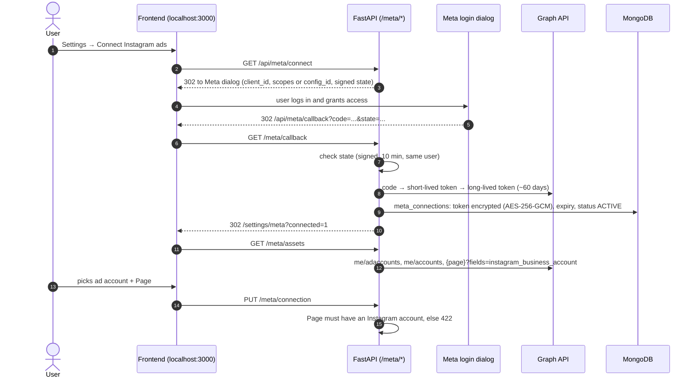

# Milestone 3 — Meta Connection + Gateway Implementation Plan

> **For agentic workers:** REQUIRED SUB-SKILL: Use superpowers:subagent-driven-development (recommended) or superpowers:executing-plans to implement this plan task-by-task. Steps use checkbox (`- [ ]`) syntax for tracking. Follow superpowers:test-driven-development for every RED/GREEN step.

**Goal:** A user can click **Connect Instagram ads**, grant our Meta app access, and pick an ad account and a Facebook Page that has a linked Instagram account. The token is stored encrypted. Every later milestone talks to Meta through two small interfaces (`AdsReader`, `AdsWriter`). Two implementations sit behind them: the official SDK (`MetaSdkGateway`) and an in-memory fake (`FakeAdsGateway`), and one shared contract test suite proves they behave the same.

**Architecture:** Everything Meta-specific lives in `app/meta/`. The SDK is touched in exactly one file (`sdk_gateway.py`). `app/container.py` is the only place that chooses the real or the fake gateway. The frontend gets its first pages: login/register and `/settings/meta`.

**Tech Stack:** `facebook-business` 26.x (confirmed: 26.0.2), tenacity, httpx (OAuth), `responses` (mocks the SDK's HTTP), respx (mocks httpx), pytest; Next.js + TypeScript + Tailwind + SWR, Vitest + Testing Library.

**Spec:** `.claude/plans/lld.md` §7 (meta layer), §9 (`/meta/*` routes), §12 (container) · HLD §5, §12.2 (`meta_connections`), §13 · PRD FR-1 (connect), NFR-1 (tokens encrypted, never logged).

**Depends on:** M0 payloads (`docs/pay_loads/`) and M1 (settings, audit, crypto, JWT, error envelope). **M3 does not need M2**, so you can build it before or after M2.

**Where to run commands:** paths below are relative to `ad_campaign_manager/backend/` unless they start with `frontend/` or `docs/`. Run backend commands from `ad_campaign_manager/backend`.

## Global Constraints

- Graph API version comes from `settings.meta_api_version` (`v26.0`). Never hard-code a version in `app/`.
- Only `app/meta/sdk_gateway.py` imports `facebook_business`. Only `app/container.py` constructs a gateway. Architecture tests enforce both.
- The access token is never logged, never returned by an API, and never put in an exception message.
- Write calls (`create`, `update`, `delete`, `upload_image`) are **not** retried inside the gateway. Only reads are retried. The publisher (M6) decides about writes, because a blind retry of a create can make a duplicate.
- Error responses use the M1 envelope. Meta errors become `MetaError` (502 `META_ERROR`), expired tokens become `MetaAuthExpired` (409 `META_AUTH_EXPIRED`).
- New routes use the `Annotated[..., Depends(...)]` style already used in `app/api/deps.py`.
- `FakeAdsGateway` is never used when `APP_ENV=production` (M1's settings validator already refuses `META_MODE=fake` there).

---

## Before You Start: Learn This Phase

### What happens, from the user's side



### Concepts

| Concept | In one line | Where |
|---|---|---|
| **OAuth authorization-code flow** | The user consents on Meta's site, Meta hands our server a one-time `code`, the server swaps it for a token. The browser never sees the token | `meta/oauth.py`, `api/meta_oauth.py` |
| **`state` parameter** | A value we generate and Meta sends back unchanged. Ours is a signed, 10-minute token naming the user, so an attacker can't make a victim's browser finish *the attacker's* login (CSRF) | `make_state()`, `check_state()` |
| **Short- vs long-lived token** | The `code` exchange gives a ~1-hour token, and a second exchange gives a ~60-day one. We store the long one and warn the user 7 days before it expires | `exchange_code()` |
| **Ports and adapters** | Our code talks to *interfaces* (`AdsReader`, `AdsWriter`). The real SDK and the in-memory fake are two *adapters* behind them | `meta/ports.py` |
| **Interface segregation** | Agent tools (M4) get only `AdsReader`. Even a hijacked model can't publish, because it has no object that can write | `ports.py`, architecture test (M4) |
| **Contract tests** | One test suite, run against both gateways. If the fake passes the same tests as the real one, every later test built on the fake is trustworthy (Liskov substitution) | `tests/contract/` |
| **Mocking HTTP, not our code** | For the SDK gateway we don't mock the SDK; we mock the *HTTP* underneath it with `responses`, replaying the real M0 payloads. The SDK's own URL building, `appsecret_proof` and error parsing run for real | `tests/contract/conftest.py` |
| **Fault injection** | The fake can be told "fail at the ad set step" (`fail_at`). M6 uses it to prove publishing recovers from timeouts and Meta errors | `FakeAdsGateway.fail_at` |

### Facts confirmed while writing this plan (facebook-business 26.0.2)

- `FacebookAdsApi(session, api_version="v26.0")` and `api.call(method, path_tuple, params)` build `https://graph.facebook.com/v26.0/<path>` from a tuple, and return a `FacebookResponse` whose `.json()` is the body.
- The SDK JSON-encodes dict, list and **bool** params itself (`False` is sent as `false`), so we pass plain Python values.
- `FacebookSession(app_id, app_secret, access_token, timeout=30)` adds `access_token` **and** `appsecret_proof` to the **URL query string** of every request.
- A failed call raises `FacebookRequestError` with `.http_status()`, `.api_error_code()`, `.api_error_subcode()`, `.body()` (a dict) and `.http_headers()`.

Because the token travels in the URL, a `requests` exception message (which quotes the URL) would contain the token. The gateway therefore never passes a `requests` exception message on. Task 3 has a test for exactly this.

### What the M0 payloads cover, and what they don't

`docs/pay_loads/` has real v26.0 captures for: ad accounts (r1), Pages (r2), Page → Instagram (r2b), interest search (r3), location search (r4), image upload (r5), campaign error and success (r6, r7) and ad set (r8). Creative and ad creation were blocked on the personal ad account (see the M1 guide). For calls without a capture (find-by-name, update, delete, delivery estimate, creative, ad), the tests use the documented Meta response shapes (`{"id": ...}`, `{"data": [...]}`, `{"success": true}`) and say so in a comment. When you capture one later, drop the file into `docs/pay_loads/` and point the test at it.

Two things the M0 files taught us, which this plan builds in:
1. `r4_search_location_bengaluru.response.json` is **not valid JSON** (a trailing comma). Task 0 fixes it and adds a test so it can't happen again.
2. `r8_adset_success.request.json` shows that v26 needs `targeting.targeting_automation.advantage_audience` set explicitly. The ad set payload builder (Task 4) always sends `0`.

## File Map

| File | Responsibility |
|---|---|
| `app/meta/__init__.py` | Package marker |
| `app/meta/errors.py` | `MetaError`, `MetaAuthExpired`, `ErrorClass`, `meta_error_from_body`, `classify`, `is_retryable` |
| `app/meta/ports.py` | `Edge`, `InterestOption`, `AdsReader`, `AdsWriter` |
| `app/meta/fake.py` | `FakeAdsGateway`, `parse_fail_at`, `STEP_FOR_EDGE`, canned catalogue |
| `app/meta/sdk_gateway.py` | `MetaSdkGateway` (the only `facebook_business` import) |
| `app/meta/payloads.py` | `object_name`, `campaign_payload`, `adset_payload`, `creative_payload`, `ad_payload` |
| `app/meta/oauth.py` | `SCOPES`, `auth_url`, `exchange_code`, `make_state`, `check_state`, `InvalidOAuthState` |
| `app/meta/connections.py` | `meta_connections` reads/writes, `public_view`, `MetaNotConnected` |
| `app/container.py` | `Container`, `build_container` (composition root) |
| `app/api/meta_oauth.py` | `/meta/connect`, `/meta/callback`, `/meta/connection`, `/meta/assets` |
| `app/api/deps.py` | + `get_container` and `Annotated` aliases |
| `app/main.py` | + `container` parameter, meta router |
| `app/config.py`, `.env.example` | + `meta_login_config_id` |
| `tests/meta_payloads.py` | Loads M0 payloads for tests |
| `tests/api_helpers.py` | `login()`, `connect_fake_meta()` |
| `tests/factories.py` | + `SAMPLE_PLAN`, `SAMPLE_VARIANTS` |
| `tests/contract/conftest.py`, `tests/contract/test_ads_gateway_contract.py` | Shared suite for both gateways |
| `frontend/…` | Next.js app: `lib/api.ts`, `AuthForm`, `MetaConnectCard`, `/login`, `/register`, `/settings/meta` |

---

### Task 0: Prepare — Dependencies and Valid M0 Payloads

> **Understand this task:** the M0 payloads are now *test fixtures*: the SDK gateway's tests replay them as if Meta sent them. A broken JSON file would make every one of those tests fail with a confusing error, so we fix r4 and add a test that every payload parses. We also install the libraries this milestone needs.

**Files:**
- Modify: `backend/pyproject.toml`, `backend/uv.lock` (via `uv add`)
- Modify: `docs/pay_loads/r4_search_location_bengaluru.response.json`
- Create: `tests/meta_payloads.py`, `tests/unit/test_meta_payload_files.py`

- [ ] **Step 1: Install dependencies (config, no test)**

```bash
cd ad_campaign_manager/backend
uv add "facebook-business>=26,<27" tenacity
uv add --dev responses respx
uv run python -c "import importlib.metadata as m; print(m.version('facebook-business'))"
```

Expected: `26.0.x`. Commit the lockfile with the code in Step 5.

- [ ] **Step 2: Write the failing test**

`tests/meta_payloads.py`:

```python
"""Load the verified Meta v26.0 payloads saved in Milestone 0 (docs/pay_loads)."""
import json
from pathlib import Path

PAYLOAD_DIR = Path(__file__).resolve().parents[2] / "docs" / "pay_loads"
M0_ACCOUNT = "act_2279071366267627"
M0_PAGE = "1415879818267624"


def m0(name: str) -> dict:
    return json.loads((PAYLOAD_DIR / f"{name}.json").read_text(encoding="utf-8"))
```

`tests/unit/test_meta_payload_files.py`:

```python
import json

import pytest

from tests.meta_payloads import PAYLOAD_DIR

FILES = sorted(PAYLOAD_DIR.glob("*.json"))


def test_payload_directory_is_found():
    assert FILES, f"no payloads found in {PAYLOAD_DIR}"


@pytest.mark.parametrize("path", FILES, ids=lambda p: p.name)
def test_every_m0_payload_is_valid_json(path):
    json.loads(path.read_text(encoding="utf-8"))


@pytest.mark.parametrize("path", FILES, ids=lambda p: p.name)
def test_no_payload_contains_an_access_token(path):
    text = path.read_text(encoding="utf-8")
    assert "access_token" not in text and "EAA" not in text
```

- [ ] **Step 3: Run and watch it fail**

Run: `uv run pytest tests/unit/test_meta_payload_files.py -v`
Expected: `test_every_m0_payload_is_valid_json[r4_search_location_bengaluru.response.json]` FAILS with `JSONDecodeError` (illegal trailing comma).

- [ ] **Step 4: Fix the payload**

In `docs/pay_loads/r4_search_location_bengaluru.response.json`, delete the blank first line and the comma after the `cursors` object, so the file ends:

```text
  "paging": {
    "cursors": {
      "before": "MAZDZD",
      "after": "NgZDZD"
    }
  }
}
```

Run again → all passed.

- [ ] **Step 5: Commit** — `git add backend docs/pay_loads && git commit -m "chore: meta SDK deps; fix invalid r4 payload; payload validity test"`

---

### Task 1: Meta Error Mapping

> **Understand this task:** Meta reports problems as `{"error": {"code", "error_subcode", "message", "error_user_msg"}}`. What we do next depends on *which kind* of problem it is:
>
> | Kind | Examples | What the app does |
> |---|---|---|
> | RETRYABLE | timeout, connection error, HTTP 5xx, codes 1, 2, 4, 17, 613, 80000–80014 (rate limits) | try again with backoff |
> | AUTH | code 190 (token expired or revoked) | mark the connection expired, ask the user to reconnect |
> | PERMISSION | code 10, 200–299 | stop and explain which permission is missing |
> | INVALID | code 100 (bad parameter) | stop and show Meta's `error_user_msg`. Retrying would fail the same way |
> | UNKNOWN | anything else | stop and show the message |
>
> `MetaError` extends M1's `AppError` (HTTP 502, `META_ERROR`), so an unhandled Meta error automatically becomes a clean error envelope whose message is Meta's user-facing text. Meta's own numeric code is kept as `meta_code`, separate from our envelope `code`.

**Files:**
- Create: `app/meta/__init__.py`, `app/meta/errors.py`
- Test: `tests/unit/test_meta_errors.py`

**Interfaces:**
- Produces: `ErrorClass` (StrEnum); `MetaError(*, http_status=None, meta_code=None, meta_subcode=None, message="Meta API error", user_msg=None, retry_after_s=None)` with those attributes; `MetaAuthExpired` (409 `META_AUTH_EXPIRED`); `meta_error_from_body(body, http_status) -> MetaError`; `classify(err) -> ErrorClass`; `is_retryable(exc) -> bool`

- [ ] **Step 1: Write the failing tests**

```python
import pytest

from app.meta.errors import ErrorClass, MetaError, classify, is_retryable, meta_error_from_body
from tests.meta_payloads import m0


def err(code=None, http_status=400, subcode=None):
    return MetaError(http_status=http_status, meta_code=code, meta_subcode=subcode)


@pytest.mark.parametrize("code", [4, 17, 613, 80000, 80004, 80014, 1, 2])
def test_throttle_and_transient_codes_are_retryable(code):
    assert classify(err(code)) == ErrorClass.RETRYABLE


def test_190_is_auth():
    assert classify(err(190)) == ErrorClass.AUTH


@pytest.mark.parametrize("code", [10, 200, 294, 299])
def test_permission_codes(code):
    assert classify(err(code)) == ErrorClass.PERMISSION


def test_100_is_invalid_and_keeps_subcode_and_user_message():
    error = meta_error_from_body(m0("r6_campaign_missing_budget_sharing.response"), 400)
    assert classify(error) == ErrorClass.INVALID
    assert error.meta_code == 100 and error.meta_subcode == 4834011
    assert "is_adset_budget_sharing_enabled" in error.user_msg


def test_server_error_without_code_is_retryable():
    assert classify(err(None, http_status=503)) == ErrorClass.RETRYABLE


def test_unknown_code_is_unknown():
    assert classify(err(12345)) == ErrorClass.UNKNOWN


def test_envelope_uses_meta_user_message():
    error = meta_error_from_body(m0("r6_campaign_missing_budget_sharing.response"), 400)
    assert error.status == 502 and error.code == "META_ERROR"
    assert error.message.startswith("You must specify True or False")
    assert error.details == {"meta_code": 100, "meta_subcode": 4834011}


def test_body_without_error_object_still_builds_an_error():
    assert meta_error_from_body({}, 500).meta_code is None


@pytest.mark.parametrize("exc,expected", [
    (TimeoutError(), True),
    (ConnectionError(), True),
    (err(17), True),
    (err(100), False),
    (err(190), False),
    (ValueError(), False),
])
def test_is_retryable_predicate_matches_table(exc, expected):
    assert is_retryable(exc) is expected
```

- [ ] **Step 2: Run and watch them fail** — `uv run pytest tests/unit/test_meta_errors.py -v` → `ModuleNotFoundError: No module named 'app.meta'`.

- [ ] **Step 3: Implement**

`app/meta/__init__.py`: empty.

`app/meta/errors.py`:

```python
from enum import StrEnum

from app.errors import AppError

THROTTLE_CODES = frozenset({4, 17, 613, *range(80000, 80015)})
TRANSIENT_CODES = frozenset({1, 2})


class ErrorClass(StrEnum):
    RETRYABLE = "RETRYABLE"
    AUTH = "AUTH"
    INVALID = "INVALID"
    PERMISSION = "PERMISSION"
    UNKNOWN = "UNKNOWN"


class MetaError(AppError):
    status, code = 502, "META_ERROR"

    def __init__(self, *, http_status: int | None = None, meta_code: int | None = None,
                 meta_subcode: int | None = None, message: str = "Meta API error",
                 user_msg: str | None = None, retry_after_s: float | None = None):
        super().__init__(user_msg or message, {"meta_code": meta_code, "meta_subcode": meta_subcode})
        self.http_status = http_status
        self.meta_code = meta_code
        self.meta_subcode = meta_subcode
        self.meta_message = message
        self.user_msg = user_msg
        self.retry_after_s = retry_after_s


class MetaAuthExpired(AppError):
    status, code = 409, "META_AUTH_EXPIRED"


def meta_error_from_body(body: dict | None, http_status: int | None) -> MetaError:
    error = (body or {}).get("error") or {}
    return MetaError(
        http_status=http_status,
        meta_code=error.get("code"),
        meta_subcode=error.get("error_subcode"),
        message=error.get("message") or "Meta API error",
        user_msg=error.get("error_user_msg"),
    )


def classify(err: MetaError) -> ErrorClass:
    code = err.meta_code
    if code == 190:
        return ErrorClass.AUTH
    if code in THROTTLE_CODES or code in TRANSIENT_CODES:
        return ErrorClass.RETRYABLE
    if code == 10 or (code is not None and 200 <= code <= 299):
        return ErrorClass.PERMISSION
    if code == 100:
        return ErrorClass.INVALID
    if (err.http_status or 0) >= 500:
        return ErrorClass.RETRYABLE
    return ErrorClass.UNKNOWN


def is_retryable(exc: BaseException) -> bool:
    if isinstance(exc, (TimeoutError, ConnectionError)):
        return True
    return isinstance(exc, MetaError) and classify(exc) == ErrorClass.RETRYABLE
```

- [ ] **Step 4: Run and watch them pass** → 24 passed.

- [ ] **Step 5: Commit** — `git add backend && git commit -m "feat: Meta error classification and envelope mapping"`

---

### Task 2: Ports, Contract Suite and `FakeAdsGateway`

> **Understand this task:**
> - **`AdsReader` / `AdsWriter`** are Python `Protocol`s: lists of methods with no code. Anything that has those methods "is" a reader or writer. Services and agents are written against these, never against a concrete gateway.
> - **The contract suite** describes what *any* gateway must do: "create returns an id", "find_by_name finds what was created", "a code-100 response raises an INVALID `MetaError`", and so on. Each test receives two fixtures:
>   - `gateway`: the gateway under test.
>   - `world`: a small helper that prepares what Meta would answer. For the SDK gateway it registers a fake HTTP response; for the fake gateway it usually does nothing, because the fake keeps real state in memory.
> - In this task the suite runs only against the fake. Task 3 adds the SDK gateway to the same suite without changing a single test.
> - **`fail_at`** makes the fake fail on purpose at a step (`IMAGE`, `CAMPAIGN`, `ADSET`, `CREATIVE`, `AD`, `UPDATE`, `DELETE`). The value is a `MetaError`, `"timeout"` (fail before creating), or `"timeout_after_create"` (create the object, *then* time out: the nastiest real-world case). A failure fires **once**, so a retry or Resume can succeed, as it would in real life.
>
> `insights()` and `ad_statuses()` are added to the ports in M7 together with the collector that needs them (no unused code now).

**Files:**
- Create: `app/meta/ports.py`, `app/meta/fake.py`, `tests/contract/__init__.py`, `tests/contract/conftest.py`, `tests/contract/test_ads_gateway_contract.py`
- Test: `tests/unit/test_fake_gateway.py`

**Interfaces:**
- Produces: `Edge`; `InterestOption(id, name, audience_size_lower=None)`; `AdsReader` (`list_ad_accounts`, `list_pages`, `instagram_account_for_page`, `search_interests`, `search_locations`, `delivery_estimate`, `find_by_name`); `AdsWriter` (`upload_image`, `create`, `update`, `delete`); `FakeAdsGateway(*, fail_at=None)` with `.objects`, `.images`, `.fail_at`, `.by_edge(edge)`; `parse_fail_at(spec) -> dict`; `STEP_FOR_EDGE`
- Return shapes (both gateways): ad account `{"id": "act_…", "name", "currency", "account_status", "min_daily_budget_minor"}`; Page `{"id", "name"}`; Instagram `{"id", "username"} | None`; location `{"key", "name", "type", "country_code"}`; estimate `{"lower": int, "upper": int}`

- [ ] **Step 1: Write the failing tests**

`tests/contract/__init__.py`: empty.

`tests/contract/conftest.py`:

```python
import pytest

from app.meta.errors import meta_error_from_body
from app.meta.fake import STEP_FOR_EDGE, FakeAdsGateway
from tests.meta_payloads import M0_ACCOUNT


class FakeWorld:
    """The fake keeps real state, so most preparations are no-ops."""

    PAGE_WITH_INSTAGRAM = "page_fake_1"

    def __init__(self, fake: FakeAdsGateway):
        self.fake = fake

    def replay(self, method: str, path: str, body: dict, status: int = 200) -> None:
        pass

    def created(self, edge: str, object_id: str) -> None:
        pass

    def found(self, edge: str, object_id: str | None) -> None:
        pass

    def updated(self, object_id: str) -> None:
        pass

    def deleted(self, object_id: str) -> None:
        pass

    def create_fails(self, edge: str, body: dict, status: int = 400) -> None:
        self.fake.fail_at[STEP_FOR_EDGE[edge]] = meta_error_from_body(body, status)


@pytest.fixture(params=["fake"])
def gateway_and_world(request):
    fake = FakeAdsGateway()
    yield fake, FakeWorld(fake)


@pytest.fixture
def gateway(gateway_and_world):
    return gateway_and_world[0]


@pytest.fixture
def world(gateway_and_world):
    return gateway_and_world[1]


@pytest.fixture
def account():
    return M0_ACCOUNT
```

`tests/contract/test_ads_gateway_contract.py`:

```python
"""Every AdsReader/AdsWriter implementation must pass these tests (Liskov)."""
import pytest

from app.meta.errors import ErrorClass, MetaError, classify
from app.meta.ports import AdsReader, AdsWriter, InterestOption
from tests.meta_payloads import m0

CAMPAIGN = {
    "name": "acm-000001-v1-CAMPAIGN", "objective": "OUTCOME_TRAFFIC", "status": "PAUSED",
    "special_ad_categories": [], "is_adset_budget_sharing_enabled": False,
}
# Synthetic: no M0 capture yet; shape from Meta's delivery_estimate docs.
DELIVERY_ESTIMATE = {"data": [{"estimate_mau_lower_bound": 1200000, "estimate_mau_upper_bound": 1400000,
                               "estimate_ready": True}]}


def protocol_methods(protocol) -> set[str]:
    return {name for name in vars(protocol) if not name.startswith("_")}


def test_gateway_has_every_port_method(gateway):
    for name in protocol_methods(AdsReader) | protocol_methods(AdsWriter):
        assert callable(getattr(gateway, name, None)), name


async def test_create_returns_an_id(gateway, world, account):
    world.created("campaigns", "120251612314120363")
    assert await gateway.create(account, "campaigns", CAMPAIGN)


async def test_find_by_name_finds_what_was_created(gateway, world, account):
    world.created("campaigns", "120251612314120363")
    object_id = await gateway.create(account, "campaigns", CAMPAIGN)
    world.found("campaigns", object_id)
    assert await gateway.find_by_name(account, "campaigns", CAMPAIGN["name"]) == object_id


async def test_find_by_name_is_none_when_absent(gateway, world, account):
    world.found("campaigns", None)
    assert await gateway.find_by_name(account, "campaigns", "acm-nothing-v1-CAMPAIGN") is None


async def test_update_returns_none(gateway, world, account):
    world.created("campaigns", "120251612314120363")
    object_id = await gateway.create(account, "campaigns", CAMPAIGN)
    world.updated(object_id)
    assert await gateway.update(object_id, {"status": "ACTIVE"}) is None


async def test_delete_removes_the_object(gateway, world, account):
    world.created("campaigns", "120251612314120363")
    object_id = await gateway.create(account, "campaigns", CAMPAIGN)
    world.deleted(object_id)
    await gateway.delete(object_id)
    world.found("campaigns", None)
    assert await gateway.find_by_name(account, "campaigns", CAMPAIGN["name"]) is None


async def test_upload_image_returns_a_hash(gateway, world, account):
    world.replay("POST", f"{account}/adimages", m0("r5_adimages.response"))
    image_hash = await gateway.upload_image(account, b"\xff\xd8 not really a jpeg", "x.jpg")
    assert len(image_hash) == 32


async def test_code_100_raises_an_invalid_meta_error(gateway, world, account):
    world.create_fails("campaigns", m0("r6_campaign_missing_budget_sharing.response"))
    with pytest.raises(MetaError) as exc:
        await gateway.create(account, "campaigns", CAMPAIGN)
    assert classify(exc.value) == ErrorClass.INVALID
    assert exc.value.meta_subcode == 4834011


async def test_search_interests_returns_resolved_options(gateway, world):
    world.replay("GET", "search", m0("r3_search_interest_python.response"))
    options = await gateway.search_interests("python", limit=5)
    assert 1 <= len(options) <= 5
    assert all(isinstance(o, InterestOption) for o in options)
    assert options[0].id == "6003682002118"


async def test_search_locations_returns_keys(gateway, world):
    world.replay("GET", "search", m0("r4_search_location_bengaluru.response"))
    first = (await gateway.search_locations("Bengaluru", "IN"))[0]
    assert first == {"key": "1017930", "name": "Bangalore", "type": "city", "country_code": "IN"}


async def test_list_ad_accounts(gateway, world):
    world.replay("GET", "me/adaccounts", m0("r1_adaccounts.response"))
    account = (await gateway.list_ad_accounts())[0]
    assert account["id"].startswith("act_")
    assert account["currency"] == "INR"
    assert isinstance(account["min_daily_budget_minor"], int)


async def test_list_pages(gateway, world):
    world.replay("GET", "me/accounts", m0("r2_pages.response"))
    assert {"id", "name"} <= set((await gateway.list_pages())[0])


async def test_instagram_account_for_page(gateway, world):
    page = world.PAGE_WITH_INSTAGRAM
    world.replay("GET", page, m0("r2b_instagram_account.response"))
    instagram = await gateway.instagram_account_for_page(page)
    assert instagram["id"] and instagram["username"]


async def test_delivery_estimate(gateway, world, account):
    world.replay("GET", f"{account}/delivery_estimate", DELIVERY_ESTIMATE)
    estimate = await gateway.delivery_estimate(account, {"geo_locations": {"countries": ["IN"]}})
    assert 0 < estimate["lower"] <= estimate["upper"]
```

`tests/unit/test_fake_gateway.py` (fake-only behaviour: fault injection):

```python
import pytest

from app.meta.errors import MetaError
from app.meta.fake import FakeAdsGateway, parse_fail_at

ACCOUNT = "act_fake_1"
ADSET = {"name": "acm-000001-v1-ADSET", "status": "PAUSED"}


async def test_fail_at_raises_the_configured_error_once():
    fake = FakeAdsGateway(fail_at={"ADSET": MetaError(meta_code=100)})
    with pytest.raises(MetaError):
        await fake.create(ACCOUNT, "adsets", ADSET)
    assert await fake.create(ACCOUNT, "adsets", ADSET)          # second try succeeds


async def test_timeout_before_create_creates_nothing():
    fake = FakeAdsGateway(fail_at={"ADSET": "timeout"})
    with pytest.raises(TimeoutError):
        await fake.create(ACCOUNT, "adsets", ADSET)
    assert fake.by_edge("adsets") == []


async def test_timeout_after_create_creates_then_raises():
    fake = FakeAdsGateway(fail_at={"ADSET": "timeout_after_create"})
    with pytest.raises(TimeoutError):
        await fake.create(ACCOUNT, "adsets", ADSET)
    assert await fake.find_by_name(ACCOUNT, "adsets", ADSET["name"])


async def test_update_and_delete_of_unknown_object_raise_code_100():
    fake = FakeAdsGateway()
    with pytest.raises(MetaError) as exc:
        await fake.update("nope", {"status": "ACTIVE"})
    assert exc.value.meta_code == 100
    with pytest.raises(MetaError):
        await fake.delete("nope")


async def test_update_changes_status():
    fake = FakeAdsGateway()
    object_id = await fake.create(ACCOUNT, "ads", {"name": "a", "status": "PAUSED"})
    await fake.update(object_id, {"status": "ACTIVE"})
    assert fake.objects[object_id]["status"] == "ACTIVE"


async def test_page_without_instagram_returns_none():
    assert await FakeAdsGateway().instagram_account_for_page("page_fake_2") is None


def test_parse_fail_at():
    parsed = parse_fail_at("ADSET:timeout_after_create, CAMPAIGN:190, AD")
    assert parsed["ADSET"] == "timeout_after_create"
    assert parsed["CAMPAIGN"].meta_code == 190
    assert parsed["AD"].meta_code == 100            # a bare step injects code 100
    assert parse_fail_at("") == {}
```

- [ ] **Step 2: Run and watch them fail** — `uv run pytest tests/contract tests/unit/test_fake_gateway.py -v` → `ModuleNotFoundError: No module named 'app.meta.fake'`.

- [ ] **Step 3: Implement**

`app/meta/ports.py`:

```python
from typing import Literal, Protocol

from pydantic import BaseModel

Edge = Literal["campaigns", "adsets", "adcreatives", "ads"]


class InterestOption(BaseModel):
    id: str
    name: str
    audience_size_lower: int | None = None


class AdsReader(Protocol):
    async def list_ad_accounts(self) -> list[dict]: ...
    async def list_pages(self) -> list[dict]: ...
    async def instagram_account_for_page(self, page_id: str) -> dict | None: ...
    async def search_interests(self, query: str, limit: int = 5) -> list[InterestOption]: ...
    async def search_locations(self, query: str, country: str) -> list[dict]: ...
    async def delivery_estimate(self, account_id: str, targeting: dict,
                                optimization_goal: str = "LINK_CLICKS") -> dict: ...
    async def find_by_name(self, account_id: str, edge: Edge, name: str) -> str | None: ...


class AdsWriter(Protocol):
    async def upload_image(self, account_id: str, data: bytes, filename: str) -> str: ...
    async def create(self, account_id: str, edge: Edge, params: dict) -> str: ...
    async def update(self, object_id: str, params: dict) -> None: ...
    async def delete(self, object_id: str) -> None: ...
```

`app/meta/fake.py`:

```python
import hashlib

from app.meta.errors import MetaError
from app.meta.ports import Edge, InterestOption

STEP_FOR_EDGE = {"campaigns": "CAMPAIGN", "adsets": "ADSET", "adcreatives": "CREATIVE", "ads": "AD"}
TIMEOUT_MODES = ("timeout", "timeout_after_create")

FAKE_ACCOUNT = {"id": "act_fake_1", "name": "Fake Ad Account", "currency": "INR",
                "account_status": 1, "min_daily_budget_minor": 9673}
FAKE_PAGES = [{"id": "page_fake_1", "name": "Fake Brand Page"},
              {"id": "page_fake_2", "name": "Page Without Instagram"}]
FAKE_INSTAGRAM = {"page_fake_1": {"id": "ig_fake_1", "username": "fake_brand"}}
# The Python id is real (M0 r3). The other ids are made up for offline use.
INTERESTS = [
    InterestOption(id="6003682002118", name="Python (programming language)", audience_size_lower=24_568_027),
    InterestOption(id="6003000000001", name="JavaScript (programming language)", audience_size_lower=30_000_000),
    InterestOption(id="6003000000002", name="GitHub", audience_size_lower=8_000_000),
    InterestOption(id="6003000000003", name="Software development", audience_size_lower=45_000_000),
    InterestOption(id="6003000000004", name="Computer programming", audience_size_lower=60_000_000),
]
LOCATIONS = [  # Bangalore's key is real (M0 r4)
    ({"key": "1017930", "name": "Bangalore", "type": "city", "country_code": "IN"}, ("bengaluru", "bangalore")),
    ({"key": "1035921", "name": "Mumbai", "type": "city", "country_code": "IN"}, ("mumbai", "bombay")),
]


def parse_fail_at(spec: str) -> dict[str, BaseException | str]:
    """'ADSET:timeout_after_create,CAMPAIGN:190,AD' -> {step: failure}. A bare step injects code 100."""
    failures: dict[str, BaseException | str] = {}
    for item in (part.strip() for part in spec.split(",")):
        if not item:
            continue
        step, _, how = item.partition(":")
        how = how.strip() or "100"
        failures[step.strip().upper()] = how if how in TIMEOUT_MODES else MetaError(
            http_status=400, meta_code=int(how), message=f"Injected Meta error {how} at {step}")
    return failures


class FakeAdsGateway:
    """In-memory Meta for tests and mock mode. Passes the same contract tests as MetaSdkGateway."""

    def __init__(self, *, fail_at: dict[str, BaseException | str] | None = None):
        self.fail_at = dict(fail_at or {})
        self.objects: dict[str, dict] = {}
        self.images: dict[str, bytes] = {}
        self._next_id = 0

    def _injected(self, step: str) -> str | None:
        failure = self.fail_at.pop(step, None)     # one-shot, so a retry or Resume can succeed
        if isinstance(failure, BaseException):
            raise failure
        if failure == "timeout":
            raise TimeoutError(f"injected timeout before {step}")
        return failure

    def _get(self, object_id: str) -> dict:
        if object_id not in self.objects:
            raise MetaError(http_status=400, meta_code=100, meta_subcode=33,
                            message=f"Object {object_id} does not exist")
        return self.objects[object_id]

    def by_edge(self, edge: Edge) -> list[dict]:
        return [obj for obj in self.objects.values() if obj["edge"] == edge]

    async def list_ad_accounts(self) -> list[dict]:
        return [dict(FAKE_ACCOUNT)]

    async def list_pages(self) -> list[dict]:
        return [dict(page) for page in FAKE_PAGES]

    async def instagram_account_for_page(self, page_id: str) -> dict | None:
        instagram = FAKE_INSTAGRAM.get(page_id)
        return dict(instagram) if instagram else None

    async def search_interests(self, query: str, limit: int = 5) -> list[InterestOption]:
        q = query.lower()
        return [option for option in INTERESTS if q in option.name.lower()][:limit]

    async def search_locations(self, query: str, country: str) -> list[dict]:
        q = query.lower()
        return [dict(loc) for loc, aliases in LOCATIONS
                if loc["country_code"] == country and any(q in alias for alias in aliases)]

    async def delivery_estimate(self, account_id: str, targeting: dict,
                                optimization_goal: str = "LINK_CLICKS") -> dict:
        return {"lower": 1_200_000, "upper": 1_400_000}

    async def find_by_name(self, account_id: str, edge: Edge, name: str) -> str | None:
        return next((oid for oid, obj in self.objects.items()
                     if obj["edge"] == edge and obj["name"] == name), None)

    async def upload_image(self, account_id: str, data: bytes, filename: str) -> str:
        self._injected("IMAGE")
        image_hash = hashlib.md5(data, usedforsecurity=False).hexdigest()   # Meta image hashes are md5
        self.images[image_hash] = data
        return image_hash

    async def create(self, account_id: str, edge: Edge, params: dict) -> str:
        failure = self._injected(STEP_FOR_EDGE[edge])
        self._next_id += 1
        object_id = f"fake_{edge}_{self._next_id}"
        self.objects[object_id] = {"edge": edge, "account_id": account_id, "name": params.get("name"),
                                   "params": dict(params), "status": params.get("status", "PAUSED")}
        if failure == "timeout_after_create":
            raise TimeoutError(f"injected timeout after creating {object_id}")
        return object_id

    async def update(self, object_id: str, params: dict) -> None:
        self._injected("UPDATE")
        obj = self._get(object_id)
        obj["params"].update(params)
        obj["status"] = params.get("status", obj["status"])

    async def delete(self, object_id: str) -> None:
        self._injected("DELETE")
        self._get(object_id)
        del self.objects[object_id]
```

- [ ] **Step 4: Run and watch them pass** — `uv run pytest tests/contract tests/unit/test_fake_gateway.py -v` → 21 passed (14 contract + 7 fake).

- [ ] **Step 5: Commit** — `git add backend && git commit -m "feat: AdsReader/AdsWriter ports, contract suite, FakeAdsGateway with fault injection"`

---

### Task 3: `MetaSdkGateway` Joins the Contract Suite

> **Understand this task:** now the real gateway runs the *same* contract tests. We don't mock the SDK. The `responses` library intercepts the HTTP requests the SDK makes and answers with the saved M0 payloads, so the SDK's real URL building, `appsecret_proof` and error parsing all run.
>
> How the gateway works:
> - **One API object per connection.** `FacebookAdsApi.init()` sets a *global* default, which would mix users' tokens. We build `FacebookAdsApi(FacebookSession(...))` per gateway instance instead.
> - **Off the event loop.** The SDK is synchronous (`requests`). `asyncio.to_thread` runs each call on a worker thread, so FastAPI keeps serving other requests meanwhile.
> - **Error translation in one place.** `FacebookRequestError` becomes `MetaError`, a `requests` timeout becomes `TimeoutError`, and a connection failure becomes `ConnectionError`. Each is raised `from None` with our own message, because the original message contains the URL, and the URL contains the token.
> - **Reads retry, writes don't.** Reads are wrapped in tenacity (4 attempts, exponential backoff with jitter, only for `is_retryable` errors). Writes are attempted once.
>
> Tests pass `wait=wait_none()` so retries don't sleep.

**Files:**
- Create: `app/meta/sdk_gateway.py`
- Modify: `tests/contract/conftest.py` (add the `sdk` parameter), `tests/unit/test_architecture.py`
- Test: `tests/unit/test_sdk_gateway.py`

**Interfaces:**
- Consumes: `Settings` (M1), `MetaError`, `meta_error_from_body`, `is_retryable` (Task 1), `InterestOption` (Task 2)
- Produces: `MetaSdkGateway(*, access_token, settings, wait=wait_exponential_jitter(initial=1, max=30))`, `GRAPH_URL`

- [ ] **Step 1: Write the failing tests**

In `tests/contract/conftest.py`, add `SdkWorld` and replace the `gateway_and_world` fixture (keep `FakeWorld` and the other fixtures):

```python
import responses
from tenacity import wait_none

from app.meta.sdk_gateway import GRAPH_URL, MetaSdkGateway


class SdkWorld:
    """Registers the HTTP response Meta would send; the real SDK parses it."""

    PAGE_WITH_INSTAGRAM = "1415879818267624"

    def __init__(self, mock: responses.RequestsMock, version: str):
        self.mock, self.base = mock, f"{GRAPH_URL}/{version}"

    def replay(self, method: str, path: str, body: dict, status: int = 200) -> None:
        self.mock.add(method, f"{self.base}/{path}", json=body, status=status)

    def created(self, edge: str, object_id: str) -> None:
        self.replay("POST", f"{M0_ACCOUNT}/{edge}", {"id": object_id})

    def found(self, edge: str, object_id: str | None) -> None:
        # Synthetic: shape of a filtered edge read, from Meta's docs.
        self.replay("GET", f"{M0_ACCOUNT}/{edge}", {"data": [{"id": object_id}] if object_id else []})

    def updated(self, object_id: str) -> None:
        self.replay("POST", object_id, {"success": True})

    def deleted(self, object_id: str) -> None:
        self.replay("DELETE", object_id, {"success": True})

    def create_fails(self, edge: str, body: dict, status: int = 400) -> None:
        self.replay("POST", f"{M0_ACCOUNT}/{edge}", body, status)


@pytest.fixture(params=["fake", "sdk"])
def gateway_and_world(request, settings):
    if request.param == "fake":
        fake = FakeAdsGateway()
        yield fake, FakeWorld(fake)
        return
    with responses.RequestsMock(assert_all_requests_are_fired=False) as mock:
        gateway = MetaSdkGateway(access_token="TEST-TOKEN", settings=settings, wait=wait_none())
        yield gateway, SdkWorld(mock, settings.meta_api_version)
```

`tests/unit/test_sdk_gateway.py` (SDK-only behaviour):

```python
import pytest
import requests
import responses
from tenacity import wait_none

from app.meta.errors import MetaError
from app.meta.sdk_gateway import GRAPH_URL, MetaSdkGateway
from tests.meta_payloads import M0_ACCOUNT, m0

TOKEN = "EAAB-SECRET-TOKEN"


@pytest.fixture
def real_settings(settings):
    return settings.model_copy(update={"meta_mode": "real", "meta_app_id": "123", "meta_app_secret": "s3cret"})


@pytest.fixture
def mock():
    with responses.RequestsMock(assert_all_requests_are_fired=False) as m:
        yield m


def url(settings, path):
    return f"{GRAPH_URL}/{settings.meta_api_version}/{path}"


def gateway(settings):
    return MetaSdkGateway(access_token=TOKEN, settings=settings, wait=wait_none())


async def test_requests_carry_versioned_url_and_appsecret_proof(real_settings, mock):
    mock.add("GET", url(real_settings, "me/accounts"), json=m0("r2_pages.response"))
    await gateway(real_settings).list_pages()
    sent = mock.calls[0].request.url
    assert sent.startswith(f"{GRAPH_URL}/v26.0/me/accounts")
    assert "appsecret_proof=" in sent


async def test_each_gateway_has_its_own_api_object(real_settings):
    a = MetaSdkGateway(access_token="A", settings=real_settings)
    b = MetaSdkGateway(access_token="B", settings=real_settings)
    assert a._api is not b._api


async def test_read_is_retried_on_code_17_then_succeeds(real_settings, mock):
    throttled = {"error": {"code": 17, "message": "User request limit reached"}}
    mock.add("GET", url(real_settings, "me/accounts"), json=throttled, status=400)
    mock.add("GET", url(real_settings, "me/accounts"), json=m0("r2_pages.response"))
    pages = await gateway(real_settings).list_pages()
    assert pages[0]["name"] == "Social Ads Demo"
    assert len(mock.calls) == 2


async def test_create_is_not_retried(real_settings, mock):
    throttled = {"error": {"code": 17, "message": "User request limit reached"}}
    mock.add("POST", url(real_settings, f"{M0_ACCOUNT}/campaigns"), json=throttled, status=400)
    with pytest.raises(MetaError):
        await gateway(real_settings).create(M0_ACCOUNT, "campaigns", {"name": "x"})
    assert len(mock.calls) == 1


async def test_create_sends_bool_as_json(real_settings, mock):
    mock.add("POST", url(real_settings, f"{M0_ACCOUNT}/campaigns"), json=m0("r7_campaign_success.response"))
    params = m0("r7_campaign_success.request")["params"]
    assert await gateway(real_settings).create(M0_ACCOUNT, "campaigns", params) == "120251612314120363"
    assert "is_adset_budget_sharing_enabled=false" in mock.calls[0].request.body


async def test_throttle_header_sets_retry_after(real_settings, mock):
    usage = '{"1": [{"type": "ads_management", "estimated_time_to_regain_access": 2}]}'
    mock.add("POST", url(real_settings, f"{M0_ACCOUNT}/campaigns"),
             json={"error": {"code": 80004, "message": "Too many calls"}}, status=400,
             headers={"X-Business-Use-Case-Usage": usage})
    with pytest.raises(MetaError) as exc:
        await gateway(real_settings).create(M0_ACCOUNT, "campaigns", {"name": "x"})
    assert exc.value.retry_after_s == 120


async def test_timeout_becomes_timeout_error_without_the_token(real_settings, mock):
    mock.add("POST", url(real_settings, f"{M0_ACCOUNT}/campaigns"),
             body=requests.Timeout(f"read timed out for ...?access_token={TOKEN}"))
    with pytest.raises(TimeoutError) as exc:
        await gateway(real_settings).create(M0_ACCOUNT, "campaigns", {"name": "x"})
    assert TOKEN not in str(exc.value)
    assert exc.value.__cause__ is None and exc.value.__suppress_context__


async def test_connection_error_becomes_connection_error(real_settings, mock):
    mock.add("GET", url(real_settings, "me/accounts"), body=requests.ConnectionError("boom"))
    with pytest.raises(ConnectionError):
        await gateway(real_settings).list_pages()
```

Add to `tests/unit/test_architecture.py`:

```python
def test_only_the_sdk_gateway_imports_facebook_business():
    offenders = [str(p) for p, src in _sources().items()
                 if p.name != "sdk_gateway.py" and "facebook_business" in src]
    assert offenders == []
```

- [ ] **Step 2: Run and watch them fail** — `uv run pytest tests/contract tests/unit/test_sdk_gateway.py -v` → `ModuleNotFoundError: No module named 'app.meta.sdk_gateway'`.

- [ ] **Step 3: Implement** — `app/meta/sdk_gateway.py`:

```python
import asyncio
import base64
import json

import requests
from facebook_business.api import FacebookAdsApi, FacebookSession
from facebook_business.exceptions import FacebookRequestError
from tenacity import AsyncRetrying, retry_if_exception, stop_after_attempt, wait_exponential_jitter

from app.config import Settings
from app.meta.errors import MetaError, is_retryable, meta_error_from_body
from app.meta.ports import Edge, InterestOption

GRAPH_URL = "https://graph.facebook.com"
READ_ATTEMPTS = 4
TIMEOUT_S = 30


def _retry_after_s(headers) -> float | None:
    raw = (headers or {}).get("X-Business-Use-Case-Usage")
    if not raw:
        return None
    try:
        usage = json.loads(raw)
        minutes = max(entry.get("estimated_time_to_regain_access", 0)
                      for entries in usage.values() for entry in entries)
    except (ValueError, AttributeError, TypeError):
        return None
    return minutes * 60 or None


def _to_meta_error(exc: FacebookRequestError) -> MetaError:
    body = exc.body() if isinstance(exc.body(), dict) else {}
    error = meta_error_from_body(body, exc.http_status())
    error.retry_after_s = _retry_after_s(exc.http_headers())
    return error


class MetaSdkGateway:
    """AdsReader + AdsWriter over the official facebook-business SDK."""

    def __init__(self, *, access_token: str, settings: Settings, wait=wait_exponential_jitter(initial=1, max=30)):
        session = FacebookSession(app_id=settings.meta_app_id or None, app_secret=settings.meta_app_secret or None,
                                  access_token=access_token, timeout=TIMEOUT_S)
        self._api = FacebookAdsApi(session, api_version=settings.meta_api_version)
        self._wait = wait

    async def _call(self, method: str, path: tuple, params: dict | None = None) -> dict:
        def send() -> dict:
            try:
                return self._api.call(method, path, params=params).json()
            except FacebookRequestError as exc:
                raise _to_meta_error(exc) from None
            except requests.Timeout:
                raise TimeoutError("Meta did not respond in time") from None      # never echo the URL: it has the token
            except requests.ConnectionError:
                raise ConnectionError("Could not reach Meta") from None

        return await asyncio.to_thread(send)

    async def _read(self, path: tuple, params: dict | None = None) -> dict:
        async for attempt in AsyncRetrying(stop=stop_after_attempt(READ_ATTEMPTS), wait=self._wait,
                                           retry=retry_if_exception(is_retryable), reraise=True):
            with attempt:
                return await self._call("GET", path, params)
        raise AssertionError("unreachable")

    # --- AdsReader ---------------------------------------------------------------------------
    # ponytail: single page (limit 100) for account/page lists; add paging if a user has more.

    async def list_ad_accounts(self) -> list[dict]:
        body = await self._read(("me", "adaccounts"),
                                {"fields": "account_id,name,account_status,currency,min_daily_budget", "limit": 100})
        return [{"id": row["id"], "name": row.get("name") or row["id"], "currency": row.get("currency"),
                 "account_status": row.get("account_status"),
                 "min_daily_budget_minor": int(row["min_daily_budget"]) if row.get("min_daily_budget") else None}
                for row in body.get("data", [])]

    async def list_pages(self) -> list[dict]:
        body = await self._read(("me", "accounts"), {"fields": "id,name", "limit": 100})
        return [{"id": row["id"], "name": row.get("name", "")} for row in body.get("data", [])]

    async def instagram_account_for_page(self, page_id: str) -> dict | None:
        body = await self._read((page_id,), {"fields": "instagram_business_account{id,username}"})
        instagram = body.get("instagram_business_account")
        return {"id": instagram["id"], "username": instagram.get("username", "")} if instagram else None

    async def search_interests(self, query: str, limit: int = 5) -> list[InterestOption]:
        body = await self._read(("search",), {"type": "adinterest", "q": query, "limit": limit})
        return [InterestOption(id=row["id"], name=row["name"], audience_size_lower=row.get("audience_size_lower_bound"))
                for row in body.get("data", [])][:limit]

    async def search_locations(self, query: str, country: str) -> list[dict]:
        body = await self._read(("search",), {"type": "adgeolocation", "q": query,
                                              "location_types": ["city", "region"], "country_code": country})
        return [{"key": row["key"], "name": row["name"], "type": row["type"], "country_code": row.get("country_code")}
                for row in body.get("data", []) if row.get("country_code") in (None, country)]

    async def delivery_estimate(self, account_id: str, targeting: dict,
                                optimization_goal: str = "LINK_CLICKS") -> dict:
        body = await self._read((account_id, "delivery_estimate"),
                                {"targeting_spec": targeting, "optimization_goal": optimization_goal})
        row = (body.get("data") or [{}])[0]
        return {"lower": row.get("estimate_mau_lower_bound") or 0, "upper": row.get("estimate_mau_upper_bound") or 0}

    async def find_by_name(self, account_id: str, edge: Edge, name: str) -> str | None:
        body = await self._read((account_id, edge), {
            "fields": "id,name", "limit": 2,
            "filtering": [{"field": "name", "operator": "EQUAL", "value": name}],
        })
        rows = body.get("data", [])
        return rows[0]["id"] if rows else None

    # --- AdsWriter (never retried here: the publisher decides) --------------------------------

    async def upload_image(self, account_id: str, data: bytes, filename: str) -> str:
        body = await self._call("POST", (account_id, "adimages"),
                                {"bytes": base64.b64encode(data).decode(), "name": filename})
        return next(iter(body["images"].values()))["hash"]

    async def create(self, account_id: str, edge: Edge, params: dict) -> str:
        return (await self._call("POST", (account_id, edge), params))["id"]

    async def update(self, object_id: str, params: dict) -> None:
        await self._call("POST", (object_id,), params)

    async def delete(self, object_id: str) -> None:
        await self._call("DELETE", (object_id,))
```

- [ ] **Step 4: Run and watch them pass** — `uv run pytest tests/contract tests/unit/test_sdk_gateway.py tests/unit/test_architecture.py -v` → the 14 contract tests now run twice (`[fake]` and `[sdk]`), plus 8 SDK tests, all green. Then `uv run pytest -q`.

If `test_requests_carry_versioned_url_and_appsecret_proof` fails because of a different URL shape, print `mock.calls[0].request.url` and adjust `GRAPH_URL`. That is a learning-test finding; note it in LLD §7.3.

- [ ] **Step 5: Commit** — `git add backend && git commit -m "feat: MetaSdkGateway over the official SDK, proven by the shared contract suite"`

---

### Task 4: Payload Builders

> **Understand this task:** these pure functions turn **our** stored plan and ad variants into the exact parameter dicts Meta expects. They're tested against the real M0 requests, so a field Meta requires can't silently go missing. Three rules are built in:
> - **Everything is created `PAUSED`.** Nothing spends until the user's separate Activate approval (M6).
> - **Deterministic names** (`acm-<last 6 of campaign id>-v<version>-<STEP>`). After a timeout the publisher (M6) looks an object up by this name before retrying, which is how we avoid duplicates when Meta offers no idempotency key.
> - **Start time in the future.** If the planned start has already passed by the time we publish, the ad set starts 10 minutes from now.
>
> The builders take plain dicts (the version document stored in MongoDB), not Pydantic models, so the publisher builds payloads straight from the approved version.

**Files:**
- Create: `app/meta/payloads.py`
- Modify: `tests/factories.py` (create it if M2 hasn't yet)
- Test: `tests/unit/test_payloads.py`

**Interfaces:**
- Produces: `object_name(campaign_id, version, step) -> str`; `campaign_payload(plan, name) -> dict`; `adset_payload(plan, campaign_id, name, *, now) -> dict`; `creative_payload(variant, *, page_id, instagram_user_id, link, image_hash, name) -> dict`; `ad_payload(adset_id, creative_id, name) -> dict`
- Test data: `SAMPLE_PLAN` (the shape `CampaignPlan.model_dump(mode="json")` must produce in M4), `SAMPLE_VARIANTS`

- [ ] **Step 1: Add test data and write the failing tests**

Append to `tests/factories.py`:

```python
SAMPLE_PLAN = {
    "objective_key": "TRAFFIC",
    "meta_objective": {"objective": "OUTCOME_TRAFFIC", "optimization_goal": "LINK_CLICKS",
                       "billing_event": "IMPRESSIONS", "bid_strategy": "LOWEST_COST_WITHOUT_CAP"},
    "targeting": {
        "geo_locations": {"countries": ["IN"]}, "age_min": 18, "age_max": 65,
        "flexible_spec": [{"interests": [{"id": "6003682002118"}]}],
        "publisher_platforms": ["instagram"], "instagram_positions": ["stream", "explore"],
    },
    "interests": [{"id": "6003682002118", "name": "Python (programming language)"}],
    "audience_estimate": {"lower": 1_200_000, "upper": 1_400_000},
    "lifetime_budget_minor": 5_000_000,
    "start_time": "2026-10-10T00:00:00Z",
    "end_time": "2026-11-09T00:00:00Z",
    "messaging_angle": "Save hours of code review every week",
    "rationale": "Developers respond to time savings",
    "dropped_interest_ids": [],
}
SAMPLE_VARIANTS = [
    {"headline": "Ship reviews 2x faster", "primary_text": "AI code review that catches bugs before your teammates do.",
     "description": "Free 14-day trial", "call_to_action": "LEARN_MORE", "image_concept": "Green CI check, square"},
    {"headline": "Fewer bugs in review", "primary_text": "Let AI handle the first pass so humans review what matters.",
     "description": "Start free today", "call_to_action": "SIGN_UP", "image_concept": "Pull request with AI notes"},
]
```

`tests/unit/test_payloads.py`:

```python
from datetime import UTC, datetime

from bson import ObjectId

from app.meta.payloads import ad_payload, adset_payload, campaign_payload, creative_payload, object_name
from tests.factories import SAMPLE_PLAN, SAMPLE_VARIANTS
from tests.meta_payloads import m0

NOW = datetime(2026, 10, 6, 9, 0, tzinfo=UTC)


def test_object_name_is_deterministic():
    cid = ObjectId("6702a1f0c3b9e4a1d2f30001")
    assert object_name(cid, 2, "ADSET") == "acm-f30001-v2-ADSET"
    assert object_name(cid, 2, "ADSET") == object_name(cid, 2, "ADSET")


def test_campaign_payload_matches_m0():
    expected = {k: v for k, v in m0("r7_campaign_success.request")["params"].items() if k != "name"}
    payload = campaign_payload(SAMPLE_PLAN, "acm-x-v1-CAMPAIGN")
    assert {k: v for k, v in payload.items() if k != "name"} == expected


def test_adset_payload_has_the_m0_fields_and_instagram_placement():
    m0_params = m0("r8_adset_success.request")["params"]
    payload = adset_payload(SAMPLE_PLAN, "cmp_1", "acm-x-v1-ADSET", now=NOW)
    assert set(payload) == set(m0_params)
    assert set(payload["targeting"]) >= set(m0_params["targeting"])
    assert payload["targeting"]["publisher_platforms"] == ["instagram"]
    assert payload["targeting"]["instagram_positions"] == ["stream", "explore"]
    assert payload["targeting"]["targeting_automation"] == {"advantage_audience": 0}
    assert payload["status"] == "PAUSED" and payload["campaign_id"] == "cmp_1"
    assert payload["lifetime_budget"] == 5_000_000


def test_adset_times_use_meta_format():
    payload = adset_payload(SAMPLE_PLAN, "cmp_1", "n", now=NOW)
    assert payload["start_time"] == "2026-10-10T00:00:00+0000"
    assert payload["end_time"] == "2026-11-09T00:00:00+0000"


def test_adset_start_moves_to_the_future_when_the_planned_start_passed():
    late = datetime(2026, 10, 12, 15, 0, tzinfo=UTC)
    assert adset_payload(SAMPLE_PLAN, "cmp_1", "n", now=late)["start_time"] == "2026-10-12T15:10:00+0000"


def test_creative_payload_has_page_instagram_account_and_link_data():
    payload = creative_payload(SAMPLE_VARIANTS[0], page_id="page_1", instagram_user_id="ig_1",
                               link="https://reviewbot.example.com", image_hash="abc", name="acm-x-v1-CREATIVE_1")
    spec = payload["object_story_spec"]
    assert (spec["page_id"], spec["instagram_user_id"]) == ("page_1", "ig_1")
    link_data = spec["link_data"]
    assert link_data["name"] == SAMPLE_VARIANTS[0]["headline"]
    assert link_data["message"] == SAMPLE_VARIANTS[0]["primary_text"]
    assert link_data["description"] == SAMPLE_VARIANTS[0]["description"]
    assert link_data["image_hash"] == "abc"
    assert link_data["call_to_action"] == {"type": "LEARN_MORE", "value": {"link": "https://reviewbot.example.com"}}


def test_ad_payload_is_paused_and_points_at_the_creative():
    assert ad_payload("adset_1", "cr_1", "acm-x-v1-AD_1") == {
        "name": "acm-x-v1-AD_1", "adset_id": "adset_1", "creative": {"creative_id": "cr_1"}, "status": "PAUSED"}
```

- [ ] **Step 2: Run and watch them fail** — `uv run pytest tests/unit/test_payloads.py -v` → `ModuleNotFoundError`.

- [ ] **Step 3: Implement** — `app/meta/payloads.py`:

```python
from datetime import UTC, datetime, timedelta

ADVANTAGE_AUDIENCE_OFF = {"advantage_audience": 0}    # v26 requires an explicit choice (M0 r8)
START_MARGIN = timedelta(minutes=10)


def object_name(campaign_id, version: int, step: str) -> str:
    return f"acm-{str(campaign_id)[-6:]}-v{version}-{step}"


def _as_datetime(value: datetime | str) -> datetime:
    return value if isinstance(value, datetime) else datetime.fromisoformat(value)


def _meta_time(value: datetime) -> str:
    return value.astimezone(UTC).strftime("%Y-%m-%dT%H:%M:%S%z")


def campaign_payload(plan: dict, name: str) -> dict:
    return {
        "name": name,
        "objective": plan["meta_objective"]["objective"],
        "status": "PAUSED",
        "special_ad_categories": [],
        "is_adset_budget_sharing_enabled": False,
    }


def adset_payload(plan: dict, campaign_id: str, name: str, *, now: datetime) -> dict:
    goal = plan["meta_objective"]
    start = max(_as_datetime(plan["start_time"]), now + START_MARGIN)
    return {
        "name": name,
        "campaign_id": campaign_id,
        "lifetime_budget": plan["lifetime_budget_minor"],
        "start_time": _meta_time(start),
        "end_time": _meta_time(_as_datetime(plan["end_time"])),
        "billing_event": goal["billing_event"],
        "optimization_goal": goal["optimization_goal"],
        "bid_strategy": goal["bid_strategy"],
        "status": "PAUSED",
        "targeting": {**plan["targeting"], "targeting_automation": ADVANTAGE_AUDIENCE_OFF},
    }


def creative_payload(variant: dict, *, page_id: str, instagram_user_id: str, link: str,
                     image_hash: str, name: str) -> dict:
    return {
        "name": name,
        "object_story_spec": {
            "page_id": page_id,
            "instagram_user_id": instagram_user_id,
            "link_data": {
                "link": link,
                "message": variant["primary_text"],
                "name": variant["headline"],
                "description": variant["description"],
                "image_hash": image_hash,
                "call_to_action": {"type": variant["call_to_action"], "value": {"link": link}},
            },
        },
    }


def ad_payload(adset_id: str, creative_id: str, name: str) -> dict:
    return {"name": name, "adset_id": adset_id, "creative": {"creative_id": creative_id}, "status": "PAUSED"}
```

- [ ] **Step 4: Run and watch them pass** → 7 passed.

- [ ] **Step 5: Commit** — `git add backend && git commit -m "feat: Meta payload builders checked against M0 requests"`

---

### Task 5: OAuth Helpers

> **Understand this task:** three small, separately testable pieces:
> 1. **`auth_url`** builds the link to Meta's consent dialog. Business-type Meta apps use **Facebook Login for Business**, which identifies the permissions by a *configuration id* (`config_id`) instead of a `scope` list. If `META_LOGIN_CONFIG_ID` is set we send `config_id`; otherwise we send `scope`. Task 12 tells you which one your app needs.
> 2. **`exchange_code`** makes two calls to `oauth/access_token`: code → short-lived token, then short → long-lived token (~60 days). Errors become `MetaError` via the same `meta_error_from_body` the gateways use.
> 3. **`make_state` / `check_state`** create and verify the signed `state`. It's a JWT signed with a **derived** secret (`JWT_SECRET + ":meta_oauth"`). The state appears in URLs (and so in browser history), so it must never be usable as a session cookie. A different secret guarantees `current_user` rejects it.
>
> respx intercepts httpx calls, so no request reaches Meta in tests.

**Files:**
- Modify: `app/config.py` (add `meta_login_config_id: str = ""` after `meta_redirect_uri`), `.env.example` (add `META_LOGIN_CONFIG_ID=` after `META_REDIRECT_URI`)
- Create: `app/meta/oauth.py`
- Test: `tests/unit/test_oauth.py`

**Interfaces:**
- Produces: `SCOPES`; `MetaToken(access_token, expires_at)`; `InvalidOAuthState` (400 `INVALID_OAUTH_STATE`); `auth_url(settings, state) -> str`; `async exchange_code(settings, code, *, now) -> MetaToken`; `make_state(settings, user_id) -> str`; `check_state(settings, state, user_id) -> None`

- [ ] **Step 1: Write the failing tests**

```python
from datetime import UTC, datetime, timedelta
from urllib.parse import parse_qs, urlparse

import pytest
import respx
from bson import ObjectId

from app.meta.errors import MetaError
from app.meta.oauth import SCOPES, InvalidOAuthState, auth_url, check_state, exchange_code, make_state
from app.security.jwt import InvalidToken, decode_token

NOW = datetime(2026, 10, 6, 9, 0, tzinfo=UTC)
TOKEN_URL = "https://graph.facebook.com/v26.0/oauth/access_token"


@pytest.fixture
def real(settings):
    return settings.model_copy(update={"meta_mode": "real", "meta_app_id": "123", "meta_app_secret": "s3cret"})


def query(url: str) -> dict:
    return {k: v[0] for k, v in parse_qs(urlparse(url).query).items()}


def test_auth_url_has_client_redirect_scopes_state_and_version(real):
    url = auth_url(real, "STATE")
    assert url.startswith("https://www.facebook.com/v26.0/dialog/oauth?")
    q = query(url)
    assert q["client_id"] == "123" and q["state"] == "STATE" and q["response_type"] == "code"
    assert q["redirect_uri"] == real.meta_redirect_uri
    assert q["scope"].split(",") == list(SCOPES)


def test_auth_url_uses_config_id_for_login_for_business(real):
    q = query(auth_url(real.model_copy(update={"meta_login_config_id": "987"}), "S"))
    assert q["config_id"] == "987" and "scope" not in q


@respx.mock
async def test_code_is_exchanged_then_made_long_lived(real):
    respx.get(TOKEN_URL, params__contains={"code": "abc"}).respond(
        json={"access_token": "SHORT", "token_type": "bearer", "expires_in": 3600})
    long_lived = respx.get(TOKEN_URL, params__contains={"grant_type": "fb_exchange_token"}).respond(
        json={"access_token": "LONG", "token_type": "bearer", "expires_in": 5_184_000})
    token = await exchange_code(real, "abc", now=NOW)
    assert token.access_token == "LONG"
    assert token.expires_at == NOW + timedelta(seconds=5_184_000)
    assert long_lived.calls[0].request.url.params["fb_exchange_token"] == "SHORT"


@respx.mock
async def test_missing_expiry_defaults_to_60_days(real):
    respx.get(TOKEN_URL, params__contains={"code": "abc"}).respond(json={"access_token": "SHORT"})
    respx.get(TOKEN_URL, params__contains={"grant_type": "fb_exchange_token"}).respond(json={"access_token": "LONG"})
    assert (await exchange_code(real, "abc", now=NOW)).expires_at == NOW + timedelta(days=60)


@respx.mock
async def test_bad_code_raises_meta_error(real):
    respx.get(TOKEN_URL).respond(400, json={"error": {"code": 100, "message": "Invalid verification code"}})
    with pytest.raises(MetaError):
        await exchange_code(real, "bad", now=NOW)


def test_state_round_trip_for_the_same_user(real):
    user = ObjectId()
    check_state(real, make_state(real, user), user)


def test_state_of_another_user_is_rejected(real):
    with pytest.raises(InvalidOAuthState):
        check_state(real, make_state(real, ObjectId()), ObjectId())


def test_garbage_state_is_rejected(real):
    with pytest.raises(InvalidOAuthState):
        check_state(real, "not-a-state", ObjectId())


def test_state_is_not_a_valid_session_token(real):
    with pytest.raises(InvalidToken):
        decode_token(make_state(real, ObjectId()), real.jwt_secret)
```

- [ ] **Step 2: Run and watch them fail** → `ModuleNotFoundError: No module named 'app.meta.oauth'`.

- [ ] **Step 3: Implement**

`app/config.py`: add `meta_login_config_id: str = ""` below `meta_redirect_uri`. `.env.example`: add `META_LOGIN_CONFIG_ID=` below `META_REDIRECT_URI`.

`app/meta/oauth.py`:

```python
from dataclasses import dataclass
from datetime import datetime, timedelta
from urllib.parse import urlencode

import httpx

from app.config import Settings
from app.errors import AppError
from app.meta.errors import meta_error_from_body
from app.security.jwt import InvalidToken, decode_token, issue_token

SCOPES = ("ads_management", "ads_read", "business_management", "pages_show_list", "instagram_basic")
DIALOG_URL = "https://www.facebook.com/{version}/dialog/oauth"
TOKEN_URL = "https://graph.facebook.com/{version}/oauth/access_token"
LONG_LIVED_DEFAULT = timedelta(days=60)
STATE_TTL_MINUTES = 10


class InvalidOAuthState(AppError):
    status, code = 400, "INVALID_OAUTH_STATE"


@dataclass(frozen=True)
class MetaToken:
    access_token: str
    expires_at: datetime


def auth_url(settings: Settings, state: str) -> str:
    params = {"client_id": settings.meta_app_id, "redirect_uri": settings.meta_redirect_uri,
              "state": state, "response_type": "code"}
    if settings.meta_login_config_id:       # Facebook Login for Business
        params |= {"config_id": settings.meta_login_config_id, "override_default_response_type": "true"}
    else:
        params["scope"] = ",".join(SCOPES)
    return f"{DIALOG_URL.format(version=settings.meta_api_version)}?{urlencode(params)}"


async def _token_request(settings: Settings, params: dict) -> dict:
    async with httpx.AsyncClient(timeout=10) as http:
        response = await http.get(TOKEN_URL.format(version=settings.meta_api_version), params={
            "client_id": settings.meta_app_id, "client_secret": settings.meta_app_secret, **params})
    body = response.json() if response.content else {}
    if response.status_code != 200 or "access_token" not in body:
        raise meta_error_from_body(body, response.status_code)
    return body


async def exchange_code(settings: Settings, code: str, *, now: datetime) -> MetaToken:
    short = await _token_request(settings, {"redirect_uri": settings.meta_redirect_uri, "code": code})
    long = await _token_request(settings, {"grant_type": "fb_exchange_token",
                                           "fb_exchange_token": short["access_token"]})
    lifetime = timedelta(seconds=long["expires_in"]) if long.get("expires_in") else LONG_LIVED_DEFAULT
    return MetaToken(access_token=long["access_token"], expires_at=now + lifetime)


def _state_secret(settings: Settings) -> str:
    return f"{settings.jwt_secret}:meta_oauth"     # different from the session secret on purpose


def make_state(settings: Settings, user_id) -> str:
    return issue_token(str(user_id), _state_secret(settings), ttl_minutes=STATE_TTL_MINUTES)


def check_state(settings: Settings, state: str, user_id) -> None:
    try:
        claims = decode_token(state, _state_secret(settings))
    except InvalidToken as exc:
        raise InvalidOAuthState("The Meta login link expired or was tampered with. Try connecting again.") from exc
    if claims["sub"] != str(user_id):
        raise InvalidOAuthState("This Meta login was started by a different user.")
```

- [ ] **Step 4: Run and watch them pass** → 9 passed; `uv run pytest tests/unit/test_config.py -q` still green.

- [ ] **Step 5: Commit** — `git add backend .env.example && git commit -m "feat: Meta OAuth URL, code exchange and signed state"`

---

### Task 6: The Meta Connection Store

> **Understand this task:** one `meta_connections` document per user holds:
> - the encrypted long-lived token, its expiry and status (`ACTIVE` / `EXPIRED`),
> - whether it is a real or fake connection,
> - the ad account, Page and Instagram account the user picked, with their names, currency and Meta's minimum daily budget. M4 uses the budget minimum to reject budgets Meta would refuse.
>
> This module is the only code that reads or writes that collection.
>
> - `public_view` is the **only** shape that leaves the backend, and it never contains the token.
> - `require_connection` raises a clear error if there's no connection (409 `META_NOT_CONNECTED`) or it expired (409 `META_AUTH_EXPIRED`). Every Meta-using endpoint calls it first.
> - `mark_expired` is called when Meta answers code 190 (used by the publisher in M6).

**Files:**
- Create: `app/meta/connections.py`
- Test: `tests/integration/test_meta_connections.py`

**Interfaces:**
- Consumes: `encrypt_token` (M1), `audit.record`, `Clock`, `MetaAuthExpired` (Task 1), `SCOPES` (Task 5)
- Produces: `MetaNotConnected` (409 `META_NOT_CONNECTED`); `EXPIRY_WARNING`; `async save_token(db, *, user_id, token, expires_at, mode, settings, clock)`; `async get_connection(db, user_id)`; `async require_connection(db, user_id, *, clock)`; `async require_selected(db, user_id, *, clock)`; `async select_assets(db, user_id, *, ad_account, page, instagram, clock) -> dict`; `async mark_expired(db, user_id, *, clock)`; `public_view(connection, *, now) -> dict`

- [ ] **Step 1: Write the failing tests**

```python
from datetime import UTC, datetime, timedelta

import pytest
from bson import ObjectId

from app.clock import FixedClock
from app.meta.connections import (
    MetaNotConnected, mark_expired, public_view, require_connection, require_selected, save_token, select_assets,
)
from app.meta.errors import MetaAuthExpired
from app.security.crypto import decrypt_token

NOW = datetime(2026, 10, 6, 9, 0, tzinfo=UTC)
ACCOUNT = {"id": "act_1", "name": "Acme", "currency": "INR", "account_status": 1, "min_daily_budget_minor": 9673}
PAGE = {"id": "page_1", "name": "Acme Page"}
INSTAGRAM = {"id": "ig_1", "username": "acme"}


@pytest.fixture
def clock():
    return FixedClock(NOW)


async def connect(db, settings, clock, user, days=60):
    await save_token(db, user_id=user, token="EAAB-SECRET", expires_at=NOW + timedelta(days=days),
                     mode="real", settings=settings, clock=clock)


async def test_token_is_stored_encrypted_and_audited(db, settings, clock):
    user = ObjectId()
    await connect(db, settings, clock, user)
    doc = await db.meta_connections.find_one({"user_id": user})
    assert b"EAAB-SECRET" not in doc["token_ciphertext"]
    assert decrypt_token(settings.token_encryption_key, doc["token_ciphertext"]) == "EAAB-SECRET"
    assert doc["status"] == "ACTIVE"
    entry = await db.audit_log.find_one({"event_type": "META_CONNECTED"})
    assert "EAAB-SECRET" not in str(entry)


async def test_reconnecting_updates_the_same_document(db, settings, clock):
    user = ObjectId()
    await connect(db, settings, clock, user)
    await connect(db, settings, clock, user)
    assert await db.meta_connections.count_documents({"user_id": user}) == 1


async def test_public_view_never_contains_the_token(db, settings, clock):
    user = ObjectId()
    await connect(db, settings, clock, user)
    view = public_view(await db.meta_connections.find_one({"user_id": user}), now=NOW)
    assert "EAAB-SECRET" not in str(view)
    assert not any("token" in key for key in view)
    assert view["status"] == "ACTIVE" and view["expiring_soon"] is False


async def test_expiring_soon_within_7_days(db, settings, clock):
    user = ObjectId()
    await connect(db, settings, clock, user, days=5)
    assert public_view(await db.meta_connections.find_one({"user_id": user}), now=NOW)["expiring_soon"] is True


def test_public_view_without_connection():
    assert public_view(None, now=NOW) == {"status": "NOT_CONNECTED"}


async def test_require_connection_without_one_raises(db, clock):
    with pytest.raises(MetaNotConnected):
        await require_connection(db, ObjectId(), clock=clock)


async def test_require_connection_after_expiry_raises(db, settings, clock):
    user = ObjectId()
    await connect(db, settings, clock, user, days=1)
    clock.advance(days=2)
    with pytest.raises(MetaAuthExpired):
        await require_connection(db, user, clock=clock)


async def test_mark_expired_is_audited_and_blocks(db, settings, clock):
    user = ObjectId()
    await connect(db, settings, clock, user)
    await mark_expired(db, user, clock=clock)
    with pytest.raises(MetaAuthExpired):
        await require_connection(db, user, clock=clock)
    assert await db.audit_log.find_one({"event_type": "META_AUTH_EXPIRED"})


async def test_selection_is_required_then_saved(db, settings, clock):
    user = ObjectId()
    await connect(db, settings, clock, user)
    with pytest.raises(MetaNotConnected):
        await require_selected(db, user, clock=clock)
    saved = await select_assets(db, user, ad_account=ACCOUNT, page=PAGE, instagram=INSTAGRAM, clock=clock)
    assert (saved["ad_account_id"], saved["page_id"], saved["instagram_user_id"]) == ("act_1", "page_1", "ig_1")
    assert saved["min_daily_budget_minor"] == 9673
    assert (await require_selected(db, user, clock=clock))["instagram_username"] == "acme"
```

- [ ] **Step 2: Run and watch them fail** → `ModuleNotFoundError: No module named 'app.meta.connections'`.

- [ ] **Step 3: Implement** — `app/meta/connections.py`:

```python
from datetime import datetime, timedelta

from pymongo import ReturnDocument

from app import audit
from app.clock import Clock
from app.config import Settings
from app.errors import AppError
from app.meta.errors import MetaAuthExpired
from app.meta.oauth import SCOPES
from app.security.crypto import encrypt_token

EXPIRY_WARNING = timedelta(days=7)
PUBLIC_FIELDS = ("ad_account_id", "ad_account_name", "currency", "page_id", "page_name",
                 "instagram_user_id", "instagram_username")


class MetaNotConnected(AppError):
    status, code = 409, "META_NOT_CONNECTED"


async def save_token(db, *, user_id, token: str, expires_at: datetime, mode: str, settings: Settings,
                     clock: Clock) -> None:
    now = clock.now()
    await db.meta_connections.update_one(
        {"user_id": user_id},
        {"$set": {"token_ciphertext": encrypt_token(settings.token_encryption_key, token),
                  "token_expires_at": expires_at, "scopes": list(SCOPES), "status": "ACTIVE",
                  "mode": mode, "updated_at": now},
         "$setOnInsert": {"created_at": now, "schema_version": 1}},
        upsert=True,
    )
    await audit.record(db, actor="user", event_type="META_CONNECTED",
                       payload={"mode": mode, "expires_at": expires_at.isoformat()}, user_id=user_id)


async def get_connection(db, user_id) -> dict | None:
    return await db.meta_connections.find_one({"user_id": user_id})


async def require_connection(db, user_id, *, clock: Clock) -> dict:
    connection = await get_connection(db, user_id)
    if connection is None:
        raise MetaNotConnected("Connect your Instagram ads account in Settings first")
    if connection["status"] == "EXPIRED" or connection["token_expires_at"] <= clock.now():
        raise MetaAuthExpired("Your Meta connection expired. Reconnect Instagram ads in Settings.")
    return connection


async def require_selected(db, user_id, *, clock: Clock) -> dict:
    connection = await require_connection(db, user_id, clock=clock)
    if not (connection.get("ad_account_id") and connection.get("page_id")):
        raise MetaNotConnected("Pick an ad account and a Page in Settings first")
    return connection


async def select_assets(db, user_id, *, ad_account: dict, page: dict, instagram: dict, clock: Clock) -> dict:
    return await db.meta_connections.find_one_and_update(
        {"user_id": user_id},
        {"$set": {"ad_account_id": ad_account["id"], "ad_account_name": ad_account["name"],
                  "currency": ad_account["currency"], "min_daily_budget_minor": ad_account["min_daily_budget_minor"],
                  "page_id": page["id"], "page_name": page["name"],
                  "instagram_user_id": instagram["id"], "instagram_username": instagram["username"],
                  "updated_at": clock.now()}},
        return_document=ReturnDocument.AFTER,
    )


async def mark_expired(db, user_id, *, clock: Clock) -> None:
    await db.meta_connections.update_one({"user_id": user_id},
                                         {"$set": {"status": "EXPIRED", "updated_at": clock.now()}})
    await audit.record(db, actor="system", event_type="META_AUTH_EXPIRED", payload={}, user_id=user_id)


def public_view(connection: dict | None, *, now: datetime) -> dict:
    if connection is None:
        return {"status": "NOT_CONNECTED"}
    expires_at = connection["token_expires_at"]
    return {
        "status": connection["status"],
        "mode": connection["mode"],
        "expires_at": expires_at.isoformat(),
        "expiring_soon": connection["status"] == "ACTIVE" and expires_at - now <= EXPIRY_WARNING,
        **{key: connection.get(key) for key in PUBLIC_FIELDS},
    }
```

- [ ] **Step 4: Run and watch them pass** → 9 passed.

- [ ] **Step 5: Commit** — `git add backend && git commit -m "feat: encrypted Meta connection store with expiry and asset selection"`

---

### Task 7: The Composition Root (`container.py`) and App Wiring

> **Understand this task:** this is **dependency inversion** made concrete. Everything else depends on interfaces; this one small file decides which concrete classes are used:
> - `META_MODE=real`: decrypt the connection's token and build a `MetaSdkGateway` for it (one per request, which is cheap).
> - `META_MODE=fake`: one shared `FakeAdsGateway`, with `FAKE_META_FAIL_AT` faults applied, or the one a test passes in.
>
> Tests get a `make_client(**setting_overrides)` fixture: it builds an app with a `FixedClock` and a fake gateway the test can inspect, and lets one test switch to `meta_mode="real"` without touching the others.

**Files:**
- Create: `app/container.py`
- Modify: `app/main.py`, `app/api/deps.py`, `tests/conftest.py`, `tests/unit/test_architecture.py`
- Test: `tests/unit/test_container.py`

**Interfaces:**
- Produces: `Container(settings, clock, gateway_for)`; `build_container(settings, *, clock=None, fake_gateway=None) -> Container`; `create_app(settings=None, db=None, container=None)`; `get_container(request)`; aliases `DbDep`, `SettingsDep`, `UserDep`, `ContainerDep`; fixtures `clock`, `fake_gateway`, `make_client`, `client`

- [ ] **Step 1: Write the failing tests**

`tests/unit/test_container.py`:

```python
from app.container import build_container
from app.meta.fake import FakeAdsGateway
from app.meta.sdk_gateway import MetaSdkGateway
from app.security.crypto import encrypt_token


def test_fake_mode_uses_one_shared_fake(settings):
    container = build_container(settings)
    reader, writer = container.gateway_for({})
    assert isinstance(reader, FakeAdsGateway) and reader is writer
    assert container.gateway_for({})[0] is reader


def test_fake_mode_uses_the_fake_a_test_passes(settings):
    fake = FakeAdsGateway()
    assert build_container(settings, fake_gateway=fake).gateway_for({})[0] is fake


def test_fail_at_setting_is_applied_to_the_fake(settings):
    container = build_container(settings.model_copy(update={"fake_meta_fail_at": "ADSET:timeout"}))
    assert container.gateway_for({})[0].fail_at == {"ADSET": "timeout"}


def test_real_mode_builds_an_sdk_gateway_from_the_decrypted_token(settings):
    real = settings.model_copy(update={"meta_mode": "real", "meta_app_id": "1", "meta_app_secret": "s"})
    connection = {"token_ciphertext": encrypt_token(real.token_encryption_key, "EAAB")}
    reader, writer = build_container(real).gateway_for(connection)
    assert isinstance(reader, MetaSdkGateway) and reader is writer
    assert reader._api._session.access_token == "EAAB"
```

Add to `tests/unit/test_architecture.py`:

```python
def test_gateways_are_constructed_only_in_the_container():
    offenders = [str(p) for p, src in _sources().items()
                 if p.name != "container.py" and ("MetaSdkGateway(" in src or "FakeAdsGateway(" in src)]
    assert offenders == []
```

(The architecture test scans only `app/`, so tests may build gateways freely.)

- [ ] **Step 2: Run and watch them fail** → `ModuleNotFoundError: No module named 'app.container'`.

- [ ] **Step 3: Implement**

`app/container.py`:

```python
from collections.abc import Callable
from dataclasses import dataclass

from app.clock import Clock, SystemClock
from app.config import Settings
from app.meta.fake import FakeAdsGateway, parse_fail_at
from app.meta.ports import AdsReader, AdsWriter
from app.meta.sdk_gateway import MetaSdkGateway
from app.security.crypto import decrypt_token


@dataclass
class Container:
    settings: Settings
    clock: Clock
    gateway_for: Callable[[dict], tuple[AdsReader, AdsWriter]]     # meta connection -> (reader, writer)


def build_container(settings: Settings, *, clock: Clock | None = None,
                    fake_gateway: FakeAdsGateway | None = None) -> Container:
    clock = clock or SystemClock()
    if settings.meta_mode == "fake":
        fake = fake_gateway or FakeAdsGateway(fail_at=parse_fail_at(settings.fake_meta_fail_at))
        return Container(settings=settings, clock=clock, gateway_for=lambda connection: (fake, fake))

    def real_gateway(connection: dict) -> tuple[AdsReader, AdsWriter]:
        token = decrypt_token(settings.token_encryption_key, connection["token_ciphertext"])
        gateway = MetaSdkGateway(access_token=token, settings=settings)
        return gateway, gateway

    return Container(settings=settings, clock=clock, gateway_for=real_gateway)
```

`app/api/deps.py`: add `from app.container import Container` to the imports (no cycle: `container.py` never imports `app.api`), add below `get_settings_dep`:

```python
def get_container(request: Request) -> Container:
    return request.app.state.container
```

and at the end of the file:

```python
DbDep = Annotated[Any, Depends(get_db)]
SettingsDep = Annotated[Settings, Depends(get_settings_dep)]
UserDep = Annotated[dict, Depends(current_user)]
ContainerDep = Annotated[Container, Depends(get_container)]
```

`app/main.py`: import `Container, build_container` from `app.container`; change the signature to `def create_app(settings: Settings | None = None, db=None, container: Container | None = None) -> FastAPI:` and, right after `app.state.db = db`, add:

```python
    app.state.container = container or build_container(settings)
```

`tests/conftest.py`: add the imports and fixtures below, and **replace** the existing `client` fixture:

```python
from contextlib import asynccontextmanager
from datetime import UTC, datetime

from app.clock import FixedClock
from app.container import build_container
from app.meta.fake import FakeAdsGateway


@pytest.fixture
def clock() -> FixedClock:
    return FixedClock(datetime(2026, 10, 6, 9, 0, tzinfo=UTC))


@pytest.fixture
def fake_gateway() -> FakeAdsGateway:
    return FakeAdsGateway()


@pytest.fixture
def make_client(settings, db, clock, fake_gateway):
    """`async with make_client(meta_mode="real") as c:` builds an app with overridden settings."""

    @asynccontextmanager
    async def _make(**setting_overrides):
        app_settings = settings.model_copy(update=setting_overrides)
        container = build_container(app_settings, clock=clock, fake_gateway=fake_gateway)
        app = create_app(app_settings, db=db, container=container)
        async with AsyncClient(transport=ASGITransport(app=app), base_url="http://testserver") as c:
            yield c

    return _make


@pytest_asyncio.fixture
async def client(make_client):
    async with make_client() as c:
        yield c
```

- [ ] **Step 4: Run and watch them pass** — `uv run pytest tests/unit/test_container.py tests/unit/test_architecture.py -v` → passed; then `uv run pytest -q` (all M1 API tests still green with the new `client`).

- [ ] **Step 5: Commit** — `git add backend && git commit -m "feat: composition root choosing the real or fake Meta gateway"`

---

### Task 8: The `/meta/*` API

> **Understand this task:** the routes are thin layers over Tasks 5–7:
>
> | Route | What it does |
> |---|---|
> | `GET /meta/connect` | Real mode: 302 to Meta with a signed state. Fake mode: stores a fake connection at once and 302s back to Settings, so the whole app works offline |
> | `GET /meta/callback` | User denied → back to Settings with `?error=denied`. Otherwise checks the state (same user, not expired), exchanges the code, stores the token encrypted |
> | `GET /meta/connection` | `public_view` (no token, ever) |
> | `GET /meta/assets` | Ad accounts and Pages, each Page with its Instagram account (or `null`) |
> | `PUT /meta/connection` | Body `{ad_account_id, page_id}`. Both are **re-checked against what Meta returns for this user**; we never trust ids from the browser. A Page without Instagram → 422 `INVALID_SELECTION` |
>
> All routes require login. The redirect targets are relative (`/settings/meta…`), and they land on the frontend because the browser reached the backend through the frontend's `/api` proxy.

**Files:**
- Create: `app/api/meta_oauth.py`, `tests/api_helpers.py`
- Modify: `app/main.py` (include the router)
- Test: `tests/api/test_meta_api.py`

**Interfaces:**
- Consumes: Tasks 5–7, `current_user`
- Produces: the routes above; `InvalidSelection` (422 `INVALID_SELECTION`); test helpers `async login(client, email=...)`, `async connect_fake_meta(client)`

- [ ] **Step 1: Write the failing tests**

`tests/api_helpers.py`:

```python
PASSWORD = "long-enough-pw"


async def login(client, email: str = "dev@example.com") -> None:
    await client.post("/auth/register", json={"email": email, "password": PASSWORD})
    response = await client.post("/auth/login", json={"email": email, "password": PASSWORD})
    assert response.status_code == 200, response.text


async def connect_fake_meta(client) -> None:
    assert (await client.get("/meta/connect")).status_code == 302
    response = await client.put("/meta/connection", json={"ad_account_id": "act_fake_1", "page_id": "page_fake_1"})
    assert response.status_code == 200, response.text
```

`tests/api/test_meta_api.py`:

```python
from urllib.parse import parse_qs, urlparse

import respx

from app.security.crypto import decrypt_token
from tests.api_helpers import connect_fake_meta, login

REAL = {"meta_mode": "real", "meta_app_id": "123", "meta_app_secret": "s3cret"}
TOKEN_URL = "https://graph.facebook.com/v26.0/oauth/access_token"


def state_of(response) -> str:
    return parse_qs(urlparse(response.headers["location"]).query)["state"][0]


async def test_connect_requires_login(client):
    assert (await client.get("/meta/connect")).status_code == 401


async def test_fake_mode_connect_creates_a_fake_connection(client):
    await login(client)
    response = await client.get("/meta/connect")
    assert response.status_code == 302 and response.headers["location"] == "/settings/meta?connected=1"
    view = (await client.get("/meta/connection")).json()
    assert (view["status"], view["mode"]) == ("ACTIVE", "fake")
    assert "token_ciphertext" not in view


async def test_real_mode_connect_redirects_to_meta_with_state(make_client):
    async with make_client(**REAL) as client:
        await login(client)
        response = await client.get("/meta/connect")
    assert response.headers["location"].startswith("https://www.facebook.com/v26.0/dialog/oauth?")
    assert state_of(response)


@respx.mock
async def test_callback_exchanges_code_and_stores_token_encrypted(make_client, db, settings):
    respx.get(TOKEN_URL, params__contains={"code": "abc"}).respond(json={"access_token": "SHORT"})
    respx.get(TOKEN_URL, params__contains={"grant_type": "fb_exchange_token"}).respond(
        json={"access_token": "EAAB-LONG", "expires_in": 5_184_000})
    async with make_client(**REAL) as client:
        await login(client)
        state = state_of(await client.get("/meta/connect"))
        response = await client.get("/meta/callback", params={"code": "abc", "state": state})
    assert response.status_code == 302 and response.headers["location"] == "/settings/meta?connected=1"
    doc = await db.meta_connections.find_one({})
    assert decrypt_token(settings.token_encryption_key, doc["token_ciphertext"]) == "EAAB-LONG"
    assert doc["mode"] == "real"


async def test_callback_rejects_a_bad_state(make_client):
    async with make_client(**REAL) as client:
        await login(client)
        response = await client.get("/meta/callback", params={"code": "abc", "state": "forged"})
    assert response.status_code == 400 and response.json()["error"]["code"] == "INVALID_OAUTH_STATE"


async def test_callback_rejects_another_users_state(make_client):
    async with make_client(**REAL) as alice, make_client(**REAL) as mallory:
        await login(mallory, "mallory@example.com")
        state = state_of(await mallory.get("/meta/connect"))
        await login(alice, "alice@example.com")
        response = await alice.get("/meta/callback", params={"code": "abc", "state": state})
    assert response.status_code == 400


async def test_denied_consent_goes_back_to_settings(make_client):
    async with make_client(**REAL) as client:
        await login(client)
        response = await client.get("/meta/callback", params={"error": "access_denied", "state": "x"})
    assert response.headers["location"] == "/settings/meta?error=denied"


async def test_state_cannot_be_used_as_a_session_cookie(make_client):
    async with make_client(**REAL) as client:
        await login(client)
        state = state_of(await client.get("/meta/connect"))
        client.cookies.clear()
        client.cookies.set("session", state)
        assert (await client.get("/auth/me")).status_code == 401


async def test_assets_include_the_instagram_account_per_page(client):
    await login(client)
    await client.get("/meta/connect")
    assets = (await client.get("/meta/assets")).json()
    assert assets["ad_accounts"][0]["id"] == "act_fake_1"
    by_id = {page["id"]: page for page in assets["pages"]}
    assert by_id["page_fake_1"]["instagram"] == {"id": "ig_fake_1", "username": "fake_brand"}
    assert by_id["page_fake_2"]["instagram"] is None


async def test_selection_is_saved(client):
    await login(client)
    await connect_fake_meta(client)
    view = (await client.get("/meta/connection")).json()
    assert (view["ad_account_id"], view["page_id"], view["instagram_username"]) == (
        "act_fake_1", "page_fake_1", "fake_brand")


async def test_page_without_instagram_is_rejected(client):
    await login(client)
    await client.get("/meta/connect")
    response = await client.put("/meta/connection", json={"ad_account_id": "act_fake_1", "page_id": "page_fake_2"})
    assert response.status_code == 422 and response.json()["error"]["code"] == "INVALID_SELECTION"


async def test_unknown_ad_account_is_rejected(client):
    await login(client)
    await client.get("/meta/connect")
    response = await client.put("/meta/connection", json={"ad_account_id": "act_999", "page_id": "page_fake_1"})
    assert response.status_code == 422


async def test_assets_without_connection_is_409(client):
    await login(client)
    response = await client.get("/meta/assets")
    assert response.status_code == 409 and response.json()["error"]["code"] == "META_NOT_CONNECTED"
```

- [ ] **Step 2: Run and watch them fail** — `uv run pytest tests/api/test_meta_api.py -v` → 404s.

- [ ] **Step 3: Implement** — `app/api/meta_oauth.py`:

```python
import asyncio
from datetime import timedelta

from fastapi import APIRouter
from fastapi.responses import RedirectResponse
from pydantic import BaseModel, Field

from app.api.deps import ContainerDep, DbDep, SettingsDep, UserDep
from app.errors import AppError
from app.meta.connections import get_connection, public_view, require_connection, save_token, select_assets
from app.meta.oauth import auth_url, check_state, exchange_code, make_state

router = APIRouter(prefix="/meta", tags=["meta"])
SETTINGS_PAGE = "/settings/meta"
FAKE_TOKEN_LIFETIME = timedelta(days=60)


class InvalidSelection(AppError):
    status, code = 422, "INVALID_SELECTION"


class SelectionBody(BaseModel):
    ad_account_id: str = Field(pattern=r"^act_\w{1,40}$")
    page_id: str = Field(pattern=r"^\w{1,40}$")


@router.get("/connect")
async def connect(user: UserDep, db: DbDep, settings: SettingsDep, container: ContainerDep) -> RedirectResponse:
    if settings.meta_mode == "fake":
        await save_token(db, user_id=user["_id"], token="fake-token",
                         expires_at=container.clock.now() + FAKE_TOKEN_LIFETIME, mode="fake",
                         settings=settings, clock=container.clock)
        return RedirectResponse(f"{SETTINGS_PAGE}?connected=1", status_code=302)
    return RedirectResponse(auth_url(settings, make_state(settings, user["_id"])), status_code=302)


@router.get("/callback")
async def callback(user: UserDep, db: DbDep, settings: SettingsDep, container: ContainerDep,
                   state: str = "", code: str | None = None, error: str | None = None) -> RedirectResponse:
    if error:
        return RedirectResponse(f"{SETTINGS_PAGE}?error=denied", status_code=302)
    check_state(settings, state, user["_id"])
    if not code:
        raise InvalidSelection("Meta did not return an authorization code")
    token = await exchange_code(settings, code, now=container.clock.now())
    await save_token(db, user_id=user["_id"], token=token.access_token, expires_at=token.expires_at,
                     mode="real", settings=settings, clock=container.clock)
    return RedirectResponse(f"{SETTINGS_PAGE}?connected=1", status_code=302)


@router.get("/connection")
async def connection(user: UserDep, db: DbDep, container: ContainerDep) -> dict:
    return public_view(await get_connection(db, user["_id"]), now=container.clock.now())


@router.get("/assets")
async def assets(user: UserDep, db: DbDep, container: ContainerDep) -> dict:
    reader, _ = container.gateway_for(await require_connection(db, user["_id"], clock=container.clock))
    accounts, pages = await asyncio.gather(reader.list_ad_accounts(), reader.list_pages())
    instagram = await asyncio.gather(*(reader.instagram_account_for_page(page["id"]) for page in pages))
    return {"ad_accounts": accounts,
            "pages": [{**page, "instagram": ig} for page, ig in zip(pages, instagram, strict=True)]}


@router.put("/connection")
async def choose_assets(body: SelectionBody, user: UserDep, db: DbDep, container: ContainerDep) -> dict:
    reader, _ = container.gateway_for(await require_connection(db, user["_id"], clock=container.clock))
    account = next((a for a in await reader.list_ad_accounts() if a["id"] == body.ad_account_id), None)
    page = next((p for p in await reader.list_pages() if p["id"] == body.page_id), None)
    if account is None or page is None:
        raise InvalidSelection("Pick an ad account and a Page from your Meta assets", {"reason": "unknown_asset"})
    instagram = await reader.instagram_account_for_page(page["id"])
    if instagram is None:
        raise InvalidSelection(
            "This Page has no linked Instagram professional account. Link one in Meta Business Suite, then retry.",
            {"reason": "no_instagram"})
    saved = await select_assets(db, user["_id"], ad_account=account, page=page, instagram=instagram,
                                clock=container.clock)
    return public_view(saved, now=container.clock.now())
```

`app/main.py`: `from app.api import auth, meta_oauth` and `app.include_router(meta_oauth.router)` after the auth router.

- [ ] **Step 4: Run and watch them pass** → 13 passed; `uv run pytest -q` green; `uv run ruff check . && uv run ruff format --check .` clean.

- [ ] **Step 5: Commit** — `git add backend && git commit -m "feat: /meta connect, callback, assets and selection API"`

---

### Task 9: Frontend Scaffold (Next.js, Vitest, API Client, Login)

> **Understand this task:** the frontend is a separate Next.js app in `frontend/`.
> - **Same-origin API calls.** Its `next.config.ts` *rewrites* `/api/*` to the backend, so the browser only ever talks to `localhost:3000`. The session cookie stays first-party and needs no CORS setup. Meta's redirect URI (`http://localhost:3000/api/meta/callback`) reaches the backend the same way.
> - **One fetch wrapper.** `lib/api.ts` is the only place that calls `fetch`. It sends credentials and turns the backend's error envelope into an `ApiError(status, code, message, details)`, so every page handles errors the same way.
> - **Testing.** Components are tested with Vitest + Testing Library in a simulated browser (jsdom). Pages that only fetch data and render tested components aren't unit-tested; Playwright covers them in M10.

**Files:**
- Create: `frontend/` (generated), `frontend/.nvmrc`, `frontend/next.config.ts`, `frontend/vitest.config.ts`, `frontend/vitest.setup.ts`, `frontend/lib/api.ts`, `frontend/lib/types.ts`, `frontend/components/AuthForm.tsx`, `frontend/app/login/page.tsx`, `frontend/app/register/page.tsx`, `frontend/app/page.tsx` (replace)
- Modify: `.github/workflows/ci.yml` (frontend job)
- Test: `frontend/lib/api.test.ts`, `frontend/components/AuthForm.test.tsx`

**Interfaces:**
- Produces: `ApiError`; `api<T>(path, init?) -> Promise<T>`; `fetcher`; `AuthForm({mode})`; types `MetaConnection`, `MetaAssets`

- [ ] **Step 1: Generate the app and install test tools (config, no test)**

```bash
cd ad_campaign_manager
npx create-next-app@latest frontend --ts --tailwind --eslint --app --no-src-dir --import-alias "@/*" --use-npm
cd frontend
npm install swr
npm install -D vitest @vitejs/plugin-react jsdom @testing-library/react @testing-library/user-event @testing-library/jest-dom
echo 24 > .nvmrc
```

If `create-next-app` asks about Turbopack or other options not listed, accept the default.

`frontend/next.config.ts` (replace the generated file):

```ts
import type { NextConfig } from "next";

const nextConfig: NextConfig = {
  async rewrites() {
    return [{ source: "/api/:path*", destination: `${process.env.BACKEND_URL ?? "http://localhost:8000"}/:path*` }];
  },
};

export default nextConfig;
```

`frontend/vitest.config.ts`:

```ts
import path from "node:path";
import react from "@vitejs/plugin-react";
import { defineConfig } from "vitest/config";

export default defineConfig({
  plugins: [react()],
  resolve: { alias: { "@": path.resolve(__dirname, ".") } },
  test: { environment: "jsdom", globals: true, setupFiles: ["./vitest.setup.ts"] },
});
```

`frontend/vitest.setup.ts`:

```ts
import "@testing-library/jest-dom/vitest";
```

In `frontend/package.json` add to `"scripts"`: `"test": "vitest run"`. In `tsconfig.json` add `"types": ["vitest/globals"]` to `compilerOptions`.

- [ ] **Step 2: Write the failing tests**

`frontend/lib/api.test.ts`:

```ts
import { afterEach, describe, expect, it, vi } from "vitest";
import { ApiError, api } from "./api";

afterEach(() => vi.unstubAllGlobals());

function respond(status: number, body: unknown) {
  vi.stubGlobal("fetch", vi.fn().mockResolvedValue(new Response(JSON.stringify(body), { status })));
}

describe("api", () => {
  it("prefixes /api, sends credentials and returns JSON", async () => {
    respond(200, { status: "ok" });
    await expect(api("/health")).resolves.toEqual({ status: "ok" });
    const [url, init] = (fetch as unknown as ReturnType<typeof vi.fn>).mock.calls[0];
    expect(url).toBe("/api/health");
    expect(init.credentials).toBe("include");
  });

  it("turns the error envelope into an ApiError", async () => {
    respond(409, { error: { code: "META_NOT_CONNECTED", message: "Connect first", details: { a: 1 } } });
    const error = await api("/meta/assets").catch((e) => e);
    expect(error).toBeInstanceOf(ApiError);
    expect([error.status, error.code, error.message]).toEqual([409, "META_NOT_CONNECTED", "Connect first"]);
  });

  it("returns undefined for 204", async () => {
    vi.stubGlobal("fetch", vi.fn().mockResolvedValue(new Response(null, { status: 204 })));
    await expect(api("/auth/logout", { method: "POST" })).resolves.toBeUndefined();
  });
});
```

`frontend/components/AuthForm.test.tsx`:

```tsx
import { render, screen } from "@testing-library/react";
import userEvent from "@testing-library/user-event";
import { afterEach, expect, it, vi } from "vitest";
import AuthForm from "./AuthForm";

const push = vi.fn();
vi.mock("next/navigation", () => ({ useRouter: () => ({ push }) }));
afterEach(() => vi.unstubAllGlobals());

it("shows the server's error message", async () => {
  vi.stubGlobal("fetch", vi.fn().mockResolvedValue(new Response(
    JSON.stringify({ error: { code: "UNAUTHENTICATED", message: "Invalid email or password", details: {} } }),
    { status: 401 })));
  render(<AuthForm mode="login" />);
  await userEvent.type(screen.getByLabelText("Email"), "a@example.com");
  await userEvent.type(screen.getByLabelText("Password"), "wrong-password");
  await userEvent.click(screen.getByRole("button", { name: "Log in" }));
  expect(await screen.findByRole("alert")).toHaveTextContent("Invalid email or password");
  expect(push).not.toHaveBeenCalled();
});
```

- [ ] **Step 3: Run and watch them fail** — `cd frontend && npm test` → cannot resolve `./api` / `./AuthForm`.

- [ ] **Step 4: Implement**

`frontend/lib/api.ts`:

```ts
export class ApiError extends Error {
  constructor(
    public status: number,
    public code: string,
    message: string,
    public details: Record<string, unknown> = {},
  ) {
    super(message);
  }
}

export async function api<T = unknown>(path: string, init: RequestInit = {}): Promise<T> {
  const jsonBody = init.body !== undefined && !(init.body instanceof FormData);
  const response = await fetch(`/api${path}`, {
    ...init,
    credentials: "include",
    headers: { ...(jsonBody ? { "Content-Type": "application/json" } : {}), ...init.headers },
  });
  if (response.status === 204) return undefined as T;
  const body = await response.json().catch(() => ({}));
  if (!response.ok) {
    const error = body.error ?? {};
    throw new ApiError(response.status, error.code ?? "UNKNOWN", error.message ?? response.statusText, error.details);
  }
  return body as T;
}

export const fetcher = <T,>(path: string) => api<T>(path);
```

`frontend/lib/types.ts`:

```ts
export type MetaConnection = {
  status: "NOT_CONNECTED" | "ACTIVE" | "EXPIRED";
  mode?: "real" | "fake";
  expires_at?: string;
  expiring_soon?: boolean;
  ad_account_id?: string | null;
  ad_account_name?: string | null;
  currency?: string | null;
  page_id?: string | null;
  page_name?: string | null;
  instagram_user_id?: string | null;
  instagram_username?: string | null;
};

export type MetaAssets = {
  ad_accounts: { id: string; name: string; currency: string | null }[];
  pages: { id: string; name: string; instagram: { id: string; username: string } | null }[];
};
```

`frontend/components/AuthForm.tsx`:

```tsx
"use client";

import { useRouter } from "next/navigation";
import { FormEvent, useState } from "react";
import { ApiError, api } from "@/lib/api";

export default function AuthForm({ mode }: { mode: "login" | "register" }) {
  const router = useRouter();
  const [error, setError] = useState("");
  const [busy, setBusy] = useState(false);

  async function onSubmit(event: FormEvent<HTMLFormElement>) {
    event.preventDefault();
    const form = new FormData(event.currentTarget);
    const body = JSON.stringify({ email: form.get("email"), password: form.get("password") });
    setBusy(true);
    setError("");
    try {
      if (mode === "register") await api("/auth/register", { method: "POST", body });
      await api("/auth/login", { method: "POST", body });
      router.push("/");
    } catch (e) {
      setError(e instanceof ApiError ? e.message : "Something went wrong");
    } finally {
      setBusy(false);
    }
  }

  return (
    <form onSubmit={onSubmit} className="mx-auto mt-16 flex max-w-sm flex-col gap-3">
      <h1 className="text-xl font-semibold">{mode === "login" ? "Log in" : "Create account"}</h1>
      <label className="flex flex-col text-sm">Email
        <input name="email" type="email" required className="rounded border p-2" />
      </label>
      <label className="flex flex-col text-sm">Password
        <input name="password" type="password" required minLength={mode === "register" ? 10 : 1}
               className="rounded border p-2" />
      </label>
      {error && <p role="alert" className="text-sm text-red-600">{error}</p>}
      <button disabled={busy} className="rounded bg-black p-2 text-white disabled:opacity-50">
        {mode === "login" ? "Log in" : "Create account"}
      </button>
    </form>
  );
}
```

`frontend/app/login/page.tsx`:

```tsx
import AuthForm from "@/components/AuthForm";

export default function LoginPage() {
  return <AuthForm mode="login" />;
}
```

`frontend/app/register/page.tsx`: the same, with `mode="register"` and the function named `RegisterPage`.

`frontend/app/page.tsx` (replace the generated page):

```tsx
import Link from "next/link";

export default function Home() {
  return (
    <main className="mx-auto max-w-2xl p-6">
      <h1 className="mb-4 text-2xl font-semibold">Ad Campaign Manager</h1>
      <ul className="list-disc pl-6">
        <li><Link className="underline" href="/settings/meta">Instagram ads connection</Link></li>
      </ul>
    </main>
  );
}
```

Add to `.github/workflows/ci.yml` under `jobs:`:

```yaml
  frontend:
    runs-on: ubuntu-latest
    defaults:
      run:
        working-directory: frontend
    steps:
      - uses: actions/checkout@v4
      - uses: actions/setup-node@v4
        with:
          node-version-file: frontend/.nvmrc
          cache: npm
          cache-dependency-path: frontend/package-lock.json
      - run: npm ci
      - run: npm run lint
      - run: npm test
      - run: npm run build
```

- [ ] **Step 5: Run and watch them pass** — `npm test` → 4 passed; `npm run lint && npm run build` succeed.

- [ ] **Step 6: Commit** — `git add frontend .github && git commit -m "feat: Next.js frontend scaffold with API client, login and register"`

---

### Task 10: `MetaConnectCard` and `/settings/meta`

> **Understand this task:** the card is *presentational*. It gets the connection and assets as props and reports clicks through callbacks, so it's easy to test. The page does the fetching.
>
> | Connection status | The card shows |
> |---|---|
> | Not connected | A **Connect Instagram ads** button |
> | Expired | A **Reconnect** button |
> | Connected | The chosen ad account, Page and **@instagram** account; a warning when the token expires within 7 days; a picker that disables Pages without an Instagram account |
>
> **Connect** navigates the whole browser to `/api/meta/connect`. It must be a full navigation, not `fetch`, because Meta's login dialog is a page the user has to see.

**Files:**
- Create: `frontend/components/MetaConnectCard.tsx`, `frontend/app/settings/meta/page.tsx`
- Test: `frontend/components/MetaConnectCard.test.tsx`

- [ ] **Step 1: Write the failing test**

```tsx
import { render, screen } from "@testing-library/react";
import userEvent from "@testing-library/user-event";
import { expect, it, vi } from "vitest";
import type { MetaAssets, MetaConnection } from "@/lib/types";
import MetaConnectCard from "./MetaConnectCard";

const CONNECTED: MetaConnection = {
  status: "ACTIVE", mode: "real", expires_at: "2026-10-10T09:00:00+00:00", expiring_soon: true,
  ad_account_id: "act_1", ad_account_name: "Acme", page_id: "page_1", page_name: "Acme Page",
  instagram_user_id: "ig_1", instagram_username: "acme",
};
const ASSETS: MetaAssets = {
  ad_accounts: [{ id: "act_1", name: "Acme", currency: "INR" }],
  pages: [
    { id: "page_1", name: "Acme Page", instagram: { id: "ig_1", username: "acme" } },
    { id: "page_2", name: "No IG Page", instagram: null },
  ],
};

it("shows the Instagram account and an expiry warning", () => {
  render(<MetaConnectCard connection={CONNECTED} assets={ASSETS} onConnect={vi.fn()} onSave={vi.fn()} />);
  expect(screen.getByText("@acme")).toBeInTheDocument();
  expect(screen.getByRole("status")).toHaveTextContent(/expires/i);
  expect(screen.getByRole("option", { name: /No IG Page/ })).toBeDisabled();
});

it("offers Connect when not connected", async () => {
  const onConnect = vi.fn();
  render(<MetaConnectCard connection={{ status: "NOT_CONNECTED" }} assets={null} onConnect={onConnect} onSave={vi.fn()} />);
  await userEvent.click(screen.getByRole("button", { name: "Connect Instagram ads" }));
  expect(onConnect).toHaveBeenCalled();
});

it("saves the chosen account and page", async () => {
  const onSave = vi.fn().mockResolvedValue(undefined);
  render(<MetaConnectCard connection={CONNECTED} assets={ASSETS} onConnect={vi.fn()} onSave={onSave} />);
  await userEvent.click(screen.getByRole("button", { name: "Save" }));
  expect(onSave).toHaveBeenCalledWith("act_1", "page_1");
});
```

- [ ] **Step 2: Run and watch it fail** — `npm test` → cannot resolve `./MetaConnectCard`.

- [ ] **Step 3: Implement**

`frontend/components/MetaConnectCard.tsx`:

```tsx
"use client";

import { useState } from "react";
import type { MetaAssets, MetaConnection } from "@/lib/types";

type Props = {
  connection: MetaConnection;
  assets: MetaAssets | null;
  onConnect: () => void;
  onSave: (adAccountId: string, pageId: string) => Promise<void>;
};

export default function MetaConnectCard({ connection, assets, onConnect, onSave }: Props) {
  const [accountId, setAccountId] = useState(connection.ad_account_id ?? assets?.ad_accounts[0]?.id ?? "");
  const [pageId, setPageId] = useState(connection.page_id ?? assets?.pages.find((p) => p.instagram)?.id ?? "");

  if (connection.status !== "ACTIVE") {
    return (
      <section className="rounded border p-4">
        <p className="mb-3">
          {connection.status === "EXPIRED" ? "Your Meta connection expired." : "Instagram ads are not connected yet."}
        </p>
        <button onClick={onConnect} className="rounded bg-black px-3 py-2 text-white">
          {connection.status === "EXPIRED" ? "Reconnect" : "Connect Instagram ads"}
        </button>
      </section>
    );
  }

  return (
    <section className="flex flex-col gap-3 rounded border p-4">
      {connection.expiring_soon && (
        <p role="status" className="rounded bg-amber-100 p-2 text-sm">
          Your Meta connection expires on {new Date(connection.expires_at!).toLocaleDateString()}.{" "}
          <button onClick={onConnect} className="underline">Reconnect</button> to keep publishing.
        </p>
      )}
      {connection.instagram_username && (
        <p className="text-sm">
          Ad account <b>{connection.ad_account_name}</b> · Page <b>{connection.page_name}</b> · Instagram{" "}
          <b>@{connection.instagram_username}</b>
          {connection.mode === "fake" && <span className="ml-2 rounded bg-gray-200 px-1">MOCK</span>}
        </p>
      )}
      {assets && (
        <div className="flex flex-col gap-2">
          <label className="flex flex-col text-sm">Ad account
            <select value={accountId} onChange={(e) => setAccountId(e.target.value)} className="rounded border p-2">
              {assets.ad_accounts.map((a) => <option key={a.id} value={a.id}>{a.name} ({a.id})</option>)}
            </select>
          </label>
          <label className="flex flex-col text-sm">Facebook Page (must have an Instagram account)
            <select value={pageId} onChange={(e) => setPageId(e.target.value)} className="rounded border p-2">
              {assets.pages.map((p) => (
                <option key={p.id} value={p.id} disabled={!p.instagram}>
                  {p.name} {p.instagram ? `(@${p.instagram.username})` : "(no Instagram account)"}
                </option>
              ))}
            </select>
          </label>
          <button onClick={() => onSave(accountId, pageId)} className="self-start rounded bg-black px-3 py-2 text-white">
            Save
          </button>
        </div>
      )}
    </section>
  );
}
```

`frontend/app/settings/meta/page.tsx`:

```tsx
"use client";

import { useRouter, useSearchParams } from "next/navigation";
import { Suspense, useEffect, useState } from "react";
import useSWR from "swr";
import MetaConnectCard from "@/components/MetaConnectCard";
import { ApiError, api, fetcher } from "@/lib/api";
import type { MetaAssets, MetaConnection } from "@/lib/types";

function MetaSettings() {
  const router = useRouter();
  const params = useSearchParams();
  const [message, setMessage] = useState("");
  const { data: connection, error, mutate } = useSWR<MetaConnection>("/meta/connection", fetcher);
  const { data: assets } = useSWR<MetaAssets>(connection?.status === "ACTIVE" ? "/meta/assets" : null, fetcher);

  useEffect(() => {
    if (error instanceof ApiError && error.status === 401) router.push("/login");
  }, [error, router]);

  async function save(adAccountId: string, pageId: string) {
    try {
      const saved = await api<MetaConnection>("/meta/connection", {
        method: "PUT", body: JSON.stringify({ ad_account_id: adAccountId, page_id: pageId }),
      });
      await mutate(saved, { revalidate: false });
      setMessage("Saved.");
    } catch (e) {
      setMessage(e instanceof ApiError ? e.message : "Could not save");
    }
  }

  return (
    <main className="mx-auto flex max-w-2xl flex-col gap-4 p-6">
      <h1 className="text-2xl font-semibold">Instagram ads connection</h1>
      {params.get("error") === "denied" && <p role="alert">You declined access on Meta. Nothing was connected.</p>}
      {message && <p role="alert">{message}</p>}
      {connection && (
        <MetaConnectCard connection={connection} assets={assets ?? null}
          onConnect={() => { window.location.href = "/api/meta/connect"; }} onSave={save} />
      )}
    </main>
  );
}

export default function MetaSettingsPage() {
  return <Suspense><MetaSettings /></Suspense>;
}
```

(`useSearchParams` needs a `Suspense` boundary in the App Router; that's why the page wraps the component.)

- [ ] **Step 4: Run and watch it pass** — `npm test` → 7 passed; `npm run lint && npm run build` succeed.

- [ ] **Step 5: Commit** — `git add frontend && git commit -m "feat: Meta connection settings page with Instagram account picker"`

---

### Task 11: Mock-Mode Smoke Run (No Meta Needed)

> **Understand this task:** before touching real Meta, run the whole connect flow in **mock mode** in a real browser. If this works, any later problem with the real run is a Meta configuration issue, not our code.

- [ ] **Step 1: Start everything**

```bash
# terminal 1
cd ad_campaign_manager && docker compose up -d mongo
cd backend && uv run uvicorn app.main:create_app --factory --reload --port 8000
# terminal 2
cd ad_campaign_manager/frontend && npm run dev
```

`backend/.env` must have `META_MODE=fake` and `LLM_PROVIDER=scripted` (as in `.env.example`).

- [ ] **Step 2: Click through**
1. `http://localhost:3000/register`: create an account. You land on `/`.
2. Open **Instagram ads connection** and click **Connect Instagram ads**. You come back with a **MOCK** connection.
3. Pick *Fake Ad Account* and *Fake Brand Page (@fake_brand)*, then **Save**. The card shows `@fake_brand`.
4. *Page Without Instagram* is greyed out.

Expected: no errors in either terminal. `docker exec -it ad_campaign_manager-mongo-1 mongosh acm --eval "db.meta_connections.findOne()"` shows `token_ciphertext: Binary(...)` and no readable token.

---

### Task 12: Exit Check Against the Real Sandbox App (Manual)

> **Understand this task:** this is the milestone's exit criterion: a real connection against **your** Meta app and sandbox ad account, with the token stored encrypted. There's no test to write. You configure Meta, run the app, and check the result. Do it once now; M6 builds on it.

- [ ] **Step 1: Configure the Meta app** (developers.facebook.com → your app)
1. **Add the login product.** Business-type apps show **Facebook Login for Business**; consumer apps show **Facebook Login**. Open its **Settings**.
2. **Valid OAuth Redirect URIs:** add `http://localhost:3000/api/meta/callback` and **Save**. Meta allows `localhost` redirect URIs while the app is in **Development** mode.
3. **Only for Facebook Login for Business:** open **Configurations → Create configuration**, choose **User access token**, and add the permissions `ads_management`, `ads_read`, `business_management`, `pages_show_list`, `instagram_basic`. Save it and copy the **Configuration ID**.
4. Under **App roles**, make sure the Facebook user you'll log in with is an Admin, Developer or Tester. Development-mode apps only work for these users.

- [ ] **Step 2: Configure the backend** — in `backend/.env`:

```dotenv
META_MODE=real
META_APP_ID=<App ID from App settings → Basic>
META_APP_SECRET=<App secret from App settings → Basic>
META_LOGIN_CONFIG_ID=<Configuration ID from Step 1.3, or empty for classic Facebook Login>
META_REDIRECT_URI=http://localhost:3000/api/meta/callback
TOKEN_ENCRYPTION_KEY=<output of the command below>
```

Generate the key once: `uv run python -c "import base64, os; print(base64.b64encode(os.urandom(32)).decode())"`. If you change it later, existing tokens can't be decrypted and users must reconnect.

- [ ] **Step 3: Connect**
1. Restart the backend, then log in at `http://localhost:3000/login`.
2. Open Settings and click **Connect Instagram ads**.
3. On Meta's dialog, select the business, ad account `act_2279071366267627`, the Page *Social Ads Demo* and the Instagram account `@synxait`, then continue.
4. Back in the app, pick the ad account and *Social Ads Demo (@synxait)*, then **Save**.

- [ ] **Step 4: Verify**
- [ ] The card shows `@synxait` and an expiry date about 60 days away.
- [ ] `http://localhost:3000/api/meta/assets` lists `act_2279071366267627` and the Page with `"instagram": {"id": "1784141618213113", "username": "synxait"}`.
- [ ] `db.meta_connections.findOne()` shows `token_ciphertext: Binary(...)`, `mode: "real"`, `status: "ACTIVE"`; search the document for `EAA`: it must not appear.
- [ ] `db.audit_log.find({event_type: "META_CONNECTED"})` has an entry with no token in it.
- [ ] The backend terminal shows no token in any log line.

**If something fails:**

| Symptom | Cause | Fix |
|---|---|---|
| Meta shows "URL blocked" / "redirect_uri is not whitelisted" | Redirect URI mismatch | The URI in Meta, `META_REDIRECT_URI` and the browser URL must match exactly (http, localhost, port 3000, path) |
| Meta shows "Invalid Scopes" or "feature unavailable" | The app uses Login for Business | Set `META_LOGIN_CONFIG_ID` (Step 1.3) |
| The dialog says `config_id` is invalid | Classic Facebook Login app | Leave `META_LOGIN_CONFIG_ID` empty |
| Back in the app with `INVALID_OAUTH_STATE` | More than 10 minutes on Meta's dialog, or logged in as a different app user | Click Connect again |
| `/meta/assets` returns `META_ERROR` with code 200 or 10 | A permission wasn't granted | Reconnect and tick every permission, or add it to the configuration |
| The Page shows `(no Instagram account)` | The Instagram account isn't linked to this Page | Link it in Meta Business Suite → Settings → Instagram accounts |

- [ ] **Step 5: Record** — set `META_MODE=fake` back in `.env` for daily development, then `git commit --allow-empty -m "chore: M3 exit check passed against the Meta sandbox app"`.

---

## Changes to Other Documents (last commit of M3)

Update `.claude/plans/lld.md` (both copies) so it matches the code:

- §2.1 Settings: add `meta_login_config_id: str = ""`.
- §7.1 Ports: `delivery_estimate(account_id, targeting, optimization_goal="LINK_CLICKS")`; `insights` and `ad_statuses` arrive in M7; ad account rows use `min_daily_budget_minor`.
- §7.2 Errors: `MetaError` is an `AppError` (502 `META_ERROR`) with fields `http_status, meta_code, meta_subcode, meta_message, user_msg, retry_after_s`; add `meta_error_from_body(body, http_status)`.
- §7.3 SDK gateway: uses `FacebookAdsApi.call(method, path_tuple, params)` for every call (one code path; the SDK still adds `appsecret_proof`, encodes params and parses errors); the constructor takes `wait` for tests.
- §7.4 Fake gateway: `FakeAdsGateway(*, fail_at=None)`; failures are one-shot; extra fail keys `UPDATE`, `DELETE`; `parse_fail_at` grammar `STEP[:timeout|timeout_after_create|<code>]`.
- §7.5 Payloads: `adset_payload(plan, campaign_id, name, *, now)` adds `targeting_automation.advantage_audience=0` and moves a past start to now + 10 min; plan and variants are dicts.
- New §7.7 Connections (`app/meta/connections.py`): the functions listed in Task 6.
- §12 Container: `Container(settings, clock, gateway_for)`; `create_app(settings, db, container)`. (M4 adds `runtime`, M6 adds `spawn`.)

Update `00-implementation-roadmap.md` (both copies): Milestone Map row M3 → `03-meta-gateway.plan.md`; the M0 payload folder is `docs/pay_loads/`.

## Self-Review Checklist (before marking M3 done)

- [ ] Contract suite green for **both** `[fake]` and `[sdk]`.
- [ ] Architecture tests green: only `sdk_gateway.py` imports `facebook_business`; only `container.py` builds gateways; the M1 audit and clock rules still hold.
- [ ] No test or log prints a token; `public_view` never returns one; the state token can't be used as a session.
- [ ] PRD FR-1 (connect and select assets), NFR-1 (encrypted, never logged), NFR-6 (correlation ids on `META_CONNECTED`).
- [ ] `uv run pytest -q` green; Ruff clean; `npm test`, `npm run lint`, `npm run build` green; CI green (backend, frontend, secrets).
- [ ] Task 11 (mock) and Task 12 (real sandbox) done.

## Next

Start `04-06-brief-review-publish.plan.md`. M4 needs **M2 done first** (domain, state machine, versions, approvals, ScriptedModel, tool guard, validate node).
