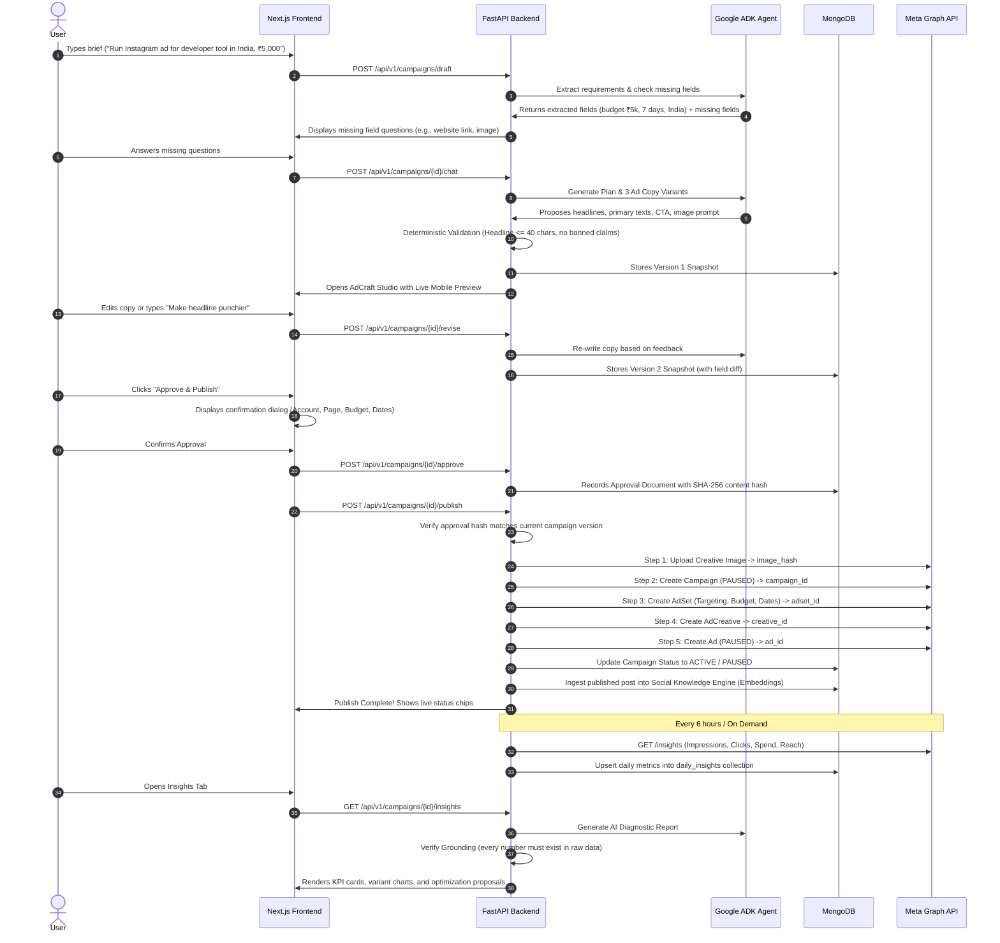

# AdCraft: High-Level Design (HLD)
## System Architecture, Components & Data Flow

---

### 1. High-Level Architecture Overview

AdCraft is architected as a modular, multi-tier web application built on the principle of the **Deterministic AI Agent Harness**. 

Rather than allowing an AI model to operate autonomously with full system privileges, AdCraft places the generative AI model inside a strict software harness. The harness controls all state transitions, validates all inputs and outputs, guards external tools, and guarantees that no consequential or irreversible action (such as spending advertising money or publishing to Meta) can occur without explicit, recorded human approval.

```
+-----------------------------------------------------------------------------------+
|                                  USER LAYER                                       |
|                                                                                   |
|    +-------------------------------------------------------------------------+    |
|    |                      Next.js 16 Web Application                         |    |
|    |   - Conversational Brief Chat        - AdCraft Studio (6 Sections)      |    |
|    |   - Live Instagram & FB Mockup       - Hashtag Category Explorer        |    |
|    |   - DM Support Chat Preview          - Performance Analytics Dashboard  |    |
|    +-------------------------------------------------------------------------+    |
+------------------------------------------+----------------------------------------+
                                           | HTTP / REST (JWT Auth Cookie)
                                           v
+-----------------------------------------------------------------------------------+
|                             BACKEND API LAYER (FastAPI)                           |
|                                                                                   |
|  [ Auth Router ]      [ Campaigns Router ]    [ Meta OAuth Router ]               |
|  [ Organic Router ]   [ DM Agent Router ]     [ Hashtags Router ]                 |
|  [ Media Router ]     [ Insights Router ]     [ Webhooks Router ]                 |
|                                                                                   |
|  * Request Validation (Pydantic v2)   * Unified Error Envelope                    |
|  * Structlog Correlation ID Tracking  * Append-Only Audit Logging                 |
+------------------------------------------+----------------------------------------+
                                           |
         +---------------------------------+---------------------------------+
         |                                                                   |
         v                                                                   v
+-----------------------------------+             +----------------------------------+
|      AI AGENT HARNESS (ADK 2.x)   |             |     SERVICES & BUSINESS LOGIC    |
|                                   |             |                                  |
|  [ AdDrafter Agent ]              |             |  [ Campaign Lifecycle Service ]  |
|  - Requirement Extraction         |             |  - Version Snapshot & Diffs      |
|  - Copy Generation & Repair Loop  |             |  - Cryptographic Approvals       |
|                                   |             |  - Resilient Publishing Engine   |
|  [ DM Customer Support Agent ]    |             |  - Daily Insights Aggregator     |
|  - Grounded Hybrid RAG            |             |  - Organic Post Publisher        |
|  - 24h Messaging Window           |             |                                  |
|                                   |             |  [ Dynamic Social Knowledge ]    |
|  [ Hashtag Recommendation Agent ] |             |  - Multimodal Post Understanding |
|  [ Post Understanding Agent ]     |             |  - 3072-dim Vector Embeddings    |
|                                   |             |  - Shared Post Context Resolver  |
|  * Tool Guards & Perm Boundaries  |             +-----------------+----------------+
|  * Prompt Injection Isolation     |                               |
+-----------------+-----------------+                               |
                  |                                                 |
         +--------+----------------+                                |
         |                         |                                |
         v                         v                                v
+------------------+     +-------------------+     +---------------------------------+
|   AI PROVIDERS   |     |   META GATEWAY    |     |          STORAGE LAYER          |
|                  |     |                   |     |                                 |
| - Google Gemini  |     | - Meta SDK (v26)  |     | - MongoDB 7.0 (Replica Set rs0) |
| - OpenAI GPT     |     | - Graph API       |     | - 9 Collections with 23 Indexes |
| - OpenRouter     |     | - Webhook Verify  |     | - GridFS Bucket (Image Store)   |
| - Offline Script |     | - Fake Gateway    |     | - AES-256-GCM Encrypted Secrets |
+------------------+     +-------------------+     +---------------------------------+
```

---

### 2. Main System Components & Responsibilities

#### A. Frontend Application (Next.js 16)
- **Framework:** Next.js 16 with React 19, TypeScript 5, and Tailwind CSS v4.
- **Key Modules:**
  - `AIAssistantCard` & `ChatStudio`: Conversational brief intake and interactive Q&A.
  - `CampaignStudioModal`: Central editing interface featuring a 6-section sidebar (Objective, Audience, Budget, Creative, Hashtags, Publishing) with in-place section saving and dirty form detection.
  - `StudioCreativeStep`: Live interactive mobile preview simulating Instagram Feed and Stories.
  - `PublishFlow`: Pre-publishing summary with jump links to incomplete fields, followed by an explicit confirmation modal displaying ad account, Page, budget, dates, and spend warning.
  - `DmAgentView`: Live Instagram DM conversation threads, auto-reply toggle, and "Try it" preview chat simulator.
  - `InsightsView`: Performance metrics dashboard showing Impressions, Reach, Clicks, Spend, CTR, CPC, and variant comparisons.

#### B. API Gateway & Security Layer (FastAPI)
- **Framework:** FastAPI running on Uvicorn (Python 3.12).
- **Responsibilities:**
  - Validates all incoming payloads using Pydantic v2 models.
  - Authenticates users via `HttpOnly`, `SameSite=Lax` JWT session cookies.
  - Verifies workspace membership (`workspace_id`) on every request to prevent cross-tenant data leakage.
  - Redacts sensitive credentials (tokens, passwords) from logs via Structlog filters.

#### C. AI Agent Harness (Google ADK 2.x & LiteLLM)
- **Framework:** Google Agent Development Kit (ADK) 2.x adapted with LiteLLM.
- **Core Agents:**
  - `AdDrafter`: Extracts campaign parameters from natural language, drafts ad copy variants, and runs the automatic self-repair loop if character limits are exceeded.
  - `DmAgent`: Answers incoming customer inquiries on Instagram using Grounded Hybrid RAG.
  - `HashtagRecommendationAgent`: Generates targeted hashtags based on ad context.
  - `PostUnderstandingAgent`: Extracts structured business facts (products, prices, discounts, offer validity, FAQs) from published posts.
- **Safety Boundaries:** Models only have access to read-only search tools (`search_interests`, `search_locations`). Models **never** hold tools that can publish, spend, or modify live campaigns.

#### D. Meta Integration Gateway
- **SDK:** Official `facebook-business` Python SDK (v26.0).
- **Dual Gateway Pattern:**
  - `MetaSdkGateway`: Communicates with live Meta Graph API endpoints with automatic exponential backoff for rate limits.
  - `FakeAdsGateway`: High-fidelity in-memory simulator used for automated tests and zero-cost offline development.
  - Both gateways share an identical contract (`tests/contract/test_ads_gateway_contract.py`).

#### E. Business Logic & Orchestration Services
- **`AdCampaignService`:** Coordinates campaign creation, updates, and state transitions.
- **`ApprovalsService`:** Generates canonical SHA-256 hashes of campaign versions and records immutable approval records before publishing.
- **`PublisherService`:** Checkpointed 7-step publishing engine that saves created Meta IDs at each step so failed runs can be safely resumed.
- **`InsightsService`:** Collects daily performance metrics, computes calculated rates (CTR, CPC), and maintains historical records.
- **`SocialKnowledgeService`:** Automatically digests published ads and organic posts into vector chunks for the DM agent.

#### F. Storage & Database Layer
- **Database:** MongoDB 7.0 configured with single-node replica set (`rs0`) to support multi-document ACID transactions.
- **File Storage:** MongoDB GridFS (`images.files`, `images.chunks`) for storing generated and uploaded 1080x1080 JPEG ad creative images.
- **Encryption:** AES-256-GCM encryption for all stored access tokens using `TOKEN_ENCRYPTION_KEY`.

---

### 3. Complete End-to-End Flow (16 Steps)

The diagram below illustrates the exact sequence from the user's initial idea to live campaign optimization:



---

### 4. Non-Negotiable Safety Invariants

AdCraft enforces six deterministic safety rules in application code that can **never** be bypassed:

1. **Model Proposes, Code Decides:** Generative models generate text and suggestions; Python code enforces character limits, budget caps, and API calls.
2. **Cryptographic Approval Gate:** Publishing requires a valid approval record matching `SHA256(canonical_campaign_json)`. If the user edits a single character after approval, the approval is invalidated and status resets to `IN_REVIEW`.
3. **Double Spend Safety Switch:** Live ad delivery requires **both** `ALLOW_REAL_AD_SPEND=true` and `SAFE_MODE_NO_SPEND=false`. By default, ads are created in `PAUSED` status.
4. **Resilient Checkpointed Publishing:** The publishing engine saves created Meta IDs after every step. If step 4 fails, retrying resumes from step 4 without recreating duplicate campaigns or ad sets.
5. **No Model Tool Permissions for Publishing:** The AI model is strictly denied access to mutate or publish tools. Publishing is an API endpoint triggered solely by the human user.
6. **Multi-Tenant Data Isolation:** Every database query is scoped to `workspace_id`. Cross-workspace data leaks are physically blocked at the database query level.
