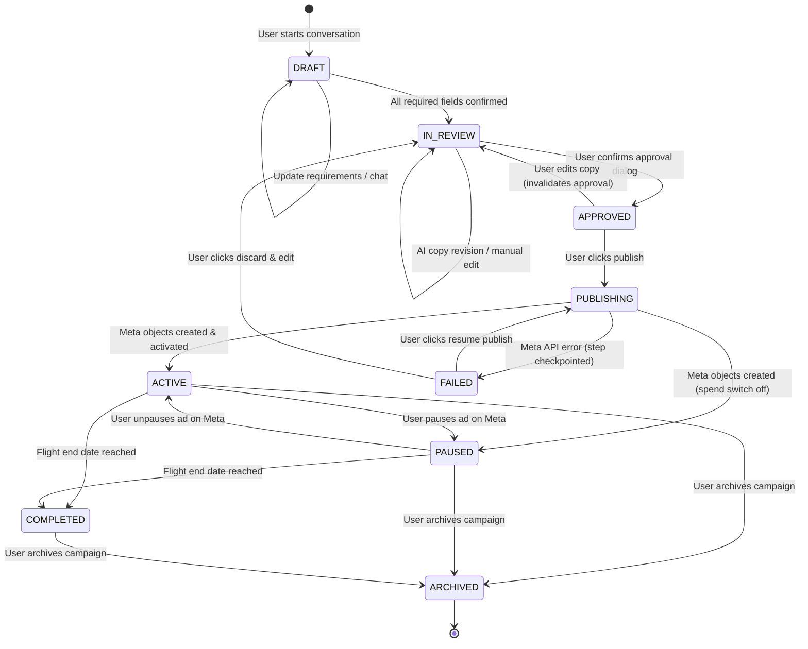

# AdCraft: Low-Level Design (LLD)
## Data Models, State Machine, Agent Harness & Database Architecture

---

### 1. Backend Package Structure

The backend follows clean hexagonal / domain-driven architecture:

```
backend/app/
├── main.py                 # FastAPI application factory and router mounting
├── config.py               # Pydantic BaseSettings (.env loading & validation)
├── container.py            # Composition root (dependency injection & gateways)
├── db.py                   # MongoDB Motor async client & 23 compound indexes
├── clock.py                # Injectable SystemClock (supports FixedClock in tests)
├── audit.py                # Append-only audit logger (the only writer to audit_log)
├── observability.py        # Correlation ID middleware and Structlog JSON logger
├── errors.py               # Standardized AppError hierarchy and HTTP handlers
│
├── domain/                 # Pure domain logic (ZERO database or framework imports)
│   ├── ad_campaign.py      # Core campaign domain entity and validation rules
│   ├── ad_states.py        # AdState enum (DRAFT, IN_REVIEW, APPROVED, etc.)
│   ├── rules.py            # Hard copy rules (40/125/30 char limits) and banned claims
│   ├── requirements.py     # Brief requirement tracking and completion percentage
│   ├── media.py            # 1080x1080 image validation and aspect ratio rules
│   └── social_knowledge.py # Knowledge chunk schemas (product, offer, faq)
│
├── services/               # Application business logic (MongoDB I/O, no AI imports)
│   ├── ad_campaigns.py     # Campaign CRUD, chat turns, and revisions
│   ├── versions.py         # SHA-256 content hashing, snapshots, and field diffs
│   ├── approvals.py        # Atomic cryptographic approval record creation
│   ├── insights.py         # Daily metrics collection and CTR/CPC calculations
│   ├── organic.py          # Organic Facebook and Instagram publishing
│   ├── image_store.py      # MongoDB GridFS image storage and retrieval
│   ├── embeddings.py       # Gemini 3072-dim and deterministic embedding generator
│   ├── hybrid_rag.py       # Grounded Hybrid RAG retrieval pipeline
│   ├── shared_post_resolver.py # Context resolver for customer-shared Instagram URLs
│   ├── social_knowledge.py # Automatic post ingestion and chunk indexing
│   └── dm.py               # DM webhook processing, rate limiting, and handoff
│
├── agents/                 # AI Agents & Harness (Google ADK 2.x & LiteLLM)
│   ├── ad_drafter.py       # Requirement extraction, copy drafting, and repair loop
│   ├── dm_agent.py         # Instagram customer service agent with Hybrid RAG
│   ├── hashtag_agent.py    # Context-aware AI hashtag recommendation agent
│   ├── post_understanding_agent.py # Multimodal post ingestion & fact extractor
│   ├── guards.py           # Tool execution guards and state permissions
│   ├── models.py           # LiteLLM model provider factory (Gemini, OpenAI, etc.)
│   └── scenarios/          # Offline deterministic JSON replay scripts
│
├── meta/                   # External Meta Marketing API Integration
│   ├── sdk_gateway.py      # Real Facebook Ads SDK gateway with retry policies
│   ├── fake.py             # In-memory fake Meta gateway for offline tests
│   ├── publisher.py        # Checkpointed 7-step campaign creation engine
│   ├── connections.py      # Token expiration checks and asset validation
│   ├── payloads.py         # Meta Marketing API Graph JSON payload builders
│   └── oauth.py            # Facebook Login for Business 60-day token exchange
│
└── security/               # Cryptography and security primitives
    ├── crypto.py           # AES-256-GCM token encryption and decryption
    ├── passwords.py        # Argon2id password hashing and verification
    └── jwt.py              # JWT session creation and verification
```

---

### 2. Database Schema & Collections

MongoDB 7.0 houses 10 primary collections with 23 compound indexes to guarantee fast lookups, unique constraints, and strict multi-tenant isolation:

```
+-----------------------------------------------------------------------------------------+
|                                    MONGODB COLLECTIONS                                  |
+-----------------------------------------------------------------------------------------+

1. users
   - _id, email (unique), password_hash (Argon2id), full_name, default_workspace_id, created_at

2. workspaces
   - _id, name, owner_id, members [{user_id, role}], created_at

3. connections
   - _id, workspace_id (unique), platform ("meta"), page_id, ad_account_id, ig_business_id,
     token_ciphertext (AES-256-GCM), token_expires_at, is_active, updated_at

4. campaigns
   - _id, workspace_id, user_id, title, status (AdState), rev (int), content_hash,
     requirements {product, objective, audience, budget_inr, duration_days, landing_url},
     targeting {countries, cities, interests [{id, name}], age_min, age_max, genders},
     variants [{id, headline, primary_text, description, cta, image_id, image_hash}],
     publish {step, campaign_id, adset_id, creative_id, ad_id, status, error},
     messages [{role, content, timestamp}], created_at, updated_at

5. campaign_versions
   - _id, campaign_id, version_num, content_hash (SHA-256), snapshot (full JSON),
     diff_from_previous, created_by, created_at

6. campaign_approvals
   - _id, campaign_id, version_num, content_hash (SHA-256), approved_by, approved_at,
     ad_account_id, budget_inr, flight_dates {start, end}

7. daily_insights
   - _id, campaign_id, date ("YYYY-MM-DD"), impressions, clicks, spend_inr, reach,
     ctr, cpc, cpm, actions, updated_at
   - Compound Unique Index: (campaign_id, date)

8. social_posts
   - _id, workspace_id, platform_post_id (unique), post_url, caption, hashtags [],
     media_type, media_urls [], products [], offers [], faqs [], is_active, created_at

9. knowledge_chunks
   - _id, workspace_id, post_id, chunk_type ("product" | "offer" | "faq" | "summary"),
     content (text), embedding (3072 float array), metadata {}, is_active, created_at
   - Compound Indexes: (workspace_id, post_id), (workspace_id, is_active)

10. dm_threads & dm_messages
   - Threads: _id, workspace_id, ig_thread_id, sender_id, status ("AI_ACTIVE" | "NEEDS_HUMAN"),
     context_post_id, last_message_at
   - Messages: _id, thread_id, direction ("INBOUND" | "OUTBOUND"), text, shared_post_url,
     tokens_used, created_at

11. audit_log
   - _id, actor_id, workspace_id, event_type, correlation_id, payload {}, timestamp

12. images.files & images.chunks (GridFS)
   - Stores raw 1080x1080 JPEG image binaries served via HMAC-signed public URLs
```

---

### 3. Campaign State Machine (17 Transitions)

The campaign lifecycle is governed by an explicit state machine (`app/domain/ad_states.py`). Unauthorized jumps raise `InvalidTransition`:



#### Optimistic Concurrency Control
Every campaign update includes a revision number (`rev`). The update query checks `{"_id": id, "rev": current_rev}` and increments `rev` by 1. If another request modified the document concurrently, the update returns 0 matched documents, raising `ConcurrentModificationError`.

---

### 4. Agent Harness & Deterministic Guard Rails

#### A. Google ADK 2.x Function Tools
The `AdDrafter` agent has access only to two read-only tools defined with strict schemas:
1. `search_interests(query: str, limit: int = 10)`: Calls Meta's `act_{id}/delivery_estimate` and `search?type=adinterest`.
2. `search_locations(query: str, country_code: str = "IN")`: Calls Meta's `search?type=adgeolocation`.

The agent **cannot** call any publishing or spending tool because none exist in its toolset.

#### B. Tool Execution Guards (`app/agents/guards.py`)
Before executing any tool, the harness passes arguments through `before_tool_guard()`:
- **Input Sanitization:** Verifies queries do not contain prompt injection payloads or control characters.
- **State Check:** Ensures tools can only be invoked when campaign status is `DRAFT` or `IN_REVIEW`. Once `APPROVED` or `ACTIVE`, tool execution is blocked.
- **Output Sanitization:** Filters Meta API responses to return only `id` and `name` strings, stripping metadata to conserve LLM context tokens.

#### C. The Self-Repair Loop
Generative models occasionally produce headlines that exceed character limits (e.g. 45 characters instead of 40). 

Instead of failing the entire request or silently truncating the text, the harness executes an automatic repair loop:

```
[ Model Generates Ad Copy ]
            |
            v
[ Harness Validation (rules.py) ]
Headline length = 46 chars (Limit = 40)
            |
            v
[ Repair Triggered (Max 2 Attempts) ]
Harness constructs targeted prompt:
"Your headline 'Revolutionize Your Code Review Workflow Now' is 46 characters.
Strict limit is 40 characters. Rewrite this headline under 40 characters without losing meaning."
            |
            v
[ Model Returns Repaired Headline ]
"Faster AI Code Reviews" (22 chars)
            |
            v
[ Harness Re-Validation -> PASSED ]
```

---

### 5. Security & Cryptographic Primitives

1. **Password Hashing:**
   - Powered by **Argon2id** (`argon2-cffi`), the state-of-the-art memory-hard hashing algorithm recommended by OWASP. Passwords are never stored in plaintext.
2. **Access Token Encryption:**
   - Meta access tokens are encrypted before being saved to MongoDB using **AES-256-GCM** authenticated encryption (`cryptography.hazmat.primitives.ciphers.aead.AESGCM`).
   - The ciphertext includes a 96-bit random nonce and a 128-bit authentication tag to prevent tampering.
3. **Cryptographic Approval Hashing:**
   - To guarantee that what the user reviewed is **exactly** what gets published to Meta, the system calculates a canonical SHA-256 hash:
     $$\text{ContentHash} = \text{SHA256}(\text{JSON}(\text{variants, targeting, budget, dates}))$$
   - The approval record stores this hash. When publishing begins, the publisher recomputes the campaign's current hash. If they do not match byte-for-byte, publishing is halted immediately.
4. **Meta Webhook Signature Verification:**
   - Incoming webhooks from Meta are validated against the `X-Hub-Signature-256` HTTP header using `HMAC-SHA256(request_body, META_APP_SECRET)`. Spoofed requests are rejected with HTTP 401.
