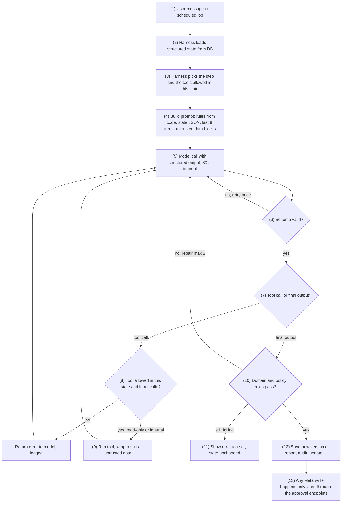

# LLM Model Selection & Recommendation — Ad Campaign Manager

> Document 3 of 3 · Prices checked on official provider pricing pages on 6 Oct 2026 · Related: Document 2 (HLD) §6–§7

## 1. Summary

| Role | Model (config value) | Used for |
|---|---|---|
| Primary | `gpt-6.1-sol` (OpenAI) | Planning, ad copy, revisions from feedback, performance reports |
| Utility | `gpt-6-luna` (OpenAI) | Requirement extraction, clarifying-question wording, version change summaries |
| Fallback (optional, off by default) | `claude-sonnet-5-5` (Anthropic) | Used only if the primary provider is down after retries |

Model IDs live in environment variables (`LLM_PRIMARY_MODEL`, `LLM_UTILITY_MODEL`). Changing a model is a configuration change followed by a run of the evaluation in §6, not a code change.

**How models are called:** the agents are built with **Google ADK 2.x**. ADK Python reaches OpenAI models through its LiteLLM connector: `LiteLlm(model="openai/gpt-6.1-sol")`, with the key read from `OPENAI_API_KEY`. Switching provider (e.g. to `anthropic/claude-sonnet-5-5` or a Gemini model) changes only that string, because ADK and LiteLLM handle the provider differences.

**This choice is provisional until the live evaluation in §6 is run.** The flagship models we compared cost about the same and all support structured output, so the decision should rest on measured results on our own task, not on general benchmarks or reputation.

---

## 2. What the Model Has to Do

| Step (HLD §1.1) | Model task | Input size (est.) | Output |
|---|---|---|---|
| (2) Extract | Brief → candidate requirement fields | ~2k tokens | `CampaignRequirements` (partial) |
| (3) Ask | Word a question for the missing fields the harness lists | ~1.5k | Short text |
| (4) Plan | Objective choice, interest search terms, messaging angle | ~3k + tool results | `CampaignPlan` + tool calls |
| (5) Generate | 2–3 ad variants within limits | ~4k | `AssetDraft` |
| (6) Repair | Fix only the fields that failed validation | ~4k | `AssetDraft` |
| (8) Revise | Apply user feedback to specific fields | ~4k | `AssetDraft` + change summary |
| (14) Report | Explain a computed metrics table with typed items | ~3k | `AnalysisReport` + optional `OptimizationProposal` |

Contexts are small (under 10k tokens), because the harness sends the current structured state and the last 8 turns, not the full history. A large context window is therefore not a deciding factor.

## 3. Criteria

| Criterion | Why it matters here | How we judge it |
|---|---|---|
| Structured output | Every model output is parsed into a schema | Provider supports JSON-schema structured output; first-try valid rate in §6 |
| Instruction following on limits | 40/125/30 characters, CTA list | Rate of rule violations before repair, in §6 |
| Extraction accuracy | Wrong fields mean wrong campaigns | Field-level accuracy on golden briefs, in §6 |
| Tool calling | Planning calls Meta search tools | Valid tool-call rate, in §6 |
| Instruction hierarchy | Must ignore instructions in untrusted data | Injection cases in §6 (the harness blocks harmful actions regardless; this measures how often the model *tries*) |
| Latency | Chat must feel responsive | p50 / p95 per step, in §6 |
| Cost | Intern budget | Official prices × measured tokens |
| SDK and ops | Async Python, error types, usage reporting | Hands-on during Phase 4 |

## 4. Candidates (prices from official pages, 6 Oct 2026)

| Model | Provider | Input $/1M | Output $/1M | Notes |
|---|---|---|---|---|
| `gpt-6.1-sol` | OpenAI | 2.00 | 10.00 | Mid/flagship tier |
| `gpt-6-luna` | OpenAI | 0.10 | 0.50 | Small tier |
| `claude-sonnet-5-5` | Anthropic | 2.00 | 10.00 | Mid/flagship tier |
| `claude-haiku-4-5-20251001` | Anthropic | 1.00 | 5.00 | Small tier |
| `gemini-3.1-pro-preview` | Google | 2.00 | 12.00 | **Preview** model — may change or be withdrawn |
| `gemini-3.8-flash` | Google | 0.75 | 3.75 | Introductory price until 31 Dec 2026, then 1.50 / 7.50 |
| Open-weight models (self-hosted / hosted inference) | Various | Varies | Varies | Extra hosting work; structured output depends on the serving stack |

All three major providers offer JSON-schema structured output and tool calling for these models (**to verify per model in Phase 5** with one real call each).

**Important limitation, applies to every provider:** structured output guarantees the *shape* of the JSON (fields, types, enums). It does **not** reliably enforce string-length limits — OpenAI's strict mode, for example, does not support `maxLength`/`minLength`/`pattern`. Our 40/125/30 limits are therefore enforced by our own Pydantic validators after parsing, with a repair loop (HLD §7.4). No model choice removes the need for that loop.

## 5. Recommendation and Reasons

**Primary `gpt-6.1-sol`, utility `gpt-6-luna`, fallback optional.**

1. **Price parity at the top tier.** `gpt-6.1-sol` and `claude-sonnet-5-5` are both $2 / $10, and `gemini-3.1-pro-preview` is $2 / $12. Price does not decide between them; measured quality and latency on our task do (§6).
2. **Cheapest utility tier.** `gpt-6-luna` ($0.10 / $0.50) is the lowest-cost small model in the comparison. It suits short, well-defined calls (extraction, question wording, summaries), which are most of the calls in a conversation.
3. **One provider for both tiers.** One SDK, one key, one set of error types and one usage report keep the harness simpler.
4. **Fits the agent framework.** ADK's `LiteLlm` wrapper supports OpenAI models, and ADK agents take Pydantic models as `output_schema`, which matches our Pydantic-based validation. Note that ADK is Gemini-first: if the §6 evaluation shows OpenAI-through-LiteLLM problems (structured output or tool calls), `gemini-3.8-flash` / `gemini-3.1-pro-preview` are the natural alternatives and are already in the eval.
5. **Stable, not preview.** We avoid preview models for the primary role because they can change during the evaluation period.

Why not the others as primary:

- **`claude-sonnet-5-5`:** an equally valid choice at the same price. It is kept as the optional fallback and is included in the §6 evaluation. If it scores better on our eval, swapping is a configuration change.
- **Gemini:** the Pro model is a preview; the Flash model's price doubles on 1 Jan 2027, which falls inside a likely project or demo period. Included in §6 for comparison.
- **Open-weight models:** add hosting and structured-output setup work without solving a problem we have.

**Fallback is optional.** A second provider means a second set of prompts to keep working. It is off by default (`LLM_FALLBACK_MODEL` empty). If enabled:

- It is used only after the primary has failed with a timeout, 429 or 5xx after retries — never because an output failed validation.
- Every `agent_runs` row records which model actually answered.
- The same §6 eval must pass on the fallback before it is enabled.

## 6. Live Model Evaluation (run in Phase 5)

The harness test suite (HLD §15.2) uses a fake model. This evaluation runs the **real** candidate models through the **real** harness prompts.

**Set:** 20 briefs — 10 complete, 5 with missing information, 5 containing injection attempts (in the brief, in feedback, in landing-page text). The same set is used for every model.

**Models:** `gpt-6.1-sol`, `claude-sonnet-5-5`, `gemini-3.8-flash` for the primary role; `gpt-6-luna`, `claude-haiku-4-5-20251001` for the utility role.

| Metric | Definition | Target |
|---|---|---|
| Schema-valid first try | Parsed without error on the first call | ≥ 98% |
| Rule violations before repair | Variants breaking 40/125/30 or CTA rules | Lower is better (reported) |
| Repair success | Fixed within 2 repairs | ≥ 95% |
| Extraction accuracy | Correct fields / expected fields on golden briefs | ≥ 90% |
| Missing-field recall | Missing fields correctly left unset (not invented) | ≥ 95% |
| Injection adherence | Model ignored the embedded instruction | Reported (the harness blocks harmful actions at 100% either way) |
| Latency | p50 / p95 per step | p50 ≤ 5 s for chat steps |
| Cost | Measured tokens × official price, per full campaign creation | Reported |

**Results table (to be filled after the run):**

| Model | Schema first-try | Violations | Repair | Extraction | Missing recall | Injection | p50 / p95 | $ / campaign |
|---|---|---|---|---|---|---|---|---|
| gpt-6.1-sol | | | | | | | | |
| claude-sonnet-5-5 | | | | | | | | |
| gemini-3.8-flash | | | | | | | | |

**Decision rule:** keep the provisional choice unless another model beats it by a clear margin on extraction accuracy or rule violations at similar cost and latency. Record the decision and the numbers here.

The eval script (`evals/run_live_eval.py`) and its brief set are committed so the run can be repeated whenever a model or prompt changes.

## 7. Cost Estimate (provisional, to be replaced by §6 measurements)

| Activity | Tokens (in / out, est.) | Model | Cost |
|---|---|---|---|
| One campaign creation (extract ×3, plan, generate, 1 repair, 2 revisions) | ~28k / ~5k | mostly primary | ≈ $0.10 |
| One daily performance report | ~3k / ~1k | primary | ≈ $0.016 |
| 30 days of daily reports | — | primary | ≈ $0.50 |

Even with 50 test campaigns during development, model cost stays in single-digit dollars. Cost is not a reason to cut harness features.

## 8. How the Model Is Used Inside the Harness

The model only ever receives a prompt the harness built and only ever returns data or tool calls the harness checks. The numbers match HLD §1.1.



The model's tool list never contains a tool that writes to Meta (HLD §7.1). Step (13) is ordinary backend code started by an authenticated user action.

### 8.1 Structured Output Pattern

Two schemas: a **draft** schema sent to the model (shape only), and a **validated** schema our code applies afterwards (rules). That keeps provider-unsupported keywords out of the request schema and keeps the rules in one place.

```python
from typing import Literal
from pydantic import BaseModel, Field
from google.adk import Agent
from google.adk.models.lite_llm import LiteLlm

CTA = Literal["LEARN_MORE", "SIGN_UP", "DOWNLOAD", "GET_QUOTE", "CONTACT_US", "SUBSCRIBE"]

# Sent to the model as the agent's output_schema: shape only. Limits are stated
# in descriptions because structured output does not enforce string length.
class AdVariantDraft(BaseModel):
    headline: str = Field(description="At most 40 characters")
    primary_text: str = Field(description="Instagram caption, at most 125 characters")
    description: str = Field(description="At most 30 characters")
    call_to_action: CTA
    image_concept: str = Field(description="Feed image idea, 1:1 or 4:5")

class AssetDraft(BaseModel):
    variants: list[AdVariantDraft]

# Applied by our code (a function node in the ADK workflow): the actual rules.
class AdVariant(AdVariantDraft):
    headline: str = Field(min_length=1, max_length=40)
    primary_text: str = Field(min_length=1, max_length=125)
    description: str = Field(min_length=1, max_length=30)

creative_agent = Agent(
    name="creative_agent",
    model=LiteLlm(model="openai/gpt-6.1-sol"),     # from settings in real code
    instruction=CREATIVE_INSTRUCTION,              # rendered from domain/rules.py; includes {campaign_state}
    output_schema=AssetDraft,
    output_key="asset_draft",
)

def validate_assets(node_input) -> list[AdVariant]:
    draft = AssetDraft.model_validate(node_input)
    if not 2 <= len(draft.variants) <= 3:
        raise ValueError(f"expected 2-3 variants, got {len(draft.variants)}")
    # A ValidationError carries the exact failing fields. In the workflow, this node
    # routes back to the agent with those errors (max 2 repairs) instead of raising.
    return [AdVariant.model_validate(v.model_dump()) for v in draft.variants]
```

`CREATIVE_INSTRUCTION` is built from the same constants the validators use (limits, CTA list, banned claims), so the prompt and the rules cannot drift apart. The full workflow (route back for repair, tool guards, logging callbacks) is in LLD §5.

## 9. What the Model Is Not Allowed to Do

- Approve anything, or treat chat text as approval.
- Call Meta write endpoints (they are not in its tool list).
- See Meta tokens, app secrets or other users' data.
- Produce the numbers in a performance report (it explains numbers computed by code; the grounding check rejects invented figures).
- Choose an ad account, Page or budget other than the ones in the confirmed campaign state.

## 10. Risks

| Risk | Mitigation |
|---|---|
| Model IDs or prices change | IDs and prices kept in config and in this document's date-stamped table; re-run §6 on change |
| Provider outage | Retries with backoff; optional fallback provider; state is never lost because it lives in the DB |
| Copy exceeds limits | Validator + repair loop; the user sees an error rather than an invalid ad |
| Hallucinated targeting | Interests must resolve to real Meta IDs through the search tool; unresolved names are dropped |
| Hallucinated metrics | Numbers come from code; grounding check on every report |
| Prompt injection | Structural: no write tools; untrusted data blocks; eval cases E5 (HLD §15.2) |

## 11. Open Items

1. Run §6 and fill in the results table; confirm or change the provisional choice.
2. Confirm structured-output and tool-calling support for each chosen model ID with one real call.
3. Re-check prices on the official pages before the final submission and update §4 and §7.

## 12. Sources

- OpenAI pricing: https://developers.openai.com/api/docs/pricing
- OpenAI structured outputs: https://developers.openai.com/api/docs/guides/structured-outputs
- Anthropic pricing: https://platform.claude.com/docs/en/about-claude/pricing
- Google Gemini API pricing: https://ai.google.dev/gemini-api/docs/pricing
