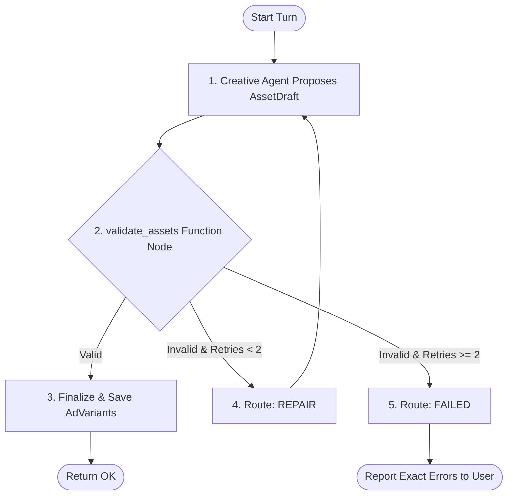

# M2 Harness Core — Complete Guide

> **Current Status:**
> - **Milestone 1 (Foundation):** **100% COMPLETED** (52 tests passed, core architecture in place).
> - **Milestone 2 (Harness Core + ADK Spike):** **100% COMPLETED** (All 11 tasks implemented, tested with 110 passing unit and agent tests, fully verified).
> - **Pending in M2:** None.
> - **Next Milestone:** Milestone 3 (Meta Connection + Gateway).
> - **Primary Source of Truth:** `docs/.claude/plans/02-harness-core.plan.md`, `lld.md` §4–§6, and `HLD §7–§8`.

---

## What is M2?

**M2** stands for **Milestone 2: Harness Core + Google ADK Spike**. It is the central orchestration and safety layer of our project: **AI-Powered Instagram Ad Campaign Manager**.

If M1 was the concrete foundation and plumbing of the skyscraper (MongoDB, authentication, cryptography, configuration, and audit logging), **M2 is the structural steel frame, safety elevator brakes, and security checkpoints**.

In an AI-powered system handling ad spend on Meta/Instagram:
- **LLMs (Large Language Models) are non-deterministic.** They can generate creative copy, suggest target audiences, or recommend campaign budgets, but they can also hallucinate, produce headlines that violate Instagram character limits, exceed budget constraints, or claim "100% guaranteed results" (which Meta immediately bans).
- **The Harness is deterministic.** It is pure Python code that enforces hard rules, mathematical boundaries, state progression, and approval gates.
- **The model proposes; the harness decides.**

```text
┌────────────────────────────────────────────────────────┐
│                   AI Model / Agent                     │
│               (Generative / Proposes)                  │
└──────────────────────────┬─────────────────────────────┘
                           │ Proposes copy & parameters
                           ▼
┌────────────────────────────────────────────────────────┐
│                 M2 HARNESS CORE LAYER                  │
│               (Deterministic / Enforces)               │
│                                                        │
│  • Copy Rules (40 / 125 / 30 char limits)              │
│  • Meta Policy Filter (banned claims, personal traits) │
│  • Image Inspector (aspect ratio, format, size)        │
│  • Requirements Tracker (confirmed vs guessed)         │
│  • State Machine (strict 17 transition table)          │
│  • Optimistic Concurrency (rev revision counter)       │
│  • Immutable Versioning (canonical SHA-256 hash)       │
│  • Multi-Document ACID Approvals                       │
│  • Tool Guards (restricts tool access by state)        │
│  • Validate ➔ Repair Workflow Loop (max 2 retries)     │
└──────────────────────────┬─────────────────────────────┘
                           │ Validated & Approved only
                           ▼
┌────────────────────────────────────────────────────────┐
│           Meta Graph API / Instagram Publishing        │
│                    (Milestone 3 & 6)                   │
└────────────────────────────────────────────────────────┘
```

---

### Why Build the Harness Before AI Agents and Meta Integration?

1. **Safety Against Financial & Reputational Loss:**
   Creating an ad campaign directly publishes to real Instagram users and consumes real money. A bug that skips an approval check or misconfigures daily budget can spend thousands of dollars in minutes. The harness guarantees that **no ad can be published without an explicit human approval recorded in an ACID transaction**.

2. **Immediate Feedback vs. Meta API Rejection:**
   If an ad creative has a headline of 45 characters, Instagram will silently truncate it or Meta's Graph API will throw an error at publish time (minutes or hours after the user designed it). The harness catches this in milliseconds inside the domain layer, formatting the exact error so the AI agent can fix it immediately.

3. **Separation of "Thinking" from "Enforcing":**
   An AI agent should never be asked: *"Did the user approve this version?"* or *"Is the campaign in a state where tools can be invoked?"* Code must enforce this. The AI agent only proposes; the harness gates every transition.

4. **Testability Without API Keys or Token Costs:**
   By building pure domain rules and scripted model harnesses first, 100% of the core business logic can be tested deterministically in milliseconds without touching Meta APIs or incurring LLM token costs.

---

### What Problem Does the Harness Solve?

| Risk / Problem | How the Harness Solves It |
|---|---|
| **Copy Overflows** | Enforces hard character limits: Headline ≤ 40, Caption ≤ 125, Description ≤ 30. |
| **Meta Policy Violations** | Catches banned claims (`guaranteed`, `100%`, `risk-free`) and personal attributes (`Are you a...`). |
| **Invalid Ad Creatives** | Inspects uploaded image bytes (Pillow): enforces JPEG/PNG, ≤ 8 MB, min width 600px, aspect ratio 4:5 to 1.91:1. |
| **AI Hallucinating Confirmed Facts** | Tracks field status (`UNKNOWN`, `GUESSED`, `CONFIRMED`, `SYSTEM`). The AI cannot promote its own guesses to confirmed status. |
| **Race Conditions & Lost Updates** | Optimistic concurrency using `rev` counter in MongoDB. If two processes update simultaneously, one fails cleanly with `ConcurrentModification`. |
| **Bypassing User Review** | Strict 17-transition state machine. You cannot jump from `PLANNING` directly to `APPROVED` or `ACTIVE`. |
| **Approving Changed Data** | Cryptographic SHA-256 canonical JSON content hashing. The approval record binds to the exact hash the user saw. |
| **Rogue Agent Actions** | Tool guard callbacks block research/publishing tools if the campaign is in an invalid state. |
| **Endless AI Fix Loops** | Bounded `Validate ➔ Repair` workflow with `REPAIR_MAX = 2`. If the agent cannot fix copy in 2 turns, it stops and reports errors to the user. |

---

### What is Possible After M2?

Once Milestone 2 is complete:
- Any text or image can be validated against Instagram's strict ad specs in memory.
- Campaign requirements can be accumulated across a multi-turn conversation without losing track of what the user actually confirmed vs. what the AI inferred.
- Campaigns move predictably through lifecycle states with concurrency protection and full audit trails.
- Campaign snapshots can be created, hashed, versioned, and compared via structural diffs.
- Approvals are cryptographically anchored to version content hashes in MongoDB transactions.
- Google ADK agents can be orchestrated within bounded workflows that automatically reject, guide, and repair invalid proposals.
- Milestones 3 (Meta Gateway) and 4 (AI Brief-to-Proposal Agents) have a solid, unbreakable core to build upon.

---

## High-Level Architecture Flow

```text
User Input / Brief
       │
       ▼
[app/domain/requirements.py] ── Accumulates brief (CONFIRMED vs GUESSED)
       │
       ▼
[app/agents/ (Google ADK)] ──── Creative Agent proposes AssetDraft (AdVariantDrafts)
       │
       ▼
[app/agents/nodes.py: validate_assets]
       │
       ├── INVALID? ──> Check repair count < 2?
       │                    ├── YES ──> Send exact line errors back to Agent (REPAIR)
       │                    └── NO  ──> Fail turn cleanly, report to user (FAILED)
       │
       ▼ (VALID)
[app/domain/models.py: finalize_assets] ── Produces frozen, validated AdVariants
       │
       ▼
[app/services/versions.py: create_version] ── Computes canonical SHA-256 content_hash
       │
       ▼
[app/services/transitions.py: transition] ── Moves state: DRAFT ➔ PLANNING ➔ IN_REVIEW
       │
       ▼
User Reviews & Approves Version
       │
       ▼
[app/services/approvals.py: approve_version] ── ACID transaction: verifies hash & advances state to APPROVED
       │
       ▼
Ready for Meta Publishing (Milestone 6)
```

---

# 1. Project Structure & Directory Layout

M2 adds three primary architectural packages to `backend/app/`:

```text
ad_campaign_manager/
├── docs/
│   ├── .claude/plans/
│   │   ├── 00-implementation-roadmap.md
│   │   ├── 01-foundation.plan.md
│   │   ├── 02-harness-core.plan.md       # Primary source of truth for M2
│   │   └── lld.md                       # Low-level design (§4 domain, §5 agents, §6 services)
│   ├── M1-foundation-guide.md           # M1 Foundation complete guide
│   └── M2-harness-guide.md              # This guide
└── backend/
    ├── pyproject.toml                   # Adds pillow, google-adk, litellm
    ├── app/
    │   ├── domain/                      # PURE RULES (Zero I/O, no DB, no network)
    │   │   ├── __init__.py
    │   │   ├── rules.py                 # Constants, limits, CTA whitelist, banned claims
    │   │   ├── validators.py            # Meta policy check, field validators, cross-field rules
    │   │   ├── models.py                # AdVariantDraft, AssetDraft, AdVariant, finalize_assets
    │   │   ├── media.py                 # Pillow Instagram image inspection (ImageInfo, ImageRejected)
    │   │   ├── requirements.py          # FieldStatus, Extraction, Requirements tracker
    │   │   └── states.py                # CampaignState enum, ALLOWED transitions table
    │   │
    │   ├── services/                    # MONGO-BACKED SERVICES (I/O, transactions, concurrency)
    │   │   ├── __init__.py
    │   │   ├── transitions.py           # transition() with optimistic concurrency & audit
    │   │   ├── versions.py              # content_hash (SHA-256), create_version, diff_versions
    │   │   └── approvals.py             # approve_version in multi-document ACID transaction
    │   │
    │   └── agents/                      # GOOGLE ADK HARNESS (Spike, guards, workflows)
    │       ├── __init__.py
    │       ├── errors.py                # ModelUnavailable, TurnFailed
    │       ├── scripted_model.py        # ScriptedModel test double with canned responses
    │       ├── models.py                # make_model factory (LiteLLM vs Scripted)
    │       ├── guards.py                # before_tool_guard, after_model_callback
    │       └── nodes.py                 # validate_assets workflow node, RepairState
    │
    └── tests/
        ├── factories.py                 # Shared test data generators
        ├── unit/                        # Fast unit tests (< 1 second)
        │   ├── test_architecture.py     # Enforces domain isolation (no I/O in domain)
        │   ├── test_copy_rules.py       # Validates headline, caption, CTA, policy
        │   ├── test_media.py            # Validates Pillow image checks
        │   ├── test_requirements.py     # Validates field promotion & readiness checks
        │   ├── test_states.py           # Validates state table & illegal jumps
        │   └── test_versions_pure.py    # Validates canonical hashing & diff logic
        ├── integration/                 # Replica-set integration tests
        │   ├── test_transitions.py      # Tests optimistic concurrency & audit log
        │   ├── test_versions.py         # Tests version insertion & auto-increment
        │   └── test_approvals.py        # Tests transaction rollbacks & approval records
        └── agents/                      # ADK spike & workflow tests
            ├── adk_helpers.py           # run_root() test runner for ADK workflows
            ├── test_adk_spike.py        # Learning tests proving ADK 2.x behavior
            ├── test_scripted_model.py   # Proves deterministic model mocking
            ├── test_tool_guard.py       # Proves tool blocking by campaign state
            └── test_validate_repair.py  # Proves 2-turn repair loop in ADK graph
```

---

# 2. Architectural Boundaries & Global Constraints

A core principle of this project is strict layering:

### Rule 1: `app/domain/` Has Zero I/O
The domain layer contains pure business rules and data models. It **must never** import:
- `pymongo`
- `httpx`
- `facebook_business`
- `google.adk`
- `litellm`
- `app.services`, `app.agents`, `app.meta`, or `app.api`

This is enforced by an automated architectural test in `tests/unit/test_architecture.py`:
```python
FORBIDDEN_IN_DOMAIN = (
    "pymongo", "httpx", "facebook_business", "google.adk", "litellm",
    "app.services", "app.agents", "app.meta", "app.api"
)

def test_domain_has_no_io_or_outer_layer_imports():
    offenders = [
        f"{p.name}: {bad}"
        for p, src in _sources().items()
        if "domain" in p.parts
        for bad in FORBIDDEN_IN_DOMAIN
        if f"import {bad}" in src or f"from {bad}" in src
    ]
    assert offenders == []
```

### Rule 2: System Fields Cannot Be Set by Models
Certain fields (`ad_account_id`, `page_id`, `instagram_user_id`, `image_id`) belong to the hosting environment and Meta authorization tokens. An LLM extraction model can never set or alter these fields. They can only be set via explicit system calls (`Requirements.set_system_field()`).

### Rule 3: State Changes Only Through `services.transitions.transition()`
No raw MongoDB update (`db.campaigns.update_one({"status": ...})`) is allowed anywhere in the application. All state mutations must pass through `transition()`, which validates the transition table, asserts optimistic concurrency, and writes an audit event atomically.

### Rule 4: Approvals Require an Exact Content Hash Match
When a user approves a campaign, the request must include the exact SHA-256 `content_hash` of the version displayed on their screen. If another background process or editor changed the campaign in the meantime, the hash will not match and the approval is rejected.

---

# 3. Deep Dive: The 11 Tasks of Milestone 2

---

## Task 1: Copy Rules and Variant Validation

### The Problem
Meta enforces strict character limits on Instagram feed and explore placements. If you send a headline longer than 40 characters or primary text longer than 125 characters, Instagram truncates the text with an ellipsis (`...`), ruining the marketing message. Furthermore, Meta's advertising policies strictly ban:
- Absolute or misleading claims (`guaranteed`, `100%`, `#1`, `risk-free`, `best in the world`).
- Asserting personal attributes (e.g. phrases matching `\bare you\b`, such as *"Are you a developer?"* or *"Are you struggling with debt?"*).

### The Implementation
1. **`app/domain/rules.py`**:
   Defines the constants derived from Meta API specifications:
   - `HEADLINE_MAX = 40`
   - `PRIMARY_TEXT_MAX = 125` (Instagram truncates after 125)
   - `DESCRIPTION_MAX = 30`
   - `VARIANTS_MIN = 2`, `VARIANTS_MAX = 3`
   - `CTA_ALLOWED = ("LEARN_MORE", "SIGN_UP", "DOWNLOAD", "GET_QUOTE", "CONTACT_US", "SUBSCRIBE")`
   - `BANNED_PHRASES = ("guaranteed", "100%", "#1", "risk-free", "best in the world")`

2. **`app/domain/validators.py`**:
   Implements `policy_violation(text: str) -> str | None`:
   - Checks case-insensitively for banned words.
   - Uses regex `\bare you\b` to detect personal attribute assertions.
   - Returns a human-readable violation reason, or `None` if clean.

3. **`app/domain/models.py`**:
   - **`AdVariantDraft`**: The permissive Pydantic schema used by the AI model during output generation. Structured output parsers cannot easily enforce length limits without throwing JSON decoding errors, so drafts use simple string types.
   - **`AdVariant`**: The strict domain model inheriting from `AdVariantDraft`. Enforces string lengths and runs `_no_policy_violation` field validators on `headline`, `primary_text`, and `description`.
   - **`finalize_assets(draft: AssetDraft) -> list[AdVariant]`**:
     Validates all variants (expecting 2 to 3 variants). If any variant fails, it does **not** stop at the first error. It aggregates all errors across all variants into a single newline-separated message with exact field paths (e.g., `variants.0.headline: String should have at most 40 characters`). This allows the AI repair loop to fix all problems in one turn.

---

## Task 2: Instagram Image Check

### The Problem
Meta requires specific image dimensions and ratios for Instagram ads:
- Minimum width: 600 px (1080 px recommended).
- Aspect ratio: Between 4:5 (0.8 portrait) and 1.91:1 (landscape). 9:16 story-shaped images are rejected for feed ad sets.
- File formats: Only JPEG or PNG.
- File size: At most 8 MB.

If an unvalidated image is uploaded, the error is only caught at publish time during the Meta Graph API multipart upload, resulting in failed publish runs and broken user trust.

### The Implementation
**`app/domain/media.py`** uses Pillow (`PIL.Image`) to parse image headers from in-memory bytes without saving to disk:
- Checks raw byte length first before decoding (`len(data) > 8MB` rejects immediately).
- Inspects `img.width`, `img.height`, and `img.format`.
- Computes `width / height` and validates that `0.8 <= ratio <= 1.91`.
- Returns a frozen dataclass `ImageInfo(width, height, format)` on success, or raises `ImageRejected(ValueError)` with a descriptive message.

---

## Task 3: Requirements — What We Know, What Was Guessed, What's Missing

### The Problem
During an ad creation conversation, a user might provide some information directly (*"I want to spend $50 a day targeting developers in Berlin"*) while leaving other fields unspecified. The AI agent might guess an objective (*"TRAFFIC"*) or suggest an age range (*"22-45"*).
If the system treats an AI guess the same as an explicit user instruction, the AI can hallucinate campaign settings that the user never agreed to.

### The Implementation
**`app/domain/requirements.py`** manages the accumulated state of campaign fields:

1. **`FieldStatus` Enum**:
   - `UNKNOWN`: Not yet provided.
   - `GUESSED`: Proposed by the AI; requires explicit user confirmation.
   - `CONFIRMED`: Explicitly provided or confirmed by the user.
   - `SYSTEM`: Set by the platform/environment (e.g. `ad_account_id`).

2. **`FieldState` Model**:
   Stores `value`, `status`, `reason` (why an invalid value was rejected), and `source` (`"user"` or `"assistant"`).

3. **`Extraction` Model**:
   What the language model returns after analyzing user input:
   - `stated`: Fields the user explicitly uttered (promoted to `CONFIRMED`).
   - `inferred`: Fields the model reasoned out (assigned `GUESSED`).

4. **Safety Rules**:
   - `apply_extraction()`: Validates values against `FIELD_VALIDATORS`. An inferred guess **cannot** overwrite an already `CONFIRMED` value.
   - `confirm(field_name)`: Promotes a `GUESSED` field to `CONFIRMED`.
   - `set_system_field(name, value)`: Strictly only allows `SYSTEM_FIELDS = ("ad_account_id", "page_id", "instagram_user_id", "image_id")`.
   - `cross_field_errors()`: Validates multi-field relationships:
     - `end_date` must be after `start_date`.
     - `start_date` must not be in the past.
     - `daily_budget` must meet Meta's minimum (≥ $1.00 or 100 cents) and cannot be a boolean.
   - `questions_to_ask()`: Returns the list of unconfirmed required fields that the conversational agent must prompt the user for.
   - `is_ready()`: Returns `True` only when all required fields are `CONFIRMED` (or have confirmed defaults) and zero cross-field errors exist.

---

## Task 4: Campaign State Machine

### The Problem
An ad campaign must progress through an orderly, auditable lifecycle. If code could arbitrarily update a campaign from `PLANNING` directly to `ACTIVE`, unreviewed ads could be launched to Instagram without approval or funding checks.

### The Implementation
**`app/domain/states.py`** defines the formal state machine:

1. **`CampaignState` Enum (8 States)**:
   - `DRAFT`: Initial brief collection.
   - `PLANNING`: Brief complete; generating audience plan and ad creative variants.
   - `IN_REVIEW`: Proposal generated; waiting for human user approval.
   - `APPROVED`: Human user approved; ready for background publisher worker.
   - `PUBLISHING`: Background publisher is uploading campaign, ad set, and creative to Meta.
   - `READY_PAUSED`: Published to Meta in PAUSED status (safe default).
   - `ACTIVE`: Running live on Instagram.
   - `COMPLETED`: Schedule ended (terminal state).
   - `FAILED`: Publishing failed after retries.

2. **The 17 Allowed Transitions Table (`ALLOWED`)**:
   ```python
   ALLOWED: dict[CampaignState, set[CampaignState]] = {
       CampaignState.DRAFT:        {CampaignState.PLANNING},
       CampaignState.PLANNING:     {CampaignState.IN_REVIEW, CampaignState.DRAFT},
       CampaignState.IN_REVIEW:    {CampaignState.APPROVED, CampaignState.PLANNING},
       CampaignState.APPROVED:     {CampaignState.PUBLISHING, CampaignState.IN_REVIEW},
       CampaignState.PUBLISHING:   {CampaignState.READY_PAUSED, CampaignState.ACTIVE, CampaignState.FAILED},
       CampaignState.READY_PAUSED: {CampaignState.ACTIVE, CampaignState.PUBLISHING},
       CampaignState.ACTIVE:       {CampaignState.READY_PAUSED, CampaignState.COMPLETED},
       CampaignState.FAILED:       {CampaignState.PUBLISHING, CampaignState.DRAFT},
       CampaignState.COMPLETED:    set(),  # Terminal state
   }
   ```
3. **`can_transition(from_state, to_state) -> bool`**:
   Validates whether a transition is permitted before attempting database updates.

---

## Task 5: Conditional Transitions & Optimistic Concurrency

### The Problem
In an asynchronous web application with background tasks and multiple browser tabs, two processes might try to modify the same campaign simultaneously. If process A transitions `IN_REVIEW ➔ APPROVED` while process B modifies the draft back to `PLANNING`, a naive `update_one` will overwrite the state, leading to data corruption.

### The Implementation
**`app/services/transitions.py`** provides `transition()`:

1. **Optimistic Concurrency Control**:
   Every campaign document in MongoDB has a `rev` (revision integer) and `status`.
   The update query matches **both** the expected current state and the current revision:
   ```python
   result = await db.campaigns.update_one(
       {
           "_id": campaign_id,
           "status": current_state.value,
           "rev": current_rev,
       },
       {
           "$set": {
               "status": target_state.value,
               "updated_at": clock.now(),
           },
           "$inc": {"rev": 1},
       }
   )
   ```
2. **Error Handling**:
   - If `target_state` is not in `ALLOWED[current_state]`, raises `IllegalTransition`.
   - If `result.matched_count == 0`, raises `ConcurrentModification`.
3. **Audit Trail**:
   Upon a successful update, records an immutable event in the `audit_log` collection with `action="campaign.transition"`, `from_state`, `to_state`, `rev`, and `correlation_id`.

---

## Task 6: Versions, Content Hash and Diff

### The Problem
Before a user approves a campaign, they must be presented with an exact snapshot of what will be published. If any field changes afterwards, the approval must become invalid. Furthermore, when users iterate on drafts, they need to see exactly what changed between v1 and v2.

### The Implementation
**`app/services/versions.py`**:

1. **Canonical Content Hashing (`content_hash`)**:
   - Takes any dictionary (campaign settings, audience, creative variants).
   - Strips volatile metadata (timestamps, MongoDB `_id`, revision numbers).
   - Encodes as canonical JSON with sorted keys: `json.dumps(obj, sort_keys=True, separators=(',', ':'))`.
   - Returns the hex-encoded SHA-256 digest (`hashlib.sha256(...).hexdigest()`).
   - **Guarantee:** Two documents with identical data in different key orders produce the exact same hash.

2. **Snapshot Creation (`create_version`)**:
   - Fetches the campaign, computes the `content_hash`.
   - Determines the next sequential version number (`v1`, `v2`, etc.) using the unique index on `(campaign_id, version)`.
   - Stores the frozen snapshot in the `campaign_versions` collection.

3. **Structural Diffing (`diff_versions(v1_doc, v2_doc) -> list[str]`)**:
   - Recursively compares nested dictionaries and lists.
   - Returns a human-readable list of changed dot-separated paths (e.g. `["ad_set.daily_budget: 2000 -> 3500", "variants.0.headline: ..."]`).

---

## Task 7: Approvals in a Multi-Document ACID Transaction

### The Problem
Approving an ad campaign requires two distinct database mutations:
1. Inserting an immutable record into the `approvals` collection.
2. Transitioning the campaign status from `IN_REVIEW` to `APPROVED`.

If the approval document is created but the campaign update fails (or vice versa), the system enters an inconsistent state. Furthermore, if the user approves version 2, but the campaign content was edited to version 3 in the background, the approval must be rejected.

### The Implementation
**`app/services/approvals.py`** implements `approve_version()`:
1. Runs inside a **MongoDB multi-document client session transaction** (`async with client.start_session() as session: async with session.start_transaction():`).
2. Checks that the campaign is currently in `IN_REVIEW`.
3. Loads the target version document from `campaign_versions` and compares its `content_hash` against the `expected_hash` supplied by the user. If they do not match, raises `ApprovalError("Content hash mismatch")`.
4. Inserts an approval record:
   ```json
   {
       "campaign_id": "...",
       "version": 2,
       "content_hash": "a1b2c3...",
       "approved_by": "user_123",
       "approved_at": "2026-10-08T12:00:00Z"
   }
   ```
5. Executes `transition(campaign_id, CampaignState.IN_REVIEW, CampaignState.APPROVED, session=session)`.
6. Writes an audit entry.
7. Commits the transaction atomically.

---

## Task 8: Google ADK Spike — Learning Tests

### The Problem
Google Agent Development Kit (`google-adk`) 2.x represents a major architectural evolution. Before building production multi-agent workflows, we must verify its exact runtime semantics:
- How does `Workflow` pass state between nodes?
- How do function nodes route between edges using `Event(route="...")`?
- How does `output_schema` parse structured Pydantic models into session state?
- How do `before_tool_callback` hooks intercept and block tool calls?

### The Implementation
In `tests/agents/test_adk_spike.py`, we construct isolated learning tests using `ScriptedModel` to verify each ADK 2.x primitive without external network calls. This serves as executable documentation and protects against regression during future dependency upgrades.

---

## Task 9: ScriptedModel and `make_model`

### The Problem
Testing agent workflows with live LLMs is slow, non-deterministic, and costly. Mocking raw HTTP requests via `httpx` is fragile. We need a first-class test double that speaks the exact ADK `BaseLlm` interface.

### The Implementation
1. **`app/agents/scripted_model.py` (`ScriptedModel`)**:
   - Implements the ADK model protocol.
   - Accepts a predefined sequence of canned text responses or structured JSON outputs.
   - Emits responses sequentially on each model call.
   - Records prompt history for assertion checking.

2. **`app/agents/models.py` (`make_model`)**:
   - Factory function driven by application settings:
   - If `settings.llm_provider == "scripted"`, returns `ScriptedModel` loaded with scenario files.
   - If `settings.llm_provider == "litellm"`, returns `LiteLlm` configured with `settings.llm_primary_model`.
   - Guaranteed production safety: `app/config.py` prevents `llm_provider="scripted"` in production.

---

## Task 10: Tool Guard and Model-Call Logging

### The Problem
1. **Unauthorized Tool Execution:** Even if an agent is prompted not to run research tools during user review, an LLM might attempt to call a Meta API tool anyway.
2. **Cost & Observability:** Every model invocation must record prompt token count, completion token count, model name, and execution duration in MongoDB for audit and cost attribution.

### The Implementation
**`app/agents/guards.py`**:
1. **`before_tool_guard(campaign_state)`**:
   - Checks the invoked tool against `TOOLS_BY_STATE[campaign_state]`.
   - If the tool is not explicitly permitted for the current campaign state, the callback returns a blocking dictionary: `{"error": f"Tool '{tool_name}' is not permitted in state {campaign_state}"}`.
   - The tool never executes.
2. **`after_model_callback()`**:
   - Captures model call metadata and appends to an in-memory batch.
   - The workflow runner flushes the batch into the `agent_runs` collection upon turn completion.

---

## Task 11: The Validate ➔ Repair Workflow

### The Problem
This is the heart of the M2 harness: combining generative LLMs with deterministic validation in an automated loop.
When the creative agent writes ad copy, it might generate a headline with 42 characters or use the banned word "guaranteed". Instead of failing immediately or accepting invalid copy, the harness should tell the model what failed and let it repair its output. However, this cannot be an infinite loop.

### The Implementation


1. **`app/agents/nodes.py` (`make_validate_assets_node`)**:
   - Receives the agent's proposed `AssetDraft`.
   - Calls `finalize_assets(draft)` inside a `try/except ValueError` block.
   - If valid, sets session state `variants = finalized` and returns `Event(route="OK")`.
   - If invalid:
     - Increments `repair_count` in `RepairState`.
     - If `repair_count <= REPAIR_MAX (2)`, returns `Event(route="REPAIR", error_message=str(exc))`. The workflow graph routes this message directly back to the creative agent's input prompt.
     - If `repair_count > REPAIR_MAX`, returns `Event(route="FAILED")`. The workflow terminates and outputs the validation errors directly to the user.

---

# 4. Summary of Key Files and Responsibilities

| File | Type | Layer | Key Exports & Purpose |
|---|---|---|---|
| `app/domain/rules.py` | Code | Domain | `HEADLINE_MAX`, `PRIMARY_TEXT_MAX`, `CTA_ALLOWED`, `BANNED_PHRASES`, `IMAGE_MIN_WIDTH`, `OBJECTIVES` |
| `app/domain/validators.py` | Code | Domain | `policy_violation()`, `FIELD_VALIDATORS`, `cross_field_errors()` |
| `app/domain/models.py` | Code | Domain | `AdVariantDraft`, `AssetDraft`, `AdVariant`, `finalize_assets()` |
| `app/domain/media.py` | Code | Domain | `ImageInfo`, `ImageRejected`, `check_instagram_image()` |
| `app/domain/requirements.py` | Code | Domain | `FieldStatus`, `FieldState`, `Extraction`, `Requirements`, `apply_extraction()` |
| `app/domain/states.py` | Code | Domain | `CampaignState` (8 states), `ALLOWED` (17 transitions), `can_transition()` |
| `app/services/transitions.py` | Code | Service | `transition()` (optimistic concurrency with `rev`, audit logging) |
| `app/services/versions.py` | Code | Service | `content_hash()` (SHA-256 canonical JSON), `create_version()`, `diff_versions()` |
| `app/services/approvals.py` | Code | Service | `approve_version()` (MongoDB multi-document ACID transaction, hash verification) |
| `app/agents/errors.py` | Code | Agents | `ModelUnavailable`, `TurnFailed` |
| `app/agents/scripted_model.py` | Code | Agents | `ScriptedModel` (deterministic test double for ADK) |
| `app/agents/models.py` | Code | Agents | `make_model()` (factory for LiteLLM vs Scripted) |
| `app/agents/guards.py` | Code | Agents | `before_tool_guard()`, `after_model_callback()`, `TOOLS_BY_STATE` |
| `app/agents/nodes.py` | Code | Agents | `make_validate_assets_node()`, `RepairState` |
| `tests/factories.py` | Test | Shared | In-memory test builders for campaigns, requirements, variants |

---

# 5. How to Run and Verify the Tests

### Fast In-Memory Tests (Zero External Dependencies)
All unit and agent tests run completely in memory without MongoDB or network access:

```bash
cd backend
uv run pytest tests/unit tests/agents -v
```

Expected output:
```text
110 passed in 6.20s
```

### Running Specific Test Modules
```bash
# Verify copy rules and character limits
uv run pytest tests/unit/test_copy_rules.py -v

# Verify Instagram image dimension and format checks
uv run pytest tests/unit/test_media.py -v

# Verify requirements tracking and field status promotion
uv run pytest tests/unit/test_requirements.py -v

# Verify campaign state table and illegal jumps
uv run pytest tests/unit/test_states.py -v

# Verify canonical content hashing and structural diffs
uv run pytest tests/unit/test_versions_pure.py -v

# Verify domain architectural isolation (no I/O in domain)
uv run pytest tests/unit/test_architecture.py -v

# Verify ADK 2.x learning spike tests (Task 8)
uv run pytest tests/agents/test_adk_learning.py -v

# Verify ScriptedModel test double & factory (Task 9)
uv run pytest tests/agents/test_scripted_model.py -v

# Verify tool guards and model call logging (Task 10)
uv run pytest tests/agents/test_guards.py -v

# Verify Validate -> Repair ADK workflow loop (Task 11)
uv run pytest tests/agents/test_repair_loop.py tests/unit/test_as_model.py -v
```

### Full Integration Suite (Requires MongoDB Replica Set)
Ensure local MongoDB replica set `rs0` is running:

```bash
# Start MongoDB container
docker compose up -d mongo

# Run full test suite
uv run pytest -q
```

---

# 6. Common Problems and Troubleshooting

### 1. `ImageRejected: Image aspect ratio must be between 4:5 (portrait) and 1.91:1`
- **Cause:** The provided image has a ratio outside Instagram feed specs (e.g. 9:16 story format `1080x1920` has ratio `0.5625`).
- **Fix:** Crop the image to 1:1 (`1080x1080`) or 4:5 (`1080x1350`).

### 2. `ConcurrentModification: Campaign was modified by another process`
- **Cause:** Two updates attempted to transition the campaign concurrently with the same revision number `rev`.
- **Fix:** Re-fetch the latest campaign document, inspect the new status and `rev`, and retry the transition if still applicable.

### 3. `ApprovalError: Content hash mismatch`
- **Cause:** The user submitted an approval with an outdated `content_hash` because the campaign version was updated while the user was viewing the review screen.
- **Fix:** Refresh the review UI with the new version snapshot and prompt the user to review the updated changes before approving.

### 4. `IllegalTransition: Cannot transition from PLANNING to APPROVED`
- **Cause:** Code attempted an unauthorized state skip.
- **Fix:** Follow the state progression: `PLANNING ➔ IN_REVIEW ➔ APPROVED`.

---

# 7. What M2 Gives Us & What Comes Next

With Milestone 2 in place, our application possesses:
1. **Mathematical Guarantees:** Instagram character limits, image dimensions, and Meta policies are strictly checked in memory.
2. **Deterministic State Progression:** Strict 17-transition state machine with optimistic concurrency protection.
3. **Cryptographic Approval Integrity:** Human approval bound to canonical SHA-256 hashes within MongoDB transactions.
4. **Self-Healing AI Workflows:** 2-turn `Validate ➔ Repair` loop that guides LLMs to valid ad output.
5. **A Proven Agent Runtime:** Google ADK verified with learning tests and deterministic scripted models.

### Milestone Roadmap

| Milestone | Title | Focus | Status |
|---|---|---|---|
| **M0** | Meta Proven by Hand | Graph API Explorer discovery | Done |
| **M1** | Foundation | DB, Auth, Crypto, Clock, Audit | Done (52 tests passed) |
| **M2** | Harness Core + ADK Spike | Domain rules, States, Approvals, ADK loop | **100% DONE (110 tests passed)** |
| **M3** | Meta Gateway | Meta OAuth, AdsReader, AdsWriter, FakeGateway | **NEXT** |
| **M4** | Brief ➔ Proposal Agents | Multi-agent ADK workflow (Brief, Creative, Plan) | Planned |
| **M5** | Review & Approval UI | Web interface for version diffs & hash approval | Planned |
| **M6** | Publishing | Resumable checkpoint publishing to Meta | Planned |
| **M7** | Monitoring & Insights | Scheduled metrics sync & performance simulator | Planned |
| **M8** | Analysis & Optimization | Grounded reporting & budget recommendations | Planned |

---

## In One Sentence

> **Milestone M2 provides the deterministic safety harness that governs the non-deterministic AI: enforcing Instagram display constraints, tracking requirements, gating campaign state transitions, anchoring approvals in cryptographic hashes, and bounding agent generation within an automated repair loop.**
