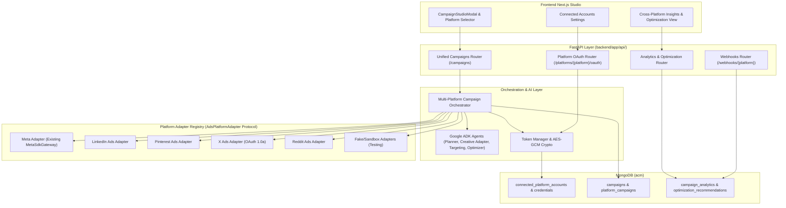
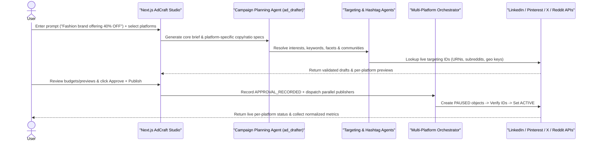
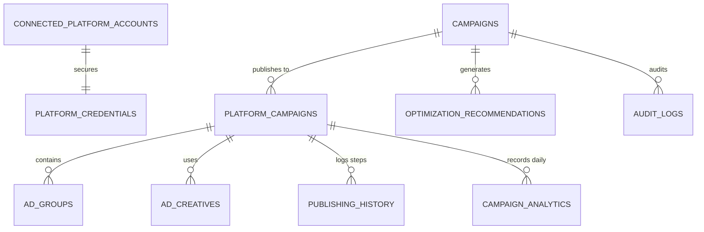

# AdCraft – Multi-Platform Advertising Integration Research & Implementation Guide

**Document Status:** Technical Research & Architecture Specification  
**Last Verified Against Official Docs & Repository:** 2026-11-10  
**Scope:** LinkedIn Ads, Pinterest Ads, X Ads (Twitter), and Reddit Ads integration into AdCraft  
**Target Audience:** AdCraft Backend, Frontend, AI Agent, QA, and Product Engineering Teams

---

## Table of Contents

1. [Introduction](#1-introduction)
2. [Platform Overview](#2-platform-overview)
3. [Official API Research and Capabilities](#3-official-api-research-and-capabilities)
4. [Account Creation and Approval Requirements](#4-account-creation-and-approval-requirements)
5. [Costs and Pricing](#5-costs-and-pricing)
6. [AdCraft Integration Architecture](#6-adcraft-integration-architecture)
7. [Platform-Specific Backend Implementation](#7-platform-specific-backend-implementation)
8. [Unified Campaign Creation UI](#8-unified-campaign-creation-ui)
9. [AI Agent Integration](#9-ai-agent-integration)
10. [Database Design](#10-database-design)
11. [Analytics and Performance Monitoring](#11-analytics-and-performance-monitoring)
12. [Security and Reliability](#12-security-and-reliability)
13. [Platform Comparison](#13-platform-comparison)
14. [Testing Strategy](#14-testing-strategy)
15. [Implementation Roadmap](#15-implementation-roadmap)
16. [Official Documentation References](#16-official-documentation-references)
17. [Final Recommendations](#17-final-recommendations)

---

## 1. Introduction

### What AdCraft Is

**AdCraft** (`ad_campaign_manager`) is an AI-powered advertising campaign manager built with a **Next.js** frontend, a **FastAPI** backend, **MongoDB** persistence, and **Google ADK** (Agent Development Kit) AI agents. Today, AdCraft supports end-to-end campaign creation, image generation, organic social publishing, DM automation, and analytics collection for **Meta** (Facebook and Instagram) via the Meta Marketing API (`v26.0` in `backend/app/config.py`).

### Why Multi-Platform Advertising Integration Is Required

Relying on a single ad network limits reach and forces businesses to switch between separate native tools—LinkedIn Campaign Manager, Pinterest Ads Manager, X Ads Manager, and Reddit Ads Manager—each with its own terminology, targeting rules, billing structure, and reporting dashboard. Small businesses and marketing teams often waste time rewriting the same promotion four different ways or misconfiguring budgets and audiences across dashboards.

### What We Want to Achieve

By adding support for **LinkedIn Ads**, **Pinterest Ads**, **X Ads**, and **Reddit Ads**, AdCraft will let each tenant (business workspace) connect its own ad accounts and manage cross-channel campaigns from one interface:

- **One Campaign Idea → Multiple Channels:** A user enters a single business promotion idea, and AdCraft prepares channel-appropriate variations.
- **Unified Approval & Spend Safety:** Every platform inherits AdCraft's explicit user confirmation rules before live spend or publishing starts (`ConfirmBody` and `spend_allowed` safety switches).
- **Normalized Performance Visibility:** Teams can compare impressions, clicks, spend, CTR (Click-Through Rate), CPC (Cost Per Click), and conversions side by side without losing platform-specific insights.

### How Users Manage Campaigns From One Application

1. **Connect Accounts Once:** In Settings, the user connects Meta, LinkedIn, Pinterest, X, or Reddit via OAuth (Open Authorization—a standard protocol that lets users grant AdCraft permission without sharing their password).
2. **Draft with AI:** In the AdCraft Studio (`CampaignStudioModal.tsx`), the user describes the promotion, selects target platforms, reviews generated copy and creatives tailored to each platform's character limits and image ratios, and adjusts targeting/budgets.
3. **Approve & Publish:** The user explicitly approves the campaign and launches it to selected platforms in a `PAUSED` or controlled state first, then activates delivery.
4. **Monitor & Optimize:** AdCraft collects daily metrics from each platform API, highlights anomalies, and recommends optimizations.

### How AI Agents Simplify the Lifecycle

- **Drafting:** Translates a short plain-English idea (e.g., *"40% off winter coats for shoppers in Mumbai and Bangalore"*) into platform-specific headlines, body copy, CTAs (Call-to-Action buttons), and targeting criteria.
- **Adaptation:** Shortens text for X's concise feed, adds professional B2B framing for LinkedIn, optimizes visual/keyword hooks for Pinterest, and adopts transparent, non-clickbait copy suited to Reddit communities.
- **Monitoring & Optimization:** Compares CTR, CPC, and spend across platforms and proposes concrete improvements (for example, pausing an underperforming ad group or reallocating budget) while keeping final execution gated behind human approval.

---

## 2. Platform Overview

### A. LinkedIn Ads

**What LinkedIn Ads Are:** LinkedIn Ads is a B2B-focused (business-to-business) and professional advertising platform that targets users based on verified career and company data such as job title, seniority, industry, company size, and skills.

- **Types of Advertisements Supported:**
  - **Sponsored Content:** Native feed ads appearing directly in the LinkedIn member feed.
  - **Single Image Ads:** One static image with intro text, headline, CTA, and destination URL.
  - **Video Ads:** Native feed videos optimized for brand awareness or lead capture.
  - **Carousel Ads:** Swipeable multi-card image ads (2–10 cards), each with its own headline and URL.
  - **Document Ads:** Interactive PDF/document previews directly inside the feed (ideal for whitepapers, guides, and case studies, often paired with lead capture).
  - **Message Ads & Conversation Ads (Sponsored Messaging):** Direct messages delivered to a member's LinkedIn Messaging inbox. **API Status:** Supported via dedicated Marketing API endpoints (Message Ads API replacing legacy `/adInMailContents`, and Conversation Ads API replacing `/sponsoredConversations`), subject to strict MDP (Marketing Developer Platform) approval, designated sender permissions, and anti-spam testing limits.
  - **Lead Generation Ads:** Ads paired with native **Lead Gen Forms** pre-filled from a member's LinkedIn profile (name, email, job title, company).
- **Campaign Objectives:** Grouped across three funnel stages:
  - *Awareness:* Brand Awareness (`CPM`).
  - *Consideration:* Website Visits (`CPC`), Engagement (`CPC`/`CPM`), Video Views (`CPV`/`CPM`).
  - *Conversion:* Lead Generation, Website Conversions, Job Applicants.
- **Audience Targeting Options:** Professional facets (`adTargetingFacets`) including Job Titles, Job Functions, Seniorities, Skills, Industries, Company Names, Company Sizes, Degrees, Fields of Study, Member Groups, Geographic Locations, Age/Gender estimates, and Matched Audiences (retargeting/lists, gated as private/secondary add-on API).
- **Budget and Scheduling:** Daily budget minimum of **$10 USD/day** (or local equivalent) and lifetime budget minimum of **$100** per campaign; start and end timestamps supported.
- **Campaign Analytics:** Retrieved via `/rest/adAnalytics` (`GET`) with granular pivots (`ACCOUNT`, `CAMPAIGN`, `CAMPAIGN_GROUP`, `CREATIVE`, `MEMBER_JOB_TITLE`, `MEMBER_INDUSTRY`, etc.) and `ALL`/`DAILY`/`MONTHLY` time granularity.
- **Official Links:**
  - Official Documentation: [https://learn.microsoft.com/en-us/linkedin/marketing/](https://learn.microsoft.com/en-us/linkedin/marketing/)
  - Developer Portal: [https://www.linkedin.com/developers/](https://www.linkedin.com/developers/)

---

### B. Pinterest Ads

**What Pinterest Ads Are:** Pinterest is a visual discovery and inspiration engine where users actively plan purchases, outfits, recipes, events, and home projects. Unlike interruptive social feeds, Pinterest users search with high commercial and planning intent.

- **Formats Supported (API v5):**
  - **Promoted Pins / Standard Image Ads:** Promoted vertical/square Pins integrated into home feeds and search results.
  - **Video Ads:** Standard-width and max-width video Pins (`VIDEO`).
  - **Carousel Ads:** Multi-image swipeable Pins (`CAROUSEL`) with 2–5 cards.
  - **Collections Ads:** A hero image/video paired with smaller shoppable product thumbnails (requires catalog/product group integration).
  - **Shopping Ads:** Product Pins pulled dynamically from an uploaded product catalog.
- **Campaign Objectives:** Streamlined in API v5 to `AWARENESS`, `CONSIDERATION`, `VIDEO_VIEW`, `SALES` (replaces legacy `WEB_CONVERSION` and `CATALOG_SALES` with `intended_promotion_type`), and `LEADS`.
- **Audience Targeting:** Demographics (age, gender, location, language, device/app type), **Pinterest Interests** (curated taxonomy), **Keywords** (phrase/exact/broad/negative search keyword targeting), and Customer List / Actalike / Engagement audiences.
- **Budget and Scheduling:** Daily or lifetime budgets configured in **microcurrency** (1 unit of currency = 1,000,000 micro-units). Technical minimums can start as low as **$1–$5/day** depending on currency/region, though **$10–$50/day** is typically needed for algorithm learning.
- **Conversion Tracking and Analytics:**
  - **Analytics:** `GET /v5/ad_accounts/{ad_account_id}/ads/analytics` (and campaign/ad_group analytics endpoints).
  - **Conversions:** Browser Pinterest Tag + server-side **Conversions API (CAPI)** (`POST /v5/ad_accounts/{ad_account_id}/events`) with `event_id` deduplication and SHA-256 hashed user data.
- **Why Pinterest Suits Specific Verticals & Should Be Optional in AdCraft:**
  - **High-Fit Industries:** Fashion, beauty, food & recipes, home decor, weddings, DIY, travel, and visually appealing consumer e-commerce perform exceptionally well because users come to Pinterest looking for aesthetic ideas to buy.
  - **Limitations & Optionality:** B2B SaaS, technical software, local emergency services, or text-heavy promotions perform poorly on Pinterest. Additionally, moving from **Trial Access** to **Standard Access** requires a formal video demo review, and **Shopping/Collections Ads** require the merchant to already maintain an approved Pinterest Product Catalog. Therefore, Pinterest should be an **optional platform toggle** in AdCraft—ideal for visual consumer brands, hidden or optional for B2B/non-visual tenants.
- **Official Links:**
  - Official Documentation: [https://developers.pinterest.com/](https://developers.pinterest.com/)
  - Business Portal: [https://business.pinterest.com/](https://business.pinterest.com/)

---

### C. X Ads (Twitter)

**What X Ads Are:** X Ads lets advertisers promote posts, threads, videos, and website/app cards inside the real-time conversation feed, search results, and profiles on X.

- **Formats & Campaign Types Supported:**
  - **Promoted Posts:** Standard organic posts boosted or **Promoted-Only Posts ("Dark Posts")** created solely for paid ad delivery without appearing on the brand's organic profile timeline.
  - **Image Ads & Video Ads:** Single or multi-media posts paired with Website Cards or App Cards.
  - **Carousel Ads:** Horizontally swipeable multi-image/video cards (up to 6 slides).
  - **Website Traffic Campaigns:** Optimize for link clicks and site visits.
  - **Engagement Campaigns:** Optimize for likes, reposts, replies, and profile clicks.
  - **App Promotion Campaigns:** App Installs and App Re-engagements (supported via App Cards and Mobile Measurement Partner / conversion tracking integration).
- **Audience Targeting:** Geography, language, gender, age, device/OS/carrier, **Keywords**, **Follower Look-alikes** (users similar to followers of specific `@handles`), **Conversation Topics**, Interests, and Tailored/Custom Audiences.
- **Budget and Scheduling:** Daily budget and total campaign budget with start/end timestamps (`ISO-8601`). X imposes **no strict platform-wide minimum campaign spend**, though an active, credit-approved funding instrument (credit card or insertion order) is mandatory.
- **Campaign Analytics:** Synchronous (`GET /12/stats/accounts/:account_id`) and asynchronous jobs (`POST /12/stats/jobs/accounts/:account_id`) supporting `ENGAGEMENT`, `BILLING`, `VIDEO`, `WEB_CONVERSION`, and `MOBILE_CONVERSION` metric groups.
- **API Access Eligibility & Restrictions:**
  - **Separate Approval Required:** Having an X Developer account (or paying for X API v2) does **not** grant access to the X Ads API (`ads-api.x.com/12`). You must submit a dedicated **Ads API Access Application**, disclose your business model (Advertiser, Agency, or Tech Platform) and expected ad volume, and pass manual review.
  - **Legacy Auth:** Unlike X API v2's OAuth 2.0 PKCE bearer tokens, the X Ads API requires **OAuth 1.0a User Context** signatures on all campaign management requests, and the connected X user must hold an `ACCOUNT_ADMIN` or `AD_MANAGER` role on the target ad account.
  - **Account Restrictions:** The connected X profile and Ad Account must comply with X Ads Policies and often require X Blue/Verified Organization status or verified billing standing to run ads in eligible regions.
- **Official Links:**
  - Official Documentation: [https://developer.x.com/](https://developer.x.com/)
  - Ads Portal: [https://ads.x.com/](https://ads.x.com/)

---

### D. Reddit Ads

**What Reddit Ads Are:** Reddit Ads places promoted posts inside Reddit's home feed, popular feeds, and—uniquely—specific topic-driven communities called **subreddits** (e.g., `r/malefashionadvice`, `r/SkincareAddiction`, `r/fitness`), plus conversation threads.

- **Formats Supported (API v3):**
  - **Promoted Posts:** Native-looking posts appearing in feeds (`FREE_FORM`, `LINK`, `IMAGE`, `VIDEO`).
  - **Image Ads & Video Ads:** Visual creative posts with headline, thumbnail/media, and destination URL.
  - **Carousel Ads:** Multi-image swipeable cards with per-card URLs and headlines.
  - **Conversation Ads:** Ads displayed directly inside post comment threads below the original Reddit post. *(Note: Check current v3 placement enums—placements `FEED` vs `COMMENTS_PAGE` govern where an ad serves; Conversation Placement may have specific creative restrictions.)*
- **Targeting Options:**
  - **Community-Based Targeting (Subreddits):** Target specific subreddits (subject to subreddit ad eligibility; not all subreddits allow ads).
  - **Interest Targeting:** Broad Reddit interest categories (e.g., Technology, Fashion & Style, Gaming).
  - **Keyword Targeting:** Available in Reddit Ads Manager and supported in ad group targeting configurations where enabled, matching users engaging with keywords in posts/communities.
  - **Geo, Device, Time-of-Day, and Custom Audiences:** Pixel retargeting and customer list audiences.
- **Campaign Objectives (API v3):** `IMPRESSIONS` (Brand Awareness & Reach), `CLICKS` (Traffic), `CONVERSIONS`, `VIDEO_VIEWABLE_IMPRESSIONS`, `APP_INSTALLS`, `CATALOG_SALES`, `LEAD_GENERATION` (paired with Reddit Lead Gen / Pixel / CAPI).
- **Budget and Scheduling:** Minimum daily budget of **$5 USD/day** (standard campaigns; automated "Reddit Max" campaigns have higher minimums around **$20/day**). Note that Reddit can over-deliver up to **20% above a daily budget** on peak days while pacing to the monthly/flight cap.
- **Campaign Analytics:** Asynchronous/structured Reporting endpoint (`POST /api/v3/ad_accounts/{ad_account_id}/reports`) with cursor pagination and support for `time_zone_id`, `starts_at`, `ends_at`, and breakdowns.
- **How Reddit Differs From Other Platforms:** Reddit audiences are skeptical of polished corporate jargon and heavily downvote or criticize misleading claims (if comments are enabled on an ad). Ads on Reddit succeed when they read like authentic, transparent, community-aware discussions—and advertisers must decide per ad whether **comments are enabled or disabled**.
- **Official Links:**
  - Official Documentation: [https://ads-api.reddit.com/docs/v3/](https://ads-api.reddit.com/docs/v3/)
  - Advertising Portal: [https://ads.reddit.com/](https://ads.reddit.com/)

---

## 3. Official API Research and Capabilities

> **Terminology Note for Beginners:**
> - **URN (Uniform Resource Name):** A structured identifier used by LinkedIn, such as `urn:li:sponsoredAccount:123456789` or `urn:li:image:C4D...`.
> - **Microcurrency:** A currency integer multiplied by `1,000,000` (used by Pinterest and Reddit) to avoid floating-point rounding errors. For example, `$5.00` = `5000000` micro-units.
> - **OAuth 2.0 vs OAuth 1.0a:** OAuth 2.0 uses short-lived Bearer tokens in headers (`Authorization: Bearer <token>`). OAuth 1.0a (required by X Ads API) requires signing every HTTP request mathematically with HMAC-SHA1 using consumer secrets and token secrets.

---

### A. LinkedIn Marketing / Ads API Research

| Aspect | Verified Details |
| :--- | :--- |
| **Base URL** | `https://api.linkedin.com/rest/` (versioned REST endpoints) and `https://www.linkedin.com/oauth/v2/` (OAuth) |
| **1. Developer Account Creation** | Standard LinkedIn member account + associated verified LinkedIn Company Page. Register at [LinkedIn Developers](https://www.linkedin.com/developers/). |
| **2. Application Registration** | Create App → Verify ownership via Company Page Admin → Request **Advertising API** (Marketing Developer Platform) product. |
| **3. OAuth Authentication** | **OAuth 2.0 (3-Legged Authorization Code Flow):** Authorize URL `GET https://www.linkedin.com/oauth/v2/authorization`, Token Exchange `POST https://www.linkedin.com/oauth/v2/accessToken`. |
| **4. Required Scopes** | `rw_ads` (manage campaigns/creatives/accounts), `r_ads` (read ads), `r_ads_reporting` (analytics), `rw_organization_admin` / `r_organization_admin` (link/publish on Company Pages). |
| **5. Access & Refresh Tokens** | Access token TTL: **60 days** (`5,184,000` s). **Refresh tokens (365-day TTL)** are **NOT** issued to standard self-serve apps; they are restricted to approved **Marketing Developer Platform (MDP)** partners. Note: the 365-day refresh expiry clock does **not** reset upon refresh. |
| **6. Account Identification** | `GET /rest/adAccounts?q=search` or `GET /rest/adAccountUsers?q=authenticatedUser` returns Ad Account URNs (`urn:li:sponsoredAccount:{id}`). |
| **7. Campaign Group Creation** | `POST /rest/adCampaignGroups` (top-level folder/budget container in LinkedIn's hierarchy: `Account -> Campaign Group -> Campaign -> Creative`). |
| **8. Campaign Creation** | `POST /rest/adCampaigns` (requires `account` URN, `campaignGroup` URN, `objectiveType`, `costType`, `dailyBudget` / `totalBudget`, `runSchedule`, `targetingCriteria`, `status`: `DRAFT` or `PAUSED`). |
| **9. Creative & Media Upload** | 3-step media upload: (1) `POST /rest/images?action=initializeUpload` (or `/rest/videos?action=initializeUpload`) → returns `uploadUrl` + `image`/`video` URN; (2) `PUT` binary file to `uploadUrl`; (3) Create post (`POST /rest/posts`) referencing media URN, then link post URN in `POST /rest/adCreatives`. |
| **10. Audience Targeting** | Discovery via `GET /rest/adTargetingFacets` and `GET /rest/adTargetingEntities?q=typeahead` (e.g., `urn:li:geo:...`, `urn:li:industry:...`, `urn:li:title:...`). Passed into `targetingCriteria.include.and` / `exclude.or` on the Campaign object. |
| **11. Budget & Bidding** | `dailyBudget` (`amount`, `currencyCode`), `unitCost` (CPC/CPM bid) or automated `costType` (`CPM`, `CPC`, `CPV`) and `optimizationTargetType`. |
| **12. Scheduling** | `runSchedule: { start: <epoch_ms>, end: <epoch_ms> }` inside `adCampaigns` and `adCampaignGroups`. |
| **13. Activation & Publishing** | Create Campaign Group, Campaign, and Creative in `PAUSED` or `DRAFT`, then `POST /rest/adCampaigns/{id}` (with header `X-RestLi-Method: PARTIAL_UPDATE` or `PATCH`) setting `status` to `ACTIVE`. |
| **14. Updates & Deletion** | Partial updates via `POST /rest/adCampaigns/{id}` with `$set`. LinkedIn restricts deleting active/previously delivered entities—standard practice is setting `status` to `ARCHIVED` or `CANCELED` (`DRAFT` items may be deleted via `DELETE`). |
| **15. Analytics & Reporting** | `GET /rest/adAnalytics?q=analytics` or `q=statistics` with `dateRange`, `timeGranularity` (`DAILY`, `MONTHLY`, `ALL`), `pivots` (`CAMPAIGN`, `CREATIVE`, etc.), and `fields` projection. |
| **16. Rate Limits** | Enforced per-second/hourly/daily per app and member/ad-account tier (returned via `429 Too Many Requests` when exceeded; exact quotas are visible in the Developer Portal App Analytics tab). |
| **17. Webhooks** | Supported for **Lead Notifications** (Lead Sync API) and **Organization Social Actions** (webhooks must be subscribed in the Developer Portal and verified via challenge/HMAC signature). Not all campaign status changes emit webhooks—analytics and delivery status require polling. |
| **18. Error Handling** | Standard HTTP codes (`400`, `401`, `403`, `429`, `5xx`) with JSON error `serviceErrorCode`, `message`, and `status`. |
| **19. API Versioning** | Mandatory header `LinkedIn-Version: YYYYMM` (e.g., `202610`) plus `X-Restli-Protocol-Version: 2.0.0`. Monthly versions have ~1-year support windows (e.g., `202511` sunsets on **2026-11-16**). |

**Key LinkedIn API Operations Summary:**

| Operation | What It Does | When Needed | Required Inputs | Expected Output | Docs & Restrictions |
| :--- | :--- | :--- | :--- | :--- | :--- |
| **Discover Ad Accounts** (`GET /rest/adAccountUsers?q=authenticatedUser`) | Lists ad accounts the logged-in user can manage | Immediately after OAuth connection | Bearer token, `r_ads`/`rw_ads`, `LinkedIn-Version` | List of account URNs + user roles (`ACCOUNT_MANAGER`, etc.) | [Ad Account Users API](https://learn.microsoft.com/en-us/linkedin/marketing/integrations/ads/account-structure/create-and-manage-account-users) |
| **Initialize Media Upload** (`POST /rest/images?action=initializeUpload`) | Reserves storage and returns signed upload URL | Step 1 before creating a post/creative | `initializeUploadRequest: { owner: "<org_or_account_urn>" }` | `uploadUrl`, `image` URN | [Images API](https://learn.microsoft.com/en-us/linkedin/marketing/community-management/shares/images-api) |
| **Search Targeting Entities** (`GET /rest/adTargetingEntities`) | Maps human text ("Software Engineer", "India") to LinkedIn URNs | Audience setup / AI keyword resolution | `q=typeahead`, `facet` URN, `query` | Array of `{ urn, name }` | [Targeting API](https://learn.microsoft.com/en-us/linkedin/marketing/integrations/ads/advertising-targeting/targeting-facets-and-entities) |
| **Create Campaign** (`POST /rest/adCampaigns`) | Creates budget, schedule, objective, and targeting container | Campaign publishing workflow | `account`, `campaignGroup`, `name`, `objectiveType`, `dailyBudget`, `targetingCriteria` | `201 Created` + `x-restli-id` header | [Campaigns API](https://learn.microsoft.com/en-us/linkedin/marketing/integrations/ads/account-structure/create-and-manage-campaigns); Dev Tier requires whitelisted account IDs |
| **Fetch Ad Analytics** (`GET /rest/adAnalytics`) | Retrieves daily/total impressions, clicks, spend, leads | Scheduled sync / manual refresh | `q=analytics`, `dateRange`, `timeGranularity`, `pivots`, `campaigns` or `accounts` | `elements[]` array of metrics | [Ad Analytics API](https://learn.microsoft.com/en-us/linkedin/marketing/integrations/ads-reporting/ads-reporting) |

---

### B. Pinterest API v5 Research

| Aspect | Verified Details |
| :--- | :--- |
| **Base URL** | `https://api.pinterest.com/v5/` (OAuth UI: `https://www.pinterest.com/oauth/`) |
| **1. Developer Account Creation** | Requires a **Pinterest Business Account** (free conversion from personal account) and agreeing to Developer Terms at [Pinterest Developers](https://developers.pinterest.com/). |
| **2. Application Registration** | Register App in Pinterest Developer Portal → starts with **Trial Access** (sandbox). |
| **3. OAuth Authentication** | **OAuth 2.0 Authorization Code Flow:** User consents at `https://www.pinterest.com/oauth/`; token exchange at `POST https://api.pinterest.com/v5/oauth/token` with HTTP Basic Auth (`base64(client_id:client_secret)`). |
| **4. Required Scopes** | `ads:read`, `ads:write`, `pins:read`, `pins:write`, `boards:read`, `boards:write`, `user_accounts:read` (plus `catalogs:read` if using Shopping/Collections ads). |
| **5. Access & Refresh Tokens** | Access token TTL: **30 days**. Request `continuous_refresh=true` during token exchange to obtain a **60-day rotating refresh token**. **Critical rule:** Every refresh call returns a **new** refresh token and immediately invalidates the old one—must be guarded with a database lock/mutex! |
| **6. Account Identification** | `GET /v5/ad_accounts` returns ad accounts (`id`, `name`, `currency`, `country`, `permissions`). |
| **7. Campaign Creation** | `POST /v5/ad_accounts/{ad_account_id}/campaigns` (Array payload up to multiple items; defines `name`, `objective_type`, `status`, optional CBO `daily_spend_cap` in microcurrency). |
| **8. Ad Group Creation** | `POST /v5/ad_accounts/{ad_account_id}/ad_groups` (Defines `campaign_id`, `budget_in_micro_currency`, `bid_in_micro_currency`, `billable_event`, `optimization_goal_metadata`, `targeting_spec`, `start_time`, `end_time`). |
| **9. Creative & Media Upload** | **Images:** Can create Pin directly via `POST /v5/pins` (`media_source: { source_type: "image_url" | "image_base64" }`), requiring a `board_id`. **Videos:** Multi-step: (1) `POST /v5/media` (`media_type: "video"`); (2) Upload multipart form data to `upload_url` using `upload_parameters`; (3) Poll `GET /v5/media/{media_id}` until `status == "succeeded"`; (4) Create Pin via `POST /v5/pins`; (5) Create Ad via `POST /v5/ad_accounts/{ad_account_id}/ads` referencing `pin_id` + `ad_group_id`. |
| **10. Audience Targeting** | Embedded `targeting_spec` JSON on Ad Group: `AGE_BUCKET`, `GENDER`, `GEO` (country/region/DMA), `LOCALE`, `APPTYPE`, `INTEREST` (IDs), `TARGETING_STRATEGY`, `AUDIENCE_INCLUDE`/`EXCLUDE`. Keyword targeting created via `POST /v5/ad_accounts/{ad_account_id}/keywords` linked to `ad_group_id`. |
| **11. Budget & Bidding** | `budget_in_micro_currency`, `budget_type` (`DAILY`/`LIFETIME`), `bid_strategy_type` (`AUTOMATIC_BID`, `MAX_BID`, `TARGET_AVG`). |
| **12. Scheduling** | Unix epoch seconds (`start_time`, `end_time`) on Campaign and Ad Group. |
| **13. Activation & Publishing** | Create Campaign, Ad Group, and Ad with `status: "PAUSED"`, then `PATCH` each resource to `status: "ACTIVE"`. |
| **14. Updates & Deletion** | `PATCH /v5/ad_accounts/{ad_account_id}/campaigns` (and `/ad_groups`, `/ads`) accepts batch arrays with `id` + updated fields, including setting `status: "ARCHIVED"`. |
| **15. Analytics & Reporting** | Synchronous `GET /v5/ad_accounts/{ad_account_id}/ads/analytics` (or `/campaigns/analytics`, `/ad_groups/analytics`) + Asynchronous `POST /v5/ad_accounts/{ad_account_id}/reports` for large date ranges/breakdowns. |
| **16. Rate Limits** | **Trial Access:** 1,000 req/day app-wide (`ads_write`: 300/day, `ads_read`: 1,000/day, `ads_analytics`: 1,000/day). **Standard Access:** 100 req/s universal ceiling (`ads_read`: 1,000/min, `ads_write`: 400/min, `ads_analytics`: 300/min per user/app). Headers: `X-Ratelimit-Limit`, `X-Ratelimit-Remaining`, `X-Ratelimit-Reset`. |
| **17. Webhooks** | Supports **Lead Ads Webhooks** for real-time lead form delivery and **Conversions API (CAPI)** (`POST /v5/ad_accounts/{ad_account_id}/events`) for server-side conversion ingestion. Campaign/ad status polling is still needed for delivery diagnostics. |
| **18. Error Handling** | HTTP `400/401/403/404/429/500` returning `{ "code": <int>, "message": <str> }`; batch create/update endpoints can return partial per-item `exceptions` inside a `200` response. |
| **19. API Versioning** | Path-based versioning (`/v5/`). Pinterest v3 and v4 are deprecated/retired; all new development must target **v5**. |

**Key Pinterest API Operations Summary:**

| Operation | What It Does | When Needed | Required Inputs | Expected Output | Docs & Restrictions |
| :--- | :--- | :--- | :--- | :--- | :--- |
| **Register Media** (`POST /v5/media`) | Initializes video upload | When creating video Pins/ads | `media_type: "video"` | `media_id`, `upload_url`, `upload_parameters` | [Media API v5](https://developers.pinterest.com/docs/api/v5/media-create/) |
| **Create Pin** (`POST /v5/pins`) | Creates organic/dark Pin creative on a board | Before attaching `pin_id` to an Ad | `board_id`, `title`, `description`, `link`, `media_source` | Pin object with `id` | In Trial Access, Pins are sandbox-only (visible only to creator) |
| **Create Campaign** (`POST /v5/ad_accounts/{id}/campaigns`) | Creates top-level campaign & objective | Campaign publishing | `name`, `objective_type`, `status` | `{ items: [{ data: { id }, exceptions }] }` | [Campaigns Create](https://developers.pinterest.com/docs/api/v5/campaigns-create/) |
| **Create Ad Group** (`POST /v5/ad_accounts/{id}/ad_groups`) | Sets budget, bid, schedule, `targeting_spec` | After Campaign creation | `campaign_id`, `name`, `budget_in_micro_currency`, `billable_event`, `targeting_spec` | `{ items: [{ data: { id }, exceptions }] }` | [Ad Groups Create](https://developers.pinterest.com/docs/api/v5/ad_groups-create/) |
| **Get Ad Analytics** (`GET /v5/ad_accounts/{id}/ads/analytics`) | Fetches daily/total metrics | Analytics dashboard refresh | `start_date`, `end_date`, `ad_ids`, `columns`, `granularity` | Array of daily/summary metric objects | [Ads Analytics](https://developers.pinterest.com/docs/api/v5/ads-analytics/) |

---

### C. X Ads (Twitter) API v12 Research

| Aspect | Verified Details |
| :--- | :--- |
| **Base URL** | Production: `https://ads-api.x.com/12/` · Sandbox: `https://ads-api-sandbox.x.com/12/` · Media Upload: `https://upload.x.com/1.1/media/upload.json` (or v2 media upload where supported) |
| **1. Developer Account Creation** | Register at [X Developer Portal](https://developer.x.com/), create a Project & App. |
| **2. Application Registration** | Submit a separate **X Ads API Access Application** for the App, specifying business type (Advertiser/Agency/Tech Partner), expected ad spend volume, and requested capabilities (Campaign Management, Creatives, Analytics, Tailored Audiences). |
| **3. OAuth Authentication** | **OAuth 1.0a User Context (3-legged)** is strictly required for X Ads API (`https://api.x.com/oauth/request_token`, `authenticate`/`authorize`, `access_token`). Note: OAuth 2.0 App-Only or PKCE tokens used for X API v2 are **not** sufficient for Ads API v12 writes. |
| **4. Required Scopes / Roles** | OAuth 1.0a App permissions must be **Read and Write**. Furthermore, the authorizing X handle must have `ACCOUNT_ADMIN` or `AD_MANAGER` access on the X Ads Account (`ads.x.com`). |
| **5. Access & Refresh Tokens** | OAuth 1.0a issues a long-lived `oauth_token` and `oauth_token_secret` (they do **not** expire on a fixed timer unless revoked by the user or app credentials change). |
| **6. Account Identification** | `GET /12/accounts` lists accessible Ad Accounts (`id` is alphanumeric base-36 like `18ce54d4x5t`, `currency`, `timezone`, `approval_status`). Funding instruments fetched via `GET /12/accounts/:account_id/funding_instruments`. |
| **7. Campaign Creation** | `POST /12/accounts/:account_id/campaigns` (Requires `funding_instrument_id`, `name`, `daily_budget_amount_local_micro`, `total_budget_amount_local_micro`, `start_time`, `end_time`, `entity_status`: `PAUSED` or `ACTIVE`). |
| **8. Line Item (Ad Group) Creation** | `POST /12/accounts/:account_id/line_items` (Defines `campaign_id`, `objective`—e.g., `WEBSITE_CLICKS`, `ENGAGEMENTS`, `REACH`, `VIDEO_VIEWS`, `APP_INSTALLS`—`placements`, `product_type`: `PROMOTED_TWEETS`, `bid_amount_local_micro` / `bid_strategy`, `categories`, `advertiser_user_id`). |
| **9. Creative & Media Upload** | (1) Chunked Media Upload (`INIT`, `APPEND` <= 5MB chunks, `FINALIZE`, `STATUS` polling for video) to get `media_key` / `media_id`; (2) Create **Card** if needed (e.g., Website Card via `POST /12/accounts/:account_id/cards/website` or Image/Video App Card) OR create **Promoted-Only Post** via `POST /12/accounts/:account_id/tweets` (`nullcast=true` / promoted-only); (3) Link post to Line Item via `POST /12/accounts/:account_id/promoted_tweets`. |
| **10. Audience Targeting** | Attached to `line_item_id` via `POST /12/accounts/:account_id/targeting_criteria` (one call per criterion or batch endpoint `POST /12/accounts/:account_id/batch/accounts/:account_id/targeting_criteria`) using `targeting_type` (`LOCATION`, `GENDER`, `AGE`, `LANGUAGE`, `KEYWORD`, `FOLLOWER_LOOK_ALIKE`, `INTEREST`, `PLATFORM`, `TAILORED_AUDIENCE`) and `targeting_value` lookup IDs. |
| **11. Budget & Bidding** | Budgets and bids specified in **local microcurrency** (`1 USD = 1,000,000`). Supports `AUTO` bid, `MAX` bid, or `TARGET` bid depending on objective. |
| **12. Scheduling** | `start_time` and `end_time` in UTC `ISO-8601` (`YYYY-MM-DDTHH:MM:SSZ`) on Campaigns and Line Items. |
| **13. Activation & Publishing** | Create Campaign, Line Item, and Promoted Tweet with `entity_status=PAUSED`, then `PUT /12/accounts/:account_id/campaigns/:campaign_id` and `PUT /12/accounts/:account_id/line_items/:line_item_id` with `entity_status=ACTIVE`. |
| **14. Updates & Deletion** | `PUT` updates existing resources; `DELETE /12/accounts/:account_id/campaigns/:campaign_id` (and `/line_items/:id`, `/promoted_tweets/:id`) soft-deletes (`deleted: true`). |
| **15. Analytics & Reporting** | **Sync:** `GET /12/stats/accounts/:account_id?entity=CAMPAIGN&entity_ids=...&metric_groups=ENGAGEMENT,BILLING&granularity=DAY`. **Async (recommended for larger queries):** `POST /12/stats/jobs/accounts/:account_id` → poll job status → download gzipped JSON from `url`. |
| **16. Rate Limits** | Rolling **15-minute windows** per endpoint and access token. Account-scoped reads/writes allow higher throughput (~450–10,000 req/15m depending on resource), whereas global endpoints like `GET /12/accounts` are tight (as low as ~5–15 req/15m). Track `x-rate-limit-remaining` and `x-rate-limit-reset` headers. |
| **17. Webhooks** | X Ads API v12 itself relies primarily on **polling / async reporting jobs** rather than native Ads webhook pushes. (Organic/Account Activity API webhooks exist separately under X API paid tiers, and conversion events are pushed via `POST /12/measurement/conversions/:pixel_id`). |
| **18. Error Handling** | Returns `{ "errors": [{ "code": "...", "message": "...", "attribute": "..." }] }`. Handles `400`, `401`, `403`, `429`, `503`. |
| **19. API Versioning** | Path-based version `/12/`. Requires matching `ads-api.x.com/12/` endpoints. |

**Key X Ads API Operations Summary:**

| Operation | What It Does | When Needed | Required Inputs | Expected Output | Docs & Restrictions |
| :--- | :--- | :--- | :--- | :--- | :--- |
| **Create Sandbox Account** (`POST /12/accounts` on `ads-api-sandbox.x.com`) | Spawns test ad account with mock funding | Integration testing without real spend | OAuth 1.0a signature, `name`, `currency`, `timezone` | Sandbox `account_id` | Sandbox only; requires approved Ads API app |
| **Create Campaign** (`POST /12/accounts/:id/campaigns`) | Sets funding instrument, budget, dates | Campaign publishing step 1 | `funding_instrument_id`, `name`, `daily_budget_amount_local_micro`, `start_time` | Campaign object with `id` | Ad account must have active funding instrument |
| **Create Promoted-Only Post** (`POST /12/accounts/:id/tweets`) | Creates dark post with text + media/card | Step 3 before linking to Line Item | `text`, `as_user_id`, optional `media_ids` / `card_uri` | `tweet_id` (`id_str`) | Needs Write permission & advertiser handle authorization |
| **Attach Targeting Criteria** (`POST /12/accounts/:id/targeting_criteria`) | Adds geo, age, keyword, lookalike rules | After creating `line_item_id` | `line_item_id`, `targeting_type`, `targeting_value` | Targeting criterion object | Multiple criteria require multiple objects/batch call |
| **Fetch Stats** (`GET /12/stats/accounts/:id`) | Pulls impressions, clicks, spend, engagements | Metrics sync | `entity`, `entity_ids`, `start_time`, `end_time`, `metric_groups`, `granularity` | `data[]` with `id_data[].metrics` | Synchronous capped at 7 days / 20 entity IDs per call; use async jobs for more |

---

### D. Reddit Ads API v3 Research

| Aspect | Verified Details |
| :--- | :--- |
| **Base URL** | `https://ads-api.reddit.com/api/v3/` (OAuth: `https://www.reddit.com/api/v1/`) |
| **1. Developer Account Creation** | Requires a standard Reddit account with **Business Admin** role in [Reddit Ads Manager](https://ads.reddit.com/). |
| **2. Application Registration** | Inside Reddit Ads Manager navigate to **Business → Developer Portal** → create Developer Application (`client_id`, `client_secret`, Redirect URI). |
| **3. OAuth Authentication** | **OAuth 2.0 Authorization Code Flow:** Consent URL `https://www.reddit.com/api/v1/authorize?...&duration=permanent&scope=adsread,adsedit,...`; Token Exchange `POST https://www.reddit.com/api/v1/access_token` (Basic Auth `client_id:client_secret`). |
| **4. Required Scopes** | `adsread` (read campaigns/reports), `adsedit` (create/edit campaigns, ad groups, ads, posts), `adsconversions` (CAPI), `adsdatadeletion` (GDPR/privacy compliance). |
| **5. Access & Refresh Tokens** | Access token expires quickly (**1–24 hours**, commonly 24h on v3/1h on standard Reddit OAuth—always obey `expires_in` returned in response). Requesting `duration=permanent` returns a persistent `refresh_token` for offline rotation. |
| **6. Account Identification** | `GET /api/v3/businesses` → `GET /api/v3/businesses/{business_id}/ad_accounts` (or `GET /api/v3/ad_accounts/{ad_account_id}`) returns `ad_account_id`, `currency`, `time_zone_id`, and funding instruments. |
| **7. Campaign Creation** | `POST /api/v3/ad_accounts/{ad_account_id}/campaigns` (Note: v3 wraps request and response payloads in a `{ "data": { ... } }` envelope!). Sets `name`, `objective`, `configured_status`, `funding_instrument_id`, optional CBO settings. |
| **8. Ad Group Creation** | `POST /api/v3/ad_accounts/{ad_account_id}/ad_groups` (Defines `campaign_id`, `name`, `goal_type`, `goal_value` in microcurrency, `bid_type` `CPC`/`CPM`/`CPV`, `bid_value` in microcurrency, `targeting`, `start_time`, `end_time`, `configured_status`). Note: Conversion-optimized ad groups require a `conversion_pixel_id` or tracking configuration. |
| **9. Creative & Media Upload** | (1) Upload media assets via `POST /api/v3/ad_accounts/{ad_account_id}/media` / creative asset endpoints; (2) Create a Reddit **Post** creative (`POST /api/v3/ad_accounts/{ad_account_id}/posts` supporting `IMAGE`, `VIDEO`, `CAROUSEL`, `TEXT`, `LINK`, and `is_allow_comments` boolean); (3) Create the **Ad** (`POST /api/v3/ad_accounts/{ad_account_id}/ads`) binding `ad_group_id` + `post_id` + `click_url`. |
| **10. Audience Targeting** | Stored inside `targeting` on the Ad Group: `communities` (subreddit IDs/names), `interests`, `geolocations`, `devices`, `custom_audience_ids`, `excluded_communities`, `excluded_geolocations`, `keywords` (where supported). Discovery endpoints: `GET /api/v3/targeting/communities`, `GET /api/v3/targeting/interests`, `GET /api/v3/targeting/geolocations`. |
| **11. Budget & Bidding** | `goal_type` (`DAILY_SPEND` or `LIFETIME_SPEND`), `goal_value` in **microcurrency** (min `$5/day` = `5000000`), `bid_strategy` (`MAXIMIZE_VOLUME`, `MANUAL_BIDDING`, `TARGET_CPA`). |
| **12. Scheduling** | `start_time` and `end_time` (`ISO-8601` timestamps) on the Ad Group (`ad_groups`). |
| **13. Activation & Publishing** | Create Campaign, Ad Group, Post, and Ad with `configured_status: "PAUSED"`, then `PATCH /api/v3/campaigns/{campaign_id}`, `PATCH /api/v3/ad_groups/{ad_group_id}`, `PATCH /api/v3/ads/{ad_id}` to `"ACTIVE"`. |
| **14. Updates & Deletion** | Partial updates via `PATCH /api/v3/campaigns/{id}` (and `/ad_groups/{id}`, `/ads/{id}`). Entities are deactivated/archived via status updates rather than hard deletion once created. |
| **15. Analytics & Reporting** | `POST /api/v3/ad_accounts/{ad_account_id}/reports` specifying `starts_at`, `ends_at`, `time_zone_id`, `breakdowns` (`CAMPAIGN_ID`, `AD_GROUP_ID`, `AD_ID`, `DATE`, `COMMUNITY`, etc.), `fields`. Uses cursor pagination (`pagination.next_url`). |
| **16. Rate Limits** | Pooled policy groups over a rolling **60-second window** (e.g., standard read policies ~400 req/60s). IETF draft rate-limit headers (`x-ratelimit-remaining`, `x-ratelimit-reset`) returned; `429 Too Many Requests` when exceeded. |
| **17. Webhooks** | Supports lead generation/conversion integrations via **Conversions API (CAPI)** (`adsconversions` scope) and Lead Gen data sync where enabled; standard campaign/report reads use polling with cursor pagination. |
| **18. Error Handling** | HTTP `400/401/403/404/422/429` with structured JSON `error` details (`code`, `message`, `field` validation issues). |
| **19. API Versioning** | Path-based `/api/v3/`. Legacy v2 endpoints are deprecated; all new builds must use **v3**. |

**Key Reddit Ads API v3 Operations Summary:**

| Operation | What It Does | When Needed | Required Inputs | Expected Output | Docs & Restrictions |
| :--- | :--- | :--- | :--- | :--- | :--- |
| **Search Subreddits** (`GET /api/v3/targeting/communities`) | Finds eligible subreddits for ad targeting | Audience Targeting step | `query` string (e.g., `"fashion"`) | `{ data: [{ id, name, subscribers }] }` | Not all subreddits allow ads |
| **Create Campaign** (`POST /api/v3/ad_accounts/{id}/campaigns`) | Creates campaign container + objective | Publishing step 1 | `{ data: { name, objective, configured_status, funding_instrument_id } }` | `{ data: { id, ... } }` | Needs `adsedit` scope + funding instrument |
| **Create Ad Group** (`POST /api/v3/ad_accounts/{id}/ad_groups`) | Configures budget, bid, schedule, communities | Publishing step 2 | `{ data: { campaign_id, name, goal_type, goal_value, bid_type, targeting } }` | `{ data: { id, ... } }` | Min `$5/day` (`5000000` micro) for standard campaigns |
| **Create Post & Ad** (`POST .../posts` + `POST .../ads`) | Builds promoted post creative & links to ad group | Publishing step 3–4 | Post payload (`headline`, `type`, `content`, `allow_comments`) + Ad payload | `{ data: { id, post_id } }` | Must comply with Reddit Ad Policies |
| **Generate Report** (`POST /api/v3/ad_accounts/{id}/reports`) | Retrieves delivery, click, spend, video metrics | Analytics collection | `{ data: { starts_at, ends_at, breakdowns, fields } }` | `{ data: { metrics: [...] }, pagination }` | Hourly breakdowns have shorter date-range limits |

---

## 4. Account Creation and Approval Requirements

Before writing integration code or onboarding tenants, engineering and product owners must understand the difference between **AdCraft's developer app** (registered once by the AdCraft team) and **tenant advertising accounts** (connected per business via OAuth).

### Platform-by-Platform Onboarding Checklist

#### 1. LinkedIn Ads
- **Personal Account:** A real LinkedIn member profile with 2FA enabled is required to create/administer the Developer App.
- **Business Account:** Must own or be Super Admin of a verified **LinkedIn Company Page** (personal profiles cannot run Sponsored Content ads).
- **Developer Account & App Registration:** Register at [linkedin.com/developers](https://www.linkedin.com/developers/), associate the app with the verified Company Page, and click **Request Access** for **Advertising API**.
- **Advertising Account:** Create a **LinkedIn Ad Account** inside LinkedIn Campaign Manager and attach a billing credit card or corporate invoice.
- **OAuth & API Access Application:** Submit the Advertising API application form explaining business use case, privacy policy, and data retention.
- **Approval & Tiers:**
  - *Development Tier:* Granted after initial review. Strictly restricted—you must whitelist specific numeric 9-digit Ad Account IDs in the Developer Portal, and programmatic refresh tokens are not issued.
  - *Standard Tier:* Requires a functional demo video/screencast showing AdCraft creating/reading campaigns cleanly, plus compliance review. Unlocks production multi-tenant access and higher limits. (365-day refresh tokens require approved MDP partner status.)
- **Sandbox:** No separate mirror server; instead, LinkedIn lets you create a `test: true` Ad Account in Campaign Manager / API (`type=BUSINESS`, `test=true`) against `api.linkedin.com/rest/`.
- **Business Verification:** Company Page Admin verification is mandatory during app setup; additional corporate vetting occurs during Standard Tier review.

#### 2. Pinterest Ads
- **Personal vs Business Account:** Requires a **Pinterest Business Account** (free to create or convert from personal).
- **Developer Account & App Registration:** Create an app in [developers.pinterest.com](https://developers.pinterest.com/) linked to your Business Account.
- **Advertising Account:** Enable **Pinterest Ads Manager** (`business.pinterest.com`) and add a valid payment method.
- **OAuth & API Access Application:** Configure Redirect URI (`https://.../api/platforms/pinterest/callback`) and request `ads:read`, `ads:write`, `pins:read`, `pins:write`.
- **Approval Tiers (Trial vs Standard):**
  - *Trial Access:* Immediate/lightweight sandbox tier. Pins and campaigns created in Trial Access act as sandbox entities visible only to the developer account and are capped at 1,000 requests/day app-wide.
  - *Standard Access:* Required before any external customer can connect their Pinterest account. Requires submitting a privacy policy URL, use-case explanation, and a **screen-recorded video demo** showing the complete OAuth consent flow and ad workflow.
- **Restrictions:** Standard Access is blocked if your website lacks a valid Privacy Policy or violates Pinterest Merchant/Advertising Guidelines (e.g., weight-loss claims, adult content, counterfeit goods).

#### 3. X Ads (Twitter)
- **Personal / Brand Account:** Requires an active X account in good standing (must not be suspended or shadow-restricted).
- **Developer Account & App Registration:** Register in [developer.x.com](https://developer.x.com/), create a Project and App, enable **OAuth 1.0a** user authentication settings with **Read and Write** permissions, and store Consumer Key/Secret.
- **Advertising Account:** Activate **X Ads** (`ads.x.com`) and add a verified credit card/funding instrument. Note: In many markets, X requires accounts running ads to have a verified checkmark/subscription or pass advertiser identity verification.
- **API Access Application:** Must fill out the dedicated **X Ads API Access Application** form separately from standard developer signup. You must specify whether AdCraft is an Advertiser, Agency, or Tech Platform, expected monthly spend, and exact endpoints needed.
- **Approval & Sandbox:**
  - *Manual Review:* Approval takes several business days to weeks depending on X Partner Engineering review queue. Unapproved apps receive `403 Unauthorized` on `ads-api.x.com`.
  - *Sandbox:* Once approved for Ads API, X provides an isolated sandbox endpoint (`https://ads-api-sandbox.x.com/12`) where developers can create test ad accounts (`POST /12/accounts`) and mock funding instruments with zero real spend.

#### 4. Reddit Ads
- **Personal & Business Account:** Requires a Reddit user account with a verified email, converted into a **Reddit Business** and **Reddit Ads Manager** account at [ads.reddit.com](https://ads.reddit.com/).
- **Developer App Registration:** Inside Reddit Ads Manager, go to **Business → Developer Portal** (`ads.reddit.com` / Reddit Business Manager) and create a Developer App to obtain `client_id` and `client_secret` (no separate external developer portal signup needed).
- **Advertising Account & Billing:** Create an Ad Account under the Business with a verified payment method (`funding_instrument_id`).
- **Approval Requirements:** Unlike Reddit's general Data API (which requires paid enterprise contracts and Responsible Builder review for scraping/LLM training), **Reddit Ads API v3 is open to advertisers and ad-tech developers** without a separate manual allowlist bottleneck just to start integrating campaigns and reporting. *(Verify partner terms if redistributing multi-tenant commercial analytics at high volume.)*
- **Sandbox / Testing:** Reddit does **not** provide a separate fake-currency sandbox domain like X's `ads-api-sandbox.x.com`. Instead, teams test using a **dedicated test Reddit Business/Ad Account**, keep campaigns in `configured_status: "PAUSED"`, and use Reddit's official v3 Postman collection to verify schemas before toggling `ACTIVE`.

### Account & Approval Comparison Table

| Requirement | LinkedIn Ads | Pinterest Ads | X Ads (Twitter) | Reddit Ads |
| :--- | :--- | :--- | :--- | :--- |
| **Account Type Needed** | Personal + Verified Company Page | Pinterest Business Account | Active X Account + Ads Account | Reddit Account + Business Admin in Ads Manager |
| **Developer Portal** | `linkedin.com/developers` | `developers.pinterest.com` | `developer.x.com` | Inside `ads.reddit.com` (Business → Developer Portal) |
| **App Approval Required?** | **Yes** (Dev Tier then Standard Tier) | **Yes** (Trial automatic/quick; Standard needs video demo) | **Yes** (Strict separate Ads API Application) | **No / Low Friction** for Ads Manager app creation (check partner policy for SaaS scale) |
| **Dedicated Sandbox Env?** | Partial (`test: true` Ad Account on prod host) | Yes (**Trial Access** isolates created Pins/ads) | **Yes** (`ads-api-sandbox.x.com/12`) | **No** (Test via paused campaigns on test Business Account) |
| **Business Verification** | Company Page Admin link mandatory | Business Account + Privacy Policy URL | Advertiser ID / Verified org checks may apply to run live ads | Valid Business + Payment Method on Ad Account |
| **Typical Approval Time** | 1–4 weeks (Standard Tier) | 1–2 weeks (Standard review) | 1–4+ weeks (Manual review) | Immediate for self-serve Ads API setup |

---

## 5. Costs and Pricing

> **Important Distinction:** Software teams often confuse **API access fees** (what the platform charges AdCraft's servers to call endpoints) with **advertising spend** (what the advertiser pays to show ads to users). Below, both are separated clearly.  
> **Verification Date:** All pricing notes below reflect official platform terms and documented structures verified as of **2026-11-10**. Platform API tiers (especially X) change periodically and **must be re-verified in each developer portal before production launch**.

### Summary Matrix: Developer Access vs. Ad Spend

| Cost Category | LinkedIn Ads | Pinterest Ads | X Ads (Twitter) | Reddit Ads |
| :--- | :--- | :--- | :--- | :--- |
| **A. Ads API Access Cost** | **$0** (Free; gated by approval, not API fees) | **$0** (Free; Trial & Standard tiers carry no call fees) | **$0** for Ads API itself *(requires approval; separate from paid X Data API v2)* | **$0** for Ads API v3 *(separate from Reddit Data API commercial pricing)* |
| **A2. Organic / General Data API Risk** | Free for approved Marketing/Share scopes | Free within v5 rate limits | **Paid!** Organic Tweet posts/reads on X API v2 use pay-per-use credits (e.g., ~$0.015/post, ~$0.005/read) if used outside Ads API | Core Reddit Data API requires paid/approved licensing (~$0.0015/read); use Ads API `posts` endpoint instead! |
| **B. Minimum Ad Spend** | **$10 USD / day** per campaign ($100 lifetime min) | **$1–$5 USD / day** technical floor ($10–$50/day practical) | **No hard platform min** (credit/billing check required) | **$5 USD / day** ($20/day for automated Max campaigns) |
| **B2. Typical Auction Benchmarks** | High B2B CPC ($5.50–$10.00+ USD typical) | Low–Mid CPC ($0.10–$1.50 USD typical); CPM $2–$7 | Auction CPC/CPM varies heavily by region & targeting | Auction CPC/CPM ($0.50–$1.50+ CPC; **20% daily over-delivery allowed**) |
| **C. Third-Party Aggregator Costs** | $0 if built directly (aggregators like Unified.to / Phyllo / Ayrshare charge $50–$500+/mo) | $0 if built directly | $0 if built directly | $0 if built directly |
| **D. Messaging / Extra Usage Fees** | Message/Conversation Ads billed per send/click within ad budget (no extra API fee) | No per-API-call messaging fee | No extra Ads API call fee *(X verification/org badge fees for advertiser account may apply)* | No per-API-call fee |

### Key Financial Warnings for Product & Finance

1. **Avoid Accidental Data API Billing on X and Reddit:**
   - On **X**, do **not** create organic posts via X API v2 unless intended; use `POST /12/accounts/:account_id/tweets` inside the Ads API for promoted-only tweets, or verify current pay-per-use credit charges if posting organically.
   - On **Reddit**, do **not** call `oauth.reddit.com` general subreddit scraping endpoints without Data API licensing. Only call `https://ads-api.reddit.com/api/v3/` for ads, posts created as ad creatives, and targeting lookups.
2. **Reddit 20% Daily Over-Delivery Rule:** Reddit's auction engine is legally permitted to spend up to **120% of a campaign's daily budget** on high-traffic days (while staying under the monthly cap = `daily_budget * 30.4`). AdCraft's budget warnings UI must inform tenants of this rule.
3. **AdCraft Spend Guardrails:** Just like Meta uses `max_daily_budget_inr` and `spend_allowed` in `backend/app/config.py`, AdCraft must enforce per-tenant currency-aware daily spend ceilings across all four new platforms so an AI prompt mistake can never allocate ₹1,00,000/day by accident.

---

## 6. AdCraft Integration Architecture

### Inspecting the Existing AdCraft Architecture

From direct inspection of the repository:

- **Frontend (`frontend/`):** Next.js App Router + React + TypeScript + SWR (`frontend/lib/api.ts`). Campaign creation happens inside `frontend/components/CampaignStudioModal.tsx` (a 6-section studio: Objective & Idea → Target Audience → Budget & Schedule → Creative & Preview → Hashtags → Publishing), with `PublishingDestinations.tsx` controlling Facebook/Instagram organic targets and `PublishFlow.tsx` controlling ad approval & publishing.
- **Backend API (`backend/app/api/`):** FastAPI routers mounted in `backend/app/main.py` (`auth`, `settings`, `meta_oauth`, `campaigns`, `media`, `dm`, `organic`, `hashtags`, `webhooks`, `social_knowledge`).
- **Dependency Container (`backend/app/container.py`):** Uses `Container` with `gateway_for(connection)` returning `(AdsReader, AdsWriter)` defined as Python `Protocol`s in `backend/app/meta/ports.py`—switching seamlessly between `FakeAdsGateway` (`META_MODE=fake`) and `MetaSdkGateway` (`META_MODE=real`).
- **Security (`backend/app/security/crypto.py`):** Encrypts/decrypts OAuth tokens using AES-GCM (`encrypt_token` / `decrypt_token`) with `TOKEN_ENCRYPTION_KEY`.
- **Publishing Engine (`backend/app/meta/publisher.py`):** Runs a checkpointed, idempotent 5-step background pipeline (`CAMPAIGN -> ADSET -> IMAGE -> CREATIVE -> AD`), updating `publish.steps` in MongoDB so interrupted jobs can resume without duplicating objects (`_adopt_or_create`).
- **AI Agents (`backend/app/agents/`):** Powered by **Google ADK** (`Agent`, `InMemoryRunner`) with Pydantic validation and automatic repair (`_run_with_repair`, `REPAIR_MAX = 2`) in `ad_drafter.py`, `hashtag_agent.py`, `dm_agent.py`, and `post_understanding_agent.py`.
- **Analytics & Lifecycle (`backend/app/services/insights.py`, `ad_lifecycle.py`, `ad_fix.py`):** `insights.py` runs periodic refreshes (`_insights_loop` in `main.py`) storing metrics on `campaign.insights`; `ad_fix.py` runs deterministic repairs; `db.py` already indexes `insights_daily`, `analysis_reports`, and `optimization_proposals` for expanded analytics and AI optimization.

### Architectural Principle: Adapter Pattern Without Forced Identical APIs

Meta, LinkedIn, Pinterest, X, and Reddit have **different object hierarchies**:
- **Meta:** Campaign → Ad Set → Creative → Ad
- **LinkedIn:** Campaign Group → Campaign (holds targeting/budget) → Creative (links to `/rest/posts`)
- **Pinterest:** Campaign → Ad Group (holds targeting/budget) → Ad (links to Pin ID)
- **X:** Campaign (holds budget/dates) → Line Item (holds targeting/bid) → Promoted Tweet + Targeting Criteria
- **Reddit:** Campaign → Ad Group (holds budget/bid/schedule/targeting) → Ad (links to Post ID)

Instead of forcing all platforms into Meta's exact 5-step JSON schema, AdCraft should generalize the **Ports & Adapters** pattern already proven in `backend/app/meta/ports.py`:



### Component Responsibilities

1. **Frontend Campaign Studio (`frontend/components/`):** Collects the user's core campaign brief, lets them toggle target platforms (Meta, LinkedIn, Pinterest, X, Reddit), dynamically renders **only supported objectives, creative formats, and targeting fields** per selected platform, shows per-platform previews, and captures explicit approval before launching.
2. **Campaign Orchestrator (`backend/app/services/platform_orchestrator.py`):** Coordinates parent campaign state, spawns independent per-platform checkpointed publishing pipelines (`PlatformCampaigns`), tracks partial success (e.g., LinkedIn succeeds while Pinterest hits validation error), and prevents silent cross-platform failure.
3. **Platform-Specific Integration Services (`backend/app/platforms/{linkedin,pinterest,x,reddit}/`):** Each implements a shared `PlatformAdapter` protocol (`validate_config`, `search_targeting`, `upload_media`, `create_paused_campaign`, `activate`, `pause`, `delete_or_archive`, `fetch_insights`), translating AdCraft's normalized domain data into each platform's exact REST payload, headers, microcurrency, and hierarchy.
4. **OAuth & Credential Management (`backend/app/services/platform_credentials.py`):** Handles OAuth 2.0 (LinkedIn, Pinterest, Reddit) and OAuth 1.0a (X), encrypts tokens using `encrypt_token()` (`backend/app/security/crypto.py`), and performs **mutex-locked proactive token refresh** (critical for Pinterest's rotating refresh tokens and Reddit's short-lived tokens).
5. **Creative Management:** Resizes/validates images per platform rule (square `1:1` for Meta/LinkedIn, vertical `2:3` for Pinterest, `16:9` for X/Reddit), runs multi-step media upload sessions, and creates dark/ad-only posts where required.
6. **Campaign Publishing:** Always creates remote entities in `PAUSED` / `DRAFT` state first using deterministic idempotency naming (`acm-{campaign_id[-6:]}-{platform}-{step}`), records remote IDs at every checkpoint in MongoDB, and requires explicit user confirmation before setting status to `ACTIVE`.
7. **Analytics Collection:** Periodic background loop (`main.py` lifespan) + rate-limited manual refresh fetches metrics from each platform API, stores raw + normalized daily metrics in `campaign_analytics`, and preserves platform-specific fields (e.g., X video views vs LinkedIn Lead Gen forms).
8. **Performance Analysis:** Evaluates normalized campaign metrics against objective benchmarks (e.g., high CPC on LinkedIn vs low CTR on Reddit) and writes structured findings.
9. **Database Persistence:** Enforces `workspace_id` / `user_id` isolation on every query and index, storing credentials separately from public campaign views.
10. **Error Handling & Logging:** Maps platform error codes into normalized AdCraft error classes (`AUTH_EXPIRED`, `RATE_LIMITED`, `POLICY_REJECTED`, `VALIDATION_FAILED`, `TRANSIENT`) with correlation IDs (`backend/app/observability.py`) and zero leakage of tokens or PII in logs.

---

## 7. Platform-Specific Backend Implementation

For all four platforms, follow AdCraft's existing separation of concerns:
- **Router (`backend/app/api/`)** → input validation via Pydantic
- **Service (`backend/app/services/`)** → orchestration, DB transactions, audit logs
- **Adapter (`backend/app/platforms/<name>/`)** → HTTP calls, OAuth signing, retries, error classification

---

### A. LinkedIn Ads Backend Implementation

#### Step 1: Developer Setup
1. Create App at `linkedin.com/developers` → link verified Company Page → request **Advertising API**.
2. Add env vars to `backend/app/config.py`: `LINKEDIN_CLIENT_ID`, `LINKEDIN_CLIENT_SECRET`, `LINKEDIN_REDIRECT_URI`, `LINKEDIN_API_VERSION="202610"`.

#### Step 2: OAuth Integration
- Redirect user to:
  `https://www.linkedin.com/oauth/v2/authorization?response_type=code&client_id=...&redirect_uri=...&state=<signed_jwt>&scope=rw_ads%20r_ads_reporting%20rw_organization_admin`
- Exchange `code` at `POST https://www.linkedin.com/oauth/v2/accessToken` (`x-www-form-urlencoded`).
- Store encrypted `access_token` (60-day TTL) and, if MDP-approved, `refresh_token` (365-day TTL). For non-MDP apps, set a `reconnect_required_at` warning 7 days before expiry (matching `EXPIRY_WARNING` in `backend/app/meta/connections.py`).

#### Step 3: Account Connection
- Fetch ad accounts: `GET https://api.linkedin.com/rest/adAccounts?q=search` with headers `Authorization: Bearer <token>`, `LinkedIn-Version: 202610`, `X-Restli-Protocol-Version: 2.0.0`.
- Also fetch Company Pages (`GET /rest/organizationAcls?q=roleAssignee&role=ADMINISTRATOR&state=APPROVED`) because LinkedIn creatives must belong to an Organization URN.

#### Step 4: Campaign Creation (Campaign Group → Campaign)
1. **Create Campaign Group:** `POST https://api.linkedin.com/rest/adCampaignGroups`
```json
{
  "account": "urn:li:sponsoredAccount:512345678",
  "name": "acm-f1a2b3-LI-GROUP",
  "status": "PAUSED",
  "runSchedule": { "start": 1794355200000, "end": 1796947200000 }
}
```
2. **Create Campaign:** `POST https://api.linkedin.com/rest/adCampaigns`
```json
{
  "account": "urn:li:sponsoredAccount:512345678",
  "campaignGroup": "urn:li:sponsoredCampaignGroup:987654321",
  "name": "acm-f1a2b3-LI-CAMPAIGN",
  "objectiveType": "WEBSITE_VISITS",
  "type": "SPONSORED_UPDATES",
  "costType": "CPC",
  "dailyBudget": { "amount": "15.00", "currencyCode": "USD" },
  "unitCost": { "amount": "3.50", "currencyCode": "USD" },
  "locale": { "country": "US", "language": "en" },
  "runSchedule": { "start": 1794355200000, "end": 1796947200000 },
  "targetingCriteria": {
    "include": {
      "and": [
        { "or": { "urn:li:adTargetingFacet:locations": ["urn:li:geo:102713980"] } },
        { "or": { "urn:li:adTargetingFacet:seniorities": ["urn:li:seniority:5", "urn:li:seniority:6"] } }
      ]
    }
  },
  "status": "PAUSED"
}
```
*(Expected response: HTTP `201 Created` with `x-restli-id` header containing the numeric Campaign ID.)*

#### Step 5: Creative Upload
1. Initialize image upload: `POST /rest/images?action=initializeUpload` with `{"initializeUploadRequest": {"owner": "urn:li:organization:12345"}}`.
2. `PUT` image bytes to returned `uploadUrl` → obtain `urn:li:image:...`.
3. Create dark/ad-only Post: `POST /rest/posts` with `author: "urn:li:organization:12345"`, `isReshareDisabledByAuthor: false`, `lifecycleState: "PUBLISHED"`, `visibility: "PUBLIC"` (or `isAd: true` / `adContext` for Dark Posts—verify `adContext.dscAdAccount` in LinkedIn Posts API docs).
4. Link Post to Creative: `POST /rest/adCreatives` referencing `campaign` URN and `content: { reference: "urn:li:share:..." | "urn:li:ugcPost:..." }` with `intendedStatus: "PAUSED"`.

#### Step 6: Audience Targeting
- Map AdCraft countries/cities/interests via `GET /rest/adTargetingEntities?q=typeahead&facet=urn:li:adTargetingFacet:locations&query=Mumbai`.
- Enforce LinkedIn requirement: every Campaign **must** include at least one location facet.

#### Step 7: Budget and Scheduling
- Validate `dailyBudget >= $10 USD` (or INR equivalent ~₹850–₹900/day—fetch account currency minimum dynamically!) before calling LinkedIn API.

#### Step 8: Approval and Publishing
- Create Group, Campaign, and Creative as `PAUSED`. Show preview + estimated cost to user. Only on explicit confirmation call `POST /rest/adCampaigns/{id}` (`X-RestLi-Method: PARTIAL_UPDATE`) to set `status: "ACTIVE"`.

#### Step 9: Analytics
- `GET https://api.linkedin.com/rest/adAnalytics?q=analytics&pivot=CAMPAIGN&timeGranularity=DAILY&dateRange=(start:(year:2026,month:11,day:1),end:(year:2026,month:11,day:10))&campaigns=List(urn%3Ali%3AsponsoredCampaign%3A123456)&fields=dateRange,impressions,clicks,costInLocalCurrency,oneClickLeads,externalWebsiteConversions`

#### Step 10: Optimization
- Feed normalized LinkedIn metrics + LinkedIn-specific `costInLocalCurrency` and `oneClickLeads` into the Google ADK Optimization Agent; propose bid adjustments (`unitCost`) or creative rotation if CTR drops below threshold.

---

### B. Pinterest Ads Backend Implementation

#### Step 1: Developer Setup
1. Register app in Pinterest Developer Portal under your Business Account.
2. Add config keys: `PINTEREST_APP_ID`, `PINTEREST_APP_SECRET`, `PINTEREST_REDIRECT_URI`.

#### Step 2: OAuth Integration
- Auth URL: `https://www.pinterest.com/oauth/?client_id=...&redirect_uri=...&response_type=code&scope=ads:read,ads:write,pins:read,pins:write,boards:read,boards:write,user_accounts:read&state=...`
- Token Exchange (`POST https://api.pinterest.com/v5/oauth/token` with Basic Auth and `continuous_refresh=true`).
- **Concurrency Safe Refresh:** Wrap refresh logic in a MongoDB distributed lock (`find_one_and_update` lease or per-account `asyncio.Lock` + DB optimistic version check) so two workers never reuse a rotated refresh token.

#### Step 3: Account Connection
- Fetch Ad Accounts (`GET https://api.pinterest.com/v5/ad_accounts`) and Boards (`GET https://api.pinterest.com/v5/boards`) because every Pin created via API must live on a Board!

#### Step 4: Campaign Creation
`POST https://api.pinterest.com/v5/ad_accounts/{ad_account_id}/campaigns`
```json
[
  {
    "ad_account_id": "549755885175",
    "name": "acm-f1a2b3-PIN-CAMP",
    "objective_type": "CONSIDERATION",
    "status": "PAUSED",
    "daily_spend_cap": 15000000
  }
]
```
*(Note: `15000000` micro-units = `15.00` in account currency. Expected response: `{ "items": [{ "data": { "id": "626735565838", "status": "PAUSED" }, "exceptions": [] }] }`.)*

#### Step 5: Creative Upload
- For Images: `POST https://api.pinterest.com/v5/pins` with `board_id`, `title`, `description`, `link`, and `media_source: { "source_type": "image_url", "url": "https://..." }` (uses AdCraft's `public_base_url` image URL, just like Meta organic publishing!).
- For Videos: `POST /v5/media` → upload to S3 `upload_url` → poll `GET /v5/media/{media_id}` until `SUCCEEDED` → `POST /v5/pins`.
- Then attach Pin to Ad Group via `POST /v5/ad_accounts/{ad_account_id}/ads`:
```json
[
  {
    "ad_group_id": "2680059592705",
    "creative_type": "REGULAR",
    "pin_id": "394205773611545468",
    "name": "acm-f1a2b3-PIN-AD",
    "status": "PAUSED"
  }
]
```

#### Step 6: Audience Targeting & Step 7: Budget/Schedule
`POST https://api.pinterest.com/v5/ad_accounts/{ad_account_id}/ad_groups`
```json
[
  {
    "campaign_id": "626735565838",
    "name": "acm-f1a2b3-PIN-ADGROUP",
    "status": "PAUSED",
    "budget_in_micro_currency": 10000000,
    "budget_type": "DAILY",
    "bid_in_micro_currency": 500000,
    "billable_event": "CLICKTHROUGH",
    "optimization_goal_metadata": null,
    "start_time": 1794355200,
    "end_time": 1796947200,
    "targeting_spec": {
      "AGE_BUCKET": ["25-34", "35-44"],
      "GENDER": ["FEMALE", "MALE"],
      "GEO": ["IN"]
    }
  }
]
```
*(If keywords are recommended by AI, send `POST /v5/ad_accounts/{ad_account_id}/keywords` linking `ad_group_id`.)*

#### Step 8: Approval & Publishing
- Present preview (vertical 2:3 Pin card) and microcurrency-converted daily budget. On confirmation, `PATCH` Campaign, Ad Group, and Ad to `status: "ACTIVE"`.

#### Step 9: Analytics
- `GET https://api.pinterest.com/v5/ad_accounts/{ad_account_id}/ads/analytics?start_date=2026-11-01&end_date=2026-11-10&ad_ids=687195134316&columns=SPEND_IN_MICRO_DOLLAR,IMPRESSION_1,CLICKTHROUGH_1,TOTAL_CONVERSIONS&granularity=DAY`
*(Convert `SPEND_IN_MICRO_DOLLAR` by dividing by `1,000,000`.)*

#### Step 10: Optimization
- Optimization Agent inspects CTR and high-performing keywords; suggests adding negative keywords or pausing low-CTR Pins.

---

### C. X Ads (Twitter) Backend Implementation

#### Step 1: Developer Setup
1. Register App in `developer.x.com` with OAuth 1.0a **Read and Write** enabled.
2. Apply for and receive **X Ads API Standard Access** approval.
3. Add env keys: `X_CONSUMER_KEY`, `X_CONSUMER_SECRET`, `X_ADS_ENV="sandbox" | "production"`.

#### Step 2: OAuth Integration (OAuth 1.0a)
- Implement 3-legged OAuth 1.0a flow (`authlib` or `httpx-oauth` / custom HMAC-SHA1 signer):
  1. Server calls `POST https://api.x.com/oauth/request_token` with `oauth_callback`.
  2. Redirect user to `https://api.x.com/oauth/authorize?oauth_token=...`.
  3. Callback exchanges `oauth_verifier` at `POST https://api.x.com/oauth/access_token` → returns permanent `oauth_token` and `oauth_token_secret`.
  4. Encrypt **both** `oauth_token` and `oauth_token_secret` using AES-GCM (`encrypt_token`).

#### Step 3: Account Connection
- `GET https://ads-api.x.com/12/accounts` (rate-limited tightly—cache result in DB after selection!).
- `GET https://ads-api.x.com/12/accounts/:account_id/funding_instruments` to retrieve required `funding_instrument_id`.

#### Step 4: Campaign & Line Item Creation
1. **Campaign:** `POST /12/accounts/:account_id/campaigns` (form-urlencoded or query params per X Ads API v12 spec):
   - `funding_instrument_id`, `name`, `daily_budget_amount_local_micro`, `start_time`, `end_time`, `entity_status=PAUSED`.
   - Expected JSON response: `{"data": {"id": "c1a2b3", "entity_status": "PAUSED", ...}}`.
2. **Line Item:** `POST /12/accounts/:account_id/line_items`:
   - `campaign_id`, `name`, `objective=WEBSITE_CLICKS`, `product_type=PROMOTED_TWEETS`, `placements=ALL_ON_TWITTER`, `bid_strategy=AUTO`, `entity_status=PAUSED`, `advertiser_user_id`.

#### Step 5: Creative & Media Upload
1. Upload image/video via chunked upload (`INIT` → `APPEND` → `FINALIZE`) to obtain `media_id` / `media_key`.
2. Optional: Create Website Card (`POST /12/accounts/:account_id/cards/website` or unified card endpoint) for headline + landing URL preview.
3. Create Promoted-Only Post: `POST /12/accounts/:account_id/tweets` with `text`, `as_user_id`, `media_ids` / `card_uri`.
4. Link to Line Item: `POST /12/accounts/:account_id/promoted_tweets` with `line_item_id` and `tweet_ids`.

#### Step 6: Audience Targeting
- Send criteria via `POST /12/accounts/:account_id/targeting_criteria` (or batch endpoint) for `LOCATION`, `AGE`, `GENDER`, `LANGUAGE`, `KEYWORD`, `INTEREST`.
- First resolve geo/interest strings using `GET /12/targeting_criteria/locations?q=India` and `GET /12/targeting_criteria/interests`.

#### Step 7 & Step 8: Budget, Approval, and Activation
- Budgets are in local microcurrency. Show preview + funding instrument check. Upon approval, `PUT /12/accounts/:account_id/campaigns/:id` and `PUT /12/accounts/:account_id/line_items/:id` with `entity_status=ACTIVE`.

#### Step 9: Analytics
- `GET /12/stats/accounts/:account_id?entity=CAMPAIGN&entity_ids=c1a2b3&start_time=2026-11-01T00:00:00Z&end_time=2026-11-10T00:00:00Z&granularity=DAY&metric_groups=ENGAGEMENT,BILLING&placement=ALL_ON_TWITTER`
- Or for >7 days: `POST /12/stats/jobs/accounts/:account_id` → poll `GET /12/stats/jobs/accounts/:account_id?job_ids=...` → stream `.json.gz` URL.

#### Step 10: Optimization
- Optimization Agent analyzes engagement rate (`retweets`, `replies`, `likes`, `url_clicks`) and recommends pausing weak Line Items or refreshing stale Promoted Tweets.

---

### D. Reddit Ads Backend Implementation

#### Step 1: Developer Setup
1. Register Developer App inside Reddit Ads Manager (`Business -> Developer Portal`).
2. Add env vars: `REDDIT_CLIENT_ID`, `REDDIT_CLIENT_SECRET`, `REDDIT_REDIRECT_URI`.

#### Step 2: OAuth Integration
- Consent URL: `https://www.reddit.com/api/v1/authorize?client_id=...&response_type=code&state=...&redirect_uri=...&duration=permanent&scope=adsread,adsedit,adsconversions`
- Token Exchange: `POST https://www.reddit.com/api/v1/access_token` with Basic Auth (`client_id:client_secret`).
- Note: Use a descriptive `User-Agent` header (`AdCraft/1.0 by <reddit_username>`) as required by Reddit API conventions, and refresh `access_token` proactively before `expires_in` elapses using the encrypted `refresh_token`.

#### Step 3: Account Connection
- `GET https://ads-api.reddit.com/api/v3/businesses` → `GET /api/v3/businesses/{business_id}/ad_accounts` to select `ad_account_id` and `funding_instrument_id`.

#### Step 4: Campaign Creation
`POST https://ads-api.reddit.com/api/v3/ad_accounts/{ad_account_id}/campaigns`
```json
{
  "data": {
    "name": "acm-f1a2b3-RED-CAMP",
    "objective": "CLICKS",
    "configured_status": "PAUSED",
    "funding_instrument_id": "fi_12345"
  }
}
```
*(Expected output: HTTP `200`/`201` with `{"data": {"id": "t2_camp_123", ...}}`.)*

#### Step 5: Creative & Post Creation
1. Upload image/video asset or submit media URL per v3 Creative Assets endpoint.
2. Create Post (`POST /api/v3/ad_accounts/{ad_account_id}/posts`) with `headline`, `type` (`IMAGE` / `LINK` / `VIDEO`), `allow_comments` (boolean toggle exposed in AdCraft UI!), and `content`.
3. Create Ad (`POST /api/v3/ad_accounts/{ad_account_id}/ads`) binding `ad_group_id`, `post_id`, `click_url`, and `configured_status: "PAUSED"`.

#### Step 6 & Step 7: Ad Group (Targeting, Budget, Schedule)
`POST https://ads-api.reddit.com/api/v3/ad_accounts/{ad_account_id}/ad_groups`
```json
{
  "data": {
    "campaign_id": "t2_camp_123",
    "name": "acm-f1a2b3-RED-AG",
    "configured_status": "PAUSED",
    "goal_type": "DAILY_SPEND",
    "goal_value": 10000000,
    "bid_type": "CPC",
    "bid_value": 500000,
    "bid_strategy": "MANUAL_BIDDING",
    "start_time": "2026-11-11T00:00:00Z",
    "end_time": "2026-11-25T00:00:00Z",
    "targeting": {
      "communities": ["fashion", "streetwear"],
      "geolocations": ["US", "IN"]
    }
  }
}
```
*(Validate `goal_value >= 5000000` micro-units = `$5/day` minimum.)*

#### Step 8: Approval & Publishing
- Present Reddit Post preview (showing subreddit badges and whether comments are ON/OFF) + 20% daily over-delivery notice. Upon user approval, `PATCH` Campaign, Ad Group, and Ad to `configured_status: "ACTIVE"`.

#### Step 9: Analytics
- `POST https://ads-api.reddit.com/api/v3/ad_accounts/{ad_account_id}/reports`
```json
{
  "data": {
    "starts_at": "2026-11-01T00:00:00Z",
    "ends_at": "2026-11-10T00:00:00Z",
    "time_zone_id": "Asia/Kolkata",
    "breakdowns": ["CAMPAIGN_ID", "DATE"],
    "fields": ["IMPRESSIONS", "CLICKS", "SPEND", "ECPC", "CTR"]
  }
}
```
- Follow `pagination.next_url` until exhausted.

#### Step 10: Optimization
- Optimization Agent analyzes per-subreddit CPA/CTR; if one subreddit drains spend with zero clicks, suggest removing that subreddit from `targeting.communities`.

---

## 8. Unified Campaign Creation UI

AdCraft's existing Studio (`frontend/components/CampaignStudioModal.tsx`) currently has 6 sections (`Objective & Idea`, `Target Audience`, `Budget & Schedule`, `Creative & Preview`, `Hashtags`, `Publishing`). To support Meta, LinkedIn, Pinterest, X, and Reddit without confusing users or allowing invalid settings:

### 1. Platform Selection Matrix (Step 1: Objective & Platforms)
- Replace the implicit Meta-only assumption with **Platform Selector Cards**: Meta (Facebook/Instagram), LinkedIn, Pinterest *(optional/visual-focused badge)*, X, Reddit.
- Show connection status right on each card (`Connected`, `Not Connected -> Connect in Settings`, `Token Expiring`). Unconnected platforms cannot be selected for publishing, though users can still preview AI drafts for them.

### 2. Platform-Specific Objectives & Compatibility Guardrails
- Users pick a unified business goal (`Traffic`, `Awareness`, `Leads`, `Conversions/Sales`, `Video Views`).
- AdCraft maps that goal per selected platform and **blocks or hides unsupported combinations**:
  - Example: If the user picks `Engagement`, Meta/LinkedIn/X support it directly, whereas Pinterest maps to `Consideration` or informs the user; if a tenant lacks an approved LinkedIn Lead Gen Form or Reddit Conversion Pixel, **Lead/Conversion objectives show an actionable inline warning and disable publishing for that platform** rather than failing silently later.

### 3. Platform-Specific Creative Formats & Live Previews (Step 4)
- Use a **Tabbed Preview Switcher** (`Meta Feed` | `LinkedIn Post` | `Pinterest Pin` | `X Post` | `Reddit Promoted Post`).
- Dynamically enforce per-platform copy & media rules:
  - **Meta:** Headline ≤ 40 chars, Primary Text ≤ 125 chars, ratio `0.8–1.91` (`rules.py`).
  - **LinkedIn:** Intro text (recommended ≤ 150–600 chars), Headline ≤ 70–200 chars, Company Page attribution badge.
  - **Pinterest:** Vertical `2:3` Pin visual recommended, Pin Title (≤ 100 chars), Description (≤ 500 chars), **Board selector dropdown** (mandatory!).
  - **X:** Post text ≤ 280 chars (including link budget), `16:9` or `1:1` image, optional **Promoted-Only ("Dark Post")** indicator.
  - **Reddit:** Headline ≤ 300 chars, **Enable/Disable Comments toggle**, optional Subreddit preview context.
- **Hide Unsupported Formats:** Do *not* show "Document Ad PDF upload" when only X and Pinterest are selected; do *not* show "Board Selector" unless Pinterest is selected; do *not* show "Hashtag Selector" (`HashtagSelector.tsx`) for Reddit (where hashtags are unnatural and hurt performance).

### 4. Audience & Budget Configuration (Steps 2 & 3)
- Shared core inputs (Countries, Age, Gender) plus conditional **Platform Targeting Panels**:
  - *LinkedIn:* Job Titles, Industries, Seniority, Company Size picker (backed by `/v1/platforms/linkedin/targeting`).
  - *Pinterest:* Keywords & Pinterest Interests picker.
  - *X:* Keywords & `@Handle` Follower Look-alikes.
  - *Reddit:* Subreddit (`r/...`) Community search & selector.
- **Per-Platform Budget Allocation:** Show combined total daily spend and individual platform daily budgets with live minimum-budget validation (`LinkedIn >= $10/day`, `Reddit >= $5/day`, `Meta >= account min`, etc.) and Reddit's 20% over-delivery disclosure.

### 5. Approval, Publishing & Status Tracking (Step 6)
- Extend `PublishingDestinations.tsx` and `PublishFlow.tsx` so Step 6 renders a unified **Pre-Launch Review Table** listing each selected platform, its creative preview, daily budget, flight dates, and an explicit confirmation checkbox/modal (`ConfirmBody`).
- Once launched, display real-time **per-platform checkpoint progress** (`Campaign -> Ad Group -> Media -> Creative -> Ad`), allowing independent retry (`onRetry`) if one platform encounters a transient rate limit while others succeed.

---

## 9. AI Agent Integration

AdCraft currently uses Google ADK agents in `backend/app/agents/`. To scale to five platforms cleanly, keep deterministic validation in Python/Pydantic while modularizing agent responsibilities:

| Agent Role | Existing AdCraft Equivalent | Multi-Platform Expansion |
| :--- | :--- | :--- |
| **Campaign Planning Agent** | `ad_drafter.py` (`draft_ad`) | Analyzes user prompt, recommends best-fit platforms (e.g., advising Pinterest+Instagram for fashion, warning against LinkedIn for consumer fast fashion unless B2B wholesale), maps objective & splits budget. |
| **Creative Generation Agent** | `ad_drafter.py` + `image_generator` | Generates master creative brief + **platform-tailored copy variants** respecting tone & character limits, plus aspect-ratio-specific image prompts (`1:1` Meta/LI, `2:3` Pinterest, `16:9` X/Reddit). |
| **Audience Targeting Agent** | `draft_ad` + `AdsReader.search_interests` | Translates plain-English persona into Meta Interests, LinkedIn Job/Industry facets, Pinterest Keywords, X Lookalike Handles, and Reddit Subreddits via each adapter's lookup API (never hallucinating IDs!). |
| **Hashtag Agent** | `hashtag_agent.py` | Active for Instagram, LinkedIn (2–3 professional tags), and X (1–2 tags); **automatically bypassed** for Reddit Ads and minimized for Pinterest descriptions. |
| **Publishing Agent / Orchestrator** | `meta/publisher.py` | Deterministic (non-LLM) checkpointed state machine executing API calls after human approval. |
| **Analytics Agent** | `services/insights.py` | Deterministic collector normalizing disparate platform responses into `CampaignAnalytics`. |
| **Performance Analysis Agent** | *(New ADK Agent backed by `analysis_reports` collection in `db.py`)* | Explains performance differences in plain language (e.g., *"Pinterest generated lower CPC ($0.35) than LinkedIn ($6.20)"*). |
| **Optimization Agent** | *(New ADK Agent backed by `optimization_proposals` collection in `db.py` + `ad_fix.py`)* | Proposes budget shifts, keyword exclusions, or creative refreshes—all requiring explicit user approval before applying via API. |

### Walkthrough Example: Multi-Platform Campaign Adaptation

**User Input:** `"Create a promotional campaign for a fashion brand offering 40% OFF."`

1. **Understand Business & Objective:** Planning Agent identifies **Retail / Fashion E-Commerce** and selects **Traffic / Sales** objective. It recommends **Instagram, Pinterest, X, and Reddit** (and marks **LinkedIn** as optional/lower priority unless targeting corporate apparel/retail buyers).
2. **Generate Core Campaign Messaging:** Establishes verified offer fact: `"40% OFF collection"`, valid landing URL prompt if missing, and enforces `BANNED_PHRASES` (`rules.py`) so no variant invents fake urgency or `"100% guaranteed"` claims.
3. **Create Suitable Visuals:** Image generator produces a clean `1:1` editorial fashion visual for Meta/X/LinkedIn and a `2:3` vertical lookbook Pin for Pinterest (with no watermark or hallucinated prices).
4. **Adapt Copy Per Platform:**
   - **LinkedIn:** *"Refresh your executive wardrobe. Enjoy 40% OFF our tailored seasonal collection for a limited time. Shop the lookbook today."* (Professional, clean, 2 hashtags: `#Menswear #ExecutiveStyle`).
   - **Pinterest:** Title: *"Autumn Capsule Wardrobe – 40% OFF"* | Description: *"Discover effortless layering pieces, tailored coats, and everyday essentials now 40% OFF. Save this Pin to style your seasonal wardrobe."*
   - **X:** *"40% OFF our entire new season drop 🔥 Shop coats, knits & essentials before sizes sell out → [Link] #FashionSale"* (Punchy, under 280 chars).
   - **Reddit:** *"Our Fall Collection is 40% OFF this week — transparent pricing, natural fabrics, and free size exchanges. Ask us anything about fit or materials below."* (Authentic, community-friendly, comments optional).
5. **Respect Policies & Constraints:** Code validators verify character caps, banned phrases, and required fields (e.g., Pinterest Board selected, Reddit comments choice set).
6. **Configure Platform-Specific Targeting:**
   - *Pinterest:* Keywords `"fall fashion outfits"`, `"capsule wardrobe"`, Females/All 18–44.
   - *X:* Follower lookalikes `@Vogue`, `@GQ`, fashion keywords.
   - *Reddit:* Eligible communities via API (`r/femalefashionadvice`, `r/malefashionadvice`, `r/streetwear`).
   - *LinkedIn (if enabled):* Location + Retail/Luxury/Design industries or consumer demographics.
7. **Present Previews:** Studio renders interactive visual cards for every selected platform in Step 4.
8. **Obtain Approval:** User reviews Step 6 summary (budgets, dates, previews) and clicks Confirm & Publish (`ConfirmBody`).
9. **Publish Using Official APIs:** Orchestrator creates `PAUSED` objects on each platform via its adapter, verifies IDs, and activates upon final go-live confirmation.
10. **Retrieve Performance Data:** Analytics loop pulls daily impressions, clicks, CTR, and spend from each platform into `CampaignAnalytics` for cross-channel comparison.



---

## 10. Database Design

AdCraft already uses MongoDB (`acm` database, `backend/app/db.py`) with `user_id` and `workspace_id` (`backend/app/domain/workspaces.py`) for tenant isolation. Below is the recommended multi-platform schema extension keeping **strict multi-tenant isolation** and **encrypted credentials**.

> **Security Rule:** Every collection containing tenant data **must** include `workspace_id` and `user_id` indexed as prefix keys, and every backend query must filter by `workspace_id`/`user_id` from the authenticated session (`UserDep`). Never store plaintext `access_token`, `refresh_token`, or `oauth_token_secret`—always store AES-GCM ciphertext produced by `encrypt_token()` (`backend/app/security/crypto.py`).

### Entity Relationship Diagram



### Suggested MongoDB Collections & Schemas

#### 1. `connected_platform_accounts` (Generalizes existing `meta_connections`)
```json
{
  "_id": "ObjectId(...)",
  "user_id": "ObjectId(...)",
  "workspace_id": "synxait",
  "platform": "linkedin | pinterest | x | reddit | meta",
  "mode": "real | sandbox | fake",
  "status": "ACTIVE | EXPIRED | REVOKED",
  "external_user_id": "string",
  "external_account_id": "string",
  "external_account_name": "string",
  "currency": "USD | INR",
  "min_daily_budget_minor": 1000,
  "platform_assets": {
    "organization_urn": "urn:li:organization:12345",
    "board_id": "3942057736",
    "funding_instrument_id": "fi_12345"
  },
  "scopes": ["rw_ads", "r_ads_reporting"],
  "token_expires_at": "ISODate(...)",
  "refresh_expires_at": "ISODate(...) | null",
  "created_at": "ISODate(...)",
  "updated_at": "ISODate(...)"
}
```
*Indexes:* `[(workspace_id, 1), (platform, 1), (user_id, 1)]` (unique per user+workspace+platform or per connected asset).

#### 2. `platform_credentials` (Isolated Secret Store)
Separating secrets from `connected_platform_accounts` ensures list/status API responses never accidentally serialize token ciphertext.
```json
{
  "_id": "ObjectId(...)",
  "account_connection_id": "ObjectId(...)",
  "workspace_id": "synxait",
  "user_id": "ObjectId(...)",
  "platform": "pinterest",
  "access_token_ciphertext": "BinData(0, ...)",
  "refresh_token_ciphertext": "BinData(0, ...) | null",
  "oauth1_secret_ciphertext": "BinData(0, ...) | null",
  "token_version": 4,
  "refresh_lock_until": "ISODate(...) | null",
  "updated_at": "ISODate(...)"
}
```
*Note on `token_version` & `refresh_lock_until`:* Essential for Pinterest's rotating refresh token atomic updates.

#### 3. `campaigns` (Existing Parent Campaign Document Extended)
Keeps existing fields (`user_id`, `workspace_id`, `title`, `idea`, `objective`, `landing_url`, `start_date`, `end_date`, `image_id`, `rev`, `status`) and adds:
```json
{
  "selected_platforms": ["meta", "linkedin", "pinterest", "reddit"],
  "platform_budgets": {
    "linkedin": { "daily_budget_minor": 1500, "currency": "USD" },
    "reddit": { "daily_budget_minor": 500, "currency": "USD" }
  }
}
```

#### 4. `platform_campaigns` (Per-Platform Execution State)
```json
{
  "_id": "ObjectId(...)",
  "campaign_id": "ObjectId(...)",
  "user_id": "ObjectId(...)",
  "workspace_id": "synxait",
  "platform": "linkedin",
  "account_connection_id": "ObjectId(...)",
  "external_account_id": "urn:li:sponsoredAccount:512345678",
  "external_campaign_group_id": "987654321 | null",
  "external_campaign_id": "234567890 | null",
  "status": "DRAFT | APPROVED | PUBLISHING | PAUSED | ACTIVE | PUBLISH_FAILED | COMPLETED",
  "platform_objective": "WEBSITE_VISITS",
  "idempotency_key": "acm-f1a2b3-linkedin-v1",
  "platform_metadata": {
    "api_version": "202610",
    "cost_type": "CPC"
  },
  "last_error": { "code": "RATE_LIMITED", "message": "...", "at": "ISODate(...)" },
  "created_at": "ISODate(...)",
  "updated_at": "ISODate(...)"
}
```

#### 5. `ad_groups` (Ad Sets / Line Items / Ad Groups)
```json
{
  "_id": "ObjectId(...)",
  "platform_campaign_id": "ObjectId(...)",
  "campaign_id": "ObjectId(...)",
  "workspace_id": "synxait",
  "platform": "reddit",
  "external_ad_group_id": "t2_ag_999",
  "name": "acm-f1a2b3-RED-AG",
  "daily_budget_minor": 1000,
  "bid_strategy": "MANUAL_BIDDING",
  "targeting_payload": { "communities": ["fashion"], "geolocations": ["US"] },
  "status": "PAUSED"
}
```

#### 6. `ad_creatives` (Pins / Tweets / Reddit Posts / LinkedIn Creatives)
```json
{
  "_id": "ObjectId(...)",
  "platform_campaign_id": "ObjectId(...)",
  "workspace_id": "synxait",
  "platform": "pinterest",
  "external_media_id": "media_123",
  "external_post_or_pin_id": "394205773611545468",
  "external_ad_id": "687195134316",
  "headline": "Autumn Capsule – 40% OFF",
  "body_text": "Discover effortless layering pieces...",
  "call_to_action": "SHOP_NOW",
  "destination_url": "https://brand.example.com/sale",
  "image_id": "ObjectId(...)",
  "platform_metadata": { "board_id": "3942057736", "allow_comments": true }
}
```

#### 7. `publishing_history` (Checkpointed Step Audit)
Records each step (`GROUP`, `CAMPAIGN`, `AD_GROUP`, `MEDIA`, `CREATIVE`, `AD`, `ACTIVATE`) with `attempt_count`, `status` (`PENDING | DONE | FAILED`), `external_object_id`, `duration_ms`, and `error_detail`—extending the step checkpoint concept in `backend/app/meta/publisher.py`.

#### 8. `campaign_analytics` (Normalized + Raw Daily Metrics — extends `insights_daily`)
```json
{
  "_id": "ObjectId(...)",
  "workspace_id": "synxait",
  "user_id": "ObjectId(...)",
  "campaign_id": "ObjectId(...)",
  "platform_campaign_id": "ObjectId(...)",
  "platform": "x",
  "external_campaign_id": "c1a2b3",
  "day": "2026-11-09",
  "currency": "USD",
  "impressions": 14200,
  "reach": null,
  "clicks": 310,
  "spend_minor": 4250,
  "ctr": 2.18,
  "cpc_minor": 14,
  "cpm_minor": 299,
  "engagements": 485,
  "conversions": 12,
  "cpa_minor": 354,
  "roas": null,
  "platform_specific_metrics": {
    "retweets": 24,
    "replies": 11,
    "likes": 140,
    "video_views_50": 890
  },
  "collected_at": "ISODate(...)"
}
```
*Unique Index:* `[(workspace_id, 1), (platform, 1), (external_campaign_id, 1), (day, 1)]`.

#### 9. `optimization_recommendations` (Already indexed in `backend/app/db.py`!)
Stores AI-proposed recommendations (`campaign_id`, `workspace_id`, `platform`, `recommendation_type`, `summary`, `suggested_patch`, `status`: `PENDING | APPROVED | REJECTED | APPLIED`, `created_at`).

#### 10. `audit_logs` (Existing `audit_log` collection in `backend/app/audit.py`)
Append-only compliance trail storing `ts`, `correlation_id`, `actor` (`user | agent | system`), `user_id`, `workspace_id`, `campaign_id`, `platform`, `event_type`, and sanitized `payload` (never containing raw tokens or customer PII).

---

## 11. Analytics and Performance Monitoring

### Why Metrics Must Be Normalized Carefully

Each platform defines metrics differently:
- **Reach:** Provided by Meta and Pinterest (`TOTAL_IMPRESSION` vs unique reach in select breakdowns), often **unavailable (`null`)** or restricted on basic LinkedIn/Reddit campaign summaries depending on timeframe/granularity—never display `0` when a metric is actually `null` (`Not Supported`).
- **Clicks:** Meta separates *All Clicks* vs *Link Clicks*; LinkedIn reports `clicks` (chargeable clicks including social clicks vs landing page clicks); Pinterest distinguishes `CLICKTHROUGH_1` (outbound pin clicks) vs `PIN_CLICK` (closeup clicks); X separates `url_clicks` vs total `clicks`.
- **Conversions & ROAS:** Available **only** if the tenant has configured each platform's tracking pixel / Conversions API (`Insight Tag` on LinkedIn, `Pinterest Tag/CAPI`, `X Pixel`, `Reddit Pixel/CAPI`) and passed revenue values.
- **Currency Units:** Pinterest & Reddit return spend in **microcurrency** (`/ 1,000,000`), X returns `billed_charge_local_micro` (`/ 1,000,000`), LinkedIn returns decimal strings (`costInLocalCurrency`), and Meta returns decimal currency strings (`backend/app/services/insights.py` uses `to_minor()`).

### Normalized Metric Mapping Table

| Normalized Field | Meta API (`v26`) | LinkedIn API (`adAnalytics`) | Pinterest API (`v5`) | X Ads API (`v12 stats`) | Reddit Ads API (`v3 reports`) |
| :--- | :--- | :--- | :--- | :--- | :--- |
| **`impressions`** | `impressions` | `impressions` | `IMPRESSION_1` (+ earned `IMPRESSION_2`) | `impressions` | `IMPRESSIONS` |
| **`reach`** | `reach` | *Limited/Pivot-dependent (`null` on some queries)* | Available on select reach reports | Not standard in base `ENGAGEMENT` group (`null`) | Available in reach breakdowns where supported |
| **`clicks`** *(Outbound/Link)* | `inline_link_clicks` / `clicks` | `landingPageClicks` / `clicks` | `OUTBOUND_CLICK_1` / `CLICKTHROUGH_1` | `url_clicks` (vs all `clicks`) | `CLICKS` |
| **`spend_minor`** | `to_minor(spend)` | `to_minor(costInLocalCurrency)` | `SPEND_IN_MICRO_DOLLAR / 10000` *(to minor cents/paise)* | `billed_charge_local_micro / 10000` | `SPEND` (convert from microcurrency) |
| **`ctr`** (%) | `(clicks / impressions) * 100` | Computed or `ctr` | `CTR` or computed | Computed `(url_clicks / impressions) * 100` | `CTR` |
| **`cpc_minor`** | `spend_minor / clicks` | `spend_minor / clicks` | `ECPC_IN_MICRO_DOLLAR` | `spend_minor / clicks` | `ECPC` |
| **`cpm_minor`** | `(spend_minor / impressions) * 1000` | Computed | `ECPM_IN_MICRO_DOLLAR` | Computed | `ECPM` |
| **`engagements`** | Post engagements | `totalEngagements` (likes, comments, shares) | `ENGAGEMENT_1` (saves, closeups) | `engagements` (likes, retweets, replies) | Upvotes, comments, shares |
| **`conversions`** | Pixel actions *(optional)* | `externalWebsiteConversions` + `oneClickLeads` | `TOTAL_CONVERSIONS` *(Tag/CAPI required)* | `conversion_purchases` / web conversions | `CONVERSIONS` *(Pixel/CAPI required)* |
| **`cpa_minor`** | `spend_minor / conversions` | Computed if `conversions > 0` | `ECPA` if `conversions > 0` | Computed if `conversions > 0` | Computed if `conversions > 0` |
| **`roas`** | Purchase value / spend *(optional)* | `conversionValueInLocalCurrency / spend` | `TOTAL_WEB_ROAS` *(value tracking required)* | `null` unless value tracked | `ROAS` *(value tracking required)* |

### Normalization Pipeline Design
1. **Collect:** Fetch raw JSON per platform in a try/except per tenant so one expired token does not stop other platforms.
2. **Convert Units:** Convert all monetary values into minor integer units (`cents` / `paise`) in the account's native `currency` alongside an explicit `currency` code.
3. **Compute Standard Ratios:** Always compute `ctr`, `cpc_minor`, and `cpm_minor` consistently in Python if denominator > 0, storing `null` when unsupported (like `reach` or unconfigured `conversions`).
4. **Preserve Raw Platform Extras:** Store rich platform engagement signals inside `platform_specific_metrics` so UI tooltips and AI optimization agents still see Reddit upvotes, Pinterest saves, X reposts, or LinkedIn native leads.

---

## 12. Security and Reliability

AdCraft already implements several strong security controls (`crypto.py`, `audit.py`, `spend_allowed`, `wrap_untrusted` prompt-injection fences). All four new platforms must adhere to the same standards:

1. **OAuth State & CSRF Protection:** Every OAuth `/connect` flow must generate a short-lived signed JWT `state` bound to `user_id` and `workspace_id` (`make_state` / `check_state` pattern from `backend/app/meta/oauth.py`). Validate `state` and reject mismatches with HTTP `400`.
2. **AES-GCM Token Encryption:** Encrypt `access_token`, `refresh_token`, and X's `oauth_token_secret` using `encrypt_token()` (`backend/app/security/crypto.py`). Never log tokens, authorization headers, or decryption keys in `structlog`.
3. **Mutex-Locked Token Refresh (Pinterest & Reddit):**
   - Pinterest's `continuous_refresh` invalidates the previous refresh token immediately on use.
   - Acquire a distributed lock (`refresh_lock_until`) in `platform_credentials` before refreshing, check `token_version`, save the new ciphertext immediately, and release the lock. If refresh fails with `invalid_grant`, mark connection `EXPIRED` and notify the user to reconnect.
4. **Permission & Role Validation:** During account selection, verify the user holds write permissions (`ACCOUNT_MANAGER` on LinkedIn, `ADMIN`/`AD_MANAGER` on X, `adsedit` scope on Reddit/Pinterest).
5. **Strict Multi-Tenant Isolation:** Every DB lookup and API route must filter by both `workspace_id` and `user_id`. Ensure webhooks map external `account_id` / `business_id` back to the owning `workspace_id` cleanly.
6. **Rate Limiting & Backoff:**
   - Respect `429 Too Many Requests` and headers (`X-Ratelimit-Reset` on Pinterest/Reddit, `x-rate-limit-reset` on X).
   - Never trigger tight polling loops—use exponential backoff (`tenacity` retries like `backend/app/meta/errors.py`) and cache static asset lists (`ad_accounts`, `boards`, `funding_instruments`).
7. **Idempotency & Checkpointing:** Follow `backend/app/meta/publisher.py`'s `_adopt_or_create` + step checkpoint pattern using deterministic names (`acm-{id[-6:]}-{platform}-{step}`). If a server restarts mid-publish, `recover_interrupted()` resumes safely without double-creating campaigns or budgets.
8. **Mandatory Human Publishing Approval:** No AI agent or background job may ever switch a campaign to `ACTIVE` without an explicit `ConfirmBody` user confirmation and `settings.spend_allowed == True`.
9. **Audit Logging:** Record `PLATFORM_CONNECTED`, `PLATFORM_TOKEN_REFRESHED`, `PLATFORM_OBJECT_CREATED`, `PLATFORM_ACTIVATED`, `PLATFORM_PAUSED`, and `PUBLISH_FAILED` in `audit_log`.
10. **Webhook Verification:** Verify HMAC-SHA256 signatures (like `webhooks.py`) for any LinkedIn or Pinterest webhook listener before parsing JSON or spawning background tasks.
11. **Prompt Injection Protection:** Continue wrapping all user prompts, retrieved platform analytics comments, and subreddit descriptions inside untrusted XML tags (`wrap_untrusted` from `ad_drafter.py`) before sending to Google ADK agents.
12. **PII Protection:** Never store raw Lead Gen Form submissions (names, emails, phones) in plain application logs; if Lead Sync is added later, store leads encrypted or behind strict RBAC.

---

## 13. Platform Comparison

| Criterion | LinkedIn Ads | Pinterest Ads | X Ads (Twitter) | Reddit Ads |
| :--- | :--- | :--- | :--- | :--- |
| **Ad Formats** | Single Image, Video, Carousel, Document, Message/Conversation, Lead Gen | Promoted Pins (Image, Video), Carousel, Collections, Shopping | Promoted Posts (Image, Video), Carousel, Website/App Cards, Dark Posts | Promoted Posts (Text, Link, Image, Video), Carousel, Conversation Ads |
| **Campaign Objectives** | Awareness, Website Visits, Engagement, Video Views, Lead Gen, Conversions | Awareness, Consideration, Video Views, Sales, Leads | Reach, Website Clicks, Engagements, Video Views, App Installs | Impressions, Clicks, Conversions, Video Views, App Installs, Leads |
| **Audience Targeting** | **Best-in-class B2B:** Job Title, Seniority, Industry, Company Size | **High Purchase Intent:** Visual Interests & Search Keywords | **Real-Time Interest:** Keywords, `@Handle` Lookalikes, Topics | **Niche Communities:** Subreddits (`r/...`), Interests, Keywords |
| **API Availability & Maturity** | High (Monthly versioned `/rest/` API) | High (Clean REST `/v5/` API) | Moderate–High (`/12/` Ads API; legacy OAuth 1.0a + form params) | High (Clean JSON:API-like `/api/v3/`) |
| **Developer Access** | Approval-gated (Dev Tier → Standard Tier) | Trial fast; Standard Tier needs video demo | Strict manual Ads API application required | **Open self-serve** via Reddit Ads Manager Business Portal |
| **Approval Requirements** | Company Page + MDP/Ads API review | Business Account + Privacy Policy + Video Demo | Separate Ads API app form + advertiser eligibility | Standard Reddit Business + funded Ad Account |
| **Sandbox Support** | Partial (`test: true` Ad Account on prod URL) | Yes (Trial Access isolates created entities) | **Yes** (`ads-api-sandbox.x.com/12`) | **No** (Use paused test campaigns on test Business Account) |
| **Analytics Support** | Very rich (demographic/job-title pivots) | Good sync & async `/analytics` + CAPI | Good sync/async `/stats` (rate-limited sync) | Good `/reports` with cursor pagination |
| **Cost Considerations** | API `$0`; High CPC ($5.50–$10+), $10/day min | API `$0`; Low–Mid CPC ($0.10–$1.50), $1–$5/day min | Ads API `$0`; **Organic Data API v2 costs money**; no min spend | Ads API `$0`; **Data API separate**; $5/day min (+20% over-delivery) |
| **Implementation Complexity** | **Medium–High** (URN taxonomy, 3-step media, monthly versions, 2-step approval) | **Medium** (Rotating refresh token lock, Board requirement, microcurrency) | **Medium–High** (OAuth 1.0a signing, chunked media, multi-call targeting criteria) | **Low–Medium** (Clean OAuth 2.0 + v3 REST, single targeting JSON) |
| **Business Suitability** | B2B SaaS, Recruiting, Enterprise, Agencies, EdTech | Fashion, Beauty, Food, Home Decor, Lifestyle, D2C E-Commerce | Tech, News, Media, Launches, Crypto/Finance, Real-Time Brands | Gaming, Tech/DevTools, Hobbyists, Niche D2C, Community Products |

### Recommended First Platform to Implement: **Reddit Ads** (Followed by **Pinterest Ads** or **LinkedIn Ads**)

- **Why Implement Reddit Ads First (Engineering & Speed):**
  1. **Zero Multi-Week Approval Bottleneck for Initial Integration:** You can register a developer app directly inside Reddit Ads Manager (`Business -> Developer Portal`) and begin testing OAuth 2.0 and `v3` endpoints immediately without waiting weeks for manual X Ads API or LinkedIn Standard Tier screencast approvals.
  2. **Clean Modern Architecture:** Standard OAuth 2.0 Bearer tokens + clean REST/JSON endpoints (`/api/v3/...`) + single embedded `targeting` JSON on Ad Groups match AdCraft's existing FastAPI async architecture (`httpx` + Pydantic) cleanly.
  3. **Exercises Every Architectural Piece:** Building Reddit first proves out AdCraft's new multi-platform `PlatformAdapter` abstraction, `platform_credentials`, `platform_campaigns`, microcurrency conversion, and unified UI before tackling more complex hurdles (Pinterest's rotating refresh token lock, LinkedIn's URN facets & monthly versioning, and X's OAuth 1.0a request signing).
- **Business Value Parallel Track:** **Submit the LinkedIn Advertising API, Pinterest Standard Access, and X Ads API applications immediately in Phase 1** while developing Reddit Ads, because external partner reviews take **1–4+ weeks**. If AdCraft's primary user base is **visual D2C/fashion/food brands** (like the existing bakery/fashion examples in the repo), **Pinterest** offers the highest immediate ROI after Reddit; if B2B SaaS/agencies, prioritize **LinkedIn** right behind Reddit.

---

## 14. Testing Strategy

Testing must **never** trigger real ad spend (`ALLOW_REAL_AD_SPEND=false`, `SAFE_MODE_NO_SPEND=true` in test environments, plus `PAUSED` defaults and fake/sandbox adapters).

| Test Area | What to Verify | How to Test Safely |
| :--- | :--- | :--- |
| **1. OAuth Flow Tests** | State JWT validation, tampered/expired state rejection (`400`), callback code exchange | Unit/integration tests mocking OAuth token HTTP responses via `respx` (already installed in `backend/pyproject.toml`!) |
| **2. Account Connection Tests** | Fetching ad accounts, storing assets (`board_id`, `organization_urn`, `funding_instrument_id`), role validation | Mocked API responses + live read-only test on authorized Dev/Test account |
| **3. Campaign Creation Tests** | Mapping AdCraft objective/budget to platform payload; ensuring `PAUSED` initial status | Unit tests asserting JSON serialization (microcurrency conversion, URN formatting, `PAUSED` flags) |
| **4. Creative Upload Tests** | Image ratio checks, 3-step/chunked media upload, polling video status until `SUCCEEDED`, dark post creation | Mocked upload flow (`respx`) + Trial/Sandbox Pin/Media upload |
| **5. Audience Targeting Tests** | Resolving countries, subreddits, LinkedIn URNs, X criteria; rejecting empty locations | Unit + integration tests against mocked targeting lookup endpoints |
| **6. Budget Validation Tests** | Enforcing `$10/day` LinkedIn, `$5/day` Reddit, server cap `max_daily_budget_inr` | Negative unit tests verifying HTTP `422` before any external API call is sent |
| **7. Publishing & Resume Tests** | Mid-publish crash recovery (`_adopt_or_create`), preventing duplicate campaigns | Inject failure at step 3 (`MEDIA` or `AD_GROUP`) using `FakePlatformAdapter`, click Resume, verify 1 remote object |
| **8. Analytics Tests** | Microcurrency → minor unit math, handling `null` Reach/Conversions, preserving raw extras | Fixtures using real documented JSON responses from all 4 APIs |
| **9. Error Handling & Rate Limits** | HTTP `429` retry/backoff, `401` marking connection `EXPIRED`, policy rejection surfacing cleanly | `respx` returning `429` with `x-ratelimit-reset` and `401`/`403` |
| **10. Token Expiry & Rotation Tests** | Concurrent refresh race test for Pinterest rotating refresh token; Reddit expiry refresh | Async `asyncio.gather` concurrency test asserting only 1 refresh HTTP call fires and `token_version` increments cleanly |
| **11. Multi-Tenant Isolation Tests** | Tenant B trying to read/publish/refresh Tenant A's `platform_campaign` or `connected_platform_account` | FastAPI `AsyncClient` tests asserting `404` / `403` across users/workspaces |
| **12. Browser End-to-End Tests** | UI rendering only supported fields per platform, Studio preview switching, approval modal, Insights table | Playwright tests against Next.js (`localhost:3000`) + FastAPI with `PLATFORM_MODE=fake` |

---

## 15. Implementation Roadmap

This roadmap integrates directly with the actual AdCraft repository layout (`backend/app/`, `frontend/`).

### Phase 1: Platform Research & Developer Registration
- **Tasks:** Create official business/developer accounts on LinkedIn, Pinterest, X, and Reddit; set up privacy policy URL and screencast plan; submit LinkedIn Advertising API, X Ads API, and Pinterest Standard Access applications early; register Reddit Ads Developer App inside Ads Manager.
- **Files Created/Updated:** Environment template `.env.example`, credential runbook doc.
- **Dependencies:** Company Pages / Business Accounts for AdCraft.
- **Expected Output:** `client_id` / `client_secret` (or consumer keys) stored securely in `.env` for development.
- **Testing & Completion Criteria:** Credentials verified via `curl`/Postman OAuth handshake in dev/sandbox.
- **External Approval Dependencies:** LinkedIn (1–4 wks), Pinterest Standard (1–2 wks), X Ads API (1–4+ wks).

### Phase 2: Common Integration Architecture
- **Tasks:** Generalize `backend/app/meta/ports.py` into a multi-platform `PlatformAdapter` registry; implement `connected_platform_accounts`, `platform_credentials` (with mutex refresh locking), `platform_campaigns`, and `campaign_analytics` indexes in `backend/app/db.py`; build `FakePlatformAdapter` for offline tests.
- **Likely New Modules:** `backend/app/platforms/base.py`, `backend/app/platforms/registry.py`, `backend/app/services/platform_credentials.py`, `backend/app/services/platform_orchestrator.py`, `backend/app/api/platforms_oauth.py`.
- **Existing Files Updated (in implementation phase):** `backend/app/config.py`, `backend/app/container.py`, `backend/app/db.py`, `backend/app/main.py`.
- **Testing & Completion Criteria:** OAuth state, AES-GCM encryption, concurrency lock tests, and tenant isolation tests pass at 100% with `FakePlatformAdapter`.

### Phase 3: Reddit Ads Integration (v3)
- **Tasks:** Implement `RedditAdsAdapter` (`OAuth 2.0` `duration=permanent`, `/api/v3/ad_accounts`, `/campaigns`, `/ad_groups`, `/posts`, `/ads`, `/targeting/communities`, `/reports`), `allow_comments` option, `$5/day` validation, and 20% over-delivery notice.
- **Likely New Modules:** `backend/app/platforms/reddit/oauth.py`, `backend/app/platforms/reddit/client.py`, `backend/app/platforms/reddit/payloads.py`, `backend/app/platforms/reddit/adapter.py`.
- **Testing & Completion Criteria:** Mocked integration suite + paused campaign lifecycle test on a test Reddit Business Account.

### Phase 4: Pinterest Ads Integration (v5)
- **Tasks:** Implement `PinterestAdsAdapter` (`OAuth 2.0` + `continuous_refresh=true` lock, `/v5/ad_accounts`, `/v5/boards`, `/v5/media`, `/v5/pins`, `/campaigns`, `/ad_groups`, `/ads`, `/ads/analytics`), microcurrency conversion, and `2:3` visual guidance.
- **Likely New Modules:** `backend/app/platforms/pinterest/` (`oauth.py`, `client.py`, `payloads.py`, `adapter.py`).
- **Testing & Completion Criteria:** Token rotation concurrency test passes; Trial Access creates sandbox Pins/Campaigns/Ad Groups cleanly.
- **External Approval Dependencies:** Pinterest Standard Access video review required before tenant onboarding.

### Phase 5: LinkedIn Ads Integration (`/rest/`)
- **Tasks:** Implement `LinkedInAdsAdapter` (`OAuth 2.0`, monthly `LinkedIn-Version` header config, `/rest/adAccounts`, `/rest/adTargetingEntities`, 3-step `/rest/images` upload, `/rest/posts`, `/rest/adCampaignGroups`, `/rest/adCampaigns`, `/rest/adCreatives`, `/rest/adAnalytics`), `$10/day` budget check, and 60-day token expiry warnings.
- **Likely New Modules:** `backend/app/platforms/linkedin/` (`oauth.py`, `client.py`, `payloads.py`, `adapter.py`).
- **Testing & Completion Criteria:** Whitelisted Dev Tier / `test: true` ad account test creates paused Group → Campaign → Creative and pulls analytics.
- **External Approval Dependencies:** LinkedIn Advertising API + Standard Tier approval.

### Phase 6: X Ads Integration (v12)
- **Tasks:** Implement `XAdsAdapter` (`OAuth 1.0a` request signer, `ads-api-sandbox.x.com` / `ads-api.x.com` toggle, `/12/accounts`, `/funding_instruments`, chunked media upload, `/tweets` promoted-only posts, `/campaigns`, `/line_items`, `/targeting_criteria`, `/stats`), and rate-limit caching.
- **Likely New Modules:** `backend/app/platforms/x/` (`oauth1.py`, `client.py`, `payloads.py`, `adapter.py`).
- **Testing & Completion Criteria:** Automated suite passes + full end-to-end run against `ads-api-sandbox.x.com/12` with mock funding instrument.
- **External Approval Dependencies:** X Ads API Application approval.

### Phase 7: Unified Frontend Integration
- **Tasks:** Add multi-platform Connected Accounts cards in `frontend/app/settings/`, platform selector + conditional objective/format/targeting UI in `frontend/components/CampaignStudioModal.tsx`, tabbed platform previews in `StudioCreativeStep.tsx`, and per-platform launch status in `PublishFlow.tsx` / `PublishingDestinations.tsx`.
- **Existing Files Updated:** `frontend/lib/api.ts`, `frontend/lib/types.ts`, `frontend/components/CampaignStudioModal.tsx`, `frontend/components/StudioCreativeStep.tsx`, `frontend/components/PublishFlow.tsx`.
- **Testing & Completion Criteria:** Vitest component tests + Playwright end-to-end flows verifying unsupported options are hidden per platform.

### Phase 8: AI Optimization & Cross-Platform Analytics
- **Tasks:** Extend `backend/app/services/insights.py` to normalize metrics across all adapters into `campaign_analytics`; build `PerformanceAnalysisAgent` and `OptimizationAgent` in `backend/app/agents/` writing to `analysis_reports` and `optimization_proposals`; build cross-platform `InsightsView.tsx`.
- **Testing & Completion Criteria:** Normalization math verified across currencies/microcurrencies; optimization proposals strictly require user approval before calling adapter `update()`.

### Phase 9: End-to-End Verification & Security Audit
- **Tasks:** Full Playwright E2E test across fake/sandbox environments, security audit of encrypted tokens, rate-limit resilience check, zero-spend guardrail verification (`ALLOW_REAL_AD_SPEND=false` default), and production rollout checklist.
- **Completion Criteria:** Zero cross-tenant leaks, zero unencrypted credentials, 100% passing unit/integration/E2E suite.

---

## 16. Official Documentation References

*Last verified: **2026-11-10**.*

### LinkedIn Marketing / Ads API
- **Marketing API Hub:** [https://learn.microsoft.com/en-us/linkedin/marketing/](https://learn.microsoft.com/en-us/linkedin/marketing/)
- **Developer Portal:** [https://www.linkedin.com/developers/](https://www.linkedin.com/developers/)
- **API Versioning & Sunset Schedule:** [https://learn.microsoft.com/en-us/linkedin/marketing/versioning](https://learn.microsoft.com/en-us/linkedin/marketing/versioning)
- **Authentication & Refresh Tokens:** [https://learn.microsoft.com/en-us/linkedin/shared/authentication/authorization-code-flow](https://learn.microsoft.com/en-us/linkedin/shared/authentication/authorization-code-flow)
- **Campaign Management & Targeting:** [https://learn.microsoft.com/en-us/linkedin/marketing/integrations/ads/account-structure/create-and-manage-campaigns](https://learn.microsoft.com/en-us/linkedin/marketing/integrations/ads/account-structure/create-and-manage-campaigns)
- **Ad Analytics Reporting:** [https://learn.microsoft.com/en-us/linkedin/marketing/integrations/ads-reporting/ads-reporting](https://learn.microsoft.com/en-us/linkedin/marketing/integrations/ads-reporting/ads-reporting)
- **LinkedIn Ads Minimum Budgets & Policies:** [https://www.linkedin.com/help/lms](https://www.linkedin.com/help/lms)

### Pinterest API v5
- **Developer Portal & Overview:** [https://developers.pinterest.com/](https://developers.pinterest.com/)
- **Pinterest API v5 Reference:** [https://developers.pinterest.com/docs/api/v5/](https://developers.pinterest.com/docs/api/v5/)
- **OAuth & Continuous Refresh Tokens:** [https://developers.pinterest.com/docs/getting-started/set-up-authentication-and-authorization/](https://developers.pinterest.com/docs/getting-started/set-up-authentication-and-authorization/)
- **Trial vs. Standard Access & Rate Limits:** [https://developers.pinterest.com/docs/reference/rate-limits/](https://developers.pinterest.com/docs/reference/rate-limits/)
- **Business Portal & Ad Policies:** [https://business.pinterest.com/](https://business.pinterest.com/)

### X Ads API (v12)
- **X Developer Platform:** [https://developer.x.com/](https://developer.x.com/)
- **X Ads API Documentation:** [https://developer.x.com/en/docs/twitter-ads-api](https://developer.x.com/en/docs/twitter-ads-api)
- **X Ads Portal:** [https://ads.x.com/](https://ads.x.com/)
- **Authentication (OAuth 1.0a):** [https://developer.x.com/en/docs/authentication/oauth-1-0a](https://developer.x.com/en/docs/authentication/oauth-1-0a)
- **X Ads Policies:** [https://business.x.com/en/help/ads-policies](https://business.x.com/en/help/ads-policies)

### Reddit Ads API (v3)
- **Reddit Ads API v3 Official Docs:** [https://ads-api.reddit.com/docs/v3/](https://ads-api.reddit.com/docs/v3/)
- **Reddit Ads Manager:** [https://ads.reddit.com/](https://ads.reddit.com/)
- **Reddit Advertising Policies & Help:** [https://business.reddithelp.com/](https://business.reddithelp.com/)

---

## 17. Final Recommendations

### 1. Feasibility & Approval Summary
- **Technically Feasible:** All four platforms offer official REST APIs that fit cleanly behind an async Python adapter interface in AdCraft's FastAPI backend.
- **Require External Manual Approval:** **X Ads API** (mandatory separate Ads API application), **LinkedIn Ads** (Development Tier + Standard Tier video/compliance review + MDP required for refresh tokens), and **Pinterest Ads** (Standard Access video demo required for external multi-tenant users).
- **Lowest Friction to Start Coding:** **Reddit Ads API v3** can be registered and tested inside Reddit Ads Manager right away while external approvals for the other three platforms are pending.

### 2. Business Value for AdCraft
- **Highest Value for Consumer / Visual SMBs (Fashion, Beauty, Food, Home):** **Pinterest Ads** + existing **Meta (IG/FB)** create a dominant visual-commerce bundle.
- **Highest Value for B2B / Agencies / SaaS Tenants:** **LinkedIn Ads** provides targeting facets Meta cannot match.
- **Highest Value for Niche Communities / Tech / Gaming:** **Reddit Ads** delivers strong ROI per click if copy respects community tone.
- **X Ads:** Best positioned as a **later phase** due to strict manual API gating, OAuth 1.0a legacy signing, and changing advertiser/API policies.

### 3. Suggested Implementation Order & Complexity

| Priority | Platform | Estimated Complexity | Why |
| :---: | :--- | :---: | :--- |
| **1st** | **Reddit Ads (v3)** | **Low–Medium** | Fastest developer onboarding, modern OAuth 2.0 + JSON v3 API, validates AdCraft's new multi-platform adapter architecture end to end. |
| **2nd** | **Pinterest Ads (v5)** | **Medium** | Huge upside for visual brands; requires careful mutex lock on rotating refresh tokens, Board selection UI, and Standard Access demo video. |
| **3rd** | **LinkedIn Ads (`/rest/`)** | **Medium–High** | Crucial for B2B tenants; requires handling URN targeting typeahead, 3-step media upload, monthly `YYYYMM` version headers, and 60-day re-auth (if non-MDP). |
| **4th** | **X Ads (v12)** | **Medium–High** | Strict partner approval gate, OAuth 1.0a HMAC request signing, chunked media upload, and strict separation from paid X Data API v2. |

### 4. Major Technical Risks
1. **Pinterest Rotating Refresh Token Race Conditions:** Concurrent background workers refreshing the same account will permanently invalidate the user's session unless protected by a database lock.
2. **LinkedIn Monthly Version Sunsets & Token Expiry:** Failing to track `LinkedIn-Version` sunset dates (1-year lifecycle) causes sudden `400`/`403` outages; without MDP partner status, users must re-authorize every 60 days.
3. **Accidental Calling of Paid Data APIs (X / Reddit):** Calling organic X v2 or Reddit Data API endpoints outside the Ads API scopes can incur unexpected per-call charges or terms violations.
4. **Silent Partial Failures in Multi-Platform Publishing:** If a user launches to 4 platforms and 1 fails, AdCraft must isolate failures per `platform_campaign` rather than rolling back or losing track of successfully created remote objects.
5. **Currency & Microcurrency Precision Bugs:** Mixing Meta's minor units (`paise`/`cents`) with Pinterest/X/Reddit's `1,000,000` micro-units can cause `100x` or `10000x` budget errors if conversion helpers aren't strictly unit-tested per currency.

### 5. Key Product & Architecture Decisions Required Before Coding
1. **Multi-Account Selection Policy:** Can one AdCraft workspace connect *multiple* ad accounts per platform (e.g., two LinkedIn ad accounts) or one active ad account per platform (like current `meta_connections` unique on `user_id`)?
2. **Pinterest Optionality Scope:** Confirm whether Pinterest is enabled as an optional toggle for all users or surfaced conditionally based on business category/onboarding.
3. **Lead Gen Forms & Conversion Pixels:** Decide whether Phase 1 of each new platform supports **Traffic & Awareness only** (matching AdCraft's current `OBJECTIVES` in `backend/app/domain/rules.py`) before adding Lead Gen Forms and server-side Conversions APIs (CAPI) in a follow-up milestone.
4. **Budget Cap Currency Handling:** Extend `MAX_DAILY_BUDGET_INR` (`backend/app/config.py`) into multi-currency workspace spend caps (e.g., USD vs INR exchange or explicit currency thresholds).
