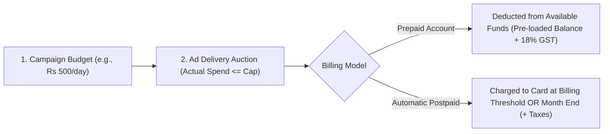

# AdCraft – Platform Advertising Billing, Payment Methods & Minimum Budgets Guide (India Focus)

> **Purpose:** Engineering, product, and advertiser onboarding reference covering campaign minimum budgets, initial deposits, billing models, Indian payment methods, GST/tax rules, account variability, and pre-publish guardrails across **Meta (Facebook & Instagram)**, **LinkedIn Ads**, **Pinterest Ads**, **X Ads**, and **Reddit Ads**.  
> **Scope:** Research and documentation only (`docs/`). No application code was modified. AdCraft never collects or processes advertising payments directly—all media spend is billed directly between the advertiser's ad account and the respective advertising platform.  
> **Last Verified Against Official Documentation & AdCraft Repository:** November 10, 2026  

---

## Table of Contents

1. [Core Billing Concepts: Budgets vs. Deposits vs. Charges](#1-core-billing-concepts-budgets-vs-deposits-vs-charges)
2. [Platform-by-Platform Billing & Minimum Budget Breakdown](#2-platform-by-platform-billing--minimum-budget-breakdown)
   - [2A. Meta (Facebook & Instagram)](#2a-meta-facebook--instagram)
   - [2B. LinkedIn Ads](#2b-linkedin-ads)
   - [2C. Pinterest Ads](#2c-pinterest-ads)
   - [2D. X Ads (Twitter)](#2d-x-ads-twitter)
   - [2E. Reddit Ads](#2e-reddit-ads)
3. [Platform-Wise Billing Comparison Table](#3-platform-wise-billing-comparison-table)
4. [Easiest & Cheapest Platforms for New Indian Advertisers](#4-easiest--cheapest-platforms-for-new-indian-advertisers)
5. [Account Variability Notes (Per Platform)](#5-account-variability-notes-per-platform)
6. [How AdCraft Should Handle Billing Requirements (Without Collecting Payments)](#6-how-adcraft-should-handle-billing-requirements-without-collecting-payments)
7. [Official Documentation References](#7-official-documentation-references)

---

## 1. Core Billing Concepts: Budgets vs. Deposits vs. Charges

Before reading platform specifics, engineers and users must clearly separate **four distinct financial concepts**:

1. **Campaign Minimum Budget (Delivery Setting):** The lowest daily or lifetime spending cap a platform allows you to type when creating a campaign or ad set/ad group (for example, `$10 USD/day` on LinkedIn or `$5 USD/day` on Reddit).
2. **Initial Deposit / Prepaid Balance (Pre-Funding):** Money loaded into an ad account wallet *before* ads can start delivering (common on Meta India UPI/Netbanking accounts).
3. **Authorization Hold (Verification Charge):** A tiny temporary hold (such as ~₹3 on Meta or ~\$1–\$5 on LinkedIn/Pinterest/X) placed when linking a new credit/debit card to confirm validity, which is refunded/released automatically.
4. **Actual Billing Amount & Taxes:** What is actually charged to the advertiser's card or deducted from funds—equal to **Delivered Ad Spend + Applicable Taxes (such as 18% India GST) ± Bank FX Markup** (when billed in USD).

---

## 2. Platform-by-Platform Billing & Minimum Budget Breakdown

---

### 2A. Meta (Facebook & Instagram)

1. **Minimum Daily & Lifetime Campaign Budgets:**
   - **Minimum Daily Budget:** **Account- and objective-dependent** (no single static INR constant). Meta dynamically calculates a daily floor roughly anchored to `$1 USD/day` equivalent for impression/click objectives and higher floors (often `$5 USD/day` equivalent or `5x` minimum bid/CPA) for conversion-optimized ad sets. On Indian `INR` accounts, technical minimums commonly sit around **₹85–₹100/day** (AdCraft's dev/test account `SYNXAIT_ACCOUNT` in `backend/app/meta/fake.py` uses `9673` minor units = **₹96.73/day**).
   - **Minimum Lifetime Budget:** Dynamically computed by Meta Ads Manager (`minimum daily budget × number of scheduled days`); Meta rejects schedules where daily average falls below the dynamic threshold.
   - **Where Confirmed:** Queried programmatically per connected ad account via the Graph API `min_daily_budget` field (already implemented in `backend/app/meta/sdk_gateway.py` line 103!).
2. **Initial Deposit / Prepaid Payment to Publish First Ad:**
   - **Automatic (Card) Accounts:** No upfront cash deposit required before publishing; Meta runs a small card verification hold (~₹2–₹3, refunded) with OTP/RBI compliance.
   - **Prepaid (UPI / Netbanking) Accounts:** **Yes — Prepaid funding is required** before ads deliver. Meta does not enforce a single universal fixed rupee minimum for top-ups across all surfaces, though Ads Manager enforces currency-specific minimums in the **Add Funds** dialog (practically **₹500+** is recommended so ads do not immediately pause).
3. **Payment Methods Supported in India (`INR` Accounts):**
   - **UPI** (Google Pay, PhonePe, Paytm, BHIM) — **Prepaid model only**.
   - **Net Banking** — **Prepaid model only**.
   - **Credit & Co-Branded Debit Cards** (Visa, Mastercard, American Express) — supports Automatic billing if compliant with Reserve Bank of India (RBI) recurring e-mandate / 2FA rules, or manual funds addition.
   - *Important Lock-in Rule:* Accounts configured at creation as **UPI/Netbanking Prepaid** generally cannot switch later to Automatic Card Postpaid (and vice versa); switching models requires creating a new ad account.
4. **Billing Models:**
   - **Prepaid Funds ("Available Funds"):** You manually deposit INR into the wallet (optional Auto-Reload where supported). Ads pause immediately when balance reaches `₹0`.
   - **Automatic Payments (Threshold Billing):** Card is charged automatically whenever unpaid spend hits your **Billing Threshold** or on your **monthly billing date** (whichever occurs first). New Indian accounts start with a low threshold (e.g., ~₹800–₹2,000) that scales upward with clean payment history.
   - **Monthly Invoicing (Credit Line):** Available only to eligible managed/enterprise advertisers via Meta account representation.
5. **Taxes & Additional Charges in India:**
   - **18% GST:** Meta India services Indian `INR` ad accounts locally and levies **18% Goods and Services Tax (GST)**.
   - **Input Tax Credit (ITC):** Adding a valid 15-digit **GSTIN** under *Billing & Payments -> Payment Settings -> Business Info* puts your GSTIN on Meta tax invoices so registered Indian businesses can claim ITC.
   - **FX Fees:** `₹0` FX conversion fee when billed in `INR`.
6. **Account Eligibility & Billing Setup Requirements:**
   - Active Facebook Business Portfolio / Business Manager + Ad Account set to Country = `India` and Currency = `INR` (locked permanently at creation).
   - Cards used for automatic payments must support international/online e-mandates under **RBI guidelines** (transactions exceeding RBI recurring mandates or bank caps like ₹15,000 require OTP / bank app approval).
7. **Exact Steps a New Indian Advertiser Follows Before Publishing:**
   1. Open **Meta Business Suite / Ads Manager** → create an Ad Account choosing **India** and **INR**.
   2. Open **Billing & Payments → Payment Settings → Business Info** and enter business legal name, address, and **GSTIN** (if GST-registered).
   3. Click **Add Payment Method**:
      - Choose **UPI / Net Banking** (Prepaid) and deposit initial funds via **Add Funds**, **OR**
      - Link an RBI e-mandate-capable **Visa/Mastercard/Amex** card and complete the OTP verification hold.
   4. Link the Business Facebook Page and **Instagram Professional account** (with profile photo—verified by AdCraft in `backend/app/meta/publish_checks.py`).
   5. Connect the Ad Account in AdCraft Settings, select it, and publish.
8. **Official Sources:**
   - Meta Business Help Center – Payment Methods & India Billing: [https://www.facebook.com/business/help](https://www.facebook.com/business/help)
   - Meta Graph API AdAccount Reference (`min_daily_budget`): [https://developers.facebook.com/docs/marketing-api/reference/ad-account](https://developers.facebook.com/docs/marketing-api/reference/ad-account)

---

### 2B. LinkedIn Ads

1. **Minimum Daily & Lifetime Campaign Budgets:**
   - **Minimum Daily Budget (Fixed Platform Rule):** **\$10 USD/day** (or exact local currency equivalent, ~₹850–₹1,000/day depending on LinkedIn's configured INR floor) per campaign across all ad formats. *(Dynamic localized limits can be queried via `/rest/adBudgetPricing`).*
   - **Minimum Lifetime Budget:** **\$100 USD** (or INR equivalent) for any new/inactive campaign, and at least `$10 USD × total scheduled days` once running.
   - *Pacing Rule:* LinkedIn may spend up to **50% above** your daily budget on high-traffic days while keeping weekly spend capped at `dailyBudget × 7`.
2. **Initial Deposit / Prepaid Payment to Publish First Ad:**
   - **No cash deposit / prepaid wallet required** for self-serve accounts.
   - LinkedIn places a **small temporary card authorization hold** (typically `$1 USD` or nominal equivalent) when linking a card, which is released within 3–5 business days.
3. **Payment Methods Supported in India (`INR` or `USD` Accounts):**
   - **Credit & Debit Cards:** Visa, Mastercard, American Express, Discover (must support international/online transactions and 3D Secure/RBI recurring rules).
   - **UPI, Paytm & Direct Net Banking:** **Not supported** natively for LinkedIn self-serve Campaign Manager accounts.
   - **Monthly Invoicing:** Only for approved enterprise/agency accounts meeting LinkedIn creditworthiness and sustained high monthly spend thresholds (commonly `$3,000+ USD/month` over consecutive months).
4. **Billing Models:**
   - **Automatic Threshold Billing (Default):** LinkedIn bills the saved card when accrued spend hits your threshold, or on a tiered frequency:
     - Balances `>= $100` (or INR equivalent): charged upon hitting threshold / daily tiers.
     - Balances `$20–$99.99`: billed weekly.
     - Balances `< $20`: billed monthly.
   - **Prepaid Balance:** **Not offered** as a self-serve UPI wallet model.
   - **RBI Friction Note:** If an Indian bank blocks an automated threshold debit (for example, crossing the ₹15,000 RBI automated mandate limit without 2FA OTP), **LinkedIn immediately puts the Ad Account "On Hold" and pauses all active campaigns** until manually paid.
5. **Taxes & Additional Charges in India:**
   - **18% GST:** Charged directly on top of ad spend for Indian-address accounts billed in `INR` (e.g., ₹10,000 spend → ₹11,800 billed).
   - **GSTIN for ITC:** Enter your **GSTIN** in **Campaign Manager → Account Settings → Billing Center** *before* accruing spend so tax invoices support Input Tax Credit.
   - **FX Fees:** None if account currency is set to `INR` at creation (note: currency cannot be changed after creation); standard bank FX markup applies if created in `USD`.
6. **Account Eligibility & Billing Setup Requirements:**
   - Active LinkedIn profile (with 2FA recommended) + LinkedIn **Company Page** (personal profiles cannot run feed ads).
   - Role on Ad Account must be `ACCOUNT_BILLING_ADMIN`, `ACCOUNT_MANAGER`, or `CAMPAIGN_MANAGER` (and `ACCOUNT_BILLING_ADMIN` is required to edit cards/GSTIN).
   - Ad account currency locked permanently at setup (`INR` recommended for Indian businesses).
7. **Exact Steps a New Indian Advertiser Follows Before Publishing:**
   1. Create a **LinkedIn Company Page** if one does not already exist.
   2. Open **LinkedIn Campaign Manager** (`linkedin.com/campaignmanager`) → **Create Ad Account** → link the Company Page, select **India**, and choose **INR** (or USD).
   3. Navigate to **Account Settings → Billing Center** → enter business address and **GSTIN**.
   4. Add an internationally enabled **Credit or Debit Card** and pass the 3D Secure temporary authorization check.
   5. Verify that daily budget is at least `$10 USD` equivalent (or `$100` lifetime minimum).
   6. Connect LinkedIn inside AdCraft Settings and publish (API app also requires LinkedIn Advertising API approval).
8. **Official Sources:**
   - LinkedIn Marketing Solutions Help – Budgets & Billing Thresholds: [https://www.linkedin.com/help/lms](https://www.linkedin.com/help/lms)
   - LinkedIn Ad Budget Pricing API: [https://learn.microsoft.com/en-us/linkedin/marketing/integrations/ads/account-structure/create-and-manage-campaigns](https://learn.microsoft.com/en-us/linkedin/marketing/integrations/ads/account-structure/create-and-manage-campaigns)

---

### 2C. Pinterest Ads

> **Critical Regional Availability Warning for India:** As verified against Pinterest Business documentation, **direct self-serve Pinterest Ads credit-card billing is NOT natively available for Indian local billing entities** in the same way it is for supported tier-1 markets (US, UK, Canada, EU, Australia, Japan, etc.). Businesses in India wanting to advertise on Pinterest generally must either:
> 1. Work with an **official Pinterest Regional Sales Partner / Reseller** in India (such as **Httpool by Aleph** or **Mediadonuts**), OR
> 2. Operate through an authorized **legal entity and payment method registered in a Pinterest Ads-supported country** (e.g., US LLC or UK Ltd billed in USD/GBP).

1. **Minimum Daily & Lifetime Campaign Budgets:**
   - **Minimum Daily Budget:** **No hard platform-wide dollar minimum** is enforced by Pinterest API v5 (`budget_in_micro_currency` accepts very small positive integers), though regional/partner agreements may apply. Practically, Pinterest guidelines recommend **4x–5x target CPA per day** (roughly `$10–$20+ USD/day`) for auction learning.
   - **Minimum Lifetime Budget:** No rigid platform floor in self-serve API; must cover campaign schedule and pacing realistically.
2. **Initial Deposit / Prepaid Payment to Publish First Ad:**
   - **Supported Self-Serve Countries (Foreign Entity):** No upfront cash deposit required for standard automatic threshold accounts (only a small temporary card authorization check when adding a card).
   - **India Reseller / Partner Managed Accounts:** Contract minimums, initial deposits, or prepaid Insertion Order (IO) terms are **approval- and partner-dependent** (negotiated directly with Httpool/Aleph or Mediadonuts).
3. **Payment Methods Supported (For Indian Advertisers):**
   - **UPI / Net Banking / RuPay:** **Not supported** natively by Pinterest self-serve Ads Manager.
   - **Credit & Debit Cards (Visa, Mastercard; Amex conditional by country):** Only usable if the ad account is registered in a **Pinterest Ads-supported country** and billed in that country's currency (`USD`, `EUR`, `GBP`, etc.). Prepaid cards and PayPal are **rejected**.
   - **Partner Invoicing / Bank Transfer:** Handled externally through authorized Indian reseller contracts.
4. **Billing Models:**
   - **Automatic Threshold Billing (Self-Serve Supported Regions):** Card charged when spend crosses the account threshold (often starting around `$50 USD` for new accounts and scaling up) or on the **1st day of the next month**, whichever comes first.
   - **Prepaid Billing (Select Regions Only):** Available only in certain markets/accounts; once enabled, accounts cannot switch back to threshold billing.
   - **Monthly Invoicing:** Eligible high-spend accounts / official reseller contracts.
5. **Taxes & Additional Charges:**
   - **Direct Foreign Entity Account:** Billed in `USD`/`GBP`/`EUR`; Indian entities paying foreign ad invoices face **18% IGST under Reverse Charge Mechanism (RCM)** (consult a Chartered Accountant) plus **card FX conversion markup (1.5%–3.5%)**.
   - **Official Indian Partner / Reseller Billing:** Local tax invoice issued by the Indian partner with **18% GST** (GSTIN collected during partner onboarding).
6. **Account Eligibility & Billing Setup Requirements:**
   - **Pinterest Business Account** (free) with an active Board for Pins.
   - **Country Eligibility:** Ad Manager billing dropdown only enables self-serve card setup for officially supported ad countries.
   - **API Requirement:** AdCraft's Pinterest API v5 app requires **Standard Access approval** (video demo + Privacy Policy) before non-developer tenants can run live campaigns.
7. **Exact Steps a New Indian Advertiser Follows Before Publishing:**
   1. Convert or create a **Pinterest Business Account** (`business.pinterest.com`) and verify your brand website domain.
   2. Check **Ads → Billing**:
      - If operating purely as an **Indian entity**: contact an **official Pinterest India Advertising Partner** (Httpool/Aleph / Mediadonuts) to provision an approved Ad Account and invoicing/prepaid setup, **OR**
      - If operating via an **eligible foreign subsidiary** (e.g., US/UK): set account country & currency to that supported region and link an international **Visa/Mastercard** under *Ads → Billing → Payment Settings* (complete temporary card authorization).
   3. Add regional tax details (GSTIN / VAT / EIN as applicable to the billing entity).
   4. Connect the Pinterest Business Account & select Ad Account + Board inside AdCraft.
8. **Official Sources:**
   - Pinterest Business Help – Billing & Payment Methods: [https://help.pinterest.com/en/business/article/add-or-update-your-billing-information](https://help.pinterest.com/en/business/article/add-or-update-your-billing-information)
   - Pinterest Advertising Availability & Agreements: [https://business.pinterest.com/](https://business.pinterest.com/)

---

### 2D. X Ads (Twitter)

1. **Minimum Daily & Lifetime Campaign Budgets:**
   - **Minimum Daily Budget:** **No strict platform-wide minimum budget** enforced in X Ads Manager or Ads API v12 (`daily_budget_amount_local_micro`). However, setting a fraction of a dollar generally wins zero auction impressions.
   - **Minimum Lifetime / Total Budget:** No hard fixed floor (`total_budget_amount_local_micro` optional).
2. **Initial Deposit / Prepaid Payment to Publish First Ad:**
   - **No cash deposit / prepaid balance required** for self-serve accounts.
   - **Mandatory Card Authorization Hold:** Adding a card in `ads.x.com` triggers a temporary **~\$5 USD authorization hold** to verify card validity (automatically released by the bank).
3. **Payment Methods Supported in India:**
   - **Supported:** Internationally enabled **Credit & Debit Cards** — **Visa, Mastercard, American Express** (plus Discover, Diners Club, JCB depending on bank).
   - **Unsupported in India:** **UPI, RuPay-only domestic cards, Paytm, and Net Banking are NOT supported.**
   - **Billing Currency Lock for India:** **INR is NOT supported.** Indian X Ads accounts are billed in **USD (`US Dollars`)**, locked permanently at account creation.
4. **Billing Models:**
   - **Automatic Threshold Billing (Default):** X charges your card automatically when unpaid ad spend hits your **Credit Limit / Billing Threshold** (new accounts start with low thresholds such as `$25–$50 USD`, scaling up with payment history) or at the end of the billing cycle.
   - **Manual Prepayments / Insertion Orders:** Manual card top-ups or corporate invoicing exist only on select/managed accounts with X sales approval.
   - **Immediate Pause on Decline:** Any failed RBI 2FA / international debit failure pauses campaigns immediately until cleared.
5. **Taxes & Additional Charges in India:**
   - **Foreign Currency Billing & FX Markup:** Because X bills Indian advertisers in **USD**, your Indian card issuer charges currency conversion fees (typically **2%–3.5% + GST on FX fee**).
   - **18% IGST under Reverse Charge Mechanism (RCM):** Since X Ads bills from a non-Indian international entity in USD without charging local Indian GST at checkout, GST-registered Indian businesses are generally required under Indian GST law to self-assess **18% IGST via RCM** in monthly GSTR-3B returns (and claim ITC back if eligible—consult a CA).
   - **Separate Verification / Subscription Cost Note:** X Ads eligibility policies in multiple tiers/regions have required accounts to maintain **X Premium** or **Verified Organizations** standing and good account health; X Premium billing is handled separately from ad spend.
6. **Account Eligibility & Billing Setup Requirements:**
   - Active X account in good standing (not restricted/suspended; verify current X Premium / Verified Org eligibility inside `ads.x.com`).
   - Valid international **Credit Card** (debit cards issued in India frequently fail RBI recurring USD debits—international credit cards have higher success rates).
   - X Ads API v12 requires a **funding_instrument_id** before any campaign can be created via API, AND AdCraft's app requires manual **X Ads API approval**.
7. **Exact Steps a New Indian Advertiser Follows Before Publishing:**
   1. Log in to **X Ads Manager** (`ads.x.com`) with your brand's X account.
   2. Select **Country: India** and confirm **Currency: USD** (permanent).
   3. Check account eligibility / verification banner inside X Ads Manager.
   4. Enable **International & E-Commerce recurring transactions** on your Indian Visa/Mastercard/Amex credit card via banking portal.
   5. Open **Billing → Credit Cards / Payment Methods** → add card → confirm the temporary **~\$5 USD verification hold**.
   6. Connect the X account inside AdCraft (requires OAuth 1.0a flow + approved X Ads API app).
8. **Official Sources:**
   - X Business Help Center (Billing & Payments): [https://business.x.com/en/help](https://business.x.com/en/help)
   - X Ads API Funding Instruments & Campaigns: [https://developer.x.com/en/docs/twitter-ads-api/campaign-management/api-reference/funding-instruments](https://developer.x.com/en/docs/twitter-ads-api/campaign-management/api-reference/funding-instruments)

---

### 2E. Reddit Ads

1. **Minimum Daily & Lifetime Campaign Budgets:**
   - **Minimum Daily Budget (Fixed Rule):** **\$5.00 USD/day** (`5000000` micro-units) per **Ad Group** for standard campaigns. Automated "Reddit Max" campaigns enforce higher floors (typically **\$20 USD/day**).
   - **Minimum Lifetime Budget:** Must equal at least `$5 USD × total scheduled campaign days` (no sub-\$5/day pacing allowed).
   - **Bidding Minimums:** Minimum bids enforced by Reddit Ads Manager / v3 API: **CPC >= \$0.10**, **CPM >= \$3.50**, **CPV >= \$0.01**.
   - **20% Daily Over-Delivery Rule:** Reddit may spend up to **120%** of a daily budget on peak days while staying within the monthly/flight cap.
2. **Initial Deposit / Prepaid Payment to Publish First Ad:**
   - **No cash deposit required** for standard self-serve accounts.
   - **Verification Hold:** Reddit places a small test authorization (often **\$1–\$10 USD**) when adding a card to confirm validity.
3. **Payment Methods Supported in India:**
   - **Supported:** International **Credit & Debit Cards** (Visa, Mastercard, American Express).
   - **Unsupported in India:** **UPI, RuPay, Net Banking, PayPal, and prepaid cards are NOT accepted** on self-serve accounts.
   - **Supported Currencies:** `USD`, `CAD`, `AUD`, `GBP`, `EUR`, `NZD`. **`INR` is NOT supported**—Indian accounts default to **USD**.
   - **Known India Card Decline Issue:** Reddit advertisers in India frequently report initial test charges passing while subsequent automatic USD threshold charges fail due to **RBI e-mandate / recurring international card restrictions**. Corporate international credit cards with explicit international recurring permissions are strongly recommended.
4. **Billing Models:**
   - **Automatic Threshold Billing (Default):** Card is charged whenever unpaid spend hits your **Billing Threshold** (new accounts start around **\$10–\$20 USD** and scale automatically through `$50 -> $100 -> $250 -> $500 -> $1,000+` with clean history), OR once daily if balance exceeds threshold, OR at the end of the calendar month.
   - **Manual Payments:** Advertisers can click **"Make a Payment"** anytime in Ads Manager to clear an outstanding balance early. Pure standalone prepaid-only wallets are generally limited to managed/enterprise agreements.
   - **Monthly Invoicing:** Available only to approved managed accounts meeting Reddit spend thresholds.
5. **Taxes & Additional Charges in India:**
   - **Tax ID Collection (GSTIN):** Reddit Business Manager includes a **Tax ID Collection** field under **Billing** where Indian businesses can input their **15-digit GSTIN**.
   - **GST / RCM & FX:** Verify on your live Reddit invoice whether Reddit is collecting 18% GST directly via Tax ID rules OR billing gross USD without Indian GST (in which case **18% IGST under RCM** applies per Indian tax law). Card issuer **FX markup (2%–3.5%)** applies to USD charges.
6. **Account Eligibility & Billing Setup Requirements:**
   - Standard Reddit account converted to a **Reddit Business** (`ads.reddit.com`) with **Business Admin** role.
   - Valid `funding_instrument_id` attached to the Ad Account before campaigns can activate via `/api/v3/`.
   - **API Advantage:** Reddit Ads API v3 requires **no manual developer allowlist** to start building inside Business → Developer Portal.
7. **Exact Steps a New Indian Advertiser Follows Before Publishing:**
   1. Sign up / log in at **Reddit Ads Manager** (`ads.reddit.com`) and create a **Reddit Business** + **Ad Account** (defaults to `USD`).
   2. Open **Billing & Payment Settings** → enter Business details and **15-digit GSTIN** under Tax ID if applicable.
   3. Link an internationally enabled **Visa/Mastercard/Amex** card (check bank app to allow recurring USD e-commerce transactions) and pass initial card verification.
   4. Configure campaigns with **`>= $5 USD/day`** per Ad Group.
   5. Connect the Reddit Business account inside AdCraft via OAuth 2.0 and publish.
8. **Official Sources:**
   - Reddit Ads Help Center – Billing Thresholds & Payment Methods: [https://business.reddithelp.com/](https://business.reddithelp.com/)
   - Reddit Ads Help – Tax ID Collection: [https://business.reddithelp.com/](https://business.reddithelp.com/)
   - Reddit Ads API v3 Reference: [https://ads-api.reddit.com/docs/v3/](https://ads-api.reddit.com/docs/v3/)

---

## 3. Platform-Wise Billing Comparison Table

*Verified as of November 10, 2026. Entries distinguish **fixed platform rules**, **India-specific constraints**, and **account-dependent / region-dependent** values.*

| Comparison Criteria | Meta (Facebook & Instagram) | LinkedIn | Pinterest | X Ads | Reddit Ads |
|---|---|---|---|---|---|
| **Minimum daily budget** | **Account- & objective-dependent** (~₹85–₹100/day typical INR floor; `min_daily_budget` queried via API) | **\$10 USD/day** per campaign (~₹850–₹1,000 INR equivalent) | **No fixed API minimum floor** (~ \$10–\$20/day practical recommendation) | **No strict fixed minimum** (must win real-time auction bids) | **\$5 USD/day** (`5000000` micro) per Ad Group (\$20/day for automated Max) |
| **Minimum lifetime budget** | **Dynamic** (`min daily budget × campaign days`) | **\$100 USD** new inactive campaign (or `$10 × days` once active) | **No fixed API floor** (must cover schedule & pacing) | **No fixed platform floor** | **Dynamic** (`$5 USD × campaign days` floor) |
| **Initial deposit required** | **Yes if UPI/Netbanking Prepaid**; **No** for Automatic Card accounts | **No** (small ~\$1 temporary card hold only) | **No** in self-serve supported countries; **Partner/contract-dependent in India** | **No** (~\$5 USD temporary card verification hold only) | **No** (~\$1–\$10 USD test card authorization only) |
| **Minimum first payment** | Varies dynamically in **Add Funds** UI for Prepaid (practically **₹500+**); Automatic starts at low threshold (~₹800+) | First billing threshold (starts low, e.g., **\$100 USD** equiv., or `$20–$99` weekly) | First billing threshold (often **\$50 USD** equiv. for self-serve) or India partner IO minimum | First billing threshold (starts low, e.g., **\$25–\$50 USD**) | First billing threshold (starts low, e.g., **\$10–\$20 USD**) |
| **Supported payment methods in India** | **UPI, Net Banking** (Prepaid), **Visa/Mastercard/Amex** (RBI e-mandate / manual) | **International Visa, Mastercard, Amex, Discover**; **No UPI / No Net Banking** | **Self-serve card billing NOT natively open for India entities**; India ads use **Official Partners** (or supported foreign entity + Visa/MC) | **International Visa, Mastercard, Amex** (billed in USD); **No UPI / No RuPay / No Net Banking** | **International Visa, Mastercard, Amex** (billed in USD); **No UPI / No Net Banking** (RBI card declines common) |
| **Automatic billing available** | **Yes** (Card accounts; subject to RBI recurring rules) | **Yes** (Primary self-serve model via Card) | **Yes** (Primary model in supported countries) | **Yes** (Primary self-serve model via Card) | **Yes** (Primary self-serve model via Card) |
| **Prepaid billing available** | **Yes** (Default/only mode when choosing UPI or Netbanking in India) | **No** self-serve prepaid UPI wallet (Enterprise credit invoicing only) | **Region-dependent** (Select countries only; cannot switch back once chosen) | **No** standard self-serve wallet (manual prepay/IO limited to managed accounts) | **Manual balance payment** supported anytime; pure prepay limited to managed accounts |
| **Billing threshold** | **Account-dependent** (starts low in INR, auto-scales upward; billed at threshold or monthly) | **Tiered** (starts ~\$100 equiv.; `>=$100` daily/threshold, `$20–99` weekly, `<$20` monthly) | **Account-dependent** (starts ~\$50 equiv., scales up; billed at threshold or 1st of month) | **Account-dependent** (starts low in USD, auto-scales up with clean payments) | **Account-dependent** (starts ~\$10–\$20 USD, scales `$50 -> $100 -> $250+`; billed at threshold/month-end) |
| **Tax/GST applicability** | **18% GST** charged directly in INR; enter **GSTIN** for ITC | **18% GST** charged directly in INR; enter **GSTIN** for ITC | **India Partner:** 18% GST invoice. **Foreign Entity:** Foreign tax / **18% IGST RCM** + FX | **Billed in USD**; Indian GST-registered firms generally pay **18% IGST via RCM** + bank FX fees | **Tax ID (GSTIN) field in Billing**; confirm invoice GST vs **18% IGST RCM** + bank FX fees |
| **Account verification required** | Business Info + IG profile photo + card OTP / Business verification for higher limits | Linked **Company Page** + `ACCOUNT_BILLING_ADMIN` card verification | **Pinterest Business Account** + domain verification + **Supported Country or Official Partner** | Active account standing + **X Premium / Verified Org** checks where required + card hold | **Reddit Business** admin + valid international card (`funding_instrument_id`) |
| **API access requirements** | Meta App Review (`ads_management`) + `allow_real_ad_spend` switch | **Gated:** Dev Tier -> Standard Tier review (+ MDP for refresh/leads) | **Gated for Prod:** Instant Trial Sandbox -> **Standard Access video review** | **Strictly Gated:** Separate manual **X Ads API application** + OAuth 1.0a | **Open Self-Serve** via Reddit Business Developer Portal (`adsread`, `adsedit`) |

---

## 4. Easiest & Cheapest Platforms for New Indian Advertisers

### Ranking for a New Indian Small Business / Startup
1. **1st (Easiest & Lowest Friction): Meta (Facebook & Instagram)**
   - **Why:** Native **`INR` billing**, **UPI & Net Banking support** (no international credit card or RBI recurring e-mandate headaches when using Prepaid), lowest technical daily budget (~₹90–₹100/day floor, practical testing from ₹300–₹500/day), and clean **18% GST tax invoices** with GSTIN for Input Tax Credit.
2. **2nd (Lowest USD Minimum & Open API): Reddit Ads**
   - **Why:** Fixed **\$5 USD/day** minimum (~₹425/day), open self-serve Ads API v3, and low initial threshold (~\$10–\$20 USD). *Caveat:* Requires an international Visa/Mastercard that passes RBI recurring USD debits.
3. **3rd (Low Minimum Spend, Higher Setup Friction): X Ads**
   - **Why:** No hard daily budget minimum, though Indian advertisers face **USD billing**, FX markups, potential X Premium/Verified Organization eligibility checks, and manual X Ads API approval gates.
4. **4th (B2B Value, Highest Daily Budget): LinkedIn Ads**
   - **Why:** Native `INR` and `18% GST` invoices are convenient, **but** no UPI support and a steep **\$10 USD/day (~₹900/day)** and **\$100 USD (~₹9,000) lifetime** floor make it expensive for small consumer budgets.
5. **5th (Hardest Direct Self-Serve Access in India): Pinterest Ads**
   - **Why:** Direct Indian entity self-serve card billing is not natively supported; Indian businesses must onboard via authorized local partners (Httpool/Aleph / Mediadonuts) or operate through a foreign legal entity.

### What AdCraft Must Display Before Allowing First Ad Publish
Before any AdCraft user clicks **Confirm & Publish** (`PublishFlow.tsx` / `ConfirmBody`), the UI should present a **Platform Billing & Readiness Checklist**:
1. **Billing Owner Notice:** *"AdCraft does not charge or collect your advertising budget. All ad spend and taxes are billed directly to your connected [Platform] Ad Account."*
2. **Account Currency & FX Warning:** Display the connected account's locked currency (e.g., `INR` for Meta/LinkedIn vs. `USD` for X/Reddit) and warn if a `USD` account will incur Indian bank FX conversion fees.
3. **Prepaid vs. Automatic Status Reminder:**
   - *Meta UPI/Netbanking:* Remind user to verify **Available Funds** in Meta Ads Manager before going live.
   - *LinkedIn / X / Reddit:* Remind user that an **internationally enabled Credit/Debit card with recurring e-mandate permission** must be active on the platform (UPI is not accepted).
4. **Estimated Budget + Tax Disclosure:** Show `Daily Budget × Days` **plus estimated 18% GST** (or RCM IGST notice for USD platforms) and note platform pacing rules (e.g., LinkedIn up to +50% daily variance; Reddit up to +20% daily over-delivery).
5. **Minimum Budget Validation:** Block submission early using live account minimums (`min_daily_budget_minor` on Meta, `$10/day` on LinkedIn, `$5/day` per Ad Group on Reddit).

---

## 5. Account Variability Notes (Per Platform)

> **Key Principle:** Never assume fixed global numbers apply universally. Platform minimums, payment methods, and billing thresholds vary across seven dimensions below. Exact live limits can **only** be confirmed inside the advertiser's own Ads Manager billing screen or authenticated Ad Account API response.

### Classification Legend
- **Fixed:** Enforced platform-wide by code/policy regardless of account age.
- **Region-Dependent:** Varies by business country and currency (e.g., India RBI rules, INR vs USD).
- **Account-Dependent:** Varies per account ID based on history, API configuration, or billing setup.
- **Approval-Dependent:** Unlocked only after credit check, partner review, or manual whitelisting.

---

### 5A. Meta (Facebook & Instagram) Variability Notes

| Dimension | Variation & Cause | Classification | Example & Where Confirmed |
|---|---|---|---|
| **1. Country & Region** | Local payment rails, GST, and currency floors depend on Business Country. | **Region-Dependent** | India (`INR`) supports UPI/Netbanking Prepaid + 18% GST; US (`USD`) uses PayPal/Cards with no GST. Confirmed inside *Ads Manager → Billing*. |
| **2. Account Type** | New accounts vs. established Agency Business Managers have lower initial thresholds and stricter spend caps. | **Account-Dependent** | New Indian accounts may face daily account spending limits until verified; established agencies receive higher credit lines. |
| **3. Billing Configuration** | Prepaid (`UPI`/`Netbanking`) vs. Automatic (`Card`) locks at account creation. | **Account-Dependent** (Fixed once chosen) | Choosing UPI locks account to manual **Available Funds**; cards use threshold billing. Confirmed in *Payment Settings*. |
| **4. Account Eligibility** | Monthly Invoicing (Credit Line) and certain ad categories require eligibility. | **Approval-Dependent** | High-spend businesses apply for Meta Credit Line via Meta rep. |
| **5. Account History & Spending** | Billing threshold scales upward automatically only after repeated successful charges. | **Account-Dependent** | New card accounts start ~₹800–₹2,000 and climb to ₹10,000–₹50,000+ after clean payments. |
| **6. Advertiser Verification** | Unverified Business Portfolios or missing GSTIN/ID checks trigger spend caps or restrictions. | **Region- & Approval-Dependent** | India Special Ad Categories / Financial ads require advertiser identity verification. |
| **7. Platform Policies** | Minimum budget adjusts dynamically by campaign objective, bid strategy, and FX rates (`min_daily_budget`). | **Account- & Policy-Dependent** | Impression ads (~₹90/day) have lower floors than Purchase/Conversion optimization. Always verify via `GET /act_{id}?fields=min_daily_budget` ([Meta Graph Docs](https://developers.facebook.com/docs/marketing-api/reference/ad-account)). |

---

### 5B. LinkedIn Ads Variability Notes

| Dimension | Variation & Cause | Classification | Example & Where Confirmed |
|---|---|---|---|
| **1. Country & Region** | Currency (`INR` vs `USD`), tax (18% GST in India vs VAT in EU), and localized budget floors follow billing country. | **Region-Dependent** | India accounts charge 18% GST and lack local UPI rails ([LinkedIn LMS Help](https://www.linkedin.com/help/lms)). |
| **2. Account Type** | Self-serve Campaign Manager vs. Enterprise/Agency Business Manager accounts. | **Account- & Approval-Dependent** | Agencies managing clients via Invoicing have unified credit limits instead of individual card thresholds. |
| **3. Billing Configuration** | Automatic card threshold billing vs. Monthly Invoicing. | **Account- / Approval-Dependent** | Card accounts charge on threshold/weekly/monthly tiers (`>=$100`, `$20–99`, `<$20`); Invoicing bills net-30. |
| **4. Account Eligibility** | Monthly Invoicing requires sustained spend (`~$3,000+/mo`) and credit approval. | **Approval-Dependent** | Confirmed via LinkedIn Billing Support / Account Rep application. |
| **5. Account History & Spending** | Repeated card declines (e.g., RBI ₹15,000 e-mandate blocks) place accounts **On Hold** and keep thresholds low. | **Account-Dependent** | Clean history increases automatic card threshold; confirmed in *Billing Center*. |
| **6. Advertiser Verification** | Company Page link + Business/Identity verification required for political/regulated ads or MDP API access. | **Approval-Dependent** | Advertising API Dev Tier restricts creation/edits to whitelisted test/up to 5 accounts ([LinkedIn Marketing Docs](https://learn.microsoft.com/en-us/linkedin/marketing/getting-started)). |
| **7. Platform Policies** | `$10 USD/day` and `$100` lifetime minimums are fixed baselines, but exact local currency minimums vary with FX via `/rest/adBudgetPricing`. | **Fixed Baseline / Region-Adjusted** | Always query `/rest/adBudgetPricing` or check Campaign Manager UI before launch. |

---

### 5C. Pinterest Ads Variability Notes

| Dimension | Variation & Cause | Classification | Example & Where Confirmed |
|---|---|---|---|
| **1. Country & Region** | Self-serve card billing is only open in officially supported ad countries; unsupported countries (like India) require resellers. | **Region-Dependent (Strict Gate)** | US/UK accounts add Visa/MC directly in `ads.pinterest.com`; India entities onboard via Httpool/Aleph ([Pinterest Business](https://business.pinterest.com/)). |
| **2. Account Type** | Self-serve SMB vs. Partner-Managed vs. Trial Sandbox developer account. | **Account- & Approval-Dependent** | Trial Access accounts can only create sandbox/private Pins, not live paid ads. |
| **3. Billing Configuration** | Automatic Threshold vs. Prepaid (select regions) vs. Monthly Invoicing. | **Region- & Account-Dependent** | Prepaid accounts cannot revert to threshold billing later ([Pinterest Billing Help](https://help.pinterest.com/en/business/article/add-or-update-your-billing-information)). |
| **4. Account Eligibility** | Shopping / Catalog Sales Ads require verified merchant domain + approved Catalog feed. | **Approval-Dependent** | Missing merchant approval disables Shopping Ads even if card billing is active. |
| **5. Account History & Spending** | Self-serve threshold starts low (e.g., `$50`) and increases with successful payments; custom threshold options vary by currency. | **Account-Dependent** | Confirmed inside *Ads → Billing* of the connected Pinterest Business account. |
| **6. Advertiser Verification** | Domain verification, Privacy Policy, and **Standard Access video review** required for API-driven multi-tenant tools. | **Approval-Dependent** | Self-serve merchants verify domain inside Business settings; apps verify via [developers.pinterest.com](https://developers.pinterest.com/docs/getting-started/set-up-app/). |
| **7. Platform Policies** | No hard API daily dollar floor, though regional partners and merchant guidelines enforce spend minimums and prohibited verticals. | **Account- & Policy-Dependent** | Reseller Insertion Orders dictate exact minimums for Indian partner accounts. |

---

### 5D. X Ads (Twitter) Variability Notes

| Dimension | Variation & Cause | Classification | Example & Where Confirmed |
|---|---|---|---|
| **1. Country & Region** | Billing currency, available card networks, and tax rules depend on account country; India accounts lock to `USD`. | **Region-Dependent** | India accounts cannot use `INR` or UPI and incur bank FX fees + RCM IGST obligations. |
| **2. Account Type** | Self-serve Ads account vs. Agency/Managed Insertion Order (IO) account. | **Account- & Approval-Dependent** | Managed accounts can pay via wire/invoice rather than credit card thresholds. |
| **3. Billing Configuration** | Automatic threshold billing vs. Manual prepay / IO invoicing. | **Account-Dependent** | Confirmed via `GET /12/accounts/:id/funding_instruments` and `ads.x.com` Billing tab. |
| **4. Account Eligibility** | Advertiser profile standing, X Premium / Verified Organizations requirements, and regional ad-serving eligibility. | **Approval- & Policy-Dependent** | Unverified or newly flagged accounts may be blocked from launching ads until verified. |
| **5. Account History & Spending** | Initial billing thresholds start low (`$25–$50`) and scale slowly; a single RBI international decline pauses all ads. | **Account-Dependent** | Exact live credit limit (`credit_limit` on funding instrument) is visible only inside that account. |
| **6. Advertiser Verification** | Card authorization hold (~\$5 USD) + manual **X Ads API application approval** for AdCraft. | **Approval-Dependent** | Without Ads API approval, API calls return `403` regardless of valid billing ([X Ads API Docs](https://developer.x.com/en/docs/twitter-ads-api/getting-started)). |
| **7. Platform Policies** | No fixed minimum daily campaign spend, though minimum bid rules and verification policies evolve frequently. | **Policy-Dependent** | Always check live funding instrument status in `ads.x.com` before publishing. |

---

### 5E. Reddit Ads Variability Notes

| Dimension | Variation & Cause | Classification | Example & Where Confirmed |
|---|---|---|---|
| **1. Country & Region** | Only 6 currencies (`USD`, `CAD`, `AUD`, `GBP`, `EUR`, `NZD`) are supported; India falls under `USD` + RBI card scrutiny. | **Region-Dependent** | Indian domestic debit cards frequently fail recurring USD debits ([Reddit Ads Help](https://business.reddithelp.com/)). |
| **2. Account Type** | Self-serve Reddit Business vs. Managed Enterprise Account. | **Account-Dependent** | Managed accounts access Insertion Orders/invoicing and specialized campaign formats. |
| **3. Billing Configuration** | Automatic Card Threshold (with optional manual "Make a Payment") vs. Managed Prepay/Invoicing. | **Account-Dependent** | Confirmed in Reddit Ads Manager *Billing & Payment Settings*. |
| **4. Account Eligibility** | Subreddit targeting eligibility + restricted vertical compliance (crypto, financial, alcohol, healthcare require approval). | **Approval- & Policy-Dependent** | Standard retail campaigns launch immediately; regulated niches need policy clearance. |
| **5. Account History & Spending** | Threshold starts around `$10–$20 USD` and auto-steps up (`$50 -> $100 -> $250+`); manual custom thresholds are disallowed. | **Account-Dependent** | Confirmed inside Reddit Ads Manager Billing UI. |
| **6. Advertiser Verification** | Card test authorization + optional **Tax ID (15-digit GSTIN)** entry under Billing settings. | **Account-Dependent** | Required in India billing profile to ensure tax invoice accuracy. |
| **7. Platform Policies** | **\$5/day Ad Group floor** (`5000000` micro) and bid floors (`$0.10 CPC` / `$3.50 CPM`) are fixed; automated Max campaigns require `$20/day`, and **20% daily over-delivery** is allowed. | **Fixed Policy Rule** | Enforced directly by Reddit Ads API v3 validation ([Reddit Ads API v3](https://ads-api.reddit.com/docs/v3/)). |

---

## 6. How AdCraft Should Handle Billing Requirements (Without Collecting Payments)

AdCraft must act purely as a **campaign automation & intelligence layer**—never as a payment processor, wallet, or billing intermediary. Here is how to extend AdCraft's existing patterns (`backend/app/meta/` and `frontend/components/`) cleanly across all five platforms:

1. **Fetch & Cache Live Account Billing Metadata During OAuth Selection (`connections.py` / `sdk_gateway.py` pattern):**
   - Just as `backend/app/meta/sdk_gateway.py` already queries `currency` and `min_daily_budget` when listing Meta Ad Accounts and saves `min_daily_budget_minor` into `meta_connections`, generalize `connected_platform_accounts` to store:
     - `currency` (`INR`, `USD`, etc.)
     - `min_daily_budget_minor` (e.g., live Meta floor, `1000` USD cents for LinkedIn, `500` USD cents for Reddit)
     - `billing_status` (`READY | NO_FUNDING_INSTRUMENT | ON_HOLD | UNSUPPORTED_REGION`)
     - `funding_instrument_id` (required for X & Reddit campaign creation!)
2. **Pre-Flight Readiness Checks Before Publishing (`publish_checks.py` pattern):**
   - Extend `check_publishable()` to verify per selected platform:
     - **Funding Check:** X and Reddit must have an active `funding_instrument_id`; Meta/LinkedIn/Pinterest ad account status must be `ACTIVE` (not `ON_HOLD` or `DISABLED`).
     - **Minimum Budget Check:** Reject budgets below that specific platform + account's floor with HTTP `422` (matching `BudgetBelowMetaMinimum`), converting cleanly for USD vs. INR accounts.
     - **India Pinterest Guardrail:** If a user connects a Pinterest account without an eligible ad account (common for India-based accounts without reseller provisioning), block ad publishing cleanly with an explanation linking to Pinterest Partner onboarding while still allowing organic Pin workflows if enabled.
3. **Never Store Card Details or Process Money:**
   - Do **not** build checkout forms, UPI QR modals, or card inputs inside AdCraft. Instead, provide a direct **"Open Billing Settings on [Meta / LinkedIn / Pinterest / X / Reddit]"** deep link when an account lacks funds, fails an RBI debit, or is missing a GSTIN.
4. **Transparent Pre-Publish UI Disclosure (`PublishFlow.tsx` / `CampaignStudioModal.tsx`):**
   - Before the final `ConfirmBody` approval click:
     - Show **Platform Currency**, **Daily & Max Flight Spend**, **Estimated 18% GST / RCM IGST Note**, and **Over-Delivery Notes** (`+50%` daily variance on LinkedIn, `+20%` on Reddit).
     - Retain `ALLOW_REAL_AD_SPEND=false` & `SAFE_MODE_NO_SPEND=true` defaults (`backend/app/config.py`) in development/test environments so no automated run ever touches real advertiser funds.

---

## 7. Official Documentation References

*(All links verified November 10, 2026)*

- **Meta (Facebook & Instagram):**
  - Meta Business Help Center (Billing, Payment Methods, India UPI/Prepaid & GST): [https://www.facebook.com/business/help](https://www.facebook.com/business/help)
  - Meta Marketing API – Ad Account (`min_daily_budget`, `currency`, `funding_source`): [https://developers.facebook.com/docs/marketing-api/reference/ad-account](https://developers.facebook.com/docs/marketing-api/reference/ad-account)
- **LinkedIn Ads:**
  - LinkedIn Marketing Solutions Help (Budgets, Thresholds, Cards & India Billing): [https://www.linkedin.com/help/lms](https://www.linkedin.com/help/lms)
  - LinkedIn Marketing API – Getting Started & Campaigns (`adBudgetPricing`): [https://learn.microsoft.com/en-us/linkedin/marketing/getting-started](https://learn.microsoft.com/en-us/linkedin/marketing/getting-started)
- **Pinterest Ads:**
  - Pinterest Business Help (Billing, Payment Methods & Supported Countries): [https://help.pinterest.com/en/business/article/add-or-update-your-billing-information](https://help.pinterest.com/en/business/article/add-or-update-your-billing-information)
  - Pinterest Business & Advertising Services Agreements: [https://business.pinterest.com/](https://business.pinterest.com/)
  - Pinterest API v5 Reference: [https://developers.pinterest.com/docs/api/v5/](https://developers.pinterest.com/docs/api/v5/)
- **X Ads (Twitter):**
  - X Business Help Center (Billing, Payment Methods, Thresholds & Currencies): [https://business.x.com/en/help](https://business.x.com/en/help)
  - X Ads Portal: [https://ads.x.com/](https://ads.x.com/)
  - X Ads API v12 – Getting Started & Funding Instruments: [https://developer.x.com/en/docs/twitter-ads-api/getting-started](https://developer.x.com/en/docs/twitter-ads-api/getting-started)
- **Reddit Ads:**
  - Reddit Ads Help Center (Billing Thresholds, Payment Methods, Budgets & Tax ID): [https://business.reddithelp.com/](https://business.reddithelp.com/)
  - Reddit Ads Portal: [https://ads.reddit.com/](https://ads.reddit.com/)
  - Reddit Ads API v3 Documentation: [https://ads-api.reddit.com/docs/v3/](https://ads-api.reddit.com/docs/v3/)
